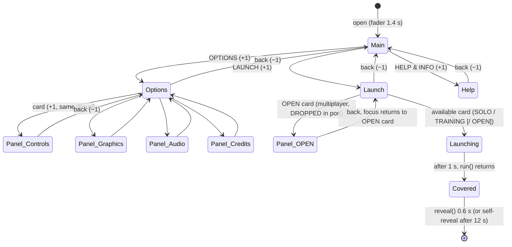
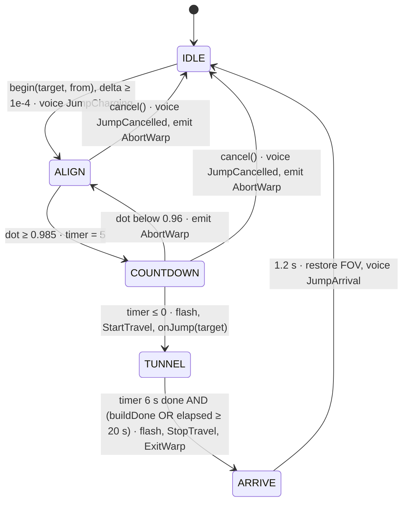

# 07 · Main menu, system map, star map and warp jump

Port reference for the Android version of *Untitled Space Exploration* (AFloidDEV).

**Area:** the main menu (start screen, LAUNCH modes, OPTIONS, HELP & INFO, CREDITS), the system map, the galaxy/star map, and the jump between star systems with its tunnel.

**Sources read in full** (paths relative to `roblox/lua/`):

| File | Lines | Role |
|---|---|---|
| `ShipClient/ShipMenu.lua` | 2444 | Main menu logic: pages, focus, input, camera, news, sounds |
| `ShipClient/ShipMenu/MainMenuInstaller.lua` | 1636 | Builds the `StarterGui.MainMenu` GUI once (all layout numbers) |
| `ShipCore/ShipMenuData.lua` | 405 | Menu texts and data: news, modes, options, help, credits, sounds, camera |
| `ShipClient/ShipSystemMap.lua` | 2104 | System map (key N): SCHEMATIC and ORBITS views, panels |
| `ShipClient/ShipStarMap.lua` | 1877 | Galaxy/star map (key M): 3D star field, search, filters, HOLD TO JUMP |
| `ShipClient/ShipWarp.lua` | 601 | Jump state machine ALIGN → COUNTDOWN → TUNNEL → ARRIVE, warp HUD |
| `ShipClient/ShipWarpTunnel.lua` | 299 | 3D tunnel around the camera |
| `ShipCore/ShipStarCatalog.lua` | 106 | 180-system catalog from one seed |
| `ShipCore/ShipConfig.lua` | sections `SystemMap` (1100-1152), `Warp` (1157-1233), `StarMap` (1241-1279) | Tunables |

Also used: `ShipClient.lua` (call sites), `ShipCore/ShipUi.lua`, `ShipSettings.lua`, `ShipUnits.lua`, `ShipKeys.lua`, `ShipIcons.lua`, `ShipNames.lua`, `ShipMath.lua`, parts of `ShipSystemBuilder.lua`, `ShipSolData.lua`, `ShipStations.lua`, `ShipResources.lua`, `ShipClient/ShipGalaxy.lua`, `ShipProfile.lua`, `ShipTraining.lua`, `ShipCallouts.lua`, `ShipAudio.lua`, `ShipServer/ShipData.lua`.

Kotlin references are relative to `core/src/main/kotlin/com/starwake/core/`.

**Conventions in this document**

- **design px**: Roblox GUI pixels at the 1080 px reference height. The menu scales by `clamp(viewportH / 1080, 0.75, 2.2)` (`ShipMenu.lua:484-497`); both maps use a 1920 × 1080 design canvas scaled by `max(min(W/1920, H/1080), 0.05)` (`ShipSystemMap.lua:518-543`, `ShipStarMap.lua:577-615`).
- **u**: the Kotlin UI unit (`Frame.u`, `Game.kt:239-254`), about 1 dp on phones. The reference phone in this document is the harness default, 2400 × 1080 px at density 2.75, which is **873 × 393 u** (20:9).
- **studs = metres** (`ShipConfig.Scale.MetresPerStud = 1`). **LY** = light years (star map units only).
- Lua system indices are **1-based, Sol = 1**. Keep 1-based system numbers in save data and keys such as `"1/Earth"`. Kotlin arrays may be 0-based internally.
- Colours are given as Lua RGB and as hex for Kotlin (`0xFFRRGGBB`).
- "Roblox `Tween` Quad/Quart/Sine/Quint Out" refer to the standard easing curves; `Out` means fast start and slow end.
- Everything marked **(inferred)** is not in the exported code. It is reconstructed from how the code uses a GUI element, and needs confirming against the real GUI (see §10).

---

## 1. Overview: what the player experiences

1. **Start.** The app opens on black. The main menu fades in over 1.4 s, and the menu music fades in over 2.5 s. Behind the menu, a 3D hangar is filmed by a slow camera that glides back and forth between fixed camera points, 25 s per leg, with a barely visible sway.
   - Top left: the logo. A planet emblem with a small moon orbiting it, then "U N T I T L E D" over "S P A C E   E X P L O R A T I O N", an orange rule, and "I N T E R S T E L L A R   F L I G H T".
   - Top right: the pilot block. "PILOT <NAME>", the credits ("12,345 CR"), the location ("SOL  /  IN FLIGHT") and a framed portrait.
   - Left column: three big entries, LAUNCH, OPTIONS and HELP & INFO. An orange bar slides behind the focused entry, and the focused label turns dark and grows 6 %.
   - Below the entries: a LATEST NEWS card that rotates through 6 news items every 9 s, each with a drawn title picture (planet, star or warp).
   - Bottom left: the version. Bottom right: key hints ("↑ ↓ SELECT", "ENTER CONFIRM").
   - Every move plays a hover tick, every choice a select click, and going back a back sound.
2. **LAUNCH** shows three tall mode cards: SOLO, OPEN PLAY and TRAINING. The focused card fills orange and grows 2 %. Until a new pilot has flown the training, TRAINING is pre-selected and reads "NEW PILOTS START HERE", while SOLO and OPEN PLAY read "TRAINING FIRST" and lead into the training. Picking a mode plays the launch sound, fades the music out over 1 s and the screen to black over 0.9 s. The world is then built, and the black curtain lifts over 0.6 s once the first flight frame has been drawn.
3. **OPTIONS** shows four cards: CONTROLS, GRAPHICS, AUDIO and CREDITS. Each opens a panel with sliders and ON/OFF toggles and a RESET TO DEFAULTS button. CONTROLS also lists every key binding in two columns, and CREDITS is a scrolling text.
4. **HELP & INFO** is a scrolling page with three columns of key help (FLIGHT, NAVIGATION, VIEW & SYSTEM) and a fourth column of numbered PILOT TIPS.
5. **System map (N).** It opens with a short rise-and-fade animation. The flight keeps running behind it.
   - **SCHEMATIC** view (default): the star sits on the left and the planets follow in orbit order on a horizontal axis. Each planet is a real textured sphere, sized by the square root of its radius, with its ring tilted as in space. Its moons and stations hang below it on a thin stem, and its orbit radius and name are shown above and below it. A "you are here" marker sits over the body you are near, or on the axis between two orbits.
   - Left panel: the system overview (class, name, counts, "YOU CHARTED x OF y BODIES") and a list of all bodies.
   - Right panel: the selected body. It has a slowly rotating preview, distance, orbit, radius, gravity, atmosphere, landing, a survey record and a LOCK TARGET button.
   - Clicking a body selects it **and locks it as the flight target** in one step.
   - **ORBITS** view: a top-down orbit diagram with dots, orbit circles, a 6-dot "where it was" trail per body, and the ship with its heading. Moons appear from zoom ×4.
6. **Star map (M).** This is a 3D perspective view of 180 star systems in a 120 LY wide disc.
   - A 10 LY grid lies on the galactic plane and fades with distance. Thin drop lines run from each star down to the plane, and each ends in a small ellipse foot.
   - Names are placed so that they never overlap. The current system pulses cyan and reads "YOU ARE HERE".
   - On opening, the map flies in to the current system.
   - Mouse controls: drag pans, the right button turns the view, the wheel zooms, and a double click centres on a star. A search box finds stars by name, and filters hide star classes, names, the grid or drop lines.
   - The info panel shows the selected star: class, planets, moons, giants, landable bodies, ringed planets, a mini system diagram, the survey record and coordinates.
   - Selecting another star draws an animated dashed route with its length in LY. Holding **HOLD TO JUMP** for 0.7 s, or pressing Enter, plots the jump. A single click never jumps.
7. **Jump.**
   - The map closes. **ALIGN:** an orange ring on screen shows the jump direction, and the status line reads "ALIGN TO <STAR>   BACKSPACE TO CANCEL". The voice says the jump is charging.
   - With the nose within about 10° of the direction, **COUNTDOWN** starts: big numbers 5 … 1 with the voice counting. The enter-warp sound starts 2 s before the jump so that its hit lands on the jump. Drifting more than about 16° off returns to ALIGN and stops the sound.
   - At zero (**TUNNEL**), the screen flashes white, the field of view kicks about 19° wider and settles at +12°, and the ship is inside a spinning dark-blue tube. A glowing core sits at its end, and light rails, streak particles and light rings rush past, with a blue light flickering in the cockpit. The controls are locked.
   - Meanwhile the old system is torn down and the new one is built, and the ship is placed outside the new star's heat zone, facing the star and at rest. The tunnel lasts at least 6 s, and longer until the build reports done (at most 20 s).
   - **ARRIVE:** a second flash, the tube fades out over 1.2 s, the field of view returns, and the voice reports the arrival.

---

## 2. Modules

### 2.1 ShipMenu + MainMenuInstaller + ShipMenuData

**Purpose.** This is the full-screen main menu that runs **before** any flight module is loaded (`ShipClient.lua:31-105`). The GUI is not built by code at runtime. `MainMenuInstaller` built it once as instances in `StarterGui.MainMenu`, and it can be edited by hand. `ShipMenu` only shows and hides pages, fills texts, wires input, plays sounds and drives the camera. All texts and data come from `ShipMenuData`.

**Public API** (contract in `ShipMenu.lua:11-31`):

| Call | Lines | Behaviour |
|---|---|---|
| `ShipMenu.new(player, playerGui, camera)` | 205-225 | Creates the state. Opens nothing yet. |
| `menu:run() -> { mode }` | 228-241 | Opens the menu and **yields** until LAUNCH. Returns `"SOLO"`, `"OPEN"` or `"TRAINING"`. If the GUI is missing it returns `"SOLO"` immediately. Before returning it calls `_close(true)`: the screen stays black. |
| `menu:reveal(fadeTime?)` | 246-267 | After `run()` returned: fades the black curtain out (default 0.6 s, Sine Out), then destroys the menu GUI. It can be called more than once, and does nothing while the menu is still open. |
| `menu:destroy()` | 270-277 | Error path: releases a waiting `run()` with `"SOLO"`, closes, reveals instantly. |

**State** (`ShipMenu.lua:205-225` and later fields):

- `screens[name]`, each `{ name, group, items[], index, focused, hints[], back(), enter(instant, direction), scroll, follow }`;
- `current`: the current screen; `launching`; `joining`; `closed`; `waiting`;
- `newsIndex`, `newsTimer`, `newsHover`;
- `held` (key repeat: `{ key, action, nextTime }`); `drag` (slider drag: `{ key, definition, track }`);
- `cams`, `cameraStart`, `fallbackPose`, `nextScan`, `originalFov`;
- `scale`, `colors`, `sounds`, `baseVolume`, `lastHover`;
- `covered`, `revealed`, `barTarget`, `shaking`.

#### Open, close and reveal

`_open` (`ShipMenu.lua:299-380`):

1. Find or clone `MainMenu`. Read its colour attributes, falling back to `FALLBACK_COLORS` (58-68).
2. Move `MenuHangar` from storage back into the workspace if needed.
3. Build the pages: pilot block, Main, Launch, Options, Help. Load pictures and audio, wire input, and hide the painted cockpit GUI and Roblox chat and player list.
4. Hide all page groups. Set the **fader opaque**, enable the GUI, show Main instantly, and start the camera.
5. **Fade the fader to transparent over 1.4 s, Sine Out** (376-378).

`_close(keepCover)` (`ShipMenu.lua:384-448`):

1. Unbind the camera step, disconnect everything and stop all sounds.
2. With `keepCover`: keep the fader opaque and hide the canvas. Set `DisplayOrder = 1000` so that it covers every flight GUI (those go up to 100), and set `covered = true`.
3. Re-enable the cockpit GUI, restore the CoreGui and the FOV, and move the hangar back to storage.
4. Start a safety timer: if `reveal()` has not come after **12 s** (`REVEAL_TIMEOUT`), reveal anyway (441-446).

ShipClient calls `reveal()` after waiting for two `RenderStepped` frames once the world is built (`ShipClient.lua:3248-3261`). The cockpit then boots while the curtain lifts.

#### Scaling

`_applyScale` (`ShipMenu.lua:484-497`): `scale = clamp(viewportH / 1080, 0.75, 2.2)`. The canvas is sized `1/scale` of the screen and gets a `UIScale` of `scale`, so all installer numbers are design px at 1080 px height. After 0.06 s, `_relayout` (499-515) runs. It:

- re-places the focus bar;
- sets the logo rule width to the measured wordmark width, using `rule.width = rule.Size.X.Offset × wordmark.AbsoluteSize.X / rule.AbsoluteSize.X`;
- re-fits the news card.

#### Pages, focus and transitions

Pages (`_newScreen`, 521-525) and their items (`_addItem`, 528-549). An item is `{ hover, click, style(on, instant), activate(), adjust(dir), hidden() }`:

- Mouse-enter on `hover` focuses the item and plays the hover sound.
- `Activated` on `click` focuses and activates it.
- Both are ignored while `launching` or `joining`.

`_focus(screen, index, withSound, instant)` (551-570) clamps the index, unstyles the old item, styles the new one, and plays "Hover" if `withSound` is set.

`_show(name, direction, instant)` (664-720). `direction` is `+1` going deeper and `-1` going back.

- **The previous page group** fades out over `FAST` (0.14 s, Quad Out) to alpha 0, sliding `-28 × direction` px (`SLIDE = 28`, line 75), and is hidden at the end.
- **The target group** fades in over `MEDIUM` (0.32 s, Quart Out) from alpha 0, sliding from `+28 × direction` to 0.
- When the two share a group (Options ↔ an options panel, Launch ↔ OPEN panel), it only fades from alpha 0.4 to 1 over `MEDIUM`.
- `target.enter(instant, direction)` runs.
- The logo `UIScale` tweens (MEDIUM) to **1 on Main and 0.62 elsewhere** (`LOGO_SMALL`). `Backdrop/ShadeFull` tweens to transparency **1 on Main and 0.5 elsewhere** (`SHADE_SUB`).
- The hint set is applied, all items are unstyled, and the remembered `screen.index` is focused instantly without sound.
- On Main, `newsTimer` is reset and `_relayout` runs after 0.06 s.
- The fades use a temporary `CanvasGroup` holder (`_fadeHolder` / `_fade` / `_settle`, 586-661) because a permanent CanvasGroup made the scaled UI blurry. **Kotlin needs no such trick:** multiply the page alpha and add an x offset at draw time.

`_goBack` (722-728) plays "Back" and calls `screen.back()` (not while launching).

`_setHints(names)` (730-739) shows only the named hint items.

`_styleButton(button, on)` (742-752) is used for Back, Reset, Refresh and Join:

| | Focused | Not focused |
|---|---|---|
| Background | Accent, transparency 0 | Transparency 1 |
| `TextLabel`s | Ink | Accent |
| Parts tagged `Ink="fill"` (the chevron) | Ink | Accent |

**Main page** (`_setupMain`, 836-883). Its items are `Launch`, `Options` and `Help` from `Screens/MainScreen/LeftColumn/MenuList/Entries`. Hints: `Select`, `Confirm`.

- Style: label `TextColor3 = Ink` when focused and `Accent` otherwise; its `UIScale` "Pop" is `1.06` when focused and `1` otherwise.
- The focused entry places the focus bar (`_placeBar`, 886-899). With `s = 1/scale`: `y = (button.absY − list.absY)·s`, `h = button.absH·s`. Then `bar.Position = (0, round(y) − 2)` and `bar.Size = (1, 0, 0, round(h) + 4)`, tweened over `FAST` unless instant.
- Activate plays "Select" and calls `_show(name, +1)`.
- The version text comes from `ShipMenuData.Version`.

**Pilot block** (GUI frame `Commander`; `_setupCommander`, 775-830). The player-facing text always says PILOT:

- Callsign: `"PILOT " .. upper(DisplayName)`.
- Amount: `groupDigits(Credits) .. " CR"`, where `groupDigits` (123-130) is the integer part with "," thousands separators.
- Location: `upper(player attribute "Location")`, falling back to `ShipMenuData.Location = "SOL  /  IN ORBIT"`. The server writes the attribute as `"<SYSTEM>  /  <STATION NAME>"` when docked and `"<SYSTEM>  /  IN FLIGHT"` otherwise (`ShipServer/ShipData.lua:310-318`).
- Credits and location refresh on attribute change.
- Portrait: a Roblox avatar headshot. The silhouette shows until the image has loaded.

**News** (`_setupNews` 901-943, `_showNews` 945-1002, `_fitNews` 1006-1041):

- At most 6 entries are shown. With more than one entry, the dots `Dot1..Dot6` are visible and clickable.
- `_showNews(i)`:
  1. Wrap `i` to `1..min(#News, 6)` and reset the timer.
  2. Fade the picture (group transparency → 1), headline, body and tag text (transparency → 1) over `FAST`.
  3. After `FAST + 0.02 s` (skipped if the menu closed or the index changed meanwhile), apply the texts, show only the `Art<entry.Art>` child (default `ArtPlanet`), set the dots (active transparency 0, others 0.65), and fade everything back in over `MEDIUM`.
- Auto-advance runs in `_step` (2266-2273): only on Main, not while the pointer is over the news card, with more than one entry, every `NewsCycleSeconds = 9` s.
- Fit (`_fitNews`):
  1. `limit = Version.absY − 14·scale`; `bottom = LeftColumn` bottom edge.
  2. If the art is visible and `bottom > limit`, hide the art (150 px).
  3. Otherwise, if the art is hidden and `bottom + 150·scale ≤ limit`, show it again.
  4. If still `bottom > limit`, hide the whole news card.
  5. A hidden news card is re-probed: show it without art and measure again after 0.05 s.

**Pictures** (`_loadPictures`, 1050-1090). Each `ImageLabel "Picture"` with an `Icon` attribute gets its image from `ShipIcons`. If loading fails, the drawn shapes next to it are shown instead.

**Cards** (Launch and Options):

- `_fillCard` (1096-1113) sets the title, the description and the status box (hidden when the status is empty).
- `_styleCard(card, on, available)` (1117-1167). `selected = on and available`; `ink = Ink` if selected, `Accent` if available, `Muted` otherwise.

| Element | Selected | Available, not focused | Unavailable |
|---|---|---|---|
| Body fill | Accent, transparency 0 | CardFill, transparency 0.2 | CardFill, transparency 0.2 |
| Body `UIScale` | 1.02 | 1 | 1 |
| Outline (Accent stroke, 2 px) | hidden | hidden | **visible when focused** |
| Art background | transparency 1 | 0.3 | 0.3 |
| Strokes, fills and images tagged `Ink` | Ink | Accent | Muted |
| Title, Description, Underline | Ink | Accent | Muted |
| Status box stroke and label | Ink | Accent | Accent |
| Glow1 / Glow2 | transparency 0.8 / 0.92 | hidden (1) | hidden |

- `_deny(card)` (1170-1185) plays "Back" at pitch 0.8, then shakes the body x offset through `9, −7, 5, −3, 0` px, each step 0.045 s Sine. It does not re-enter while a shake runs.

**Launch page** (`_setupLaunch`, 1187-1306). Its items are the cards `SOLO`, `OPEN` and `TRAINING` in `ShipMenuData.Modes` order, then Back. Hints: `Browse`, `Confirm`, `Back`. Back goes to Main.

Activating a card:

- An unavailable mode calls `_deny`.
- `OPEN`, when the OPEN panel exists and training is not required, goes to `Panel:OPEN`. That panel is multiplayer: **dropped in the port**.
- Anything else calls `_launch(mode.Id)`.

Training logic:

- `recommendTraining = TRAINING card exists and player.TrainingDone == false`.
- `startIndex` is the TRAINING card when recommended, else the first available card.
- `refreshTraining` (1263-1276) runs on the `TrainingDone` and `SaveStatus` changes:
  - The TRAINING status becomes `TrainingRecommended` ("NEW PILOTS START HERE") when recommended, else the mode's own status.
  - SOLO and OPEN show `TrainingFirst` ("TRAINING FIRST") while `ShipTraining.required(player)` holds (`ShipTraining.lua:719-735`: `ShipConfig.Training.Required` and `TrainingDone == false`).
- ShipClient then redirects SOLO/OPEN to TRAINING (`ShipClient.lua:111-127`).

`enter()`:

1. Restore the header "LAUNCH" and the back label "BACK TO MAIN MENU".
2. Hide the panels and slide the cards in.
3. Focus the OPEN card when coming back (`direction == -1`), else `startIndex()`.

**`_launch(mode)`** (1308-1328):

1. Ignored if already launching. Sets `launching`.
2. Clears held keys and drags.
3. Plays "Launch".
4. Tweens the music volume to 0 over 1 s.
5. Tweens the fader to opaque over **0.9 s, Sine In**.
6. **After 1 s**, fires the launched event with the mode.

**Options page** (`_setupOptions`, 1629-1687). Its items are the cards `Controls`, `Graphics`, `Audio` and `Credits` (`ShipMenuData.OptionCards`), then Back. Hints: `Browse`, `Confirm`, `Back`.

- A card opens `Panel:<Id>` (+1).
- `enter()` restores the header "OPTIONS" and the back label, hides the panels, and slides the cards in (`_slideIn`, 1690-1707): the frame starts `HomeX + 28` px and tweens to `HomeX` over `MEDIUM`.

**Options panels** (`_setupPanel`, 1709-1787):

- Hints: `Select`, `Adjust`, `Back`. Back goes to Options.
- `enter()`:
  1. Header RichText: `'OPTIONS <font color="#ff7a00">/ CONTROLS</font>'`.
  2. Back label "BACK TO OPTIONS".
  3. Hide the cards, show only this panel, scroll it to the top, slide the panels in.
- **Credits**: hints `Scroll`, `Back`. The text is built by `_creditsText` (1940-1953): each heading in Accent, size 17, bold, then its lines, then an empty line.
- **Other panels**:
  1. One row per setting key in `ShipMenuData.OptionPanels[id]` (`_addSettingRow`).
  2. Controls also fills the key rows (`_fillKeyRows`, 1911-1938), whose labels come from `KeyBindings` and whose caps come from `keyName(key)`.
  3. Reset (`FooterBar/Reset`) sets every key of the panel to its definition's default.
  4. Back.

**Setting row** (`_addSettingRow`, 1789-1891). Label = `definition.label`; hint = `SettingInfo[key].Hint` (hidden if empty).

- **Slider**:
  - `refresh` sets `alpha = clamp((v − min) / (max − min), 0, 1)` and the value text `formatValue`. Fill size `(alpha, 1)` and handle position `(alpha, 0.5)` are tweened `FAST`.
  - `adjust(dir)`: `step = definition.step or (max − min)/20`; `set(snap(def, (before or default) + dir·step))`, with "Hover" at pitch 1.2 when the value changed.
  - Mouse down on `Hit` starts a drag. `_dragTo(x)` (1893-1909) computes `alpha = clamp((x − track.absX) / track.absW, 0, 1)` and sets `snap(min + alpha·(max − min))`.
- **Toggle**:
  - `refresh` makes the active button (On when true, Off when false) Accent with Ink text, and the other transparent with Accent text.
  - `adjust(dir)`: left (dir < 0) sets **false**, right sets **true**, and plays "Select" when changed.
  - `activate` flips the value. Clicking On or Off sets the value directly.
- Row style: focused shows the row background (transparency 0; its gradient makes a solid left edge plus a faint orange wash); unfocused is transparency 1.
- `snap` (164-174): `v = clamp(value, min, max)`; if `step > 0`, `v = min + round((v − min)/step)·step`, clamped again and rounded to 4 decimals.
- `formatValue` (176-196):

| Case | Output |
|---|---|
| `nil` | `"-"` |
| toggle | `"ON"` / `"OFF"` |
| `percent` | `string.format("%d %%", round(v·100))`, e.g. "100 %" |
| `degrees` | `"%d°"` |
| `multiplier` | `"%.2f×"` |
| `step ≥ 1` | integer |
| otherwise | `"%.2f"` |

**Help page** (`_setupHelp`, 1959-2021). Hints: `Scroll`, `Back`. The only item is Back, so up and down scroll the content.

- It fills the column titles, the key caps per entry (`keyName`) and the texts, plus the tips: number `"%02d"` and text.
- Scrolling (`_scroll`, 2024-2035): `step = page ? 0.8·window : 90·scale`; `y = clamp(y + dir·step, 0, canvasH − window)`, tweened `FAST`.

**Keyboard input** (`_setupInput` 2041-2072, `_action` 2075-2121; key table `KEY_ACTIONS` 84-99):

| Key | Action |
|---|---|
| Up, W | up |
| Down, S | down |
| Left, A | left |
| Right, D | right |
| Return, KeypadEnter | confirm |
| Backspace | back (Escape belongs to Roblox) |
| PageUp, PageDown | page scroll |

`_action(action, first)` returns the **repeat interval** for a held key:

| Action | Effect | Repeat |
|---|---|---|
| confirm | `focused.activate()` (first press only) | none |
| back | `_goBack()` (first press only) | none |
| pageUp / pageDown | `_scroll(∓1, page)` | 0.25 s |
| left / right on an item with `adjust` | `adjust(dir)` | 0.05 s |
| up / down on a page with `scroll` and ≤ 1 item | `_scroll(dir)` | 0.06 s |
| any other move | focus `index + dir`, skipping hidden items; with `screen.follow` also `_scrollTo` the item (1335-1356) | 0.14 s |

A held key first repeats after `REPEAT_DELAY = 0.38 s` (`_step` 2275-2284). Mouse movement drives an active slider drag, and the mouse button going up ends it.

**Per-frame step** (`_step`, 2236-2285; bound with `BindToRenderStep` at camera priority):

1. Force `CameraType = Scriptable`, a free mouse and a visible cursor.
2. While there are no hangar cameras, rescan every 1 s.
3. Camera pose and FOV, plus sway (below).
4. `_animateEmblem(now)`.
5. News auto-advance.
6. Key repeat.

**Hangar camera** (`_scanCams` 2127-2146, `_cameraPose` 2200-2234, `_fallbackPose` 2150-2182). The cameras are `Workspace.MenuHangar.Cameras.Cam<N>` parts, sorted by N. A part may carry a `FieldOfView` attribute.

- **n ≥ 2: ping-pong.**
  - `t = (now − start) / max(LegSeconds, 1)` with `LegSeconds = 25`; `leg = floor(t) mod 2(n−1)`; `α = frac(t)`; `eased = (1 − cos(απ))/2`.
  - Forward legs (`leg < n−1`) go from camera `leg+1` to `leg+2`. Backward legs use `back = leg − (n−1)` and go from `n − back` to `n − back − 1`.
  - `pose = lerp(A.CFrame, B.CFrame, eased)` (position lerp plus rotation slerp); `fov = fovA + (fovB − fovA)·eased`.
- **n = 1:** that camera.
- **n = 0:** `_fallbackPose`.
  - The focus is the bounding box of `MenuHangar.Ship`, or of the hangar, or the midpoint of all its parts, or the origin with size (30, 12, 30).
  - `distance = clamp(|size| × 0.65, 18, 220)`; `eye = focus + unit(0.72, 0.3, 0.9) × distance`; look at the focus.
  - Without a hangar: `lookAt((0,12,40), (0,0,0))`.
- **Sway:** `s = elapsed × SwaySpeed (0.12)`, then `pose = pose × Angles(noise(s, 0.37, 1.7) × sway, noise(s, 4.13, 2.9) × sway, 0)` with `sway = rad(0.35°)`. `noise` is Roblox Perlin `math.noise`; any smooth 1D noise works.
- Default FOV: `ShipMenuData.Camera.FieldOfView = 50` (vertical degrees).

**Emblem moon** (`_animateEmblem`, 2289-2326). The moon runs along a stadium-shaped track, the `Orbit` frame (104 × 26 design px, rotated −18°).

- `r = h/2 = 13`; `straight = max(w − h, 0)/2 = 39`; `perimeter = 4·straight + 2πr ≈ 237.7`; `s = (now × 24) mod perimeter`. That is 24 px/s, about 9.9 s per lap.
- The four segments, in order:

| Segment | Arc length | Position |
|---|---|---|
| Top straight (back side) | `0 ≤ s < 2·straight` | `x = −straight + s`, `y = −r` |
| Right half circle | next `πr` | `a = (s − 2·straight)/r − π/2`; `(straight + r cos a, r sin a)` |
| Bottom straight | next `2·straight` | `x = straight − (s − 2·straight − πr)`, `y = r` |
| Left half circle | rest | `a = (s − 4·straight − πr)/r + π/2`; `(−straight + r cos a, r sin a)` |

- Rotate by `orbit.Rotation` (−18°) and offset by the orbit position from the emblem centre.
- The moon is **hidden** (transparency 1) while on the back segment **and** inside the planet radius (`rx² + ry² < 26²`).

**Audio** (`_setupAudio` 2332-2365, `_updateMusic` 2367-2375, `_play` 2377-2395):

- Sounds `Hover`, `Select`, `Back` and `Launch` come from `ShipMenuData.Sounds`. The base volume is multiplied by the `EffectsVolume` setting. `PlaybackSpeed = pitch or 1`, and each play restarts from 0. "Hover" is rate-limited to once per 0.06 s.
- Music uses `ShipConfig.Audio.Music.SoundId` and loops. It starts at volume 0 and tweens to `MusicVolume(0.3) × setting MusicVolume` over `MusicFadeIn = 2.5 s`. A setting change re-tweens it over 0.2 s, and launch tweens it to 0 over 1 s.

**Hiding other GUIs** (2401-2441). This is Roblox-only: it hides the cockpit `Main` GUI and the chat and player list. **Not ported.**

**Not ported:** the OPEN PLAY panel (`_setupOpenPanel`, 1362-1623: friends list, JOIN, teleports), `_guardDuplicates` (454-478, a StarterGui spawn quirk), CoreGui handling, and headshot loading.

### 2.2 ShipSystemMap (system map, key N)

**Purpose** (header `ShipSystemMap.lua:1-31`). This is a full-screen map of the **current** system. It has two views, `"schematic"` (the default) and `"orbits"`. The left panel holds the system overview and body list, the right panel the selected body. A click selects a body and locks it as the flight target. The GUI is `StarterGui.SystemMap`, built by `ServerStorage.Dev.UI.SystemMapInstaller`, which is **not in the export**. The module clones templates and builds the 3D spheres inside `ViewportFrame`s at runtime.

**Public API**:

| Call | Lines | Notes |
|---|---|---|
| `ShipSystemMap.new(playerGui, galaxy, profile)` | 285-365 | Registers itself as an exclusive screen (`ShipUi.registerExclusive`), listens for gravity-tagged bodies being added or removed (→ `dirty`), wires input, and attaches the GUI when it appears. `galaxy:onChanged` and `profile:onChanged` set `infoDirty`. |
| `toggle()`, `setOpen(open)`, `isOpen()` | 1278-1316 | `setOpen(true)` first closes the other map (`ShipUi.openExclusive`). Opening sets `infoDirty`, plays "Open" and runs `ShipUi.animateOpen`. Closing drops the drag and hover and plays "Close". |
| `resetView()` | 1308-1312 | Schematic re-fits; orbits zoom 1, pan 0. |
| `setTargetCallback(fn(part))` | 1318 | ShipClient: `markers:setLocked(part)` (`ShipClient.lua:290-292`). |
| `setSystemGetter(fn() -> index)` | 1323-1326 | ShipClient returns `currentSystemIndex` (`ShipClient.lua:535-537`). |
| `update(dt, shipPosition, shipLook, locked)` | 2046-2090 | Called **every frame, open or not** (`ShipClient.lua:3001`). |
| `destroy()` | 2092-2101 | |

**State.** `open`, `ready`, `mode`; `entries[]` and `byPart[part]`; `planets[]`; `star`; `selectedPart`; `hovered`; `hoverFromList`; `locked`; `dirty` and `dirtyAt`; `infoDirty` and `infoTimer`; `drag`; schematic `scale`, `goalScale`, `offset` (starts at (20, 0)), `zoomAnchor`, `fitted`, `trackSize`; orbits `orbitZoom`, `orbitGoal`, `orbitPan`, `orbitAnchor`; `shipPosition`, `shipLook`; `previewFor`, `previewSphere`, `previewAngle`; `liftedOrbit`; `stationCount`; `factor` (canvas scale).

An **entry** (`rebuild`, 637-661) holds:

| Field | Meaning |
|---|---|
| `part` | The body |
| `kind` | `"star"`, `"planet"` or `"moon"` |
| `name` | Attribute `DisplayName`, else the model name |
| `class` | Attribute `BodyClass` |
| `radius` | Attribute `SurfaceRadius`, else 100 |
| `ringOuter` | `RingOuter / radius` in radii, or nil |
| `tilt` | Planets only: `atan2(−up.X, up.Y)` of the body's up vector; 0 otherwise |
| `display` | `RotZ(tilt) · RotX(OPENING)`, the ring plane tilted 20° towards the viewer |
| `spin` | `RotZ(tilt)⁻¹ · part.rotation` |
| `moons[]`, `stations[]`, `trail[]`, `stationDefs` | Children, station glyphs, trail dots, stations hosted here |
| `order` | Planet number |
| `parent` | For moons: the planet entry |
| Layout results | `cx, cy, w, h, d`, plus the GUI frames `frame`, `row`, `dot`, `ring`, `stem` |

The star entry also gets `letter`: the spectral class parsed from `BodyClass "Star G"` (666-667), default "G".

**Per frame (`update`, 2046-2090):**

1. If `locked` changed, store it and set `infoDirty`. If the new lock is a known body, it also becomes the selection: an external lock with T/Y moves the selection.
2. If closed or not ready, stop here.
3. Store the ship position and look vector.
4. If `dirty` and the system has been quiet for **0.25 s** (`os.clock() − dirtyAt > 0.25`), `rebuild()`. Bodies register one by one when a system is built, so this avoids about 20 rebuilds in a row.
5. With no selection, select the locked entry, else the `nearestBody()`, else the star, and set `infoDirty`.
6. `updateSchematic(dt)` or `updateOrbits(dt)`, then `updatePreview(dt)`.
7. The panels refresh when `infoDirty` is set or `infoTimer` has run out (**every 0.25 s**): `fillOverview`, `fillDetails`, `fillFooter`.

#### rebuild (606-721)

1. Drop all old clones.
2. Collect the gravity-tagged parts in the workspace: `IsStar` makes the star (first one wins), `BodyClass == "Moon"` makes a moon, everything else is a planet.
3. Sort the planets by `OrbitRadius`. Attach each moon to its host planet (`moonModel.Parent.Parent.Body`), then sort the moons by `OrbitRadius`.
4. Stations: `ShipStations.forSystem(systemIndex)`. Each station is attached to the non-star entry whose name matches `station.Host` (case-insensitive) as `entry.stationDefs`, and is counted in `stationCount`.
5. `Empty.Visible = #entries == 0`.
6. `layout()`, `buildList()`, `buildOrbits()`. `fitted = false`, `infoDirty`, `previewFor = nil`. Drop a selection whose part no longer exists.

#### Sphere views (`sphereFor` 168-199, `ringFor` 203-269, `fillView` 725-744, `fillAir` 747-775, `extent` 273-283)

- **Sphere:** a radius-1 sphere mesh.
  - Star: Neon (flat and bright) in `colour.lerp(white, 0.25)`.
  - Planet or moon with a `TextureAsset`: that texture, matte "Fabric", with the vertex colour of the real mesh.
  - Otherwise: plain `SmoothPlastic` in the body colour.
- **Ring:** with a ring image, two 1024-unit quads with that image, rotated ±90° about X (ring in the XZ plane), scaled to `outerU × 2`. Without one, 48 flat segments at radius `mid = (inner+outer)/2` (in radii) with width `outer − inner` (minimum 0.05), colour `RingColour` (default (205,192,168)) and transparency `1 − RingDensity` (default 0.5). `inner` defaults to `0.7 × outer`.
- **Camera:** vertical FOV `VIEW_FOV = 20°`, looking down −Z from `(0, 0, D)`. `k = (d / frameH) × tan(10°)` and `D = 1 / sin(atan(k))`, so the sphere silhouette is exactly `d` px tall in a frame `frameH` px tall.
- **Pose:** the sphere uses `display · spin`, the ring uses `display`.
- **Extent** of sphere plus ring, in radii:
  - `a = ringOuter`; no ring (or `a ≤ 1`) gives (1, 1).
  - `b = a·sin(20°)`, `c = cos(tilt)`, `s = sin(tilt)`.
  - `halfW = max(√((a c)² + (b s)²), 1)` and `halfH = max(√((a s)² + (b c)²), 1)`.
- **Air (atmosphere hem):**
  - Star: a circle stroke of diameter `d + 10`, thickness 4, transparency 0.6, in the star colour.
  - Planet or moon with `HasAtmosphere`: diameter `d + 4`, thickness 2, transparency 0.5, colour `AtmosphereColour.lerp(white, 0.25)`, else `AirColor` (120,175,255).
  - Otherwise hidden.

#### Schematic layout (`layout`, 777-916), in track coordinates (design px)

The constants are at 49-56: `AXIS_Y = 230`, `STAR_X = 130`, `STAR_D = 200`.

1. **Star.** The `Track/Star` frame sits at (130, 230), size 200 × 200 (anchor centre, inferred from usage).
   - `Core` colour is `starColour.lerp(white, 0.3)`; `Glow` and `Halo` are `starColour`.
   - `Name` = upper(star name); `Class` = `"CLASS <letter> STAR"`.
   - `star.cx, cy, w, h, d = 130, 230, 200, 200, 200`.
2. **Start values:** `x = 130 + 100 + 60 = 290`; `bottom = 230 + 100 + 60 = 390`; `lastX = 130`.
3. **For each planet** in orbit order (`cfg` = `ShipConfig.SystemMap`):
   1. `d = clamp(PlanetScale(1.25) × √radius, MinPlanet 34, MaxPlanet 132)`.
   2. `(halfW, halfH) = extent(planet)`; `w = ceil(d·halfW·1.04)`; `h = ceil(d·halfH·1.04)`.
   3. `column = max(w, MinColumn 84)`; `cx = x + column/2`. The planet sits at `(cx, 230)` with size `w × h`.
   4. Clone `Templates.Body` and fill `View` (`fillView` with frame size (w, h) and diameter d) and `Air`.
   5. Labels: `Orbit` = upper(`distance(OrbitRadius)`), for example "828 KM"; `Name` = `shortName(name, starName)`; `Class` = `shortClass(class)`.
   6. **Moons**, stacked below: start at `y = 230 + h/2 + 58`, with the stem starting at `230 + h/2 + 48`. For each moon:
      - `md = clamp(MoonScale 1.25 × √r, MinMoon 16, MaxMoon 46)`; centre `my = y + md/2`.
      - Clone `Templates.Moon` at `(cx, my)`, size `md`; fill it; `Name` = shortName.
      - The stem reaches down to `my`; `y += md + 30`.
   7. **Stations** of the planet and its moons: one `Templates.Station` glyph per station at `(cx, y + 7)`. `Name` = upper(station name); the label is `max(column + 20, 100) × 14`. The stem reaches down to `y + 7`; `y += 34`.
   8. **Stem:** `Templates.Stem` at `(cx, stemTop)`, size `1 × (stemBottom − stemTop)`, when there is anything below.
   9. `bottom = max(bottom, y + 10)`; `lastX = cx`; `x += column + ColumnGap (34)`.
4. **Class labels must not touch.** Walk left to right with `rightEdge = −∞`. A label's half width is estimated as `half = #text × TextSize × 0.36`. If `cx − half > rightEdge + 10` the label is shown and `rightEdge = cx + half`; otherwise **the right-hand label is hidden** (names stay).
5. **Axis:** `Track/Axis` at (130, 230), size `(max(lastX − 130, 1), 2)`, colour `AxisColor` (140,66,8). Hidden without planets.
6. `trackSize = (x + 20, bottom + 20)`; `Track.Size = trackSize`.

`shortName(name, system)` (132-141) removes a leading `"<SYSTEM> "` prefix, so "TYCHO 912 F I 3 A" becomes "3 A". `shortClass` (119-128) upper-cases the class, drops a trailing " WORLD" or " BODY", and maps "ICE" to "ICY".

**fitTrack** (1205-1216). With `row` = the Row size in design px:

- `scale = clamp(min(1, (row.x − 40)/trackW, (row.y − 10)/trackH), MinScale 0.55, 1)`.
- `offset = clampOffset((20, max(0, (row.y − trackH·scale) × 0.42)))`: a little above the vertical middle.
- `fitted = true`. Runs whenever `fitted` is false: after rebuilds and viewport changes.

**clampOffset** (1188-1195). With `W = trackW·scale` and `H = trackH·scale`:

- `x ∈ [min(20, row.x − W − 20), max(20, row.x − W − 20)]`
- `y ∈ [min(0, row.y − H), max(0, row.y − H)]`

A track that fits may wander inside the Row; a larger one may only pan until no empty edge shows.

**Schematic per frame** (`updateSchematic`, 1405-1493):

- **Smooth zoom.** If `|goal − scale| > 1e-4`: `scale += (goal − scale)·(1 − e^(−12·dt))` (`Smoothing = 12`). With a zoom anchor, `offset = anchor.point − anchor.content·scale`. Then clamp.
- `Zoom.Scale = scale`; `Track.Position = offset`.
- **Selection ring:** `d = min(sel.d·1.3 + 12, 220)` at `(cx, cy)`. Its `Spin` child rotates `(now·40) mod 90` degrees, so it has 4-fold symmetry.
- **Lifted orbit label** (1439-1460). The orbit label of the **selected planet** moves up so the ring's teeth do not cross the number:
  - `spread = Spin.Size.X.Scale × 0.5`, default 0.65.
  - `reach = d·spread − h/2 + 3`. If `reach > −label.Y.Offset`, set `label.Y.Offset = −reach`.
  - The previously lifted label is restored when the selection changes.
- **Hover ring:** only when the hovered body is not the selected one. `d = min(hov.d·1.2 + 10, 210)`.
- **Locked brackets:** `(w + 16, h + 16)`, or `224 × 224` for the star.
- **You marker:** `youPosition()`; hidden if nil.

**nearestBody** (1333-1360). For each non-star entry:

- `distance = |part − ship| − radius`.
- `reach = radius × YouInfluence (30)`. For planets, `reach = max(reach, moonOrbit × 1.25)` over their moons. For a moon, `reach = radius × 12`.
- `ratio = distance / max(reach, 1)`. The smallest ratio wins, so a moon beats its planet when you are closer to it, and the result is accepted only if `ratio ≤ 1`.

**youPosition** (1364-1403):

- **Near a body:** `top = cy − h/2`. For moons and the star, `(cx, top − 4)`. For planets, `(cx, top − lift)` with `lift = max(34, −Orbit.Y.Offset + measuredOrbitLabelHeight + 6)`, so the marker clears the orbit label at any text size.
- **Otherwise:**
  1. `r = |ship − star|` measured in the XZ plane.
  2. Walk the planets with `prevX = 130 + 100 = 230` and `prevR = star.radius`. At the first planet with `r ≤ orbit`, use `t = clamp((r − prevR)/max(orbit − prevR, 1), 0, 1)` and return `(prevX + (cx − prevX)·t, AXIS_Y − 6)`.
  3. Beyond the last planet: `(lastPlanetCx + 60, 224)`.
  4. No star: nil.

#### Orbits view (`buildOrbits` 991-1035, `updateOrbits` 1495-1698)

Coordinates are Row design px.

- **Clones per body:**
  - Non-star bodies get a dot from `Templates.Dot` with `Label` = shortName. Moon dots use `colour.lerp((150,150,155), 0.5)`, planet dots `colour.lerp(white, 0.15)`.
  - Planets also get an orbit ring from `Templates.OrbitRing`.
  - Each body gets `TrailPoints = 6` trail dots.
  - The star dot is `colour.lerp(white, 0.3)` with label upper(name).
- **Scale per frame:**
  - `maxRadius = max(1000, max over planets of (|pos − star| + radius))`.
  - `base = min(row.x, row.y) × PlaneFraction (0.40) / maxRadius`.
  - Smooth zoom with anchor, using `oldScale = base·zoom` from before the step:
    - `zoom += (goal − zoom)(1 − e^(−12dt))`
    - `world = (anchor − (row/2 + pan)) / oldScale`
    - `pan = anchor − row/2 − world·base·zoom`
  - `scale = base·zoom`; `mid = row/2 + pan`.
- **Projection:** `screen(p) = mid + (p.x − star.x, p.z − star.z)·scale`. World +Z is screen-down. Moons are shown only when `zoom ≥ MoonZoomThreshold (4)`.
- **Per entry:**
  - Dot size `clamp(radius·scale·2, MinDotSize 5, MaxDotSize 40)`, at least 14 for the star.
  - The dot stroke is `LockedColor` (255,170,60) when locked and Accent otherwise. Its thickness is 2 when locked or selected, else 0 (invisible).
  - Label colour: LockedColor when locked, InkColor when hovered, LabelColor otherwise.
  - The orbit ring is centred on `mid`, size `2·OrbitRadius·scale`, visible when the radius is above 2 px.
- **Trails:** dot `i` (1..6) shows where the body was `i × TrailMinutesPerPoint (250) × 60` s ago, centred on the star (moons: on their planet). Size `TrailDotSize = 3`, transparency `0.15 + 0.7·i/6`. `pastPosition` (149-161):
  1. `angle = atan2(offset.z, offset.x) − (secondsAgo / OrbitPeriod)·2π`.
  2. `x = cos(angle)·R`, `z = sin(angle)·R`.
  3. Result: `centre + (x, −z·sin(tilt), z·cos(tilt))`, where `R = OrbitRadius` and `tilt = rad(OrbitTilt)`.
  4. Without orbit attributes: the current position.
- **Label decluttering** (1583-1672):
  1. Ranks: selected, locked or hovered = ∞; the star = 1e15; others = radius. Sort descending.
  2. Each label tries 4 places in order, using its measured size (cached, else estimated as `#text·9 × 18`):

     | Place | Box (dot at x, y with half size `half`) |
     |---|---|
     | Right | `x0 = x + half + 6` → `[x0, y − h/2, x0 + w + 4, y + h/2]` |
     | Left | `x1 = x − half − 6` → `[x1 − w − 4, y − h/2, x1, y + h/2]` |
     | Up | `y1 = y − half − 2` → `[x − w/2 − 2, y1 − h, x + w/2 + 2, y1]` |
     | Down | `y0 = y + half + 2` → `[x − w/2 − 2, y0, x + w/2 + 2, y0 + h]` |

  3. A place is free if it overlaps no placed label box and **no other dot's square**.
  4. Rank-∞ labels fall back to Right. Others without a free place are hidden.
  5. The anchor and position per place are in `ORBIT_LABEL_PLACES` (87-92): Right `(0, .5)` at `(1, 8, .5, 0)`; Left `(1, .5)` at `(0, −8, .5, 0)`; Up `(.5, 1)` at `(.5, 0, 0, −4)`; Down `(.5, 0)` at `(.5, 0, 1, 4)`.
- **Ship:** `ShipMark.Ship` sits at `screen(shipPos)`. `Heading` is a 26 × 2 bar (`HeadingLength`) centred at `p + dir·13`, where `dir` = unit `(look.x, look.z)` and the rotation is `atan2(dir.y, dir.x)`. It is hidden if the look vector is vertical.
- **Scale label:** `upper(distance(row.x / scale)) .. " ACROSS  ·  WHEEL TO ZOOM"`, plus `"  ·  MOONS FROM x4"` while moons are hidden.

#### Preview (`updatePreview`, 1701-1735)

When the selection changes, the selected body is rebuilt in `Details.Preview.View` (`PREVIEW = 396 × 230` design px):

- `s = min(85, (198 − 8)/halfW, (115 − 8)/halfH)`, or 80 for the star; `d = 2s`.
- `fillView` and `fillAir`.
- `Empty` is visible when nothing is selected.

Every frame, `previewAngle += dt × PreviewSpin (0.12 rad/s)` and the sphere pose is `display · RotY(previewAngle) · spin`.

#### Input (`connectInput`, 1069-1165)

- **Keyboard:** `Keys.SystemMap` (N) toggles the map. Ignored if the key was already processed (chat) or while `Runtime.Deck` or `Runtime.Aboard` is set.
- **Mouse, only while open and ready**, and only inside the Row and not over a panel (`blockers` = Tabs, Overview, Details, Footer):
  - Left or right button down starts a drag (`pending` for left, `pan` for right) and remembers the start offsets.
  - Moving more than **5 screen px** turns `pending` into `pan`. The schematic pans with `offset = clampOffset(start + Δ/factor)`; the orbits view with `pan = start + Δ/factor`.
  - Releasing a `pending` left button runs `pick()` and `lockEntry()`.
  - The wheel inside the Row calls `zoomAt(mouse, up)`.
  - Moving without a drag sets the hover from `pick()`, with the "Hover" sound rate-limited to 0.08 s.
- **`zoomAt`** (1168-1184):
  - Schematic: `goalScale = clamp(goal × or ÷ ZoomStep 1.25, MinScale 0.55, MaxScale 1.8)`, anchored on the content point under the mouse: `content = (point − offset)/scale`.
  - Orbits: `orbitGoal = clamp(goal × or ÷ 1.25, MinZoom 0.5, MaxZoom 40)`, anchored on the mouse point.
- **`pick`** (1219-1258):
  - Orbits: the nearest visible dot within `max(dotSize/2 + 6, 12)` screen px.
  - Schematic: the visible body frame (the star's `Core` frame for the star) containing the point with 6 px padding. **The smallest area wins**, so moons beat rings.
- **`lockEntry`** (1265-1273): set `selectedPart` and `infoDirty`, call `onTargetPicked(part)` (the flight target lock), set `locked = part`, play "Lock".
- **List rows** (`buildList` 919-988): a click calls `lockEntry`. Mouse-enter shows the row `Hover` and sets `hovered` (with `hoverFromList`).
- **Tabs** (484-515): `Tab_Schematic` and `Tab_Orbits` switch the view and play "Select". `setMode` (552-576) shows the active tab's `Underline` and colours its label InkColor (MutedColor when inactive), then clears the hover and drag.
- **Details `Lock` button:** locks the selected entry if it is not already locked. Every GUI button with a `Hover` child shows it on mouse-over.

#### Panels

**fillOverview** (1764-1839):

- **Counts** over the non-star entries: `planets`, `moons`, `landable` (attribute `Landable`), `giants` (class contains "Giant"), `ringed`, `Stations` = `stationCount`, and `charted` = entries whose `"<index>/<name>"` key is in `profile.charted`, out of `total`.
- **Header line:** `ClassChip.Label = "CLASS <letter>"`, dot in the star colour. `Name` = upper(system name). `Kind` = `CLASS_NAMES[letter]`, plus `"  ·  HOME SYSTEM"` for system 1.
- **Stats:** `Stats.<Key>.Value` for the six counts.
- **Charted line:** `Charted = "YOU CHARTED %d OF %d BODIES"`, coloured GoodColor when all bodies are charted and MutedColor otherwise.
- **Header sub-line:** `Header.Sub = "<NAME>  ·  <n> PLANET(S)  ·  <m> MOON(S)"`.
- **List markers:** each row shows `Mark` when selected and `Lock` when locked.
- **System name** (`systemName`, 1741-1762): `ShipStations.getSystemName(index)` (the catalog name), else a `SystemName` attribute up the tree, else the star name, else "UNKNOWN".

**fillDetails** (1841-2017):

- **Caption:** "TARGET LOCKED" in LockedColor if the selection is locked, else "SELECTED BODY" in Accent.
- **No selection:**
  - Chip hidden; name "NO BODY SELECTED"; kind "CLICK A PLANET, MOON OR THE STAR"; all stats "-"; record "".
  - Status "A CLICK LOCKS THE BODY AS YOUR TARGET" in Muted.
  - Lock button "SELECT A BODY" (text transparency 0.55, background 0.93).
- **With a selection:**
  - Chip: "CLASS <letter>" for the star, else the full upper-case class, with a dot in the body colour.
  - Kind:
    - star: `"<CLASS NAME>  ·  SYSTEM PRIMARY"`
    - moon: `"MOON OF <PARENT>"`
    - planet: `"PLANET <i> OF <n>  ·  <k> MOON(S)"`
  - Stats:

    | Stat | Value |
    |---|---|
    | Distance | `distance(max(|part − ship| − radius, 0))` |
    | Orbit | `distance(OrbitRadius)` or "-" |
    | Radius | `distance(radius)` |
    | Gravity | `"%.2f G"` of `SurfaceGravityG` (not for the star) |
    | Atmosphere | star "-", else "YES" or "NONE" |
    | Landing | star "NO" (Bad); else "POSSIBLE" (Good) when `Landable` and no `LandingBlocked`, else "BLOCKED" (Bad) |

  - **Record** (RichText, one item per line):
    1. "INHABITED WORLD" in Good, when `ShipResources.isInhabited(index, name)`.
    2. Discovery, one of:
       - `DISCOVERED BY  <BY>  ·  <DD MON YYYY>` (the name in Ink; the UTC date omitted when the time is 0);
       - "UNDISCOVERED  ·  SCAN IT FIRST TO PUT YOUR NAME ON IT" in Muted, when the system record exists;
       - "NO SURVEY RECORD ON FILE" in Muted.
    3. `YOUR SURVEY  CHARTED` (Good) or `NOT CHARTED` (Ink).
    4. `DEPOSITS  <NAME (GRADE)  ·  …>`, or "DEPOSITS  UNKNOWN UNTIL DISCOVERED" in Muted.
    5. Star only: "KEEP CLEAR OF THE HEAT ZONE. NEAR THE STAR YOUR SHIP IS MASS LOCKED AND OVERHEATS." in Muted.
    6. `STATIONS  <NAME (ECONOMY)  ·  …>`. CamelCase economy names are split, for example "HighTech" becomes "HIGH TECH".
    7. `RING SYSTEM  <distance(ringOuter·radius·2)> ACROSS`.
  - **Lock button:** "TARGET LOCKED" (text transparency 0.45, background 0.9, `Key` hidden) or "LOCK TARGET" (text 0, background 0.8).
  - **Status line**, the first that applies:
    1. A non-star body that is not landable or is blocked: `"<REASON or NO SOLID SURFACE>  ·  LANDING BLOCKED"` in Bad.
    2. Locked: `"<P> AUTOPILOT  ·  <Y> CLEARS THE TARGET"` in Good, using the key names.
    3. Otherwise: "CLICK TO LOCK THIS BODY AS YOUR TARGET" in Muted.

**fillFooter** (2019-2036): `Current` = upper(system name). `Target` = `"<NAME>  ·  <distance to surface>"`, or "NONE  ·  CLICK A BODY".

### 2.3 ShipStarMap (galaxy/star map, key M)

**Purpose** (header `ShipStarMap.lua:1-38`). Look at the galaxy, search it, select a star and confirm the jump. Since 2026-11-04 it uses a real perspective view and three depth cues:

- a grid on the plane `y = 0`, every 10 LY with coordinates, which fades around the look-at point;
- **drop lines** from each star down to the plane, with a foot ellipse;
- **size by distance**: near stars are bigger and brighter.

The GUI is `StarterGui.GalaxyMap` (built by `ServerStorage.Dev.UI.GalaxyMapInstaller`, **not in the export**). It has two parts:

- **Field**: the star field, drawn in real screen pixels;
- **Canvas**: the panels, on a 1920 × 1080 design canvas with a `UIScale`.

The system data comes from the seed with no server query: `ShipSystemBuilder.makeProcedural`, or `ShipSolData` for Sol. Galaxy records (first visit, stations) are shown only when already loaded, so that browsing never creates storage entries.

**Public API**:

| Call | Lines | Notes |
|---|---|---|
| `ShipStarMap.new(playerGui, galaxy, profile)` | 159-237 | Builds the catalog with `ShipStarCatalog.build(Seed, SystemCount, RadiusLightYears, Thickness)` (197). `self.systems` is that list (used by ShipClient). View and goal start at `focus 0, yaw rad(StartYaw 0), pitch rad(StartPitch 36), distance OpenDistance 34`. |
| `toggle()`, `setOpen(open)`, `isOpen()` | 995-1036 | Opening closes the system map (exclusive), calls `centreOnCurrent(false)`, sets `infoDirty`, plays "Open" and runs `animateOpen`. Closing drops the drag and hover, cancels the hold, releases the search focus, hides the results and plays "Close". |
| `setCurrentSystem(index)` | 1042-1046 | Sets `currentIndex` and `infoDirty`, and calls `centreOnCurrent(true)`. |
| `getCurrentSystem()`, `getSelected()` | 1048-1054 | |
| `setConfirmCallback(fn(system) -> bool)` | 1056-1058 | ShipClient: the jump checks, then `warp:begin` (`ShipClient.lua:834-849`). |
| `confirm() -> bool` | 1064-1074 | Needs a selected system that is not the current one and an `onConfirm` that returns true. Then plays "Jump", closes the map and returns true. |
| `update(dt)` | 1822-1863 | Called every frame (`ShipClient.lua:3032`). Returns at once while closed. |

**State.** `systems[]`; `entries[]`, which per system hold `star, glow, halo, drop, foot, footStroke, sx, sy, z, size, shown`; `labels[]` (a pool of `LabelCount + 4 = 30`); `gridSegments[]`; `gridLabels[]`; `dashes[]` (28); `view` and `goal` (`focus` Vector3 in LY, `yaw`, `pitch` in radians, `distance` in LY); `selected`, `hovered`, `currentIndex`; `hidden[class]`; `showNames`, `showGrid`, `showDrops` (all on); `dirty` and `infoDirty`; `holdStart`; `statusText` and `statusUntil`; `lastClickIndex` and `lastClickAt`; `drag`; `matches[]`; `pixel`; `definitions[]` (a cache of system definitions, `false` = failed); `covers[]`; `takenRects`; `nameWidths`; `tagFor` and `tagHome`.

#### Build (`buildField`, 350-438)

- **One star per system.** Clone `Templates.Star`. `Halo` and `Glow` take the system colour, `Core` takes `colour.lerp(white, 0.35)`, `Spark` is white. Add a drop line and a foot from `Templates.Drop` / `Templates.Foot`.
- **Grid.** `step = GridStep 10`, `n = floor(GridExtent 60 / step) = 6`. For each `c = i·step`, `i = −6..6`, and each segment `j = −6..5` (from `j·step` to `(j+1)·step`), add one segment parallel to Z (x = c) and one parallel to X (z = c). That is **312 segments**, each with a midpoint and `major = (i == 0)`.
- **Grid labels.** One per line value and axis, **26 labels**. The text is `"0"` or `"%+d"` (for example "+10", "−20").
- **Route.** `RouteDashes = 28` dash clones.

#### Panels wiring (`wirePanels`, 466-574)

- Every GUI button gets its `Hover` frame on mouse-over.
- `Header.Sub = "%d SYSTEMS  ·  %d LY ACROSS"`, which gives "180 SYSTEMS  ·  120 LY ACROSS". `Filters.Scale = "GRID SPACING  10 LY"`.
- **Class filter rows** `Filters.Class_O … Class_M`: `Count` = the number of systems of that class. A click toggles `hidden[letter]` and `setCheck`, sets `dirty` and plays "Select". `setCheck` (454-464) shows `Check.Fill` when on; the label is BodyColor at transparency 0 when on, MutedColor at 0.35 when off.
- **Display toggles** `Toggle_Names`, `Toggle_Grid` and `Toggle_Drops` flip `showNames`, `showGrid` and `showDrops`.
- **Search** `Header.Search.Query` (a TextBox):
  - Text change or focus runs `search(text)`.
  - Losing the focus with Enter while there are matches calls `choose(matches[1])`.
  - Otherwise the results are hidden 0.2 s later, unless the box is focused again (so that a click on a result still lands).
- **`Info.Jump` button**:
  - Mouse down calls `startHold()`; mouse up and mouse-leave call `cancelHold()`.
  - `Info.FocusTarget` re-centres on the selection; `Info.FocusHome` re-centres on the current system. Both play "Select".

#### Scaling (`fit`, 577-615)

- Canvas `factor = max(min(W/1920, H/1080), 0.05)`.
- The title row shifts right of the Roblox top-left buttons: `shift = max(0, ceil(TopbarInset.Min.X / factor) + 14 − Header.X)`. Roblox only.
- The field pixel size is **`pixel = max(H/1080, 0.5)`**:
  - name `TextSize = max(round(13·pixel), 9)`;
  - grid label `TextSize = max(round(12·pixel), 8)`;
  - every marker gets a `UIScale = pixel`.
- A resize clears the measured name widths.

#### Camera and projection (`render`, 1138-1155; `toCamera`, `project`, `segment`, 1098-1136)

```
back    = (cos pitch · sin yaw, sin pitch, cos pitch · cos yaw)
eye     = focus + back · distance
forward = −back
right   = unit(forward × (0,1,0))
up      = right × forward
focal   = H/2 / tan(FieldOfView 50° / 2)      (≈ 1158 px at H = 1080)
centre  = (W/2, H/2)
project(p): d = p − eye; x = d·right, y = d·up, z = d·forward
            z < NEAR (0.4 LY) → not drawn; otherwise (cx + x/z·focal, cy − y/z·focal, z)
```

Screen bounds are `[−60, W+60] × [−60, H+60]` (`MARGIN = 60`).

`segment(frame, a, b, thickness)` draws a world-space line:

1. Transform both ends to camera space.
2. If both are behind the near plane, drop it. If one is, move that end onto `z = NEAR` by linear interpolation.
3. Project both ends.
4. Clip to the bounds with **Liang–Barsky** (`clip`, 119-157).
5. Place the line as a rotated frame: centre at the midpoint, width = length, height = thickness, rotation `atan2` (`placeLine`, 109-114). The clipping keeps lines just in front of the camera from turning into frames 100 000 px long.

`collectCovers()` (625-637) gathers, once per render, the rectangles of the visible panels in field pixels, grown by 4 px on each side: Header, Results, Filters, Info and Footer. No field text may be drawn under them, because the semi-transparent panels would show it through as ghost text.

#### Render passes (`render`, 1138-1385; only when the view moved or `dirty`)

**Grid** (1157-1197):

- `focusFlat = (focus.x, 0, focus.z)`; `fadeRadius = clamp(distance × GridFade 1.3, 24, 150)`; `lineWidth = max(1, floor(pixel + 0.25))`.
- Per segment: `t = clamp(|mid − focusFlat| / fadeRadius, 0, 1)`; `base = 0.38` for the major lines (the two axes through the origin) and `0.6` otherwise; `transparency = base + (1 − base)·t²`.
- A segment is drawn if `transparency < 0.97` and `segment(...)` succeeds. Major lines are `lineWidth + 0.5` wide.
- Labels sit on the grid edge **facing the camera**, at `edge = 60 + 4.5 = 64.5`:
  - axis 1 labels at `(c, 0, ±edge)`, the sign of `eye.z`;
  - axis 2 labels at `(±edge, 0, c)`, the sign of `eye.x`.
- A label is shown when it projects on screen and its box (±16·pixel × ±8·pixel) is not covered. Its transparency is `0.15 + 0.8·t²` with `t = clamp(|p − focusFlat| / (1.5·fadeRadius), 0, 1)`, drawn only if below 0.95.

**Stars and drop lines** (1199-1263). Skipped when the class is hidden or the star is off the screen bounds.

- `zoomScale = clamp((34 / distance)^0.35, 0.55, 1.5)`; `starBase = StarSize 7 · pixel · zoomScale`.
- `size = clamp(starBase · sizeFactor · (distance / z)^0.7, MinStarSize 2.5·pixel, MaxStarSize 28·pixel)`, a square frame centred on the projected point.
- `far = clamp((z − distance) / (2.5·distance), 0, 1)`. Glow transparency is `0.62 + 0.25·far`; halo transparency is `0.93 + 0.05·far`.
- `ZIndex = 20 − clamp(floor(z / (3·distance) · 10), 0, 9)`: nearer stars are drawn on top.
- **Drop line** (when `showDrops` and `|y| > 0.05`): a segment from the star to `(x, 0, z)`, `lineWidth` wide.
  - Colour: Accent when selected, CurrentColor for the current system, otherwise DropColor.
  - Transparency: 0.15 for the selected and current systems, otherwise `0.5 + 0.3·far`.
- **Foot:** at the projected `(x, 0, z)`. `footSize = clamp(4·pixel·(distance / fz)^0.5, 2, 7·pixel)` and the frame is `footSize × footSize·max(sin pitch, 0.3)`: an ellipse squashed by the view angle. Its stroke uses the same colour scheme as the drop line.

**Names** (1265-1384):

1. Sort the visible stars by depth, nearest first.
2. Reserve the marker tag areas first, each taken rectangle `[x0, y0, x1, y1]`:
   - **Current marker** ("YOU ARE HERE" above the star): `ring = max(size·2, 18·pixel)/2`. The tag size is estimated by `tagSize(mark, text, textSize, padding, minHeight)`: `width = max(#text × textSize × 0.66 × pixel + padding × pixel, measured)` and `height = max(minHeight × pixel, measured)`. Here that is `tagSize("YOU ARE HERE", 12, 0, 16)` with the width at least `18·pixel`. Rectangle: `[sx − w/2 − 3p, sy − ring − 34p − h, sx + w/2 + 3p, sy + ring]`.
   - **Hover marker** (not the selected star): `ring = max(size·2, 18p)/2`; `tagSize(name, 14, 0, 18)`; `reach = max(h/2, ring)`. Rectangle: `[sx − ring, sy − reach, sx + ring + 14p + w, sy + reach]`.
   - **Selection marker:** `ring = max(size·2.4, 24p)/2`; `tagSize(name, 18, 22, 46)`; `reach = max(h/2, 1.45·ring)`. Rectangle: `[sx − 1.45·ring, sy − reach, sx + ring + 20p + w, sy + reach]`.
3. Place a name label for each star:
   - Position `x = sx + size·0.75 + 4p`, `y = sy`, left-aligned and vertically centred. The text is `upper(name)`; its width is measured from the label once it shows that text (cached per text), else estimated as `#text·TextSize·0.68`.
   - **Skipped if it would cross the right screen edge** (`x + width > W − 4p`).
   - The box is `[x − 3p, y − half, x + w + 3p, y + half]`, with `half = max(TextBounds.y, 1.2·TextSize)/2`.
   - Skipped if covered by a panel. Skipped if it overlaps a taken rectangle, unless forced.
   - Transparency: 0 when forced, else `clamp((z − distance) / (3·distance), 0, 0.55)`.
4. Order:
   1. **First** the current system, forced, in CurrentColor, unless it is selected or hovered (those have their own tags).
   2. Then up to `LabelCount 26` others in LabelColor, skipping the selected, hovered and current stars.
5. Keep the taken rectangles in `takenRects` for the route tag. Hide the unused labels.

#### Markers and route (`updateMarkers`, 1388-1524; every frame)

Marker sizes are in design px because each marker has `UIScale = pixel`.

- **Selection:**
  - `d = max(size·2.4, 24p)/p`; `Spin.Rotation = (now·40) mod 90`.
  - When the selection or the current system changes, set `Tag.Body.Name = upper(name)` and `Tag.Body.Meta` = `"CLASS <C>  ·  YOU ARE HERE"` for the current system, else `"CLASS <C>  ·  %.1f LY"`.
  - The tag is hidden while covered.
- **Hover:** `d = max(size·2, 18p)/p`; `Tag.Text = upper(name)`.
- **Current:** `d = max(size·2, 18p)/p`. The `Pulse` stroke transparency is `0.15 + 0.6·(0.5 + 0.5·sin(3·now))`, a period of about 2.1 s.
- **Route** (only when the selection is not the current system):
  - `offset = (now × RouteFlow 0.35) mod 1`. For dash `i = 1..28`: `t0 = (i − 1 + offset)/28`, `t1 = min(t0 + 0.55/28, 1)`. Draw the dash as `segment(lerp(a, b, t0), lerp(a, b, t1))` with width `max(2, floor(2p + 0.5))`, while `t0 < 1`. The dashes flow towards the target.
  - **Route tag:** `"%.1f LY"`, placed at the first spot along the route in the order `{0.5, 0.4, 0.6, 0.3, 0.7, 0.2, 0.8}` that projects fully on screen and is not covered.
    - Pass 1 also requires the spot to be clear of `takenRects` (with a 3p gap).
    - Pass 2 drops that requirement.
    - Hidden when no spot fits.

#### Per frame (`update`, 1822-1863)

1. `a = 1 − e^(−Smoothing 10 · dt)`.
2. Smooth `focus`, `yaw` and `pitch` linearly towards the goal: `v += (g − v)·a`, each with an epsilon. **The distance is smoothed in log space:** `distance *= (goal/distance)^a`.
3. Re-render if anything moved or `dirty`.
4. Expire the status flash after 4 s (sets `infoDirty`).
5. `fillInfo()` when `infoDirty`.
6. `updateMarkers()` and `updateHold()`.

#### Input (`connectInput`, 672-776)

- **Ignored** on station decks and aboard.
- **Keyboard** (keys already processed, for example by the search box, are ignored):
  - `Keys.StarMap` (M) toggles the map.
  - While open, `Keys.ConfirmJump` (Return) calls `confirm()`. If that fails while a star other than the current one is selected, it flashes "JUMP NOT POSSIBLE HERE  ·  LEAVE ATMOSPHERE AND STATION RANGE". A key, not a click, so that a stray click never jumps.
- **Left button** (not over a panel): `drag = { pending, from, focus }`.
  - **Moving more than 5 px** pans (`panBy`).
  - Releasing a `pending` drag calls `click()`.
- **Right button:** `drag = { rotate }`.
  - `yaw = yaw0 − Δx·RotateSpeed 0.006`; `pitch = clamp(pitch0 + Δy·0.006, rad(MinPitch 8), rad(min(MaxPitch, 85)))`.
  - These are applied **without smoothing** (`view = goal`).
- **Wheel** (not over a panel): `goal.distance` ÷ 1.2 for wheel up (zoom in), × 1.2 for wheel down (zoom out); clamped to `[MinDistance 5, MaxDistance 170]` LY.
- **Hover:** without a drag, `pick()` under the mouse (none over panels) sets `hovered` and `dirty`, with "Hover" rate-limited to 0.08 s.
- **`panBy`** (779-797): the point under the mouse roughly follows it.
  - `wpp = distance / focal`; `rightFlat = (cos yaw, 0, −sin yaw)`; `awayFlat = (−sin yaw, 0, −cos yaw)`; `stretch = 1 / max(sin pitch, 0.35)`.
  - `focus = focus0 − rightFlat·Δx·wpp + awayFlat·Δy·wpp·stretch`.
  - The flat radius is clamped to `RadiusLightYears·1.25 = 75` LY. Goal and view are set directly.
- **`pick`** (800-814): among the shown stars, the nearest within `max(size·0.9, PickRadius 14·pixel)`.
- **`click`** (816-829): a second click on the same star within `DoubleClick 0.35 s` calls `focusOn(index)`; otherwise `select(index)` and remember the click.
- **`select`** (831-839): on change, set `selected`, `infoDirty` and `dirty`, clear the status flash, play "Select".
- **`focusOn`** (841-847): `goal.focus = system.position`.
- **`centreOnCurrent(instant)`** (1077-1088): goal and view focus = the current position; `goal.distance = 34`; `view.distance = 34`, or `34 × 1.6` when not instant, so the opening **flies in**.

#### Search (`search` 852-934, `choose` 936-946)

1. `query = lower(trim-left(text))`. An empty query clears the matches and hides the results.
2. Collect the systems whose lower-case name **starts with** the query, then those that **contain** it. Sort each group by distance from the **current** system.
3. Take at most `MAX_RESULTS = 6`.
4. Each result row clones `Header.Results.Result`:
   - `Dot` in the system colour; `Name` = upper(name);
   - `Meta` = `"<C>  ·  HERE"` for the current system, else `"<C>  ·  %.1f LY"` (just the class letter).
   - A click calls `choose(index)`.
5. With no match, a "NO SYSTEM FOUND" row in Muted, without the dot and not clickable.
6. `choose(i)` = `select(i)` + `focusOn(i)`, clears the query, releases the focus and hides the results.

#### Jump hold (`startHold` 955-960, `cancelHold` 962-967, `updateHold` 969-983, `flash` 986-990)

- `canJump = selected ~= nil and selected ~= current`.
- `startHold` only if `canJump`: `holdStart = now`.
- Every frame, `fraction = (now − holdStart) / HoldToJump 0.7`; `Jump.Fill.Size = (clamp(fraction, 0, 1), 1)`.
- At `fraction ≥ 1`: `cancelHold()`, then `confirm()`. If that fails, flash "JUMP NOT POSSIBLE HERE  ·  LEAVE ATMOSPHERE AND STATION RANGE".
- `cancelHold` resets the fill to 0.
- `flash(text)` shows the text in the status line in BadColor for 4 s.

#### Info panel (`fillInfo` 1650-1817, `definition` 1529-1543, `summarize` 1545-1565, `fillStrip` 1567-1648)

The panel shows the selected system, else the current one (`infoIndex`).

- **Header lines:**
  - Caption: "CURRENT SYSTEM" in CurrentColor for the current system, else "SELECTED SYSTEM" in Accent.
  - Chip: "CLASS <C>", with a dot in the system colour.
  - Name: upper(name).
  - Kind: `CLASS_NAMES[C]`, plus `"  ·  HOME SYSTEM"` for Sol.
- **Definition:** cached per index. Sol (index 1, or `isHome`) uses `ShipSystemBuilder.sol()`; any other system uses `ShipSystemBuilder.makeProcedural(seed, planets, colour, class)`. A failure is cached as `false`.
- **Summary:**
  - `planets` = the number of planets.
  - `ringed` = planets with `ring`.
  - `giants` = planets whose class contains "Giant".
  - `landable` = **every non-giant planet plus every moon**: you can land anywhere except gas and ice giants.
  - `moons` = all moons.
- **Stats:** Distance `"HERE"` or `"%.1f LY"`, then Planets, Moons, Giants, Landable, Ringed.
- **Strip** (a mini system diagram):
  1. `width = Strip.Size.X.Offset`; the span runs from x 46 to `width − 10`. `Strip.Star` takes the system colour; `Empty` is visible when there are no planets.
  2. Per planet, the disc `d = clamp(6 + 5·ln(max(r, 150)/150), 6, 28)`, and its footprint is `2.25·d` with a ring, else `d`.
  3. `scale = clamp((span − 7·(n−1)) / Σfootprint, 0.45, 1)`; `gap = clamp((span − Σfootprint·scale)/(n−1), 7·scale, 30)`.
  4. Lay the planets out left to right. Each disc sits at `(x, 34)` with size `max(d·scale, 4)` and the planet colour, default (150,150,150). Its `Ring` child is visible for ringed planets.
  5. Up to 4 moons per planet: a stem from `34 + d/2 + 2` down to `56 + (k−1)·9`, and the moons at `(x, 56 + (m−1)·9)` with size `clamp(3 + 2·ln(max(r, 150)/150), 3, 7)`.
- **Record** (only if `galaxy:get(index)` is already loaded; RichText):
  - `FIRST VISIT  <BY>  ·  <DD MON YYYY>`, or "FIRST VISIT  NOBODY YET" in Muted.
  - `BODIES DISCOVERED  <found> OF <planets + moons>`. Only bodies of this definition count; the star does not.
  - `PRIVATE STATIONS  <n>  ·  <up to 2 names>`.
  - Without a record: "NO SURVEY RECORD ON FILE.\nFLY THERE TO CHART IT." in Muted.
  - Always: `YOUR SURVEYS  <n> BODY/BODIES`, counting the profile's charted keys with the prefix `"<index>/"`.
- **Coords:** `"X %+.1f   Y %+.1f   Z %+.1f   LY FROM SOL"`.
- **Jump button:**
  - Label "HOLD TO JUMP" when `canJump` (transparency 0, `Key` visible, `Edge` stroke 0.1, background 0.8).
  - Otherwise "YOU ARE HERE" when the selection is the current system, else "SELECT A STAR" (label 0.55, `Key` hidden, edge 0.6, background 0.93).
- **FocusTarget** label transparency: 0 when there is a selection, else 0.55.
- **Status line**, the first that applies:
  1. An active flash, in Bad.
  2. "YOU ARE IN THIS SYSTEM" in Good.
  3. "HOLD THE BUTTON OR PRESS ENTER TO JUMP" in Muted.
- **Footer:** `Current` = upper(current name); `Target` = `"<NAME>  ·  %.1f LY"`, or "NONE  ·  CLICK A STAR".

### 2.4 ShipStarCatalog (+ ShipNames): the galaxy from one number

`ShipStarCatalog.build(seed, count, radius, thickness)` (`ShipStarCatalog.lua:53-97`). It is called with `20260824, 180, 60, 16` by the star map, by `ShipStations.getCatalog()` (`ShipStations.lua:154-160`), and through it by the server modules. **One shared catalog.**

```
rng = Random.new(seed)
systems[1] = { seed 0, name "Sol", class "G", colour (255,244,214), sizeFactor 1.0,
               position (0,0,0), planets 8, isHome true }
for index = 2..count:
    systemSeed = seed + index·7919
    distance   = sqrt(rng:NextNumber()) · radius        -- uniform over the disc area
    angle      = rng:NextNumber() · 2π
    bulge      = 1 − (distance/radius)·0.7              -- thicker towards the centre
    height     = (rng:NextNumber() − 0.5) · thickness · bulge
    class      = pickClass(rng)                         -- one more NextNumber
    srng       = Random.new(systemSeed)
    systems[index] = { seed = systemSeed,
                       name = ShipNames.generate(systemSeed, 0.35),
                       class = class.letter, colour = class.colour, sizeFactor = class.size,
                       position = (cos(angle)·distance, height, sin(angle)·distance),
                       planets = srng:NextInteger(0, 9), visited = false }
```

`pickClass` (38-48): `roll = NextNumber() × 100` (the total weight), then a cumulative search through the table:

| Class | Weight | Colour | Hex | sizeFactor | Name (map) |
|---|---|---|---|---|---|
| M | 76 | (255,130,100) | FF8264 | 0.70 | RED DWARF |
| K | 12 | (255,180,120) | FFB478 | 0.85 | ORANGE DWARF |
| G | 7 | (255,240,200) | FFF0C8 | 1.00 | YELLOW DWARF |
| F | 3 | (240,245,255) | F0F5FF | 1.15 | YELLOW-WHITE STAR |
| A | 1.4 | (200,220,255) | C8DCFF | 1.35 | WHITE STAR |
| B | 0.5 | (160,195,255) | A0C3FF | 1.60 | BLUE-WHITE GIANT |
| O | 0.1 | (140,175,255) | 8CAFFF | 1.90 | BLUE GIANT |

`ShipStarCatalog.describe` (99-103) is unused.

`ShipNames.generate(seed, properChance)` (`ShipNames.lua:76-93`):

1. `rng = Random.new(seed)`.
2. If `NextNumber() < chance`, a proper name: `ONSET + MIDDLE`, plus a `CODA` if `NextNumber() < 0.75`.
3. Otherwise a catalogue name: `"%s %d"` of `CATALOGS` and `NextInteger(100, 9999)`, plus `" " + LETTER` if `NextNumber() < 0.35`.
4. Then, if `NextNumber() < 0.5`, append `" " + ROMAN` (I–X).
5. `pick(list)` is `list[NextInteger(1, #list)]`. The syllable tables are at `ShipNames.lua:26-46`.

The procedural planet names are `<SystemName> <i>`, and moons `<planet> a/b/c…` (`ShipSystemBuilder.lua:532-728`).

> **Reproducing the same galaxy requires Roblox's `Random` bit for bit** (`Random.new`, `NextNumber()`, `NextNumber(min, max)`, `NextInteger(min, max)`). The algorithm is engine code and not documented; it is believed to be PCG-based, but that is not verified. The Kotlin `Rng` is SplitMix64 (`math/Rng.kt`), so it does **not** match. See decision D1 and Appendix B: export the catalog and its definitions from Studio as golden data.

### 2.5 ShipWarp: the jump state machine and warp HUD

**Purpose** (`ShipWarp.lua:1-26`). A four-phase state machine, `IDLE → ALIGN → COUNTDOWN → TUNNEL → ARRIVE → IDLE`. Each phase has exactly one job. The tunnel is both the effect **and the loading bar**: it lasts at least its own time, and longer while the target system is still being built.

**Public API**:

| Call | Lines | Notes |
|---|---|---|
| `ShipWarp.new(playerGui, camera)` | 39-225 | Builds two GUIs, the screen tunnel fallback and the 3D tunnel. Wires the **CancelJump** key (Backspace): it cancels in `ALIGN` and `COUNTDOWN` only, not for a processed key, and not on decks or aboard. |
| `setCallbacks(onJump(target), onVoice(line), onSound(event))` | 237-241 | ShipClient wiring in `ShipClient.lua:891-933`. |
| `begin(targetSystem, fromPosition) -> bool` | 256-275 | Only from `IDLE`, with a target, and with a distance `target.position − from` of at least 1e-4. Sets `target`, `direction = unit(delta)` (galaxy LY axes = world axes), `state = ALIGN`, `timer = 0`. |
| `cancel(reason) -> bool` | 282-300 | Returns false in `TUNNEL` or `ARRIVE` ("no way back"). Otherwise sets `IDLE`, clears the target, timer and enter flag, and hides the countdown, status and ring. Emits `AbortWarp` if a jump was plotted. The reason is only informational: `"CANCELLED"`, `"DESTROYED"`, `"ATMOSPHERE"`. |
| `isBusy()`, `isTravelling()` | 302-312 | Both true in `TUNNEL` and `ARRIVE`. |
| `isActive()`, `getState()` | 314-320 | `state ~= IDLE`; the state name. |
| `markBuildDone()` | 326-328 | The system builder reports that it is done. |
| `update(dt, shipCFrame)` | 330-464 | Every frame (`ShipClient.lua:3041`). |
| `destroy()` | 584-598 | |

**State.** `state`; `target`; `direction`; `timer`; `lastCountdownSecond`; `tunnelPhase`; `flash` (0..1); `enterPlayed`; `buildDone`; `tunnelElapsed`; `baseFov`; GUI references.

**Per-frame `update(dt, shipCFrame)`.** Here `alignment = shipLook · direction`, a cosine. All numbers come from `ShipConfig.Warp` (§3.3).

| State | Every frame | Exit |
|---|---|---|
| `IDLE` | `updateTunnel(0)`; `flash = smooth(flash, 0, 0.25 s)`; flash frame transparency `1 − flash`. | `begin()` → `ALIGN` |
| `ALIGN` | `showAlignment`; `updateTunnel(0)`. | `alignment ≥ 0.985` (≈ 9.9°) → `COUNTDOWN` with `timer = 5`, `lastCountdownSecond = nil`, `enterPlayed = false`. `cancel()` → `IDLE`. |
| `COUNTDOWN` | `showAlignment`. If `alignment < 0.96` (≈ 16.3°): **back to `ALIGN`**, hide the countdown, `enterPlayed = false`, emit `AbortWarp` (stops the enter sound). Otherwise `timer −= dt`. Once `timer ≤ EnterSoundLead 2.0` (once): emit `EnterWarp`. `second = ceil(timer)`; countdown text `second` (or "JUMP" when ≤ 0). When `second` changes: `onVoice("Count" .. second)`, or `"Jump"` at ≤ 0. | `timer ≤ 0` → `TUNNEL`: `timer = TunnelSeconds 6`, `tunnelElapsed = 0`, `buildDone = false`, `baseFov = camera FOV`, `flash = 1`, hide the countdown, status and ring, emit `StartTravel`, call **`onJump(target)`**. |
| `TUNNEL` | `timer −= dt`; `tunnelElapsed += dt`; `updateTunnel(1)`. FOV: `kick = TunnelFovKick 12 × (1 + 0.6·e^(−3·tunnelElapsed))`; `fov = smooth(fov, baseFov + kick, 0.15 s)`. `flash = smooth(flash, 0, 0.35 s)`. | `timer ≤ 0` **and** (`buildDone` or `tunnelElapsed ≥ MaxTunnelSeconds 20`) → `ARRIVE`: `timer = ArriveSeconds 1.2`, `flash = 1`, emit `StopTravel` and then `ExitWarp`. A timeout without `buildDone` also logs a warning. |
| `ARRIVE` | `timer −= dt`; `fade = clamp(timer / 1.2, 0, 1)`; `updateTunnel(fade)`; `fov = smooth(fov, baseFov, 0.25 s)`; `flash = smooth(flash, 0, 0.4 s)`. | `timer ≤ 0` → `IDLE`, `target = nil`, `restoreFov()`: FOV = `baseFov` exactly. |

`ShipMath.smooth(cur, target, response, dt) = cur + (target − cur)·(1 − e^(−dt/response))` (`ShipMath.lua:19-25`).

Because the state switches to `TUNNEL` in the same frame in which the text becomes "JUMP", **"JUMP" is never seen**. The player sees 5, 4, 3, 2, 1, each for about 1 s, and hears Count5 … Count1 and then "Jump" at the moment of the jump.

**`showAlignment(shipCFrame, alignment)`** (466-511):

- **Status text** (RichText). `hint = '   <font color="rgb(150,175,195)" size="<text(15)>">BACKSPACE TO CANCEL</font>'`, where the key name is `KeyCode.Name:upper()`.
  - Aligned (`alignment ≥ 0.985`): `'<font color="rgb(120,220,150)">ALIGNED</font>  <TARGET NAME>' .. hint`. The ring uses `AlignedColour`.
  - Otherwise: `'ALIGN TO  <font color="rgb(255,170,60)">' .. name .. '</font>' .. hint`. The ring uses `AlignColour`.
  - The label's own colour is `AlignColour`, so "ALIGN TO" and the target name are orange, and "ALIGNED" is green.
- **Ring position:**
  - `point = cameraPos + direction·1000` is projected to the viewport.
  - On screen: the ring sits there.
  - Off screen: take `dir2 = projected − centre`, **negated when the point is behind the camera** (`Z < 0`), default `(0, −1)`. Clamp the ring to `centre + unit(dir2) · min(W, H)·0.38`, a circle of radius 38 % of the short side. Behind-the-camera points are therefore clamped to the edge, never mirrored.

**Layout** (`layout`, 227-235; `px` and `text` from `ShipUi`, reference height 1080, clamped 0.75–2.2; see §2.8):

| Element | Anchor | Position | Size | Text |
|---|---|---|---|---|
| `AlignRing` (circle, UIStroke 2 px) | (0.5, 0.5) | projected point | px(74) × px(74) | — |
| `Status` | (0.5, 0) | (0.5, 0, 0, px(140)) | px(760) × px(30) | Sarpanch SemiBold, `text(22)`, RichText, AlignColour |
| `Countdown` | (0.5, 0.5) | (0.5, 0, 0.42, 0) | px(420) × px(140) | Sarpanch Bold, `text(110)`, CountdownColour (235,245,255) |
| `Flash` | — | full screen | — | white, ZIndex 30, transparency `1 − flash` |

Two ScreenGuis are used (70-84). `ShipWarpTunnelGui` has `DisplayOrder −5`, **behind** the cockpit image (0), and holds the fallback tunnel. `ShipWarpGui` has `DisplayOrder 70`, **in front**, and holds the ring, status, countdown and flash.

**Screen-space fallback tunnel** (147-188, `updateTunnel` 529-582). It is used only when the 3D tunnel fails to build.

- A backdrop `BackdropColour (4,10,32)` with transparency `1 − intensity·0.94`.
- `StreakCount = 190` streak bars, seeded with `Random.new(90210)`. Each has `angle ∈ [0, 2π)`, `phase ∈ [0, 1)`, `speed ∈ [0.55, 1.45]`, `width ∈ [1.1, 3.4]`, and a colour from `StreakColours`.
- Per frame with `intensity > 0.001`:
  1. `phase = (phase + speed·dt) mod 1`; `distance = InnerGap 26 · e^(phase · Growth 4.2)`.
  2. If `distance > 0.75·max(W, H)`: `phase = 0`, `distance = 26`.
  3. `growth = distance / 26`. The bar sits at `centre + (cos, sin)(angle)·distance`, size `(StreakLength 30 · growth · intensity) × (width · min(growth, 3.5))`, rotation `angle`.
  4. Transparency is `1 − clamp((growth − 1)/0.8, 0, 1)·intensity`.
- Exponential motion: slow near the centre, fast at the edge, which reads as a pull forward.
- At intensity 0, all bars become transparent once.

### 2.6 ShipWarpTunnel: the 3D tunnel around the camera

**Purpose** (`ShipWarpTunnel.lua:1-29`). The tunnel is real 3D geometry, created locally around the camera. Because it sits in the world, the 3D cockpit **occludes it correctly**: the tunnel is behind the dashboard and canopy frame, not a curtain over them. The opaque wall hides the new system while it is built, including its huge star.

Geometry constants (38-44): `RADIUS = 140`, `LENGTH = 2000`, `BEHIND = 200` (the tube extends 200 behind the camera so that looking sideways finds no gap), `FAR = LENGTH − BEHIND = 1800`, `SLATS = 24`. Units are studs; the camera is at the origin, looking down −Z along the flight axis.

| Part | Spec | Lines |
|---|---|---|
| **Slats** | 24 Neon boxes. Width `2π·140/24 · 1.08 ≈ 39.6` (8 % overlap so no stars show through the joints), thickness 2, length 2000. Slat `i` sits at angle `(i − 0.5)/24 · 2π`, offset `(0, RADIUS, BEHIND − LENGTH/2 = −800)` in the rotated frame, so it spans z from +200 to −1800. Even `i`: `TunnelWall (8,20,64)`; odd `i`: `TunnelWallAlt (9,23,71)`. The two near-identical tones make visible stripes because Neon glows strongly. | 110-118, 266-269 |
| **Cap** | A Neon box `308 × 308 × 2` (`RADIUS·2.2`) at `z = −FAR`, colour `TunnelCap (60,110,220)`. Closes the far end. | 119, 270-271 |
| **Core** | A camera-facing quad (a Beam) of size `RADIUS·1.9 = 266` at `z = −(FAR − 20) = −1780`, texture `glow.png` (a soft radial glow, additive), colour `TunnelCore (150,205,255)`, brightness 2. | 125-127 |
| **Haze** | A camera-facing quad of size `RADIUS·1.8 = 252` at `z = −FAR·0.4 = −720`, texture `shadowblurmask.png` (a soft round gradient, additive), the same colour, brightness 2.5. | 130-131 |
| **Rails** | `TunnelRailCount = 110` (55 in performance mode) camera-facing ribbons, seeded with `Random.new(4711)`. Each gets a random angle and radius `RADIUS·U(0.45, 0.93)`, and runs from `z = −(FAR − 60) = −1740` to `z = +BEHIND/2 = +100`. Width `U(1.2, 3.4)`. Texture `glow.png` in **Wrap** mode, repeated every `TextureLength = U(60, 180)` studs and **scrolled towards the camera** at `U(TunnelRailSpeedMin 1200, Max 2200)` studs/s, so each repeat is a soft light streak. Colour gradient from `TunnelStreakFar (90,150,255)` at the far end to `TunnelStreakNear (210,235,255)` at the near end. Transparency keys `(0 → 1), (0.3 → 0.25), (0.92 → 0.1), (1 → 0.7)`. Brightness `TunnelRailBrightness 4 × intensity`. Additive. | 137-172, 274-277 |
| **Streak particles** | An emitter disc of diameter `RADIUS·1.9` at `z = −(FAR − 40) = −1760`, emitting towards the camera. The disc volume is used with `ShapePartial 0.35`, i.e. an annulus from 35 % to 100 % of the radius, which leaves the view forward clear. Speed `U(1300, 2300)`, lifetime `U(1.0, 1.35)` s, size 5, squash 3, oriented along the velocity, **locked to the emitter** (so they spiral with the spin), brightness 3, additive. Colour far→near as the rails. Transparency `(0 → 1), (0.2 → 0.15), (0.85 → 0.25), (1 → 1)`. Rate `TunnelStreakRate 160/s × intensity` (80 in performance mode). | 176-207, 286 |
| **Hoops** | A clone of the streak emitter. Particles come **only from the disc rim** (surface, `ShapePartial 1`), all at speed 1500 and lifetime 1.25 s, size 3, so each burst flies through as a ring. Every `TunnelHoopInterval 0.55` s while `intensity > 0.6`, `TunnelHoopCount 90` particles are emitted at once (45 in performance mode). | 211-219, 287-291 |
| **Cockpit light** | A point light at the camera, colour `TunnelLight (110,170,255)`, range 26, brightness `1.4 × intensity × (0.7 + 0.3·pulse)`, no shadows. | 222-229, 284 |

**`update(dt, origin, intensity)`** (254-292):

- `intensity ≤ 0.001` hides the tunnel: unparent it, set the streak rate to 0, clear the particles. Otherwise show it.
- `clock += dt`; `spin = (spin + dt·TunnelSpin 0.45) mod 2π`.
- `axis = origin · RotZ(spin)`. `origin` is the camera position looking along the **ship's** look vector, with the ship's up (`ShipWarp.lua:534-537`), and is updated in the same frame after the camera.
- Slats and cap: the CFrames above, with **transparency `1 − intensity`**. They are opaque in `TUNNEL` and fade during `ARRIVE`.
- `pulse = 0.5 + 0.5·sin(5.3·clock)·sin(1.7·clock + 1)`.
  - Core transparency: `1 − intensity·(0.75 + 0.25·pulse)`.
  - Haze transparency: `1 − intensity·(0.32 + 0.12·pulse)`.

### 2.7 How ShipClient wires the area (`ShipClient.lua`)

| What | Lines | Behaviour to keep |
|---|---|---|
| Menu first | 31-105 | The menu runs before any flight module is required. If it errors, the flight starts directly. `launchMode` = the menu result. |
| Training redirect | 111-137 | SOLO or OPEN with training required → TRAINING (then the chosen mode). Roblox teleports are not ported. |
| Construction | 287-305 | `systemMap = ShipSystemMap.new(playerGui, galaxy, profile)`; target callback → `markers:setLocked(part)`. `starMap = ShipStarMap.new(...)`; `setCurrentSystem(1)`. `warp = ShipWarp.new(playerGui, camera)`. |
| Current system | 532-537, 644-663 | `currentSystemIndex` comes from the save (`Location.System`), default 1. `definitionFor(index)`: Sol is `ShipSystemBuilder.sol()`, any other system `makeProcedural(seed, planets, colour, class)`. `buildSystem`, then `starMap:setCurrentSystem(index)`, galaxy fetch and stations. When the start is not in Sol, the respawn point faces away from the star (`spaceSpawn`). |
| `buildSystem(definition)` | 561-578 | Clears terrain, textures, impostors, traffic and the system folder. **Resets the floating origin**, builds, sets the orbit root, snaps the orbits, applies the skybox. |
| `arrivalPoint(definition)` | 596-602 | `danger = max(Star.heatRadius or 1.6·radius, Star.massShadowRadius or 4·radius)`; `safe = danger × ArrivalMargin 1.15`; **arrival = `(0, 0.06·safe, −safe)`** in universe coordinates (star at the origin). Sol: `max(37000, 92000)·1.15 = 105 800` → `(0, 6348, −105800)`. `clearOfBodies` (608-620) moves the point out to 3 radii if it lies within 1.5 radii of a body. |
| Confirm callback | 834-849 | Refuse (false) if landed or in the surface scene, or if the atmosphere state is not `SPACE`. If the **station mass lock** applies (`stations:getLimit` lock, within `Stations.DockingRange 6000`) or docking is busy: toast "JUMP BLOCKED" / "STATION MASS LOCK  ·  FLY 6 KM AWAY" (red; the voice says JumpBlocked) and return false. Otherwise `warp:begin(system, currentSystem.position)`. |
| `arriveInSystem(target)` | 853-889 | Runs **in a separate task** started by `onJump`. Find the index, set `currentSystemIndex`, build the definition, `docking:reset()`, `buildSystem`, `starMap:setCurrentSystem(index)`, report the jump to the save (`ReportJump`), wait at most 6 s for the galaxy record, build and sync stations. Then place the ship at the arrival point **looking at the star**. The respawn point is the same spot looking away. `thrust:reset()` (velocity 0, throttle 0, no boost or cruise); `markers:setLocked(nil)`; `autopilot:disengage`. |
| `onJump` and errors | 891-915 | `pcall(arriveInSystem)`. **On error: fall back to Sol** (index 1, Sol definition, start spawn). Always `warp:markBuildDone()`. |
| `onVoice` | 916-918 | `voice:say(line)`: `Count5..Count1` and `Jump` are *timed* lines that cut lower priorities and expire after 0.5 s (`ShipConfig.Voice.Timed`, `TimedMaxWait`). |
| `onSound` | 918-933 | `EnterWarp` → cue `WarpEnter`; `StartTravel` → loop `WarpTravel`; `StopTravel` → **hard** stop of `WarpTravel`; `ExitWarp` → cue `WarpExit`; `AbortWarp` → stop cue `WarpEnter` with a 0.12 s fade. |
| Callouts | `ShipCallouts.lua:201-215` | `IDLE → ALIGN`: "JumpCharging". `ALIGN` or `COUNTDOWN → IDLE`: "JumpCancelled". `TUNNEL` or `ARRIVE → IDLE`: "JumpArrival". |
| Cockpit jump button | 986-994 | When a jump is plotted and not yet travelling: cancel. Otherwise `starMap:confirm()`; if that fails, open the star map. |
| Cockpit actions | 1076-1102 | `"SystemMap"` and `"StarMap"` toggle the maps; `"Jump"` → `jumpButton()`. The cockpit has buttons SYSTEM MAP (N), STAR MAP (M) and HYPERSPACE JUMP (ENTER) on all 8 ships (seen in `Assets.rbxmx` attributes). |
| Crash | 1478-1482 | A plotted (not travelling) jump is cancelled with `"DESTROYED"`. Maps close when the flight UI is hidden (crash, walking aboard: 1370-1377, 1838-1843). |
| Controls while travelling | 2351-2364, 2379-2380 | `thrust:setInputEnabled(false)` and zero aim and keys during `TUNNEL`/`ARRIVE`. When `travelling` changes, the cursor is centred. |
| Map open | 2792, 2985-3000 | While a map is open the mouse is released and **the flight cursor is centred** (the ship keeps its throttle but does not turn, so a jump alignment is not lost unnoticed). The flight keys still work. |
| Per-frame order | 3001, 3032-3041 | … → `systemMap:update(dt, shipPos, look, markers:getLocked())` → impostors → `starMap:update(dt)` → **cancel a plotted jump if landed or not in SPACE** (`"ATMOSPHERE"`) → `warp:update(dt, shipCFrame)` → atmosphere. |
| Gating while travelling | 2752, 2764, 3134, 3158-3164, 3188 | Traffic, survey, mining, the attitude HUD and position reports are off. Other pilots see the status "JUMPING". The cockpit status line shows `"HYPERSPACE <STATE>"` in cyan while warp is active (`ShipInterior.lua:1040-1041`). |
| System edge | 2511-2527 | At the play-field edge: toast "SYSTEM EDGE" / "THE SYSTEM ENDS HERE  ·  PRESS M FOR THE STAR MAP AND JUMP ON", at most every 30 s. |
| Reveal | 3248-3261 | After the world is built: wait for `MainMenu` (≤ 8 s), two `RenderStepped` frames, `menu:reveal()`, then the cockpit boot. |
| Debug | 3649-3676 | `warp(index)`, `warpBroken()` (a target that makes the build fail, which must end in Sol) and `align()` (points the ship along the warp direction). Mirror these in the harness. |

### 2.8 Shared helpers this area relies on

- **`ShipUi`** (`ShipCore/ShipUi.lua`):
  - `scale = clamp(viewportH / 1080, 0.75, 2.2)`; `px(v) = round(v·scale)`; `text(size) = max(round(size·scale), 8)`; `onChanged(cb)`.
  - `registerExclusive(owner, close)` / `openExclusive(owner)`: opening one full-screen map closes the other.
  - `animateOpen(gui, canvas)`: the canvas starts `px(OpenRise 14)` lower and tweens to 0 over `OpenTime 0.22 s` (Quint Out). A veil `(6,10,16)` starts at transparency `OpenVeil 0.35` and fades to 1 over the same time. There is no close animation.
- **`ShipSettings`** (`ShipCore/ShipSettings.lua`). The definitions in menu order:
  - `MouseSensitivity`: slider 0.25–2, step 0.05, default 1.
  - `InvertPitch`: toggle, false.
  - `MouseYaw`: toggle, labels ROLL/YAW, default `Cursor.MouseXAxis == "YAW"` = false.
  - `FieldOfView`: slider 60–100, step 1, default `Camera.FieldOfView 80`.
  - `CameraShake`: slider 0–1, step 0.05, default 1.
  - `PerformanceMode`: toggle, false.
  - `MusicVolume`: slider 0–1, step 0.05, default 1.
  - `EffectsVolume`: slider 0–1, step 0.05, default 1.
  - `set` clamps and fires `Changed(key, value)` only on a real change. **Roblox does not persist these** (session only); the port should.
- **`ShipUnits.distance(m)`**:

  | Range | Format |
  |---|---|
  | `< 999.5` | `"%d m"` |
  | `< 9995` | `"%.2f km"` |
  | `< 99950` | `"%.1f km"` |
  | `< 999500` | `"%d km"` |
  | `< 9 995 000` | `"%.2f Mm"` |
  | `< 99 950 000` | `"%.1f Mm"` |
  | otherwise | grouped integer + `" Mm"` |

  `upper()` keeps "Mm" (it would otherwise read as millimetres). The maps always show `upper(distance(x))`.
- **`ShipKeys` / `keyName`**: layout-aware key names. Not needed on touch.
- **`ShipIcons`**: 26 uploaded PNG icons (white, tinted at runtime) with a `Fill` factor. `size(name, target) = floor(target / Fill + 0.5)`. Menu names: `Emblem, Credits, Solo, OpenPlay, Training, Controls, Graphics, Audio, Team, HelpFlight, HelpNav, HelpView`. The flight HUD and cockpit also use `Hyperspace, StarMap, SystemMap`.

---

## 3. Tunables

The "Used" column says where each value is read. "unused" means the key exists in the config but no code reads it; it is still listed so that no key is missing.

### 3.1 `ShipConfig.SystemMap` (`ShipConfig.lua:1100-1152`)

| Key | Value | Meaning | Used |
|---|---|---|---|
| `PlaneFraction` | 0.40 | ORBITS: the outermost orbit spans this fraction of the shorter Row side at zoom 1 | `updateOrbits` |
| `BackdropTransparency` | 0.12 | Old background transparency | unused |
| `MinZoom` / `MaxZoom` | 0.5 / 40 | ORBITS zoom range | `zoomAt` |
| `ZoomStep` | 1.25 | Factor per wheel notch (both views) | `zoomAt` |
| `MoonZoomThreshold` | 4 | ORBITS shows moons from this zoom; also in the scale label ("MOONS FROM x4") | `updateOrbits` |
| `MinDotSize` / `MaxDotSize` | 5 / 40 | ORBITS dot diameter clamp, design px (the star at least 14) | `updateOrbits` |
| `HeadingLength` | 26 | ORBITS ship heading line length, design px | `updateOrbits` |
| `TrailPoints` | 6 | Trail dots per body | `buildOrbits` |
| `TrailMinutesPerPoint` | 250 | Orbit time between trail dots, in minutes (point *i* is i·250 min in the past) | `updateOrbits` |
| `TrailDotSize` | 3 | Trail dot size, design px | `updateOrbits` |
| `PanSpeed` | 1.0 | Pan speed factor | unused |
| `PlanetScale` | 1.25 | SCHEMATIC planet diameter = `PlanetScale·√(radius in studs)` | `layout` |
| `MinPlanet` / `MaxPlanet` | 34 / 132 | Planet diameter clamp, design px | `layout` |
| `MoonScale` | 1.25 | Moon diameter = `MoonScale·√radius` | `layout` |
| `MinMoon` / `MaxMoon` | 16 / 46 | Moon diameter clamp, design px | `layout` |
| `MinColumn` | 84 | Minimum column width per planet (room for name and class) | `layout` |
| `ColumnGap` | 34 | Gap between planet columns | `layout` |
| `MinScale` / `MaxScale` | 0.55 / 1.8 | SCHEMATIC zoom range (fit never above 1) | `zoomAt`, `fitTrack` |
| `Smoothing` | 12 | Zoom smoothing rate, `a = 1 − e^(−12·dt)` (both views) | `updateSchematic`, `updateOrbits` |
| `YouInfluence` | 30 | The "you" marker sits on a body within 30 radii of its surface (moons: 12 radii; planets also within 1.25 × their outermost moon orbit) | `nearestBody` |
| `PreviewSpin` | 0.12 | Preview sphere spin, rad/s | `updatePreview` |
| `StarColor`, `BodyColor`, `MoonColor`, `LockedColor`, `OrbitColor`, `LabelColor`, `AccentColor`, `ShipColor` | (255,226,150), (150,200,230), (140,140,145), (255,170,60), (70,105,130), (190,212,228), (150,200,230), (120,255,190) | The pre-2026-11-04 colour set | **unused**: colours now come from the GUI attributes, fallbacks in `DEFAULTS` (§5.1) |

Module constants (`ShipSystemMap.lua:49-56`):

| Constant | Value | Meaning |
|---|---|---|
| `DESIGN` | 1920 × 1080 | Design canvas |
| `AXIS_Y` | 230 | Planet axis y in the track |
| `STAR_X` | 130 | Star centre x in the track |
| `STAR_D` | 200 | Star frame size |
| `OPENING` | 20° | View tilt onto rings and poles |
| `VIEW_FOV` | 20° | Sphere viewport camera FOV, so the spheres hardly distort |
| `PREVIEW` | 396 × 230 | Details preview frame size |

Behaviour constants in the code:

| Value | Meaning |
|---|---|
| 0.25 s | Rebuild debounce |
| 0.25 s | Panel refresh period |
| 5 px | Drag threshold |
| 6 px | Pick padding |
| 0.08 s | Hover sound rate limit |
| 58 / 48 / 30 / 34 / +7 | Moon and station stacking offsets |
| 20 / 0.42 | Fit margin / fit vertical position |
| +16 / 224 | Lock bracket padding / star bracket size |
| 1.3·d + 12, max 220 | Selection ring size |
| 1.2·d + 10, max 210 | Hover ring size |
| `(now·40) mod 90` | Spin angle |

### 3.2 `ShipConfig.StarMap` (`ShipConfig.lua:1241-1279`)

| Key | Value | Meaning |
|---|---|---|
| `Seed` | 20260824 | Galaxy seed (the catalog, shared with the stations and the server) |
| `SystemCount` | 180 | Number of systems, Sol included |
| `RadiusLightYears` | 60 | Disc radius, LY. Also the pan limit (×1.25 = 75 LY) and the header text (120 LY across) |
| `Thickness` | 16 | Disc thickness, LY (height = ±8 × bulge) |
| `FieldOfView` | 50 | Vertical FOV, degrees |
| `OpenDistance` | 34 | Camera distance when opening, LY. The view starts at ×1.6 and flies in |
| `MinDistance` / `MaxDistance` | 5 / 170 | Zoom range, LY |
| `ZoomStep` | 1.2 | Distance factor per wheel notch |
| `RotateSpeed` | 0.006 | rad per pixel of right-button drag |
| `Smoothing` | 10 | View smoothing rate (focus, yaw, pitch linear; distance in log space) |
| `StartYaw` / `StartPitch` | 0 / 36 | Initial view angles, degrees |
| `MinPitch` / `MaxPitch` | 8 / 85 | Pitch clamp, degrees (90 = top-down, hard-capped at 85) |
| `GridStep` | 10 | Grid spacing, LY |
| `GridExtent` | 60 | Grid half extent, LY |
| `GridFade` | 1.3 | Grid fade radius = distance × 1.3, clamped 24..150 LY |
| `StarSize` | 7 | Base star size, px at 1080p |
| `MinStarSize` / `MaxStarSize` | 2.5 / 28 | Star size clamp, px at 1080p (× pixel) |
| `LabelCount` | 26 | Most names at once (pool = 30) |
| `PickRadius` | 14 | Minimum click radius, px at 1080p |
| `HoldToJump` | 0.7 | Seconds to hold HOLD TO JUMP |
| `DoubleClick` | 0.35 | Double-click window, s (centres the view on the star) |
| `RouteDashes` | 28 | Dashes on the route |
| `RouteFlow` | 0.35 | Route dash flow speed, route lengths per dash per second |

Module constants (`ShipStarMap.lua:53-72`):

| Constant | Value | Meaning |
|---|---|---|
| `DESIGN` | 1920 × 1080 | Design canvas |
| `NEAR` | 0.4 LY | Near clip distance |
| `MARGIN` | 60 px | Off-screen margin |
| `MAX_RESULTS` | 6 | Search results |
| `ROUTE_TAG_SPOTS` | {0.5, 0.4, 0.6, 0.3, 0.7, 0.2, 0.8} | Route tag positions to try |
| `CLASS_ORDER` | O B A F G K M | Filter order |

Behaviour constants in the code:

| Value | Meaning |
|---|---|
| 5 px | Drag threshold |
| 0.08 s | Hover sound rate limit |
| 4 s | Status flash |
| 0.2 s | Search results hide delay |
| 1.6× | Open fly-in distance factor |
| 0.35 | Minimum `sin(pitch)` for the pan stretch and the foot ellipse |

### 3.3 `ShipConfig.Warp` (`ShipConfig.lua:1157-1233`)

| Key | Value | Meaning |
|---|---|---|
| `AlignmentRequired` | 0.985 | `dot(look, direction)` needed to start the countdown (≈ 9.9°) |
| `AlignmentHold` | 0.96 | Below this the countdown returns to ALIGN (≈ 16.3°) |
| `CountdownSeconds` | 5 | Countdown length |
| `EnterSoundLead` | 2.0 | `WarpEnter` starts when 2 s remain (its hit is 2 s into the file) |
| `TunnelSeconds` | 6 | Minimum tunnel time |
| `MaxTunnelSeconds` | 20 | Emergency exit if the build never reports done |
| `ArriveSeconds` | 1.2 | Tunnel fade-out |
| `ArrivalMargin` | 1.15 | Arrival distance = 1.15 × max(heat radius, mass shadow radius) |
| `StreakCount` | 190 (performance mode 90) | Fallback screen tunnel streaks |
| `BackdropColour` / `BackdropOpacity` | (4,10,32) / 0.94 | Fallback backdrop |
| `InnerGap` | 26 px | Fallback streak start radius |
| `Growth` | 4.2 | Fallback exponential growth |
| `FadeInGrowth` | 0.8 | Fallback fade-in range (growth − 1) |
| `StreakLength` | 30 px | Fallback base length |
| `StreakWidthMin` / `Max` | 1.1 / 3.4 px | Fallback streak width |
| `MaxWidthGrowth` | 3.5 | Fallback width growth cap |
| `StreakSpeedMin` / `Max` | 0.55 / 1.45 | Fallback phase speed, 1/s |
| `StreakColours` | (120,190,255), (70,130,240), (180,225,255), (255,255,255), (40,90,210), (150,210,255) | Fallback streak colours |
| `TunnelWall` / `TunnelWallAlt` | (8,20,64) / (9,23,71) | Slat colours (Neon) |
| `TunnelCap` | (60,110,220) | End cap |
| `TunnelCore` | (150,205,255) | Core and haze colour |
| `TunnelStreakFar` / `Near` | (90,150,255) / (210,235,255) | Rail and particle colour gradient |
| `TunnelRailCount` | 110 (perf 55) | Light rails |
| `TunnelRailBrightness` | 4 | Rail brightness × intensity |
| `TunnelCoreBrightness` | 2 | Core brightness |
| `TunnelHazeBrightness` | 2.5 | Haze brightness |
| `TunnelRailSpeedMin` / `Max` | 1200 / 2200 | Rail texture speed, studs/s |
| `TunnelStreakRate` | 160 (perf 80) | Streak particles per second × intensity |
| `TunnelHoopInterval` | 0.55 | Seconds between light rings |
| `TunnelHoopCount` | 90 (perf 45) | Particles per light ring |
| `TunnelSpin` | 0.45 | Tube spin about the flight axis, rad/s |
| `TunnelLight` / `TunnelLightBrightness` | (110,170,255) / 1.4 | Cockpit light |
| `TunnelFovKick` | 12 | FOV increase in the tunnel, degrees (starts at ×1.6 = 19.2°) |
| `AlignColour` / `AlignedColour` / `CountdownColour` | (255,170,60) / (120,220,150) / (235,245,255) | Warp HUD colours |

Tunnel constants in code (`ShipWarpTunnel.lua:34-44`): `RADIUS 140`, `LENGTH 2000`, `BEHIND 200`, `FAR 1800`, `SLATS 24`, rail RNG seed 4711, fallback streak RNG seed 90210, light range 26.

### 3.4 Menu constants

**`ShipMenu.lua`**:

| Constant | Value | Meaning |
|---|---|---|
| `FAST` | 0.14 s, Quad Out | Fade-outs, focus bar, hover styles, scroll tweens |
| `MEDIUM` | 0.32 s, Quart Out | Fade-ins, logo scale, shade, slide-ins |
| `LOGO_SMALL` | 0.62 | Logo scale on sub-pages |
| `SHADE_SUB` | 0.5 | `ShadeFull` transparency on sub-pages |
| `SLIDE` | 28 | Page slide distance, design px |
| `REPEAT_DELAY` | 0.38 s | Held-key first repeat (intervals: up/down 0.14, adjust 0.05, scroll 0.06, page 0.25) |
| `REVEAL_DEFAULT` | 0.6 s | Curtain fade after launch (Sine Out) |
| `REVEAL_TIMEOUT` | 12 s | Self-reveal if the world never reports |
| `DUPLICATE_GUARD` | 20 s | Roblox only |
| `COVER_ORDER` | 1000 | Curtain above all flight GUIs |

Other timings: menu open fade 1.4 s Sine Out; launch fade 0.9 s Sine In; launch event after 1 s; music fade-out 1 s; deny shake 5 × 0.045 s; hover rate limit 0.06 s; scroll step 90 px (page = 0.8 × window); emblem moon 24 px/s.

**`MainMenuInstaller.lua:62-68`** (design px):

| Constant | Value | Meaning |
|---|---|---|
| `MARGIN` | 72 | Left and right margin |
| `TOP` | 80 | Top of the logo and the pilot block (`Commander`) |
| `HEADER_Y` | 222 | Sub-page header |
| `CONTENT_Y` | 300 | Top of the column, cards and panels |
| `BOTTOM` | 34 | Footer gap from the bottom |
| `CARD_HEIGHT` | 540 | Card height |
| `ART_HEIGHT` | 190 | Picture zone at the top of a card |

**`ShipMenuData`**:

| Key | Value |
|---|---|
| `Version` | "ALPHA 0.4.0  ·  BUILD 2026.11.01" |
| `Location` | "SOL  /  IN ORBIT" |
| `HideChatAndPlayerList` | true |
| `NewsCycleSeconds` | 9 |
| `Sounds.Hover` | id 10066931761, volume 0.25 |
| `Sounds.Select` | id 10128760939, volume 0.5 |
| `Sounds.Back` | id 10066914500, volume 0.45 |
| `Sounds.Launch` | id 10066968815, volume 0.6 |
| `Sounds.MusicVolume` | 0.3 |
| `Sounds.MusicFadeIn` | 2.5 s |
| `Camera.LegSeconds` | 25 |
| `Camera.FieldOfView` | 50 |
| `Camera.SwayDegrees` | 0.35 |
| `Camera.SwaySpeed` | 0.12 |

### 3.5 Related values from other config sections

| Key | Value | Used for |
|---|---|---|
| `Ui.ReferenceHeight` / `MinScale` / `MaxScale` | 1080 / 0.75 / 2.2 | Menu and warp HUD scaling |
| `Ui.OpenTime` / `OpenRise` / `OpenVeil` / `OpenVeilColor` | 0.22 s / 14 px / 0.35 / (6,10,16) | Map open animation |
| `Ui.Fonts.Ui` / `UiBold` | Sarpanch SemiBold / Bold | Warp status / countdown |
| `Keys.SystemMap` / `StarMap` / `ConfirmJump` / `CancelJump` | N / M / Return / Backspace | Map and jump keys |
| `Audio.Music.SoundId` | rbxassetid://96582856040286 | Menu music (also the flight fallback) |
| `Audio.Cues.WarpEnter` | id 134109310387207, volume 2.6 | `EnterWarp` |
| `Audio.Cues.WarpExit` | id 128075296791691, volume 2.6 | `ExitWarp` |
| `Audio.Loops.WarpTravel` | id 94469489903395, volume 2.2, FadeTime 0.25 | `StartTravel` / `StopTravel` |
| `Audio.Events.QuietTime` | 1.5 s | No boost or cruise sounds after the tunnel |
| `Voice.Lines` | `JumpCharging`, `Count5`…`Count1`, `Jump`, `JumpCancelled`, `JumpBlocked`, `JumpArrival` (`ShipConfig.lua:2358-2367`) | Voice lines |
| `Voice.Timed` / `TimedMaxWait` / `TimedGap` | Count5..1 and Jump / 0.5 s / 0.08 s | Countdown lines cut in and expire |
| `Voice.Tier` | `JumpCancelled`, `JumpBlocked` = CAUTION | Others STATUS |
| `Stations.DockingRange` | 6000 | Mass-lock radius; "FLY 6 KM AWAY" |
| `Camera.FieldOfView` | 80 | Default flight FOV (the warp kick is added on top) |
| `Ship.FieldRadius` | 9 000 000 | Play-field radius (procedural orbits squeezed to 0.8 of it) |
| `Training.Required` | true | SOLO/OPEN redirect to training for new pilots |
| `Performance.Low` | Warp `StreakCount 90`, `TunnelRailCount 55`, `TunnelHoopCount 45`, `TunnelStreakRate 80` | Low-end values |

---

## 4. State machines, timings, thresholds and edge cases

### 4.1 Menu pages



| Page | Items, in focus order | Hints | Back to | `enter()` |
|---|---|---|---|---|
| Main | LAUNCH, OPTIONS, HELP & INFO | Select, Confirm | — (Roblox: none; port: exit app) | Reset the news timer, relayout |
| Launch | SOLO, OPEN, TRAINING, Back | Browse, Confirm, Back | Main | Header "LAUNCH", cards slide in, focus = recommended or first available (OPEN card when coming back) |
| Options | CONTROLS, GRAPHICS, AUDIO, CREDITS, Back | Browse, Confirm, Back | Main | Header "OPTIONS", cards slide in |
| Panel:Controls | MOUSE SENSITIVITY, INVERT PITCH, MOUSE X AXIS, RESET TO DEFAULTS, Back | Select, Adjust, Back | Options | Header "OPTIONS / CONTROLS", list to top, panels slide in |
| Panel:Graphics | FIELD OF VIEW, CAMERA SHAKE, PERFORMANCE MODE, RESET, Back | Select, Adjust, Back | Options | as above |
| Panel:Audio | MUSIC, EFFECTS, RESET, Back | Select, Adjust, Back | Options | as above |
| Panel:Credits | Back | Scroll, Back | Options | as above |
| Help | Back | Scroll, Back | Main | Scroll to top |

The focus index is remembered per page (`screen.index`), except Launch (recomputed on `enter`) and the OPEN panel (always 1). While `launching` (and `joining`) all input is ignored.

### 4.2 Menu timeline

| t | Event |
|---|---|
| 0 | Menu open: fader opaque, Main shown instantly, camera starts, music starts at volume 0 |
| 0 → 1.4 s | Fader to transparent (Sine Out) |
| 0 → 2.5 s | Music to `0.3 × MusicVolume` |
| L | LAUNCH chosen: "Launch" sound, music → 0 over 1 s, fader → opaque over 0.9 s (Sine In) |
| L + 1 s | `run()` returns the mode. The screen stays black (cover above all flight GUIs). The world builds. |
| build done | 2 rendered flight frames later: `reveal()`, curtain fades over 0.6 s (Sine Out), cockpit boots |
| L + 1 s + 12 s | If `reveal()` has not come: self-reveal (safety net) |

### 4.3 Maps: open, close, exclusivity, refresh

- **Only one map at a time.** `setOpen(true)` calls `ShipUi.openExclusive(self)`, which closes the other map with its "Close" sound.
- Open: `gui.Enabled`, "Open" sound, `animateOpen` (0.22 s rise by 14 px plus a veil 0.35 → 1). The star map also flies in from 1.6 × 34 LY to 34 LY, focused on the current system.
- Close: instant hide, "Close" sound. The star map also cancels the hold, releases the search focus and hides the results.
- The maps close automatically when the flight UI is hidden: crash cinematic, walking aboard.
- **The flight keeps running while a map is open.** The cursor is centred (no turning), the throttle and keyboard thrust keys still work, and the world (orbits, stations, traffic) keeps moving. The system map's distances and "you" marker update live.
- **System map refresh:**

  | What | When |
  |---|---|
  | Rebuild | 0.25 s after the last body add or remove |
  | Panels | Every 0.25 s, or at once when `infoDirty` (selection, lock, galaxy or profile change) |
  | Schematic and orbit drawing | Every frame while open |
  | Lock and selection sync | Every frame, even when closed |

- **Star map refresh:** the field re-renders only when the view moved or `dirty` (selection, hover, filters, results visibility, resize). Markers and the route update every frame; the info panel only when `infoDirty`.

### 4.4 Star map interaction thresholds

| Input | Threshold | Effect |
|---|---|---|
| Left press, then move | > 5 px | Becomes a pan. Without that move, the release is a click |
| Click on the same star | < 0.35 s after the previous | Double click: `focusOn` (centre the view on it) |
| Pick | `max(0.9·starSize, 14·pixel)` | Nearest shown star |
| HOLD TO JUMP | 0.7 s continuous; ends on release or mouse-leave | `confirm()`; on failure, flash for 4 s |
| Enter | Not while the search box has focus | `confirm()`; on failure with a valid selection, flash |
| Search Enter | — | Choose the first match |
| Search focus lost | 0.2 s | Results hidden |
| Pitch | 8°..85° | — |
| Distance | 5..170 LY | — |
| Pan | Flat radius ≤ 75 LY | — |

`canJump()` = a star is selected and it is not the current system. `confirm()` also needs `onConfirm` to accept (§2.7), so the `WarpDrive` must be `IDLE`. **Edge case:** with a jump already plotted (ALIGN or COUNTDOWN), selecting another star and confirming fails and shows "JUMP NOT POSSIBLE HERE  ·  LEAVE ATMOSPHERE AND STATION RANGE". That text is misleading; the port may show "JUMP ALREADY PLOTTED  ·  CANCEL IT FIRST" (see Appendix A).

### 4.5 Warp state machine



**Timeline of a normal jump** (aligned immediately; times from COUNTDOWN start):

| t | What happens |
|---|---|
| 0.00 | COUNTDOWN. "5" shown, voice Count5 |
| 1.00 | "4", Count4 |
| 2.00 | "3", Count3 |
| 3.00 | `timer ≤ 2.0`: **EnterWarp** cue starts; "2", Count2 |
| 4.00 | "1", Count1 |
| 5.00 | Voice "Jump", **TUNNEL**: white flash 1 → 0 (response 0.35 s); FOV kick +19.2° settling to +12° (response 0.15 s); WarpTravel loop; `onJump` → the system build starts; controls locked |
| 5.00 + build | The ship moves to the arrival point (velocity 0, facing the star) |
| ≥ 11.00 | The tunnel may end: `timer ≤ 0 && buildDone` (or 25.0 = 5 + 20 at the latest). **ARRIVE:** flash, StopTravel (hard cut), ExitWarp cue |
| ARRIVE 0 → 1.2 s | Tube transparency 0 → 1 linear; rails, particles and light fade with intensity; FOV back to base (response 0.25 s) |
| + 1.2 s | IDLE, FOV exactly base. Callout JumpArrival. Controls unlocked (the cursor centres) |

**Cancel paths** (only in ALIGN and COUNTDOWN; never in TUNNEL or ARRIVE):

1. The CancelJump key (Backspace), or the cockpit HYPERSPACE JUMP button.
2. A crash starting (`"DESTROYED"`).
3. Any frame in which the ship is landed or the atmosphere state is not `SPACE` (`"ATMOSPHERE"`).

**ALIGN has no timeout:** a plotted jump waits forever.

**Refusals before ALIGN** (the star map flashes and the callback returns false):

- In the surface scene or not in `SPACE`.
- Within 6 km of a station (mass lock), or docking busy: toast "JUMP BLOCKED" and voice "JumpBlocked".
- Warp not `IDLE`.
- Target = current system.

**Build failure:** an error in `arriveInSystem` rebuilds **Sol**, places the ship at the Sol start spawn, and still marks the build done. **Build hang:** the tunnel ends after 20 s anyway, with a warning, and the player arrives wherever the half-finished build left them.

**Alignment geometry.** `direction = unit(target.position − current.position)` in galaxy LY, used directly as a **world-space** direction: galaxy axes = world axes, the same in every system. The ring shows the target direction projected 1000 studs ahead. When the direction is behind the camera, the ring clamps to a circle of radius 0.38 × the short screen side, on the side opposite the mirrored projection, so it shows the way to turn.

**FOV:** `kick(t) = 12·(1 + 0.6·e^(−3t))` degrees on top of the base FOV captured at the TUNNEL start, smoothed with response 0.15 s; back to base with response 0.25 s in ARRIVE; snapped exactly at the end. The base is vertical FOV: the setting "FIELD OF VIEW", default 80°.

**Arrival placement** (§2.7): `(0, 0.06·safe, −safe)` from the star with `safe = 1.15·max(heatRadius, massShadowRadius)`, pushed out of bodies, looking at the star, at rest. The respawn point for later crashes is the same spot looking away from the star. For a ×3000 Sol (see §8.4) these are absolute distances from the Sol data, so they scale with it.

### 4.6 Other edge cases worth a test

- System map with no star: the star frame is hidden, `youPosition` is nil without a near body, the overview shows "UNKNOWN" for the class name. With no bodies at all: the `Empty` label.
- The selected body disappears on rebuild: the selection is cleared and auto-selection (lock, nearest, star) runs again.
- An external lock change (T/Y in flight) moves the system map selection when the body is known.
- A rejected station-mass-lock jump leaves the map open with the flash text; the toast appears in parallel.
- The star map search with a leading space trims it. Matching is case-insensitive.
- Star names never cross the right edge or sit under panels. The current system's name is forced even over others.
- News with one entry: no dots, no cycling. More than 6: only the first 6 are shown (warning).
- Panel focus on a hidden row (OPEN panel only) jumps back to the first item.
- Slider values snap to their step and are rounded to 4 decimals, so 0.30000000000000004 becomes 0.3.

---

## 5. On screen: layout, colours, fonts, animations

### 5.1 Palettes

**Menu** (`MainMenuInstaller.lua:36-46`, also stored as attributes on the `MainMenu` GUI; same fallbacks in `ShipMenu.lua:58-68`):

| Name | RGB | Hex | Used for |
|---|---|---|---|
| Accent | (255,122,0) | FF7A00 | Focus bar, entries, card fill when selected, rules, strokes, labels |
| AccentDeep | (140,66,8) | 8C4208 | Header and footer rules, slider track and ticks |
| Ink | (16,9,3) | 100903 | Text on accent fills |
| CardFill | (58,30,8) | 3A1E08 | Card body (transparency 0.2), keycaps (0.35) |
| Muted | (150,94,42) | 965E2A | Unavailable cards, silhouette |
| Text | (242,238,232) | F2EEE8 | Wordmark, headings, values |
| Body | (196,170,146) | C4AA92 | Location, hints, hint labels, news text, tips |
| Panel | (8,5,3) | 080503 | Panels (transparency 0.3), portrait, scroll fade |
| Art | (14,8,3) | 0E0803 | Card art zone, news picture |

Backdrop shades are black. The fader is black.

**Maps** (`DEFAULTS` in `ShipSystemMap.lua:69-82` and `ShipStarMap.lua:75-88`; the real values are Canvas attributes, **not exported**):

| Name | RGB | Hex | System map | Star map |
|---|---|---|---|---|
| AccentColor | (255,122,0) | FF7A00 | Caption, dot strokes | Caption, selected drop line, route |
| InkColor | (242,238,232) | F2EEE8 | Values, names, active tab | Record values |
| MutedColor | (150,120,92) | 96785C | Muted lines, inactive tab | Muted lines, filters off |
| BodyColor | (196,170,146) | C4AA92 | Moon names in the list | Filter labels on |
| GoodColor | (120,220,150) | 78DC96 | POSSIBLE, CHARTED, inhabited | YOU ARE IN THIS SYSTEM |
| BadColor | (255,70,60) | FF463C | BLOCKED, NO | Flash status |
| CurrentColor | (90,220,255) | 5ADCFF | — | Current system: caption, name, drop line, foot, pulse |
| LockedColor | (255,170,60) | FFAA3C | Locked caption, dot stroke, label | — |
| OrbitColor | (70,105,130) | 466982 | Orbit rings (inferred: template colour) | — |
| AxisColor | (140,66,8) | 8C4208 | Schematic axis | — |
| LabelColor | (214,202,190) | D6CABE | Orbit labels | Star names |
| AirColor | (120,175,255) | 78AFFF | Atmosphere hem fallback | — |
| GridColor | (58,112,160) | 3A70A0 | — | Grid lines (inferred) |
| CoordColor | (110,185,230) | 6EB9E6 | — | Grid labels (inferred) |
| RouteColor | (255,122,0) | FF7A00 | — | Route dashes (inferred) |
| DropColor | (88,128,168) | 5880A8 | — | Drop lines and feet |

**Warp HUD**:

| Name | RGB | Hex |
|---|---|---|
| Align ring and status | (255,170,60) | FFAA3C |
| Aligned | (120,220,150) | 78DC96 |
| Countdown | (235,245,255) | EBF5FF |
| Cancel hint | (150,175,195) | 96AFC3 |
| Flash | white | FFFFFF |

### 5.2 Fonts

| Roblox (`MainMenuInstaller.lua:49-60`, `ShipConfig.Ui.Fonts`) | Used for | Kotlin atlas today (`tools/gen_font.py`) | Port action |
|---|---|---|---|
| **Michroma** Regular ("Display") | Wordmark, sub-page headers, section titles, tip numbers | missing | **Add** `Michroma-Regular.ttf` (OFL, Vernon Adams) as face 3 `DISPLAY` |
| Sarpanch SemiBold ("Ui") | Menu entries, setting labels, Back/Reset labels, toggle labels, warp status | Sarpanch **Bold** (face TITLE) | TITLE with SDF `weight ≈ −0.02`, or add the SemiBold file |
| Sarpanch Bold ("UiBold") | Callsign, card titles, news headline, help/key group titles, warp countdown | TITLE | as is |
| Titillium Web Regular ("Body") | News text, help text, tips, setting hints | Titillium **SemiBold** (face UI) | UI with `weight ≈ −0.02` |
| Titillium Web SemiBold ("BodySemi") | Location, subtitle, version, hint labels, card descriptions, key labels, credits text | UI | as is |
| Titillium Web Bold ("BodyBold") | Credit amount, keycaps, status boxes, "LATEST NEWS", news tag | UI | `weight ≈ +0.04` |
| Roboto Mono | Map numbers (inferred from `ShipConfig.lua:2030-2034`) | MONO | as is |

Glyphs used beyond ASCII: `·` `°` `×` `←→↑↓` `◀▶` `–`. All are in the atlas symbol set. Spaced titles ("S P A C E   E X P L O R A T I O N") are literal spaces.

### 5.3 Main menu layout (Roblox, design px at 1080 high)

All positions are inside the scaled Canvas. W and H are the canvas size in design px (1920 × 1080 on 16:9; about 2400 × 1080 on 20:9 when the scale is 1).

| Element | Anchor | Position | Size | Content and style |
|---|---|---|---|---|
| `Backdrop` (Z 1) | (0,0) | (0,0) | full | Four black shades: |
| ↳ `ShadeLeft` | (0,0) | (0,0) | (0.62 W, H) | Horizontal gradient transparency 0→0.25, 0.45→0.5, 1→1 |
| ↳ `ShadeTop` | (0,0) | (0,0) | (W, 300) | Vertical gradient 0→0.3, 1→1 |
| ↳ `ShadeBottom` | (0,1) | (0, H) | (W, 220) | Vertical gradient 0→1, 1→0.25 |
| ↳ `ShadeFull` | (0,0) | (0,0) | full | Transparency 1 on Main, 0.5 on sub-pages |
| `Screens` (Z 3) | | | full | Pages (below) |
| `Logo` (Z 5) | (0,0) | (72, 80) | auto | `UIScale` 1 / 0.62; vertical list, gap 10, **centred** |
| ↳ `Emblem` | | | 112 × 74 | See §5.6 |
| ↳ `Wordmark` | | | auto | Michroma 34, Text, RichText `<font size="22">U N T I T L E D</font>\nS P A C E   E X P L O R A T I O N`, LineHeight 1.1 |
| ↳ `Rule` | | | (wordmark width, 2) | Accent; the width follows the wordmark at runtime |
| ↳ `Subtitle` | | | auto | "I N T E R S T E L L A R   F L I G H T", Titillium SemiBold 16, Accent |
| `Commander` (Z 5) | (1,0) | (W − 72, 80) | auto | Horizontal list, gap 16, right-aligned, top |
| ↳ `Info` | | | auto | Vertical list, gap 4, right-aligned: `Callsign` "PILOT <NAME>" Sarpanch Bold 24, Text; `Credits` row (gap 8): a 16 × 16 icon (11 × 11 diamond outline at 1.5 px rotated 45°, plus a 4 × 4 core rotated 45°, Accent) and `Amount` "0 CR" Titillium Bold 20, Accent; `Location` Titillium SemiBold 18, Body |
| ↳ `Portrait` | | | 84 × 84 | Panel at transparency 0.2, Accent stroke 1 at 0.5, clipped. Silhouette (head circle 30 at y 16, shoulders 62 × 50 at y 52 with radius 22, Muted at 0.35). Headshot image. Corner brackets: inset 0, length 12, thickness 2, Accent |
| `Hints` (Z 5) | (1,1) | (W − 72, H − 34) | auto | Horizontal list, gap 24, right: `keycap(text 16)` and a label Titillium SemiBold 17, Body, gap 8 |
| `Fader` (Z 10, outside the canvas) | | | full screen | Black |

**Main page** (`buildMain`, 1058-1360):

| Element | Position | Size | Style |
|---|---|---|---|
| `LeftColumn` | (72, 300) | 380 × auto | Vertical list, gap 36 |
| ↳ `MenuList` → `FocusBar` (Z 1) | slides | (380, entry height + 4) | Accent. Glow1 (+4 px each side, transparency 0.78), Glow2 (+10, 0.9) |
| ↳ `MenuList` → `Entries` (Z 2) | | vertical list, gap 4 | 3 buttons, full width, padding 10 top and bottom / 16 right / 18 left. Label Sarpanch SemiBold 24: "LAUNCH", "OPTIONS", "HELP & INFO". Ink + scale 1.06 when focused, Accent + 1 otherwise |
| ↳ `News` | | 380 × auto | Panel at 0.3. Vertical list, gap 0: |
| ↳↳ `TopLine` | | 380 × 2 | Accent |
| ↳↳ `Header` | | auto, padding 10/14 | "LATEST NEWS" Titillium Bold 17, Accent. `Dots` right-aligned (anchor (1, 0.5)): 6 diamonds 8 × 8 rotated 45°, gap 9, Accent, active transparency 0, others 0.65 |
| ↳↳ `Art` | | 380 × 150 | Picture plus a `Tag` at (14, 14): an Accent plate with padding 2/8 and "UPDATE" / the news tag in Titillium Bold 15, Ink. See §5.5 |
| ↳↳ `Body` | | auto, padding 14 top, 16 sides, 16 bottom; list gap 8 | `Headline` Sarpanch Bold 20, Text; `Rule` 1 px AccentDeep; `Text` Titillium Regular 19, Body, wrapped |
| `Version` | anchor (0,1) at (72, H − 34) | auto | Titillium SemiBold 16, Text at transparency 0.35 |

**Shared sub-page parts** (`header`/`footer`, 536-573):

| Part | Position | Size | Style |
|---|---|---|---|
| `Header` | (72, 222) | (W − 144, auto) | Vertical list, gap 12: `Title` Michroma 28, Text, RichText (sub-panels add `<font color="#ff7a00">/ NAME</font>`); `Rule` 2 px AccentDeep |
| `Footer` | anchor (0,1) at (72, H − 28) | (W − 144, auto) | Vertical list, gap 10: `Rule` 1 px AccentDeep; `Back` button with padding 6/14/6/10, list gap 10: glyph (10 × 14, left chevron, s 6, width 2) and `Label` Sarpanch SemiBold 18, Accent ("BACK TO MAIN MENU" / "BACK TO OPTIONS"). Focused: Accent fill, Ink |

**Launch page:** `Cards` at (72, 300), size (W − 144, 540), horizontal list, gap 16, three cards each **310** wide.

**Card** (`card`, 576-653):

| Part | Position | Size | Style |
|---|---|---|---|
| root | | 310 × 540 (Options: 290 × 540) | — |
| `Glow1` / `Glow2` | centre | +8 / +16 px each side | Accent, shown only when selected (transparency 0.8 / 0.92) |
| `Body` (button, Z 2) | centre | full | CardFill at 0.2; `Outline` UIStroke Accent 2 (hidden); `UIScale` "Pop" |
| ↳ `Art` | (0, 0) | (310, 190) | Art at 0.3, horizontal transparency gradient 0→0, 1→0.5. Brackets: inset 10, length 16, thickness 2, at 0.35. `Icon` 160 × 120 centred (§5.6) |
| ↳ `Content` | (0, 190) | (310, 350) | Padding 18/20/18/20, list gap 10: `Title` Sarpanch Bold 30, Accent; `Underline` 2 px Accent; `Description` Titillium SemiBold 20, Accent, wrapped |
| ↳ `Status` | anchor (0,1) at (20, 540 − 18) | (270, auto) | UIStroke "Box" Accent 1 at 0.3; padding 5/10; `Label` Titillium Bold 16, Accent |

**Options page:** `Cards` as on Launch, but **four cards each 290** wide. `Panels` at (72, 300), size (1000, H − 430), hidden until a card opens. Panel (`panel`, 808-869):

| Part | Spec |
|---|---|
| Frame | Panel at 0.3. Size: Controls and Credits the full `Panels` size; Graphics and Audio (1000, 380) |
| `TopLine` | 2 px Accent |
| `List` | `ScrollingFrame` at y 2, height `H − 64` (with reset) or `H − 2`; padding 18/24; list gap 6; scrollbar 4 px Accent |
| `ScrollFade` | Bottom 36 px (above the footer bar when there is one), Panel colour, vertical transparency gradient 1 → 0.15, Z 2 |
| `FooterBar` | 62 px. `Rule` at x 24, width W − 48, 1 px AccentDeep. `Reset` button anchor (1, 0.5) at (W − 24, 31), UIStroke Accent 1 at 0.2, padding 6/14, label "RESET TO DEFAULTS" Sarpanch SemiBold 18, Accent |
| Section title | Michroma 18, Text: "MOUSE" (Controls), "CAMERA" (Graphics), "VOLUME" (Audio). Controls also has "KEY BINDINGS" with 18 px above it |

**Setting row** (`settingRow`, 671-791). Full width, padding 12/16/12/18, horizontal list, gap 20, centred vertically.

| Part | Spec |
|---|---|
| Focus look | The row background is Accent with a horizontal transparency gradient 0→0, 0.004→0, 0.005→0.86, 1→0.9: a solid edge about 4 px wide on the left and a faint orange wash. Shown only when focused |
| `Left` (46 % wide) | Vertical list, gap 2: `Label` Sarpanch SemiBold 20, Accent; `Hint` Titillium Regular 17, Body |
| `Control` (54 % − 20, 40 high), slider | `Value` right-aligned Titillium Bold 20, Text. `Track` from x 0, width `W − 110`, 2 px AccentDeep, ticks 2 × 10 at 0 / 0.5 / 1. `Fill` Accent. `Handle` 10 × 22 Accent, centred at alpha. `Hit` button from x −8, width `W − 94`, full height |
| `Control`, toggle | `Choice` right-aligned, gap 6: two buttons `Off` / `On` (labels `choices` or OFF/ON), UIStroke Accent 1 at 0.2, padding 5/18, label Sarpanch SemiBold 18. Active: Accent fill, Ink label |

**Key rows** (Controls panel): a two-column grid, gap 40, each column `0.5 W − 20`, list gap 2.

- Group title: Sarpanch Bold 18, Accent, padding 14 above (2 for the first).
- Row: `Label` Titillium SemiBold 19, Text at 0.08 (fills the row), then `Cap` keycap with text 18. Padding 4.

**Keycap** (`keycap`, 241-257): CardFill at 0.35, UIStroke Accent 1 at 0.25, padding 3/9, minimum width 30, text Titillium Bold (16 / 17 / 18), Accent, centred.

**Credits panel:** a single text, Titillium SemiBold 20, Text, LineHeight 1.15, RichText. Headings are `<font color="#ff7a00" size="17"><b>…</b></font>`.

**Help page** (`buildHelp`, 1462-1547):

| Part | Spec |
|---|---|
| `Content` | `ScrollingFrame` at (72, 300), size (W − 144, H − 420), scrollbar 4 Accent |
| `Columns` | Width W − 8, horizontal list, gap 16. **4 columns**, each `(1/4) W − 12`. Panel at 0.3, `TopLine` 2 Accent |
| Column `Inner` | Padding 16/18/20/18, list gap 12. `Header`: optional 24 px icon, then `Title` Sarpanch Bold 20, Accent. `Rule` 1 px AccentDeep |
| Entry rows | `KeyCell` (minimum width 116, caps text 17, gap 6) and `Text` Titillium Regular 18, Text at 0.05 (fills the row); gap 12 |
| Tips column | `Number` "01".."09" Michroma 18, Accent, and `Text` Titillium Regular 18, Body |

**Hints per page:** Main = Select, Confirm. Launch and Options = Browse, Confirm, Back. Panels = Select, Adjust, Back. Credits and Help = Scroll, Back. The hint texts are `↑ ↓ SELECT`, `← → SELECT` (Browse), `← → ADJUST`, `↑ ↓ SCROLL`, `ENTER CONFIRM`, `BACKSPACE BACK`.

### 5.4 Main menu on a 20:9 phone (proposed, in u; reference 873 × 393 u)

The Roblox layout at 1 design px = 1 phone px would put 19 px body text at about 7 dp, which cannot be read. **Rule:** sizes (text, strokes, icons, paddings) use **1 design px = 0.6 u**, with text never below 9 u. Vertical positions follow the table below, because 1080 × 0.6 = 648 u does not fit in 393 u. Horizontal positions keep the Roblox structure. Safe insets (`Frame.sl/st/sr/sb`) are added to all edges.

| Element | Roblox (design px) | Phone (u) |
|---|---|---|
| Side margin `MARGIN` | 72 | 28 |
| Top `TOP` | 80 | 16 |
| Bottom `BOTTOM` | 34 | 12 |
| Logo scale, Main / sub-pages | 1 / 0.62 | **0.8 / 0.5** (relative to the 0.6-scaled logo; about 87 u / 54 u tall). The Main value is reduced so that LATEST NEWS still fits |
| Wordmark sizes | 34 / 22 | 20 / 13 (× logo scale) |
| `CONTENT_Y` (Main column) | 300 | top + logo + 14 ≈ 117 |
| Menu entry | label 24, padding 10 | label 15, padding 9, so each entry is ≥ 34 u tall (touch) |
| LeftColumn width | 380 | 228 |
| News art | 150 high | 90 high (the fit rule usually hides it on phones) |
| Sub-page header y (`HEADER_Y`) | 222 | top + 54 + 10 ≈ 80 |
| Header title | Michroma 28 | Michroma 17 |
| Sub-page content y (`CONTENT_Y`) | 300 | ≈ 116 |
| Footer | rule + Back (label 18) | rule + Back (label 11, padding 10, ≥ 36 u tall), bottom 8 |
| Card height | 540 | `footerTop − 10 − contentY` ≈ 220 |
| Card widths (Launch / Options) | 310 / 290, gap 16 | 186 / 174, gap 10 (fits 578 / 726 u) |
| Card art zone | 190 of 540 (35 %) | 35 % of the card height ≈ 77 |
| Card title / description / status | 30 / 20 / 16 | 18 / 12 / 10 |
| Options panel | 1000 × (H − 430) | min(600, available) × ≈ 220, scrolling |
| Setting label / hint / value / control height | 20 / 17 / 20 / 40 | 12 / 10 / 12 / 30 |
| Help columns | 4 | **2** (each ≈ 400 u), scrolling |
| Pilot block (`Commander`) | callsign 24, amount 20, location 18, portrait 84 | 14 / 12 / 11 / 50 |
| Hints | always | **only with a gamepad connected** (§8.2) |

### 5.5 News pictures (`buildMain`, 1153-1339)

The picture is 380 × 150 (phone: the column width × 90) and is clipped.

- **Background:** `Picture` filled with Art, plus `Bg` in CardFill with a horizontal transparency gradient 0.15 → 0.85.
- **Stars:** 16 small squares in Text colour. Each is (x, y as fractions of the picture, size px, transparency):

  (0.05, 0.2, 2, 0.25) · (0.12, 0.64, 1, 0.4) · (0.2, 0.34, 2, 0.5) · (0.27, 0.86, 1, 0.3) · (0.34, 0.12, 1, 0.2) · (0.42, 0.55, 2, 0.6) · (0.5, 0.24, 1, 0.3) · (0.57, 0.78, 1, 0.5) · (0.63, 0.08, 2, 0.4) · (0.7, 0.46, 1, 0.2) · (0.78, 0.9, 1, 0.5) · (0.85, 0.2, 2, 0.3) · (0.91, 0.6, 1, 0.4) · (0.96, 0.36, 1, 0.2) · (0.02, 0.9, 1, 0.5) · (0.24, 0.06, 1, 0.6)
- **ArtPlanet** (anchor at x = 0.74 of the width, y = 182 px; mostly below the bottom edge):
  - Globe: a 300 px circle with a 125° colour gradient: (255,176,92) FFB05C at 0 → (196,86,14) C4560E at 0.3 → (70,26,4) 461A04 at 0.62 → (14,6,2) 0E0602 at 1.
  - Rim: a 306 circle, stroke Accent 2 at 0.45.
  - Ring: an ellipse 620 × 84 rotated 9°, stroke (255,196,130) FFC482 2 at 0.3.
  - Moon: 16 px at (0.18, 48) with a 135° gradient (230,214,196) → (60,40,26).
- **ArtStar** (sun anchor at (0.68, 0.42)):
  - Glows: circles 250 / 170 / 110 / 64 in Accent at transparency 0.95 / 0.9 / 0.8 / 0.6.
  - `Flare`: 560 × 2 in (255,214,160), horizontal transparency 1 → 0 → 1.
  - `FlareV`: 1 × 150, vertical 1 → 0.2 → 1.
  - `Corona`: 46 circle, stroke (255,200,140) 1 at 0.4. `Core`: 28 circle (255,240,214).
  - Shadow planet: 110 circle at (0.2, H − 14), Panel fill, stroke Accent 1.5 at 0.35.
- **ArtWarp** (anchor (0.64, 0.5)):
  - Tubes: circles 240 and 130, stroke Accent 1 at 0.85 / 0.7.
  - **22 streaks**, `i = 1..22`: `angle = rad(i·360/22 + (i mod 3)·5)`; `r1 = 20 + (7i mod 16)`; `r2 = r1 + 50 + (37i mod 120)`. A line from `r1` to `r2`, width 2 when `i mod 4 == 0` else 1. Colour (255,220,180) when `i mod 3 == 0` else Accent. Transparency gradient 1 → 0.05 along the line, so it brightens outward.
  - `Eye`: 30 circle, stroke Accent 1.5 at 0.1. `Spark`: 8 circle (255,236,210).
- **Common to all:**
  - `Shade`: bottom 56 px, Panel colour, vertical 1 → 0.2, Z 2.
  - `Frame` brackets: inset 8, length 14, thickness 2, at 0.35, Z 3.
  - `Tag` plate (outside the clip so the text stays sharp; in Kotlin just draw it last).

### 5.6 Vector icons (`MainMenuInstaller.lua:265-468`)

These are the shapes the installer draws (and keeps as the fallback when an uploaded PNG fails). Coordinates are relative to the icon centre, in design px. All strokes and fills are Accent and re-coloured as "ink" by the card style.

| Primitive | Definition |
|---|---|
| `line(x1,y1,x2,y2,w)` | A rect centred at the midpoint, length `dist + w` (closed corners), height `w`, rotated `atan2` |
| `bar(x,y,w,h,rot)` | A filled rect centred at (x, y) |
| `dot(x,y,d)` | A filled circle |
| `outline(x,y,w,h,t,radius,rot)` | A stroked rect |
| `ring(x,y,w,h,t,rot)` | A stroked ellipse |
| `chevron(x,y,s,dir,w)` | `h = 0.6s`. Up: (x−s, y+h/2) → (x, y−h/2) → (x+s, y+h/2). Down mirrored. Left: (x+h/2, y−s) → (x−h/2, y) → (x+h/2, y+s). Right mirrored |
| `brackets(inset, len, t, transp)` | An L of two bars at each of the 4 corners |
| `delta(x,y,s,w)` | Arrow ship: polyline (x, y−30s) → (x−24s, y+24s) → (x, y+12s) → (x+24s, y+24s) → (x, y−30s) |
| `scope` | `ring(0,0,104,104,2)` and ticks: bars 2 × 10 at (0, ±58), 10 × 2 at (±58, 0) |

Mode icons (icon frame 160 × 120):

| Icon | Shapes |
|---|---|
| **SOLO** | scope, `delta(0,0,1,3)`, `line(0,18 → 0,34, 2)` |
| **OPEN** | scope, `delta(0,−12,0.62,2.5)`, `delta(−26,18,0.5,2)`, `delta(26,18,0.5,2)` |
| **TRAINING** | scope, `ring(0,0,40,40,2)`, `dot(0,0,6)`, lines (0,−42→0,−28), (0,28→0,42), (−42,0→−28,0), (28,0→42,0), width 2 |

Option icons:

| Icon | Shapes |
|---|---|
| **Controls** | `outline(0,44,84,14,2,r7)` base, `bar(0,25,4,24)` shaft, `outline(0,−10,30,46,2.5,r10)` grip, `dot(0,−22,8)` button, chevrons left (−44,−10), right (44,−10), up (0,−48), s 8, w 2.5 |
| **Graphics** | `outline(0,−8,112,72,2.5,r3)` screen, `bar(0,33,4,10)` neck, `bar(0,39,46,3)` foot, landscape polyline (−50,18) (−26,−4) (−12,8) (8,−14) (28,6) (50,−8) w 2, sun `dot(28,−26,12)` |
| **Audio** | 11 bars at `x = −60 + 12(i−1)`, width 5, heights 10, 24, 40, 22, 56, 76, 50, 30, 44, 18, 8 |
| **Credits** | `outline(−18,−2,60,82,2.5)` page; text lines `bar(−38 + w/2, −24 + 11(i−1), w, 3)` with w = 36, 36, 26, 32; seal `ring(32,12,30,30,2.5)` + `dot(32,12,10)`; ribbons `line(26,27 → 22,44, 2.5)`, `line(38,27 → 42,44, 2.5)` |

**Emblem** (112 × 74, logo; `buildLogo`, 921-933):

- Planet: `ring(0,0,52,52,2.5)`, stroke **Text**.
- Core: `dot(0,0,12)` Accent.
- Orbit: `ring(0,0,104,26,2,rot −18°)` Accent.
- Moon: `dot(−44,12,8)` Text, Z 2, animated (§2.1).

The uploaded PNG icons (`ShipIcons`) replace these shapes when available. The port can use the vector versions; they stay sharp at any scale.

### 5.7 Animations summary

| What | Duration and curve | From → to |
|---|---|---|
| Menu open fader | 1.4 s Sine Out | black → clear |
| Launch fader | 0.9 s Sine In (event at 1.0 s) | clear → black |
| Reveal fader | 0.6 s Sine Out | black → clear |
| Page out | 0.14 s Quad Out | alpha 1 → 0, x 0 → −28·dir |
| Page in | 0.32 s Quart Out | alpha 0 → 1, x +28·dir → 0 |
| Same-group switch | 0.32 s Quart Out | alpha 0.4 → 1 |
| Cards or panels slide-in | 0.32 s Quart Out | x +28 → 0 |
| Logo scale | 0.32 s Quart Out | 1 ↔ 0.62 |
| ShadeFull | 0.32 s Quart Out | transparency 1 ↔ 0.5 |
| Focus bar | 0.14 s Quad Out | to the focused entry (y − 2, h + 4) |
| Entry focus | 0.14 s Quad Out | colour Accent ↔ Ink, scale 1 ↔ 1.06 |
| Card focus | 0.14 s Quad Out | fill, scale 1 ↔ 1.02, ink colours, glows |
| Deny shake | 5 × 0.045 s Sine | x 9, −7, 5, −3, 0 |
| News change | 0.14 s out, then 0.32 s in | alpha |
| Emblem moon | continuous, 24 px/s | stadium track |
| Hangar camera | 25 s per leg, cosine ease | ping-pong over Cam1..CamN |
| Map open | 0.22 s Quint Out | canvas y +14 px → 0; veil 0.35 → 1 |
| Selection spin (both maps) | continuous | rotation `(t·40) mod 90` degrees |
| Current system pulse | sine, 3 rad/s | stroke transparency 0.15..0.75 |
| Route dashes | 0.35 dash spacings per second | flow towards the target |
| Preview sphere | 0.12 rad/s | spin about the body axis |
| Hold fill | 0.7 s linear | 0 → full width |
| Warp flash | exponential, response 0.35 s (tunnel), 0.4 s (arrive), 0.25 s (idle) | 1 → 0 |
| Warp FOV | response 0.15 s in, 0.25 s out | base → base + 12..19.2° |

### 5.8 System map screen

**Known from code** (design 1920 × 1080; the GUI tree as the module uses it):

```
SystemMap (ScreenGui)
├─ Sounds: Hover, Select, Lock, Open, Close
└─ Canvas (UIScale; colour attributes §5.1)
   ├─ Header: Icon, Title (static, inferred "SYSTEM MAP"), Sub ("<NAME>  ·  n PLANETS  ·  m MOONS")
   ├─ Tabs: Tab_Schematic{Label, Underline, Hover}, Tab_Orbits{…}
   ├─ Overview: ClassChip{Label, Dot}, Name, Kind,
   │            Stats{Planets, Moons, Landable, Giants, Ringed, Stations}.Value, Charted,
   │            List (ScrollingFrame) → Entry template {Dot, Branch, Name, Meta, Hover, Mark, Lock}
   ├─ Details: Caption, ClassChip{Label, Dot}, Name, Kind,
   │           Preview{View (ViewportFrame 396×230), Air (UIStroke ring), Empty},
   │           Stats{Distance, Orbit, Radius, Gravity, Atmosphere, Landing}.Value,
   │           Record (RichText), Lock (button){Label, Key, Hover}, Status
   ├─ Footer: Current, Target
   └─ Row (the map area)
      ├─ Track (the schematic, position = offset)
      │  ├─ Zoom (UIScale = scale)
      │  ├─ Bodies (cloned planets, moons, station glyphs, stems)
      │  ├─ Star{Core, Glow, Halo, Name, Class}   Axis
      │  └─ Markers{Selection{Spin}, Hover, Locked, You}
      ├─ Orbits: Rings, Trails, Dots, ShipMark{Ship, Heading}, ScaleLabel
      ├─ Empty
      └─ Templates: Body{View, Air, Orbit, Name, Class}, Moon{View, Air, Name},
                    Station{Name}, Stem, OrbitRing, Dot{Label}, Trail
```

- **List rows:**
  - The dot is at (14, 15), 10 × 10, in the body colour. Moons: (32, 15), 7 × 7, with the `Branch` shown.
  - The name is at x 28 (moons 44): planets and the star in InkColor, moons in BodyColor.
  - `Meta`: "STAR" or the short class.
  - The row height is about 30 (inferred from the dot y).
- **Static labels (inferred, not exported):** the stat names ("PLANETS", "MOONS", "LANDABLE", "GIANTS", "RINGED", "STATIONS"; "DISTANCE", "ORBIT", "RADIUS", "GRAVITY", "ATMOSPHERE", "LANDING"), the tab labels ("SCHEMATIC", "ORBITS"), and the footer captions ("CURRENT SYSTEM", "TARGET").
- **Not in the export:** panel positions and sizes, fonts, marker artwork (spin ring, lock brackets, "you" marker), the star frame's Core/Glow/Halo sizes, and the sound ids. **Proposed reconstruction** for 1920 × 1080 (to replace with the real values when exported): Header at top-left (40, 24); Tabs below it (y ≈ 96); Overview panel left, x 40, width ≈ 400, y 140..1000; Details panel right, width ≈ 440 (the preview is 396 wide), y 96..1000; Footer a bottom band; Row = the space between the panels.

**Phone layout (proposed):** a top band 40 u with the title and sub-line, the map switch "SYSTEM | STAR MAP" (centre) and a close ✕ (44 u) on the right. Under it, tabs SCHEMATIC | ORBITS (32 u). The **Details panel** stays on the right, 250 u wide, scrolling. The **Overview** is a left drawer, 220 u wide, opened with a LIST button and closed by default below 1000 u width. The footer band is 24 u. The Row fills the rest, about 560 u when the drawer is closed. The schematic keeps design px × 0.6 u for its geometry (planet discs 20..79 u). **Scale note:** `PlanetScale·√radius` assumes Roblox studs. If the port scales Sol (and other systems) by S ≈ 3000, use `√(radius / S)` for planets and moons so that the disc sizes, columns and moon stacks stay identical. Distances and labels use the real (scaled) values.

### 5.9 Star map screen

**Known from code:**

```
GalaxyMap (ScreenGui)
├─ Sounds: Hover, Select, Open, Close, Jump
├─ Field (real pixels; drawn under the panels)
│  ├─ Templates: Star{Halo, Glow, Core, Spark}, Drop, Foot{UIStroke}, GridLine, GridLabel, Name, Dash
│  ├─ Grid, Drops, Stars, Names, Route   (layers in this order)
│  └─ Markers: Selection{Spin, Tag{Body{Name, Meta}}}, Hover{Tag}, Current{Pulse{UIStroke}, Tag}, RouteTag
└─ Canvas (1920×1080, UIScale)
   ├─ Header: Icon, Title (static, inferred "STAR MAP"), Sub ("180 SYSTEMS  ·  120 LY ACROSS"),
   │          Search{Query (TextBox)}, Results{Result template {Dot, Name, Meta, Hover}}
   ├─ Filters: Class_O … Class_M {Check{Fill}, Label, Count},
   │           Toggle_Names, Toggle_Grid, Toggle_Drops {Check{Fill}, Label}, Scale ("GRID SPACING  10 LY")
   ├─ Info: Caption, ClassChip{Label, Dot}, Name, Kind,
   │        Stats{Distance, Planets, Moons, Giants, Landable, Ringed}.Value,
   │        Strip{Star, Empty, Planet{Ring}, Moon, Stem}, Record, Coords,
   │        Jump{Fill, Label, Key, Edge (UIStroke)}, FocusTarget{Label}, FocusHome, Status
   └─ Footer: Current, Target
```

**Marker artwork (inferred from the reserved areas in `render`):**

- **Current:** a pulsing ring of diameter `max(2·size, 18p)`, plus a **diamond on a 34 px stem above the star** with a "YOU ARE HERE" plate (text about 12, at least 16 high).
- **Selection:** a spinning bracket ring of diameter `max(2.4·size, 24p)`, plus a **tag to the right** of the ring at 20 px with the name (18) and the meta line, about 46 high.
- **Hover:** a ring of diameter `max(2·size, 18p)` plus a name tag to the right at 14 px (text 14, about 18 high).
- **Star:** `Halo`, `Glow`, `Core` and `Spark` are concentric (the relative sizes are not exported; proposal: halo 2.6×, glow 1.6×, core 0.7×, spark 0.3× of the frame size).
- **Route tag:** a small plate "12.3 LY".

**Phone layout (proposed):** the field is full screen. The top band holds the title and sub-line, the map switch and close, and a **search field** that opens the Android keyboard (§8.2). Filters are a drawer (FILTERS button, 200 u). The **Info panel** is on the right, 260 u wide: caption, chip, name, kind, a 2 × 3 stats grid, the strip (width = panel − 20 u), the record, coords, then **HOLD TO JUMP** (full width, 48 u), and FOCUS TARGET / FOCUS HOME (2 × 36 u). The footer is a 24 u band. Text minimums: star names 10 u, grid labels 9 u, tags 11 u.

### 5.10 Warp HUD and tunnel look

- **HUD (in front of the cockpit), phone sizes:**
  - Status line centred at y = 140 design px → **st + 52 u**, Sarpanch SemiBold 13 u, width up to 760 × 0.6 = 456 u.
  - Countdown centred at 42 % of the height, Sarpanch Bold **66 u** (110 × 0.6), colour EBF5FF.
  - Align ring 74 px → **44 u**, 2 px stroke → 1.5 u, clamped to 0.38 × the short side.
  - **CANCEL JUMP** button (phone addition, §8.2) centred under the status line, 140 × 36 u, Accent outline.
  - Flash: full screen white.
- **Tunnel:**
  - It must look **opaque** dark navy with faint stripes that rotate at 0.45 rad/s. The far end is a bright blue disc (the cap) with a soft white-blue glow (the core).
  - A large faint haze sits 720 studs ahead. About 110 thin blue-white light streaks rush along the walls towards the viewer at 1200–2200 m/s, plus particle streaks from an annulus at the far end.
  - Every 0.55 s a **ring of light** flies through.
  - The cockpit is lit blue and flickers with the core pulse.
  - All of it fades in a single 1.2 s ramp on arrival.
  - Neon in Roblox renders the colour bright and self-lit with bloom; reproduce it as unlit emissive colour × about 2–3 with the tonemapper (tune against a reference video, §10).

---

## 6. Dependencies on other modules and areas

| Needed from | What exactly | Used by |
|---|---|---|
| **System data / builder** (Sol and procedural; other spec) | A system definition per index: `Name`, `Seed`, `Star{name, radius, colour, class, heatRadius, massShadowRadius, skyRadius}`, and `Planets[]{name, class, radius, orbit, speed, colour, ring{inner, outer, tilt}, atmosphere, atmosphereColour, landable, seed, moons[]{name, radius, orbit, speed, colour}}`. Built bodies with: display name, class, surface radius, `OrbitRadius`/`OrbitPeriod`/`OrbitTilt`, ring outer/inner/colour/density/image, `HasAtmosphere` + colour, `Landable`, `LandingBlocked` reason, `SurfaceGravityG`, texture, rotation (for tilt and spin), `IsStar`, moon → planet link. A `buildSystem(definition)` that can run while the tunnel shows, and an **arrival point** rule. | System map, star map info, warp arrival |
| **Star catalog** (this area) | 180 entries `{index, seed, name, class, colour, sizeFactor, position (LY), planets, isHome}`, shared with stations and the save | Star map, warp, stations, save validation |
| **Stations** | `forSystem(index)` → `{Id, Name, Host, Economy, …}`; `getSystemName(index)`; the mass-lock test (nearest station within `DockingRange 6000`); docking busy/reset | System map stacks, jump refusal, arrival |
| **Economy / survey / galaxy records** | `isInhabited(index, body)`; per-system record `{FirstVisit{By, Time}, Bodies{[name] = {Discovered{By, Time}, Deposits[{Id, Grade}]}}, Stations{…}}`; resource names and grade names (`POOR..EXCEPTIONAL`); the player's charted set `"<index>/<body>"`; change notifications | System map details, star map record |
| **Save game** | Current system index (`Location.System`), credits, location text, `TrainingDone`, settings, callsign; report the jump (first visit) | Menu pilot block, launch logic, warp |
| **Training** | `required()`; a TRAINING launch mode; "wait until the jump is over" while warp is active | Launch page, launch routing |
| **Flight** | Ship pose and look vector; **disable input** while travelling; `thrust.reset()` on arrival (velocity 0, throttle 0, boost and cruise off); landed / atmosphere state `SPACE`; autopilot disengage; floating-origin reset on system build | Warp, maps |
| **Targeting / markers** | `getLocked()`, `setLocked(body or null)`; lock changes coming from flight (T/Y or the LOCK button) | System map |
| **Camera** | Base vertical FOV (setting FIELD OF VIEW 60..100, default 80) and an **additive FOV offset**; the camera pose for the tunnel origin | Warp |
| **Cockpit / HUD** | HYPERSPACE JUMP / STAR MAP / SYSTEM MAP buttons; status "HYPERSPACE <STATE>"; HUD hidden while travelling (attitude indicator) | Warp, maps |
| **Audio** | UI sounds Hover, Select, Back, Launch, Lock, Open, Close, Jump; menu music with volume and fades; cues `WarpEnter`, `WarpExit`; loop `WarpTravel` with a hard stop; volume settings | Menu, maps, warp |
| **Voice / callouts** | Lines `Count5..1`, `Jump` (timed), `JumpCharging`, `JumpCancelled`, `JumpArrival`, `JumpBlocked`; a toast system ("JUMP BLOCKED", "SYSTEM EDGE") | Warp |
| **Performance** | A quality level (LOW = Roblox Performance Mode) controlling rail, hoop and streak counts | Tunnel |
| **Rendering** | Planet sphere rendering with textures and rings for map thumbnails and the preview; skybox per system seed; re-baking planet textures after a jump | System map, warp |
| **Platform** | Text input (search), haptics, back button, app version string | Star map, menu |

---

## 7. Gap analysis against the current Kotlin code

| Feature | Roblox | Kotlin today | Gap / action |
|---|---|---|---|
| Menu palette and type | Orange and brown (§5.1); Michroma, Sarpanch, Titillium | `Theme` is cyan (`ACCENT 0xFF4CD6FF`) (`ui/Widgets.kt:8-23`); atlas has no Michroma | New `MenuTheme`; add the Michroma face |
| Main page | Logo with an animated emblem, pilot block, LAUNCH / OPTIONS / HELP & INFO with a focus bar, news carousel, version, hints | `MainMenu` (`ui/Screens.kt:42-116`): title text, LAUNCH / SETTINGS / EXIT buttons, a ship card with a livery selector and stat bars, "DRAG TO ROTATE" | Rebuild the page. The ship card and livery are port-only and do not exist in Roblox (move livery elsewhere, Q8). EXIT stays reachable via Android back |
| Backdrop | 3D hangar, camera ping-pong over Cam1..N, sway, shade gradients | Ship showcase in the asteroid field with orbit drag (`Game.kt:619-636`, 406-457) | The hangar is not exported (Q3). Port the camera path algorithm; keep the showcase as the fallback scene |
| LAUNCH modes | SOLO / OPEN PLAY / TRAINING cards, deny shake, training recommendation | None (LAUNCH starts the flight) | New page. OPEN disabled (D2). TRAINING routes to the training area |
| OPTIONS | Cards → panels (Controls, Graphics, Audio, Credits), sliders and toggles with snap and format, reset, key list | `SettingsScreen` (`ui/Screens.kt:118-186`): one panel with quality, frame rate, FPS, stick axes, sensitivity, layout, haptics | Restructure into cards and panels; map the settings (§8.2); add FOV, shake, music, effects; persist |
| HELP & INFO | 3 key-help columns and tips | None | New page with phone texts (Appendix A) |
| Credits | Credits panel | None (README only) | New panel |
| Menu input | Keyboard focus, key repeat, mouse hover and click, slider drag | Touch buttons (`WidgetGroup`), gamepad A/START launch, B back | Add a focus model for the gamepad; touch tap = activate; hints only with a gamepad |
| Menu audio | 4 UI sounds and music | **No audio system** | Depends on the audio area |
| Launch and reveal | 0.9 s fade, black until the first frame, 0.6 s reveal, 12 s safety | `fade` / `fadeTarget` exponential (speeds 14/5) (`Game.kt:604-616`) | Use the Roblox timings and curves; hold black until the system is built |
| Map entry | N (system), M (star); exclusive | One MAP button → `MapScreen` with SYSTEM and GALAXY tabs (`ui/MapScreen.kt`, `Game.kt:491-510`) | Two map screens behind one MAP button with a switch (D4) |
| Flight while a map is open | Continues (cursor centred) | **Pauses** (`updateFlight`: `paused = overlay != NONE`, `Game.kt:638-707`) | Keep the sim running (D5, Q10) |
| System map: SCHEMATIC | Default view (§2.2) | None | New |
| System map: ORBITS | Top-down: dots sized 5..40 px, orbit rings, trails, heading, label declutter, zoom 0.5..40 with anchor, moons from ×4 | `MapScreen.drawSystem` is a real-scale top-down view with pinch/pan anchoring, tap select, scale bar, ship arrow, YOU label, station squares, `LabelBoxes` declutter, selection card with ETA | Partly there. Reuse the pinch/anchor gesture code and `LabelBoxes`; change the scale model (fit to the outermost orbit × 0.4), dot sizing, trails, 4-place label order, selection = lock |
| System map panels | Overview + list, Details + preview + record + LOCK, footer, tabs | A selection card (name, kind, distance, ETA) and a LOCK TARGET button that closes the map | New panels; tap locks at once and the map stays open (D6) |
| Station lock from the map | Not possible (stations are glyphs only) | Possible (`LOCK_STATION`) | 1:1 removes it (D6, Q11); stations stay lockable in flight |
| Star map | 180-system 3D map (§2.3) | Decorative 600-dot Gaussian blob, "YOU ARE HERE", "UNCHARTED SPACE …" (`MapScreen.drawGalaxy`) | New |
| Star catalog and names | Seeded from `Random` (PCG?) | None. `Rng` is SplitMix64 (`math/Rng.kt`) | New `StarCatalog` from golden data (D1) |
| Multiple systems | Any of 180, built at runtime | One hard-coded placeholder (`game/StarSystem.kt`, "HOME SYSTEM", 6 bodies) | System builder area. Warp needs `StarSystem` rebuilt from a definition |
| Warp state machine | §2.5 | None | New `WarpDrive` |
| Warp HUD | Ring, status, countdown, flash | None | New `WarpHud` |
| Tunnel | 3D tube, cap, core, haze, rails, particles, light; FOV kick | None | New `WarpTunnelRenderer`; an FOV offset in the camera path (`Game.kt:713-715`) |
| System switch | Async build during the tunnel, done flag, 20 s timeout, Sol fallback, arrival placement | Content baked once at startup (`Game.kt:213-233`, `Content`) | Re-bake per system, spread over the tunnel frames |
| Text input | Roblox TextBox | None | Platform IME bridge (§8.2) |
| UI primitives | Gradients, rotated frames, ellipses, clipping, RichText colours | `UiRenderer`: rect (rounded/chamfer, stroke, soft), circle, line, SDF text (`gfx/UiRenderer.kt:210-300`) | Add a gradient rect, a rotated ellipse, a scissor clip, colour spans |
| Back button | Backspace = back | Android back: settings → close, map → close, flight → pause, menu → exit (`Game.kt:393-402`) | Extend: sub-pages → back; Main → exit |

Tests that change. `MapScreenTest` (pinch and anchor) and `LabelBoxesTest` stay useful for the ORBITS view and the label code. The galaxy tab drawing is replaced. Tests and harness scenarios that use the placeholder names ("PLANET III", "HOME STATION": `StarSystemTest`, desktop `Bodies`, `RenderProbe`, `MapScenario`) must follow the real system data when the system-builder area lands. `MapScenario` also needs updating for the two new map screens.

---

## 8. Phone adaptation

### 8.1 Units and scaling

- **Menu chrome, map panels, warp HUD:** `1 design px = 0.6 u` for sizes. Text never below 9 u. Touch targets at least 36–44 u tall. Vertical positions follow the phone tables (§5.4, §5.8, §5.9).
- **Star map field:** keep Roblox's relative look with `pixel = max(H_px / 1080, 0.5)` for star sizes, line widths and route width. That is the same fraction of the screen height as on PC, and correct for a "picture". Text and touch get floors:

  | Item | Floor |
  |---|---|
  | Star names | `max(13·pixel, 10u)` |
  | Grid labels | `max(12·pixel, 9u)` |
  | Marker tags | text ≥ 11 u |
  | Pick radius | `max(0.9·size, 14·pixel, 22u)` |
  | Drag threshold | 10 u (instead of 5 px) |

- **System map schematic:** design px × 0.6 u inside the Row, so planet discs are 20–79 u and moons 10–28 u. Zoom 0.55..1.8 as in Roblox. Pick padding is 6 → 10 u, and a body smaller than 36 u gets a 36 u hit box.
- **Orbits view:** dots 5..40 design px → 6..24 u with a 24 u hit radius. Heading 26 → 16 u.
- **Warp HUD:** §5.10.

### 8.2 Input mapping

**Main menu**

| Roblox | Touch | Gamepad |
|---|---|---|
| Mouse hover = focus (+ hover tick) | none (no hover); a press shows the focus style while held | D-pad / left stick moves the focus, with the Roblox repeat (0.38 s delay; intervals 0.14 / 0.05 / 0.06 / 0.25 s) and a tick per move |
| Click = focus + activate | **Tap** = focus + activate (release inside, like the existing `Button`) | A |
| ↑ ↓ ← → / WASD | — | D-pad / left stick |
| Enter | — | A |
| Backspace | Android **back** gesture or button; also the footer Back button | B |
| PageUp / PageDown | One-finger drag scrolls lists, with fling | LB / RB (or the right stick) |
| Slider: ← → in steps, or drag on the track | Drag on the track (Hit area); tap-to-jump on the track | D-pad left / right on the focused row |
| Toggle: click OFF / ON, ← = OFF, → = ON | Tap OFF or ON | Left / right; A flips |
| News dots | Tap a dot; **swipe left or right on the news card** (port addition) | — (auto-cycles) |
| Key hints bar | **Hidden** | Shown with gamepad glyphs: "Ⓐ CONFIRM", "Ⓑ BACK", "✥ SELECT" (keycap style) |

On Main, Android back closes the app. Suggested: a toast "PRESS BACK AGAIN TO EXIT" with a 2 s window (port addition).

**Settings mapping** (the OPTIONS panels on the phone):

| Roblox key | Phone setting | Notes |
|---|---|---|
| `MouseSensitivity` 0.25–2.00×, step 0.05 | **STICK SENSITIVITY** (`Settings.sensitivity`, today 0.5–1.5) | Show it as `"%.2f×"`. The range is to decide with the flight-controls area |
| `InvertPitch` | **INVERT PITCH** = `!Settings.pitchUpClimb` | Hint: "STICK UP PITCHES THE NOSE DOWN, LIKE A FLIGHT STICK." |
| `MouseYaw` ROLL/YAW | **STICK X AXIS** ROLL/YAW = `Settings.stickXRoll` | Two-button choice, labels ROLL / YAW |
| — | LAYOUT (RIGHT-/LEFT-HANDED), HAPTICS | Phone-only rows in the Controls panel |
| Key bindings list | **TOUCH CONTROLS** list (and **GAMEPAD** list when one is connected) | Rows of label plus a keycap with the touch control name (Appendix A.6) |
| `FieldOfView` 60–100°, default 80 | FIELD OF VIEW | Owned by the camera/cockpit area |
| `CameraShake` 0–100 % | CAMERA SHAKE | |
| `PerformanceMode` | **QUALITY** LOW / MEDIUM / HIGH (`Settings.quality`) + FRAME RATE + SHOW FPS | LOW plays the role of Performance Mode, including the warp counts in §3.3 |
| `MusicVolume`, `EffectsVolume` 0–100 % | MUSIC, EFFECTS | Need the audio area |
| — | livery | Not in the Roblox menu; move to the ship/shipyard area (Q8) |

**System map**

| Roblox | Touch | Gamepad |
|---|---|---|
| N toggles; cockpit SYSTEM MAP button | **MAP** button (opens the last used map), header switch **SYSTEM \| STAR MAP**, ✕ closes | SELECT opens or closes; **LB / RB** switch maps |
| Tabs SCHEMATIC / ORBITS (click) | Tap the tabs | X switches the view |
| Left click on a body: select and lock | **Tap** a body: select and lock (with a haptic tick) | D-pad up / down walks the body list (star → planets → moons) and moves the selection; **A** locks |
| Left or right drag: pan | One-finger drag (≥ 10 u); two-finger drag pans too | Left stick pans (about 600 design px/s × stick) |
| Wheel: zoom at the cursor | **Pinch**, anchored at the finger midpoint (reuse `MapScreen` pinch code: `ui/MapScreen.kt:122-150`) | LT / RT zoom at the screen centre |
| Hover ring and hover sound | none (selection only) | The D-pad focus shows the hover ring |
| List row: click locks; hover highlights | Tap a row: lock | as above |
| LOCK TARGET button | Tap (≥ 40 u tall) | A |
| "WHEEL TO ZOOM" / "CLICK …" texts | Rewritten (Appendix A.4) | |

**Star map**

| Roblox | Touch | Gamepad |
|---|---|---|
| M toggles; cockpit STAR MAP button | MAP button + header switch; ✕ closes | SELECT, then LB / RB |
| Left click: select | **Tap**: select the nearest star within the pick radius | **A** selects the star nearest the screen-centre reticle (a reticle is drawn only in gamepad mode) |
| Double click (0.35 s): focus on the star | **Double-tap**, same window | **Y** focuses on the selection |
| Left drag: pan (`panBy`) | **One-finger drag** | Left stick (`Δ = stick × 600 px/s × dt` fed into `panBy`) |
| Right drag: turn (yaw −Δx·0.006, pitch +Δy·0.006) | **Two-finger drag**: the midpoint moves yaw and pitch with the same rad/px × (2.75 / density) so the speed feels like the PC version; **pinch** changes the distance (`distance = startDistance × startSpan / span`, clamped 5..170), both at once | Right stick: yaw and pitch at about 1.6 rad/s |
| Wheel: distance ÷ or × 1.2 | Pinch (above) | LT / RT: zoom continuously, factor `1.2^(2·dt)` per second |
| Search TextBox; Enter = first match | Tap the search field → **Android IME** (new `Platform.requestTextInput(hint, current)` with callbacks for the text and the done/enter action) | — (D-pad on the results list) |
| Filters (click) | FILTERS drawer, tap rows | — |
| HOLD TO JUMP: hold the mouse 0.7 s; Enter | **Press and hold** the button for 0.7 s (cancel on release or slide-out); the fill animates; haptic TICK on start and HEAVY on success | **Hold A** for 0.7 s on the jump button (or hold X anywhere in the map) |
| FOCUS TARGET / FOCUS HOME | Tap | Y / D-pad down |

**Warp in flight**

| Roblox | Touch | Gamepad |
|---|---|---|
| Backspace cancels (ALIGN, COUNTDOWN) | **CANCEL JUMP** button under the status line, visible only in ALIGN and COUNTDOWN | **D-pad left** (only while plotted) |
| Cockpit HYPERSPACE JUMP button | If the cockpit area adds it: same as `jumpButton()` (§2.7) | — |
| Status hint "BACKSPACE TO CANCEL" | "TAP CANCEL JUMP TO ABORT" (Appendix A.5) | "D-PAD ◀ TO CANCEL" |
| Steering to align | The existing right-thumb stick or gamepad stick; **haptic TICK when ALIGNED is reached**, and on each countdown second | |
| Controls locked while travelling | Hide or dim the flight controls during TUNNEL and ARRIVE; ignore the throttle | Ignore |

### 8.3 Help & Info on the phone

The help entries stay grouped as in Roblox (FLIGHT, NAVIGATION, VIEW & SYSTEM, PILOT TIPS), but the "keys" become touch control names in keycap style, with the gamepad button shown after a "·" when a pad is connected. The full proposed texts are in Appendix A.3. Controls owned by other areas (autopilot, survey, mining, station panel, walking aboard) are marked *TBD by that area* and are filled in when those controls exist on touch.

### 8.4 Performance (60 fps on a Xiaomi 15, playable on mid-range)

- **No per-frame allocation.** Preallocate everything at build time:
  - star map: arrays for 180 projected stars (`sx, sy, z, size, shown`), 312 grid segments (precomputed endpoints), 26 grid labels, 30 name slots, 28 dashes;
  - system map: entries per system;
  - menu: the news strings.
  Build the text with `TextBuf` or preallocated `StringBuilder`s; cache upper-case names once per system. Rich record lines become arrays of `(text, colour)` spans filled at panel refresh (every 0.25 s / on change), not per frame.
- **Star map:**
  - Render (project and place labels) only when the view moved or `dirty`, as Roblox does. Markers and the route update every frame (≤ 40 quads).
  - About 1.6 k quads at worst (180 × 4 star layers + 312 lines + 360 drops/feet + 30 labels + dashes) in the single `UiRenderer` batch.
  - Label placement is O(labels × taken) ≤ 30 × 33. Sort only the visible stars by z, with an insertion sort on a preallocated index array (nearly sorted frame to frame).
- **System map:**
  - The sphere views are **pre-rendered once per system** into a thumbnail atlas: an FBO of e.g. 1024 × 1024 with 128 px cells, 64 px for moons, rendered by `BodyRenderer` with the planet texture, the ring and `display·spin` orientation. Drawn as UI quads.
  - Only the Details preview (one body, rotating) renders live in a scissored viewport each frame, and only while the map is open.
  - The orbit trails (6 × bodies) are computed analytically from the orbit parameters, as in Roblox; no history buffers.
- **Tunnel:**
  - Tube: one static mesh, 24 quads plus the cap. The colour comes from per-vertex stripes, and the spin is in the model matrix.
  - Rails: **one instanced draw** of 110 (LOW 55) camera-facing ribbons. The scrolling streak pattern is computed in the fragment shader from `time × speed / textureLength`, with no texture needed: a soft dash profile.
  - Particles: **stateless GPU particles**. A fixed pool sized for the steady state: streaks 160/s × 1.35 s ≈ 216 slots; hoops 90 × ceil(1.25 / 0.55) = 270 slots. Each slot has a spawn time and a seed, and the vertex shader computes its position. No CPU simulation, no allocation.
  - Additive blending for the rails, particles, core and haze. The opaque tube is drawn first with depth. **While the intensity is ≥ 0.999, skip the background, stars, bodies and stations entirely**: the tube hides them, which saves most of the frame during the 6+ s tunnel. Keep drawing the ship and cockpit.
  - Cockpit light: one extra uniform for the lit shader (colour × brightness), no shadow.
- **System build during the tunnel:**
  - Build the definition and CPU data (`StarSystem`) on a **worker thread** (allocation is fine off the render loop). Hand it to the GL thread through a single-slot queue.
  - Do the GPU work (planet texture bakes, skybox, mesh uploads) in **time-sliced steps**, about 4 ms per frame, while the tunnel runs.
  - `markBuildDone()` when the last step has finished. The 6 s minimum hides the work; keep the 20 s timeout.
  - Report the build time in the perf harness.
- **Menu:** the 3D backdrop is the heaviest part; menus already drop to 60 fps (`Platform.setActivePlay(false)`). The news art and icons are vector quads, a few hundred at most.
- **Frame pacing:** the warp countdown and tunnel timers use the existing `dt` (clamped to 0.1 s). Use the same `smooth()` formula, so the timing does not depend on the frame rate.

### 8.5 Singleplayer replacements

| Roblox (server or Roblox service) | Port (local) |
|---|---|
| `ShipPilots.friendsInGame` / `ShipPilots.join` / teleports (OPEN panel) | **Dropped.** The OPEN PLAY card is disabled (D2) |
| `ShipTraining.required(player)` (player attribute `TrainingDone`, `SaveStatus`, `ForceTraining`) | `save.trainingDone == false && Config.trainingRequired` |
| SOLO private-server transfer, TRAINING teleport (`ShipClient.lua:111-137`) | Start a local session in the chosen mode; TRAINING runs the local training scenario |
| Player attributes `Credits`, `Location` (`ShipData.lua:310-329`) | Read from the local save. The location text is built the same way: `"<SYSTEM>  /  <STATION>"` docked, `"<SYSTEM>  /  IN FLIGHT"` otherwise |
| Avatar headshot | Silhouette only (or a ship icon) |
| `DisplayName` | Optional pilot callsign in OPTIONS (Q7); otherwise just "PILOT" |
| `ShipGalaxy` (DataStore records shared by all players: first visit, discoveries, deposits, player stations) | `GalaxyRecords` in the local save: per system `{firstVisit{by, time}, bodies{name → {discovered{by, time}, deposits[]}}, stations[]}`. Sol is pre-filled with "SOL REGISTRY" (as `ShipServer/ShipGalaxy.lua:69, 160-168`). Records always exist locally, so the "NO SURVEY RECORD ON FILE" branch only shows for systems never visited |
| `profile:fire("ReportJump", index)` | Set `save.location.system = index`. Set `firstVisit = {callsign or "PILOT", now}` if empty. Save. |
| `profile.charted` | `save.charted: Set<String>` of `"<index>/<body>"` (survey area) |
| `galaxy:fetch(index, timeout)` and its waits (≤ 6 s in a jump, 8 s at start) | Immediate local read; no waiting |
| `ShipStations.forSystem` with player stations from the galaxy store | A local station list (base list from data + the player's stations from the save) |
| `ShipUi.registerExclusive`, CoreGui hiding, `GuiService.TopbarInset` shift, duplicate guard | Not needed (screens are owned by `Game`; use the safe insets instead of the top bar) |
| `os.date("!%d %b %Y", t)` (UTC, e.g. "09 NOV 2026") | Format the same, with UTC and English month abbreviations, upper case |

---

## 9. Kotlin port plan

### 9.1 Classes and files

All new code lives in `:core` (pure Kotlin, testable without Android) unless noted.

| File | Class / contents | Ports |
|---|---|---|
| `galaxy/StarCatalog.kt` | `StarEntry(index, seed, name, className, colour, sizeFactor, x, y, z /*LY, double*/, planets, isHome)`; `StarCatalog.load(json)` and the `systems` array; `byIndex(i)` (1-based); `distanceLy(a, b)`. With D1 = golden data, it loads `assets/galaxy/galaxy.json`; otherwise it generates with `RobloxRandom` | `ShipStarCatalog` |
| `galaxy/StarNames.kt` | `generate(seed, chance)`, `properName`, `catalogName` and the syllable tables | `ShipNames` |
| `galaxy/RobloxRandom.kt` | **Only if** a bit-exact `Random` port is wanted and verified against Studio reference values (Appendix B). `nextNumber()`, `nextNumber(min, max)`, `nextInteger(min, max)` | Roblox `Random` |
| `galaxy/GalaxyRecords.kt` | The local replacement for `ShipGalaxy`: `get(index)`, `body(index, name)`, `markVisited`, listeners, (de)serialisation into the save | `ShipClient/ShipGalaxy`, `ShipServer/ShipGalaxy` |
| `warp/WarpDrive.kt` | The state machine of §2.5 / §4.5. Pure logic: `begin(target, from)`, `cancel(reason)`, `update(dt, lookX, lookY, lookZ)`, `markBuildDone()`. It exposes `state`, `isActive`, `isTravelling`, `alignment`, `countdownSecond`, `tunnelIntensity`, `fovOffsetDeg`, `flash`, `direction`. It sends events to a `WarpListener { onJump(target); onVoice(line); onSound(event) }`, with event codes as `Int` constants (no allocation) | `ShipWarp` (logic) |
| `ui/WarpHud.kt` | The align ring (projection with clamping), the status line with colour spans, the countdown, the flash, the CANCEL JUMP button | `ShipWarp` (GUI) |
| `gfx/WarpTunnelRenderer.kt` | The tube and cap mesh, core and haze sprites, instanced rails, stateless particles, the cockpit light uniform; `render(cam, intensity, spin, time)`; LOW-quality counts | `ShipWarpTunnel` |
| `ui/MenuTheme.kt` | Palette (§5.1), font faces including `DISPLAY` (Michroma), timings `FAST` / `MEDIUM`, easing functions (`quadOut`, `quartOut`, `sineIn`, `sineOut`, `quintOut`), the 0.6 u design scale | Installer constants |
| `ui/MenuText.kt` | All texts of `ShipMenuData` with the phone rewrites (Appendix A), plus the map, warp and status strings | `ShipMenuData` |
| `ui/menu/MainMenuScreen.kt` | The page graph (Main, Launch, Options, `Panel:Controls/Graphics/Audio/Credits`, Help), focus model, transitions (alpha + x offset), launch / reveal hooks, news timer, hints | `ShipMenu` |
| `ui/menu/MenuWidgets.kt` | `FocusList` (focus bar), `ModeCard` (styles, deny shake), `SettingRow` (slider and toggle with snap and format), `KeyCap`, `PageHeader`, `PageFooter`, `ScrollPanel` (clip, fling, scroll fade), `NewsCard` | Installer builders |
| `ui/menu/MenuArt.kt` | The emblem with the moon track, the card and option icons, the news art (planet, star, warp), brackets, chevrons | Installer drawings |
| `ui/menu/MenuBackdrop.kt` | The hangar camera ping-pong and sway (with a fallback pose); the shade gradients | `_cameraPose`, `buildBackdrop` |
| `ui/maps/SystemMapScreen.kt` | Panels, tabs, input, the refresh timer, `update(dt, ship, look, lockedBody)` | `ShipSystemMap` |
| `ui/maps/SystemSchematic.kt` | Pure layout math: `layout(entries)` → positions and sizes, `fitTrack`, `clampOffset`, `zoomAt`, `nearestBody`, `youPosition`, `extent`, `shortName`, `shortClass`, the class collision rule | `layout`, etc. |
| `ui/maps/SystemOrbits.kt` | Pure math for the orbit scale and anchor zoom, `pastPosition`, the 4-place label placement (reuse `LabelBoxes` or a ported `ORBIT_LABEL_PLACES` variant) | `updateOrbits` |
| `ui/maps/StarMapScreen.kt` | Panels, search (IME), filters, hold-to-jump, info, footer | `ShipStarMap` |
| `ui/maps/StarMapView.kt` | Pure math: the camera basis, `project`, near-plane `segment` clip plus Liang–Barsky, the grid fade, star sizing, `pick`, `panBy`, label placement with covers and taken rectangles, route dash and tag spots | `render`, `updateMarkers` |
| `ui/maps/MapPanels.kt` | Shared chips, stat grids, rich record lines (span arrays), buttons with a hold fill | — |
| `gfx/MapThumbnails.kt` | The FBO atlas of body spheres (`BodyRenderer`) and the live preview viewport | `fillView` |
| `gfx/UiRenderer.kt` (extend) | `rectGradient(x, y, w, h, c0, c1, vertical)`, `ellipse(cx, cy, rx, ry, rotation, colour, stroke)`, `pushClip / popClip` (scissor), `textSpans(...)` | GUI primitives |
| `Platform.kt` (extend) | `requestTextInput(hint, initial)` plus a text and done callback queue; `appVersion` | TextBox |
| `:app` `GameActivity` | An IME bridge: a hidden `EditText`, or a dialog that forwards text to the GL thread | — |
| `tools/gen_font.py` + `tools/fonts/Michroma-Regular.ttf` | Face 3 `DISPLAY` in the atlas | Michroma |

### 9.2 Hooks into `Game.kt`

1. **Fields.** Add `catalog` (`StarCatalog`), `currentSystem` (1-based), `galaxyRecords`, `warp = WarpDrive(…)`, `warpHud`, `systemMap`, `starMap`, `mainMenu` (replacing `menu` and the menu use of `settingsScreen`), and `tunnel` (owned by `SceneRenderer`). All are created once; no allocation per frame.
2. **Layout.** `relayout()` (`Game.kt:256-264`) calls `layout(frame)` on the new screens.
3. **Menu state** (`STATE_MENU`):
   - `updateMenu` (619-636) drives `MenuBackdrop` (or the current showcase), `mainMenu.update(dt)` (news timer, emblem, key repeat for the gamepad) and the first-open fade (1.4 s).
   - Input routing (406-457) sends the menu pointers to `mainMenu`.
   - `onBack()` (393-402) → `mainMenu.back()`; it returns false on Main, which means exit.
4. **Launch.**
   - `launch(mode)` replaces `launch()` (465-470). It sets `pendingAction = ACTION_LAUNCH`, the launch mode and a **timed fade**: 0.9 s Sine In. Replace the exponential `fade` (604-616) with explicit `fadeFrom / fadeTo / fadeTime / easing`.
   - At 1.0 s, `startFlight(mode)` (557-584) builds the current system from the save (system builder area). It keeps `fade = 1` until **two frames have rendered** after the build, then reveals over 0.6 s Sine Out, with a 12 s safety reveal.
   - TRAINING → the training area's start hook.
5. **Overlays.** Replace `OVERLAY_MAP` (1833) with `OVERLAY_SYSTEM_MAP` and `OVERLAY_STAR_MAP`. `openMap()` (491-497) opens the last used map. `closeMap()` and `lockFromMap()` now forward a body lock without closing (D6). Opening one map closes the other (one overlay variable is enough).
6. **Flight while a map is open (D5).**
   - In `updateFlight` (638-744), stop treating the map overlays as paused: `paused = overlay == SETTINGS || overlay == PAUSE || overlay == DOCKED`.
   - While a map is open: hide the touch flight controls, zero the stick axes (`controls.pitch/yaw/roll/strafe = 0`) and keep `controls.throttle`. This matches the Roblox centred cursor with the throttle kept.
7. **Per-frame order inside `updateFlight`** (after `system.locate` and the collision steps, before the camera):
   1. `systemMap.update(dt, ship.pos, shipForward, lockedBody)`: every frame, open or not (lock sync).
   2. `starMap.update(dt)`: returns early while closed.
   3. If `warp.isActive && !warp.isTravelling && (landed || landing || here.zone == LOW_ALTITUDE /* until the atmosphere area defines "not SPACE" */)`, call `warp.cancel(ATMOSPHERE)`.
   4. `warp.update(dt, shipForward)`.
   5. If `warp.isTravelling`: zero all control axes and the boost, ignore the throttle input (keep the current value until arrival resets it), centre the stick once when travelling changes, hide the touch controls, and skip docking and landing actions.
8. **Camera.** In the FOV line (`Game.kt:715`), add `warp.fovOffsetDeg × DEG2RAD` to `cam.fovY`. The `WarpDrive` keeps the Roblox smoothing internally (target kick in TUNNEL, 0 in ARRIVE, snapped to 0 at IDLE).
9. **Warp callbacks** (`WarpListener`):
   - `onJump(target)`: hand the target to the **system switcher**, which runs on a worker thread and then in GL steps (§8.4). Once applied:
     - set `currentSystem`;
     - rebuild `StarSystem` and the content bakes;
     - reset docking, landing and lock; disengage the autopilot (when it exists);
     - set the ship pose to the **arrival point** looking at the star, velocity 0, throttle 0, no boost;
     - set the respawn pose;
     - `starMap.setCurrentSystem`; `systemMap.markDirty()`;
     - write the save (`location.system`, first visit).
     On any exception, build Sol instead. Always `warp.markBuildDone()`.
   - `onVoice(line)` / `onSound(event)`: go to the audio and voice areas (no-ops until they exist). Keep the event names so that the callouts (JumpCharging / JumpCancelled / JumpArrival) can be derived from state changes in one place.
10. **Star map confirm** (`starMap.onConfirm`): the refusal checks of `ShipClient.lua:834-849`:
    - not landed, not in an atmosphere;
    - not within 6 km of a station (`here.nearestStation` distance), and not docking or docked;
    - `warp.state == IDLE`.
    On a station lock: `showMessage("JUMP BLOCKED · STATION MASS LOCK · FLY 6 KM AWAY")` until a toast system exists. Then `warp.begin(target, current.position)`.
11. **Rendering** (`render`, 827-858). `SceneRenderer.render` gets `f.warpIntensity`, `f.warpSpin` and `f.warpTime`, and `f.warpLight` for the cockpit light:
    - intensity ≥ 0.999: skip the background, stars, bodies and far slice;
    - intensity > 0.001: draw the tunnel tube after the far scene, with depth test, before the near ship and cockpit; then the additive layers.
    The UI pass: the HUD, then `warpHud.draw` (above the HUD; flash on top of everything except the fade), then the map overlays.
12. **Debug commands** (`handleSystemEvents`, 336-391), mirroring `ShipClient.lua:3649-3676`. These drive the harness:
    - `"systemmap"`, `"starmap"`, `"select-star:<i>"`, `"warp:<i>"`, `"align"` (points the ship along `warp.direction`), `"warp-broken"` (a target whose build throws, which must end in Sol), `"cancel-jump"`;
    - `"menu-page:<name>"`, `"menu-focus:<i>"`.
13. **Back button.**
    - star or system map → close;
    - warp ALIGN or COUNTDOWN → do **not** cancel on back; open the pause menu as now (cancelling is an explicit button);
    - menu sub-page → previous page.
14. **Settings.** New fields in `Settings` (`Settings.kt`): `fovDeg` (80), `cameraShake` (1.0), `musicVolume` (1.0), `effectsVolume` (1.0), `callsign` (""). Add them to `serialize` and `deserialize` with the same clamping as `ShipSettings.set`.

### 9.3 Order of work

1. **Galaxy data.** `StarCatalog` and `StarNames`, from golden data (D1) or `RobloxRandom` verified against the Studio reference values. Unit tests. *(Unblocks the star map, the warp and the stations.)*
2. **UI foundation.** The Michroma atlas face, `MenuTheme`, the `UiRenderer` additions (gradient, ellipse, clip, spans), the IME bridge, `MenuText`.
3. **Main menu.** Main, Launch, Options panels with the settings mapping and persistence, Help, Credits, the timed launch and reveal, gamepad focus and repeat. The hangar backdrop if exported (Q3), else the current showcase.
4. **Star map.** The view math first (testable), then rendering, selection, search, filters, info panel (with the procedural definition summary once the builder exists; until then, show the catalog `planets` count and "—" for the rest), HOLD TO JUMP.
5. **Warp logic and HUD.** `WarpDrive`, `WarpHud`, the FOV offset, cancel paths, input lock, and the system switch hook. Until the system builder lands, "arriving" can rebuild the placeholder system under the target star's name, so the whole flow is testable end to end.
6. **Tunnel renderer.** The tube, cap, core and haze, rails, particles, light, and the scene-skip optimisation; LOW-quality counts.
7. **System map.** The SCHEMATIC layout and panels, ORBITS on top of the existing pinch code, thumbnails. Needs the real system data (classes, moons, rings, stations, landable).
8. **Polish.** Sounds and voice hooks when the audio area lands; gamepad map control; haptics; harness scenarios and the zero-allocation checks for all of the above.

### 9.4 Unit tests (`:core`, JUnit, no GL)

| Test | What it pins |
|---|---|
| `StarCatalogTest` | 180 systems; index 1 = Sol at the origin, class G, 8 planets, home; all within 60 LY on XZ and `abs(y) ≤ 8·(1 − 0.7·r/60)`; deterministic; class distribution plausible (M most common). **Golden parity:** every entry equals `galaxy.json` (name, class, position to 1e-9, planets) |
| `StarNamesTest` | Format patterns (proper vs catalogue vs roman suffix); parity with the golden names when available |
| `WarpDriveTest` | `begin` only from IDLE, rejects a zero delta; ALIGN → COUNTDOWN at dot 0.985 (not 0.984); COUNTDOWN → ALIGN below 0.96 with an `AbortWarp` event; voice lines exactly Count5, 4, 3, 2, 1, Jump, once each, at the right times; `EnterWarp` once when timer ≤ 2.0; TUNNEL lasts ≥ 6 s, waits for `markBuildDone`, and ends at 20 s without it; ARRIVE 1.2 s with linear intensity; the FOV offset target is 19.2 → 12 in the tunnel, the offset follows with response 0.15 s, and it is exactly 0 at IDLE; `cancel` returns false in TUNNEL and ARRIVE; flash resets to 1 on TUNNEL and ARRIVE and decays with the responses 0.35 / 0.4 / 0.25 |
| `WarpAlignRingTest` | Ring placement: on screen; off screen clamped to 0.38 × the short side; behind the camera mirrored to the correct side |
| `ArrivalPointTest` | `(0, 0.06·safe, −safe)` with `safe = 1.15·max(heat, shadow)`; Sol = (0, 6348, −105800) studs (× the Sol scale factor) |
| `SystemSchematicTest` | Diameters and clamps; `extent` with rings (tilt 0 and 30°); columns ≥ 84; moon and station stacking; stem extent; the class collision rule hides the right-hand label; `trackSize`; `fitTrack` scale and offset (0.42); `clampOffset` both cases; zoom-anchor invariance (the content point under the finger stays); `nearestBody` (moon beats planet; ratio ≤ 1); `youPosition` interpolation between orbits and beyond the last |
| `SystemOrbitsTest` | Base scale = 0.4 × min(row) / maxRadius (min 1000); dot clamps; moons at zoom ≥ 4; `pastPosition` (period quarter = 90° back); label places (right → left → up → down; rank-∞ always shown) |
| `StarMapViewTest` | Camera basis at yaw 0 / pitch 36°; `project` against hand values; the near-plane split of a segment crossing `z = 0.4`; Liang–Barsky against brute force; `panBy` (the point under the finger roughly stays; 75 LY clamp); pitch and distance clamps; log-space distance smoothing; `pick` radius; the double-tap window; grid fade alpha; label rules (never past the right edge, never under covers, current system forced, ≤ 26) |
| `StarMapSearchTest` | Prefix matches before substring matches, each by distance from the current system; max 6; trimming and case; the "NO SYSTEM FOUND" row |
| `HoldToJumpTest` | 0.7 s hold → confirm once; release at 0.69 s → nothing; a failed confirm → 4 s flash text |
| `MainMenuScreenTest` | The page graph and back targets; focus memory; training recommendation (TRAINING focused, "NEW PILOTS START HERE", SOLO/OPEN "TRAINING FIRST"); deny shake on OPEN (disabled); slider snap and `formatValue` (percent, degrees, multiplier, 0.30000000000000004 → "0.30"); reset to defaults; news cycle 9 s and wrap; gamepad repeat delay and intervals |
| `MenuArtTest` | Emblem moon position at s = 0, 2·straight, the perimeter; hidden only on the back segment inside the planet radius |
| `MenuCameraTest` | Ping-pong leg and alpha mapping for n = 2, 3, 4; cosine easing endpoints |
| Allocation checks | Extend the existing zero-allocation harness checks (desktop `Perf`) to menu draw, both maps (update + draw), warp update and tunnel render |

### 9.5 Harness scenarios (desktop, 2400 × 1080 and `--cutout`)

| Scenario | Shots / checks |
|---|---|
| `menu-main` | First frame (black), 0.7 s (half faded), 1.5 s (full); focus on each entry; news art planet, star and warp; news hidden or art hidden on a short screen (`--size 2400x900`) |
| `menu-launch` | Three cards, the TRAINING recommendation, the disabled OPEN with focus outline, the deny shake mid-frame; the launch fade at 0.45 s and 0.9 s; the reveal after the build |
| `menu-options` | Each card page and each panel (Controls with the touch controls list, Graphics, Audio, Credits scrolled); slider drag; toggle; reset |
| `menu-help` | Two-column help, scrolled top and bottom |
| `starmap` | Open (fly-in at 0 / 0.3 / 1 s), selected far star (route, tag, info panel, strip), search results "ta", filters with M hidden, pitch 8° / 85°, zoom 5 / 170 LY, hold fill at 50 %, failed-jump flash; allocation and CPU per frame |
| `systemmap` | SCHEMATIC default with auto-selection, a selected planet with rings (orbit label lifted), a locked moon, the "you" marker between orbits; ORBITS at zoom 1 and 5 (moons and trails); the label declutter in a crowded inner system |
| `warp` | `select-star` → confirm → ALIGN (ring on screen and off screen behind) → `align` → COUNTDOWN "3" → TUNNEL at 0.1 s (flash), 3 s, 6 s → ARRIVE 0.6 s → the arrived system. Log the state timeline, build time, frame times and allocations in the tunnel |
| `warp-cancel` | The CANCEL JUMP button in ALIGN; a drift-off in COUNTDOWN (back to ALIGN); landing / atmosphere auto-cancel; a jump refused near a station |
| `warp-broken` | A build that throws → arrival in Sol, tunnel ended (not stuck) |

---

## 10. Decisions taken in this spec, open questions, risks

### 10.1 Decisions (proposals the implementers follow unless the user says otherwise)

| ID | Decision | Why |
|---|---|---|
| D1 | **The galaxy comes from golden data exported from Studio** (`galaxy.json`: 180 catalog entries plus each system's procedural definition). A bit-exact `RobloxRandom` port is only used if Studio reference values prove it exact. A new galaxy from the Kotlin RNG is the last resort | The names, positions and systems must match the Roblox game 1:1; Roblox's `Random` algorithm is not public |
| D2 | **OPEN PLAY card stays, disabled** (`Available = false`, status "NOT IN THIS VERSION"), with the Roblox deny shake. The OPEN panel (friends, JOIN) is dropped | Keeps the 3-card layout; singleplayer |
| D3 | Phone scale: **1 design px = 0.6 u** for sizes, text ≥ 9 u, explicit phone layout tables (§5.4); Help in 2 columns; Main logo × 0.8 | 1:1 pixels are unreadable on a 6" screen |
| D4 | **One MAP button** opens the last used map; a header switch **SYSTEM \| STAR MAP**; maps stay mutually exclusive; gamepad LB/RB switch | Two keys (N, M) → one touch button |
| D5 | **The flight keeps running while a map is open**: the stick is neutral and the throttle kept, as in Roblox. The pause button pauses | 1:1 feel; live map data |
| D6 | System map: **tap = select + lock**, and the map stays open. Stations are not lockable from the map | 1:1 (`lockEntry`) |
| D7 | Star map gestures: 1 finger pans, 2 fingers rotate and pinch-zoom together, double-tap focuses, **press and hold 0.7 s** to jump | Maps the mouse buttons and wheel to touch; hold-to-jump is native to touch |
| D8 | A **CANCEL JUMP** HUD button in ALIGN and COUNTDOWN; Android back does not cancel; gamepad D-pad left | Replaces Backspace |
| D9 | Only the **3D tunnel** is ported (the screen-space fallback is not). GPU stateless particles; the world is skipped at full tunnel intensity | Simpler, cheaper, and the fallback exists only for Roblox failures |
| D10 | The **system switch runs on a worker thread**, with time-sliced GPU uploads during the tunnel; build-done handshake, 20 s timeout, Sol fallback | Keeps 60 fps; the same semantics as Roblox |
| D11 | **Add Michroma** as a 4th SDF face; other weights via the SDF weight offset | The wordmark and headings are Michroma |
| D12 | **Vector icons** from the installer shapes instead of the uploaded PNGs | No dependency on Roblox assets; sharp at any scale |
| D13 | Settings are **persisted** (Roblox kept them per session only); new keys fov, shake, music, effects, callsign | A phone app is expected to remember them |
| D14 | Key hints only with a gamepad; news swipe; "back again to exit" on Main | Phone conventions |
| D15 | The port-only pause screen stays, restyled in the menu palette, with OPTIONS reachable from it | Phone needs pause; Roblox used Escape for its own menu |

### 10.2 Open questions for the user

1. **Q1 · Map and menu GUI export.** The GUIs `StarterGui.SystemMap` and `StarterGui.GalaxyMap` (built by `ServerStorage.Dev.UI.SystemMapInstaller` / `GalaxyMapInstaller`) are **not in the 98 exported scripts**. Can you export the two installer scripts, or the GUIs as `roblox/ui/*.json` (see `roblox/EXPORT_INSTRUCTIONS.md` step 4), plus screenshots of both maps, the main menu pages, the warp countdown and a short video of the tunnel? The panel layout, fonts, static labels, marker artwork and sound ids of the maps are reconstructed in this spec (§5.8, §5.9) and will drift from your design without them.
2. **Q2 · Galaxy golden data.** Can you run the Studio snippet in Appendix B and commit its output (`galaxy.json` + Random reference values)? That reproduces your 180 systems exactly. Or is a newly generated galaxy acceptable on the phone?
3. **Q3 · Menu hangar.** `Workspace.MenuHangar` (with `Cameras/Cam1..CamN` and the parked ship) is not in `Assets.rbxmx`. Export it, reuse `Assets/Decks/Hangar` with new camera points, or keep the current asteroid-field showcase behind the menu?
4. **Q4 · OPEN PLAY.** Show the card disabled ("NOT IN THIS VERSION", proposed), hide it (two cards), or relabel it?
5. **Q5 · Audio.** The menu UI sounds come from the Roblox audio library and cannot ship outside Roblox. Do you have the original files for the menu music (`rbxassetid://96582856040286`), the warp sounds (WarpEnter, WarpExit, WarpTravel) and the voice lines (Count5..1, Jump, JumpCharging, JumpCancelled, JumpArrival, JumpBlocked)? Or should we pick CC0 replacements?
6. **Q6 · Icons.** Export the 26 uploaded icon PNGs (`ShipIcons`, "by Josh"), or use the vector shapes the installer draws (proposed)?
7. **Q7 · Pilot name.** Should the phone ask for a callsign (shown as "PILOT <NAME>" and as the discoverer on survey records), or show just "PILOT"?
8. **Q8 · Port-only menu bits and credits.** Keep the ship card with the livery selector and the EXIT button on the main page (they are not in Roblox), or move livery to the shipyard and use Android back to exit? What should the version line say ("ALPHA 0.4.0 · ANDROID"?), and how should the credits change: "BUILT WITH ROBLOX STUDIO", the extra fonts Roboto Mono / Inter, and the sound sources?
9. **Q9 · Units at Sol × 3000.** The maps format distances as m / km / Mm, so outer orbits would read about "20,509 Mm". Keep it (1:1), or add Gm or AU above 10,000 Mm?
10. **Q10 · Flight while a map is open.** Keep it running as in Roblox (proposed D5), or pause the flight while a map is open, as the current Android build does?
11. **Q11 · Stations on the system map.** Roblox cannot lock a station from the system map (only in flight); the current Android map can. Keep the Roblox behaviour (proposed) or keep station locking?

### 10.3 Risks

| Risk | Impact | Mitigation |
|---|---|---|
| Roblox `Random` cannot be reproduced | Different star names, positions and planet counts; procedural systems differ from Roblox | Golden data (D1, Q2); parity tests |
| Map GUIs not exported | Layout, labels and art of both maps only approximate the original | Q1; keep the layout data-driven (one table per screen) so it is easy to correct |
| Phone legibility vs a 1:1 layout | Help and news are text-heavy and may not fit | Phone tables, scroll panels, the news-fit rule, 2-column help |
| Tunnel look | Neon glow, Beams and particles render differently from GLES | Reference video (Q1); emissive × tonemap tuning; compare in the harness |
| System switch hitch | Re-baking planet textures and the skybox can spike frames or exceed GPU memory | Worker thread, time-sliced uploads, release the old system's textures first; the tunnel covers ≥ 6 s; perf harness |
| Scale × 3000 | Map numbers become huge; trail timing depends on orbital periods; arrival distances scale | Use relative or scaled formulas (`√(radius/3000)` in the schematic, §5.8); coordinate with the Sol spec |
| No audio system yet | The menu and the warp feel flat; the countdown voice carries the timing | Keep the event hooks; haptic ticks as an interim cue |
| Android IME | The keyboard covers the landscape map; threading between the UI and GL threads | Full-screen IME with a "SEARCH" action; queue the text to the GL thread |
| Flight continues under the map | A phone player cannot steer while reading the map | Pause is one tap away; Q10 |
| Font atlas growth | About +30 % atlas size with Michroma | ASCII + symbols only; a 1024 px atlas is still small |
| Asset licensing | Roblox library sounds and the uploaded icons | Q5 and Q6; vector icons by default |

---

## Appendix A · Strings

Upper case is intentional: the menu shows texts exactly as written. "·" is U+00B7, used with two spaces on each side in the Roblox strings (`"A  ·  B"`).

### A.1 News (`ShipMenuData.lua:43-80`)

| # | Tag | Art | Title | Body (Roblox) | Phone change |
|---|---|---|---|---|---|
| 1 | NEW PILOTS | Planet | FLIGHT TRAINING IS OPEN | NEW TO THE COCKPIT? CHOOSE TRAINING UNDER LAUNCH: A PRIVATE GUIDED FLIGHT THROUGH FLYING, SURVEYING, LANDING AND DOCKING. YOU KEEP THE CREDITS YOU EARN. | none |
| 2 | CONTROLS | Warp | NEW KEYS: R / F, L AND K | R AND F NOW FLY STRAIGHT UP AND DOWN. L LANDS ON A PLANET, K DOCKS AT A STATION, SO BOTH WORK EVEN WHEN A STATION IS CLOSE. P RUNS THE AUTOPILOT. | Title "TOUCH CONTROLS: ▲ / ▼ AND ACTION"; body "▲ AND ▼ FLY STRAIGHT UP AND DOWN. THE ACTION BUTTON LANDS ON A PLANET OR DOCKS AT A STATION, WHICHEVER YOU ARE CLOSE TO." |
| 3 | UPDATE | Planet | HANGAR AND MAIN MENU ONLINE | EVERY FLIGHT NOW STARTS IN THE HANGAR. CHOOSE YOUR MODE UNDER LAUNCH, TUNE MOUSE, VIEW AND SOUND UNDER OPTIONS, AND FIND EVERY KEY IN HELP & INFO. | "…TUNE CONTROLS, VIEW AND SOUND UNDER OPTIONS, AND FIND EVERY CONTROL IN HELP & INFO." (first sentence depends on Q3) |
| 4 | SURVEY | Planet | SOL: EIGHT WORLDS CHARTED | OPEN THE SYSTEM MAP, CLICK A PLANET TO LOCK IT AND LET THE AUTOPILOT FLY YOU THERE. CLOSE TO A PLANET YOU CAN BEGIN A LANDING. | "CLICK" → "TAP" |
| 5 | NAVIGATION | Warp | JUMP DRIVE CALIBRATED | PICK A STAR ON THE STAR MAP AND CONFIRM THE JUMP. CHANGED YOUR MIND? A PLOTTED JUMP CAN BE CANCELLED UNTIL THE TUNNEL OPENS. | "…AND HOLD TO JUMP. …" |
| 6 | ADVISORY | Star | HEAT WARNING NEAR STARS | SKIMMING A STAR REFUELS YOUR SHIP, BUT THE HULL HEATS UP FAST. WATCH THE HEAT GAUGE AND PULL AWAY BEFORE IT REACHES THE LIMIT. | none |

### A.2 Launch, Options and Credits

- **Modes** (`ShipMenuData.lua:87-112`):

  | Card | Description | Status |
  |---|---|---|
  | SOLO | "FLY ON YOUR OWN. EVERY STAR, PLANET AND JUMP IN THE GALAXY IS YOURS TO EXPLORE." | "PRIVATE SESSION" |
  | OPEN PLAY | "SHARE THE GALAXY WITH OTHER PILOTS AND JOIN YOUR FRIENDS WHEREVER THEY FLY." | "FLY WITH FRIENDS"; phone: disabled, "NOT IN THIS VERSION" |
  | TRAINING | "PRIVATE GUIDED FLIGHT: FLY, SURVEY, LAND, DOCK AND EARN YOUR FIRST CREDITS. YOU KEEP THEM." | "PRIVATE SESSION" |

  Also: `TrainingRecommended` = "NEW PILOTS START HERE"; `TrainingFirst` = "TRAINING FIRST".
- **Option cards** (171-176):

  | Card | Description | Phone |
  |---|---|---|
  | CONTROLS | "KEY BINDINGS, MOUSE SENSITIVITY, PITCH INVERSION AND MOUSE AXIS." | "TOUCH CONTROLS, STICK SENSITIVITY, PITCH INVERSION, STICK AXIS AND LAYOUT." |
  | GRAPHICS | "FIELD OF VIEW AND CAMERA SHAKE IN THE COCKPIT." | "QUALITY, FRAME RATE, FIELD OF VIEW AND CAMERA SHAKE." |
  | AUDIO | "MUSIC AND EFFECTS VOLUME." | — |
  | CREDITS | "THE PEOPLE AND TOOLS BEHIND UNTITLED SPACE EXPLORATION." | — |

- **Setting hints** (186-195), with phone rewrites:

  | Setting | Hint | Phone |
  |---|---|---|
  | MOUSE SENSITIVITY | "HOW FAR THE FLIGHT ARROW LEANS OUT FOR A MOUSE MOVEMENT." | STICK SENSITIVITY: "HOW HARD THE SHIP TURNS FOR A STICK MOVEMENT." |
  | INVERT PITCH | "MOUSE UP PITCHES THE NOSE DOWN, LIKE A FLIGHT STICK." | "STICK UP …" |
  | MOUSE X AXIS | "ROLL: THE MOUSE PITCHES AND ROLLS, Q / E YAW. YAW: THE MOUSE PITCHES AND YAWS, Q / E ROLL." | STICK X AXIS: "ROLL: THE STICK PITCHES AND ROLLS, THE LEVER YAWS. YAW: THE STICK PITCHES AND YAWS." |
  | FIELD OF VIEW | "HOW MUCH OF THE COCKPIT AND SPACE YOU SEE AT ONCE." | — |
  | CAMERA SHAKE | "STRENGTH OF COCKPIT SHAKE UNDER THRUST AND IMPACTS." | — |
  | PERFORMANCE MODE | "FOR SLOWER PCS: NO SHADOWS, FEWER PARTICLES AND STREAKS, LESS DISTANT TERRAIN. TURNS ITSELF ON WHEN YOUR PC STRUGGLES." | QUALITY: "LOW FOR SLOWER PHONES: LOWER RESOLUTION, FEWER PARTICLES AND STREAKS. PICKED FROM YOUR PHONE ON FIRST START." |
  | MUSIC | "BACKGROUND MUSIC IN THE MENU AND IN FLIGHT." | — |
  | EFFECTS | "ENGINES, THRUSTERS, WARNINGS AND INTERFACE SOUNDS." | — |

  Section titles: "MOUSE" → phone "TOUCH STICK"; "CAMERA"; "VOLUME"; "KEY BINDINGS" → phone "TOUCH CONTROLS".
- **Credits** (360-374):
  - UNTITLED SPACE EXPLORATION / A GAME BY AFloidDEV
  - DESIGN, FLIGHT MODEL AND WORLDS / AFloidDEV
  - TYPEFACES / MICHROMA BY VERNON ADAMS, SARPANCH BY INDIAN TYPE FOUNDRY, TITILLIUM WEB BY ACCADEMIA DI BELLE ARTI DI URBINO
  - INTERFACE SOUNDS / ROBLOX AUDIO LIBRARY
  - BUILT WITH / ROBLOX STUDIO
  - (no heading) / THANK YOU FOR FLYING, PILOT.

  Phone (Q8): add ROBOTO MONO BY CHRISTIAN ROBERTSON and INTER BY RASMUS ANDERSSON to the typefaces; replace the sound source; consider "ORIGINAL GAME BUILT WITH ROBLOX STUDIO" plus an "ANDROID VERSION" block.
- Fixed menu strings:
  - entries: "LAUNCH", "OPTIONS", "HELP & INFO";
  - "LATEST NEWS", the default tag "UPDATE";
  - headers "LAUNCH", "OPTIONS", "HELP & INFO";
  - "BACK TO MAIN MENU", "BACK TO OPTIONS", "RESET TO DEFAULTS", "PILOT TIPS";
  - the pilot block defaults "PILOT", "0 CR", "SOL  /  IN ORBIT";
  - the version "ALPHA 0.4.0  ·  BUILD 2026.11.01";
  - the hints `↑ ↓ SELECT`, `← → SELECT`, `← → ADJUST`, `↑ ↓ SCROLL`, `ENTER CONFIRM`, `BACKSPACE BACK` (phone: gamepad glyphs only).

### A.3 Help & Info on the phone

The Roblox originals are at `ShipMenuData.lua:297-355`. Caps are written as `TOUCH · PAD`; *TBD* means another area defines the touch control.

**FLIGHT**

| Cap | Text |
|---|---|
| RIGHT STICK · L-STICK | PITCH AND ROLL. PUSH FURTHER TO TURN FASTER. OPTIONS > CONTROLS > STICK X AXIS SWAPS ROLL FOR YAW. |
| LEVER ↕ · RT / LT | THROTTLE UP / DOWN. THE LOWER PART OF THE LEVER IS REVERSE. |
| — · LB / RB | LATERAL THRUSTERS LEFT / RIGHT. *(touch: TBD by flight controls)* |
| ▲ ▼ · R-STICK ↕ | VERTICAL THRUSTERS: STRAIGHT UP / DOWN. |
| LEVER ↔ · R-STICK ↔ | YAW LEFT / RIGHT: SLOW BUT PRECISE FOR LINING UP A TARGET. |
| DOUBLE-TAP LEVER | FULL STOP: RETRO THRUSTERS BRAKE THE SHIP. |
| FA · X | FLIGHT ASSIST ON / OFF. OFF MEANS PURE NEWTONIAN DRIFT. |
| BOOST · A | BOOST: A SHORT BURST OF EXTRA THRUST PAST TOP SPEED. HEATS THE SHIP, THEN RECHARGES. |

**NAVIGATION**

| Cap | Text |
|---|---|
| LOCK · D-PAD ▲ | LOCK THE TARGET NEAREST YOUR NOSE. TAP AGAIN TO CLEAR IT. |
| AUTOPILOT *(TBD)* | AUTOPILOT TO THE LOCKED TARGET. ONCE DOCKING IS GRANTED IT FLIES YOU ONTO YOUR PAD. STEERING HARD TAKES BACK CONTROL. |
| MAP · SELECT | SYSTEM MAP. TAP A BODY TO LOCK IT AS YOUR TARGET. |
| MAP ▸ STAR MAP · RB | STAR MAP. TAP A STAR TO PLOT A JUMP. |
| HOLD TO JUMP · HOLD A | HOLD THE BUTTON ON THE STAR MAP TO CONFIRM THE JUMP. |
| CANCEL JUMP · D-PAD ◀ | CANCEL A PLOTTED JUMP BEFORE THE TUNNEL OPENS. |
| ACTION · D-PAD ▼ | LAND ON A PLANET JUST BELOW YOU / REQUEST DOCKING AT A NEARBY STATION, OR LAUNCH WHEN DOCKED. |
| SURVEY *(TBD)* | LOCK A NEARBY PLANET, MOON OR STAR, POINT AT IT AND HOLD TO SURVEY IT. SELL THE DATA AT ANY STATION. |
| PINCH · LT / RT | ZOOM THE SYSTEM AND STAR MAP. |
| DRAG · STICKS | DRAG TO PAN THE MAPS. TWO FINGERS TURN THE STAR MAP. |

**VIEW & SYSTEM**

| Cap | Text |
|---|---|
| VIEW · Y | SWITCH BETWEEN COCKPIT AND EXTERNAL VIEWS. |
| II · START | PAUSE. *(phone addition; replaces RELEASE MOUSE and CENTER FLIGHT ARROW, which have no touch meaning)* |
| OPTIONS > AUDIO | BACKGROUND MUSIC VOLUME. *(replaces J MUSIC ON / OFF)* |
| MINE *(TBD)* | LANDED ON A SURVEYED PLANET OR MOON: HOVER LOW AND SLOW AND HOLD TO MINE ORE INTO YOUR HOLD. |
| STATION *(TBD)* | SURVEY DATA AND YOUR OWN STATION: DEPOSITS AND VALUE OF A BODY, THE STATION CHARTER, DELIVERIES AND STORAGE. |
| LEAVE SEAT *(TBD)* | LARGER SHIPS: STAND UP AND WALK AROUND ON BOARD, EVEN DURING A JUMP. |

**PILOT TIPS** (`ShipMenuData.lua:345-355`). Keep them, except:

- Tip 1 "SPEED IS MEASURED IN C…" is outdated: speeds are shown in m/s, km/s and Mm/s since `ShipUnits` (2026-11-06). Suggested: "SPEED IS SHOWN IN M/S, KM/S AND MM/S. NEAR PLANETS AND STARS A MASS SHADOW HOLDS YOU BACK: CLIMB AWAY BEFORE YOU GO FAST."
- Tip 3 "…PRESS THE AUTOPILOT KEY…" → "…TAP AUTOPILOT…".

### A.4 System map strings

| Where | String (phone change in brackets) |
|---|---|
| Header sub-line | `<SYSTEM>  ·  <n> PLANET(S)  ·  <m> MOON(S)` |
| Overview | `CLASS <L>`; class names (BLUE GIANT, BLUE-WHITE GIANT, WHITE STAR, YELLOW-WHITE STAR, YELLOW DWARF, ORANGE DWARF, RED DWARF) + `  ·  HOME SYSTEM`; `YOU CHARTED %d OF %d BODIES` |
| List meta | `STAR` or the short class (`ROCKY`, `ICY`, `GAS GIANT`, …) |
| Details caption | `TARGET LOCKED` / `SELECTED BODY` |
| Details, empty | `NO BODY SELECTED`; `CLICK A PLANET, MOON OR THE STAR` [TAP …]; `A CLICK LOCKS THE BODY AS YOUR TARGET` [A TAP …]; button `SELECT A BODY` |
| Details kind | `<CLASS NAME>  ·  SYSTEM PRIMARY`; `MOON OF <PLANET>`; `PLANET %d OF %d  ·  %d MOON(S)` |
| Details values | `%.2f G`; `YES` / `NONE` / `-`; `POSSIBLE` / `BLOCKED` / `NO` |
| Record | `INHABITED WORLD`; `DISCOVERED BY  <NAME>  ·  <DD MON YYYY>`; `UNDISCOVERED  ·  SCAN IT FIRST TO PUT YOUR NAME ON IT`; `NO SURVEY RECORD ON FILE`; `YOUR SURVEY  CHARTED` / `NOT CHARTED`; `DEPOSITS  <…>`; `DEPOSITS  UNKNOWN UNTIL DISCOVERED`; `KEEP CLEAR OF THE HEAT ZONE. NEAR THE STAR YOUR SHIP IS MASS LOCKED AND OVERHEATS.`; `STATIONS  <…>`; `RING SYSTEM  <dist> ACROSS` |
| Lock button | `LOCK TARGET` / `TARGET LOCKED` |
| Status | `<REASON>  ·  LANDING BLOCKED` (default reason `NO SOLID SURFACE`); `<P> AUTOPILOT  ·  <Y> CLEARS THE TARGET` [`TARGET LOCKED  ·  AUTOPILOT CAN FLY YOU THERE`]; `CLICK TO LOCK THIS BODY AS YOUR TARGET` [TAP …] |
| Footer | `<SYSTEM>`; `<NAME>  ·  <dist>`; `NONE  ·  CLICK A BODY` [TAP] |
| Orbits scale | `<dist> ACROSS  ·  WHEEL TO ZOOM` [PINCH TO ZOOM] + `  ·  MOONS FROM x4` |
| Schematic | `CLASS <L> STAR`; the orbit radius as `upper(distance)` |

### A.5 Star map and warp strings

| Where | String |
|---|---|
| Header sub-line | `180 SYSTEMS  ·  120 LY ACROSS`; filters `GRID SPACING  10 LY` |
| Search | meta `<L>  ·  HERE` / `<L>  ·  %.1f LY`; `NO SYSTEM FOUND` |
| Selection tag | `CLASS <L>  ·  YOU ARE HERE` / `CLASS <L>  ·  %.1f LY`; current marker `YOU ARE HERE`; route `%.1f LY` |
| Info | `CURRENT SYSTEM` / `SELECTED SYSTEM`; `CLASS <L>`; class name + `  ·  HOME SYSTEM`; distance `HERE` / `%.1f LY` |
| Record | `FIRST VISIT  <NAME>  ·  <DATE>`; `FIRST VISIT  NOBODY YET`; `BODIES DISCOVERED  %d OF %d`; `PRIVATE STATIONS  %d  ·  <A>, <B>`; `NO SURVEY RECORD ON FILE.\nFLY THERE TO CHART IT.`; `YOUR SURVEYS  %d BODY/BODIES` |
| Coordinates | `X %+.1f   Y %+.1f   Z %+.1f   LY FROM SOL` |
| Jump button | `HOLD TO JUMP` / `YOU ARE HERE` / `SELECT A STAR` |
| Status | `YOU ARE IN THIS SYSTEM`; `HOLD THE BUTTON OR PRESS ENTER TO JUMP` [HOLD THE BUTTON TO JUMP]; flash `JUMP NOT POSSIBLE HERE  ·  LEAVE ATMOSPHERE AND STATION RANGE`; port addition `JUMP ALREADY PLOTTED  ·  CANCEL IT FIRST` |
| Footer | `<CURRENT>`; `<TARGET>  ·  %.1f LY`; `NONE  ·  CLICK A STAR` [TAP] |
| Warp status | `ALIGN TO  <STAR>` + `   BACKSPACE TO CANCEL` [TAP CANCEL JUMP TO ABORT / pad: D-PAD ◀ TO CANCEL]; `ALIGNED  <STAR>` + the hint |
| Countdown | `5` … `1` (`JUMP` exists but is never visible) |
| Toasts | `JUMP BLOCKED` / `STATION MASS LOCK  ·  FLY 6 KM AWAY`; `SYSTEM EDGE` / `THE SYSTEM ENDS HERE  ·  PRESS M FOR THE STAR MAP AND JUMP ON` [OPEN THE STAR MAP AND JUMP ON] |
| Cockpit | `HYPERSPACE <STATE>` (cockpit area) |

### A.6 TOUCH CONTROLS list (replaces KEY BINDINGS on the phone)

**FLIGHT**

| Action | Control |
|---|---|
| THROTTLE | LEFT LEVER ↕ |
| YAW | LEFT LEVER ↔ |
| FULL STOP | DOUBLE-TAP LEVER |
| PITCH & ROLL | RIGHT STICK |
| THRUST UP / DOWN | ▲ / ▼ |
| FLIGHT ASSIST | FA |
| BOOST | BOOST |

**NAVIGATION**

| Action | Control |
|---|---|
| LOCK / RELEASE TARGET | LOCK |
| SYSTEM & STAR MAP | MAP |
| LAND / DOCK / LAUNCH | ACTION |
| JUMP | HOLD TO JUMP (STAR MAP) |
| CANCEL JUMP | CANCEL JUMP |

**VIEW & SYSTEM**

| Action | Control |
|---|---|
| CAMERA VIEW | VIEW |
| PAUSE | II |

**GAMEPAD** (shown when connected), from the README:

| Control | Action |
|---|---|
| Left stick | Pitch and roll |
| Right stick | Yaw and vertical |
| RT / LT | Throttle |
| LB / RB | Strafe |
| A | Boost |
| X | FA |
| Y | View |
| D-pad ▲ | Lock |
| D-pad ▼ | Action |
| D-pad ◀ | Cancel jump |
| SELECT | Map |
| START | Pause |
| B | Back |

---

## Appendix B · Studio snippet for golden galaxy data (for Q2)

Run it in the Roblox Studio command bar with the place open (Edit mode is fine). It prints JSON in chunks; join the chunks into `roblox/data/galaxy.json`, or copy the output into a ModuleScript and export that. It only reads; it changes nothing.

```lua
local RS = game:GetService("ReplicatedStorage")
local Http = game:GetService("HttpService")
local core = RS.ShipCore
local Config = require(core.ShipConfig)
local Catalog = require(core.ShipStarCatalog)
local Builder = require(core.ShipSystemBuilder)
local cfg = Config.StarMap
local function rgb(c) return { math.floor(c.R * 255 + 0.5), math.floor(c.G * 255 + 0.5), math.floor(c.B * 255 + 0.5) } end
local out = {}
for i, s in Catalog.build(cfg.Seed, cfg.SystemCount, cfg.RadiusLightYears, cfg.Thickness) do
	local entry = { index = i, seed = s.seed, name = s.name, class = s.class, colour = rgb(s.colour),
		sizeFactor = s.sizeFactor, x = s.position.X, y = s.position.Y, z = s.position.Z, planets = s.planets }
	if i > 1 then
		local def = Builder.makeProcedural(s.seed, s.planets, s.colour, s.class)
		local planets = {}
		for _, p in def.Planets do
			local moons = {}
			for _, m in p.moons or {} do
				table.insert(moons, { name = m.name, radius = m.radius, orbit = m.orbit, speed = m.speed, colour = rgb(m.colour) })
			end
			table.insert(planets, { name = p.name, class = p.class, radius = p.radius, orbit = p.orbit, speed = p.speed,
				colour = rgb(p.colour), atmosphere = p.atmosphere, atmosphereColour = rgb(p.atmosphereColour),
				landable = p.landable, seed = p.seed,
				ring = p.ring and { inner = p.ring.inner, outer = p.ring.outer, tilt = p.ring.tilt, colour = rgb(p.ring.colour) } or nil,
				moons = moons })
		end
		entry.definition = { name = def.Name, seed = def.Seed, star = { name = def.Star.name, radius = def.Star.radius,
			skyRadius = def.Star.skyRadius, heatRadius = def.Star.heatRadius, massShadowRadius = def.Star.massShadowRadius },
			planets = planets }
	end
	table.insert(out, entry)
end
-- Reference values for checking a Kotlin port of Roblox's Random
local r = Random.new(cfg.Seed)
local ref = { r:NextNumber(), r:NextNumber(), r:NextInteger(1, 9), r:NextNumber(-0.5, 0.5), r:NextInteger(0, 9), r:NextNumber() }
local json = Http:JSONEncode({ seed = cfg.Seed, systems = out, randomReference = ref })
print("galaxy.json length", #json)
for i = 1, #json, 3000 do print(string.sub(json, i, i + 2999)) end
```

Numbers are printed with JSON double precision. The Kotlin parity tests compare positions to 1e-9 LY and the integers exactly.
