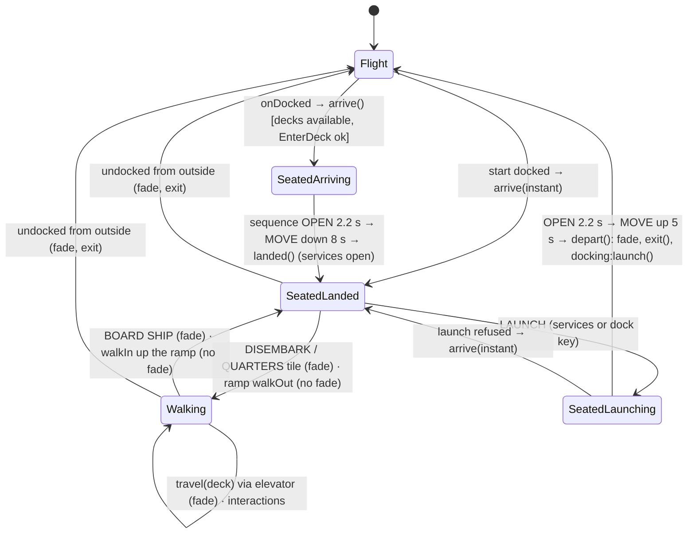
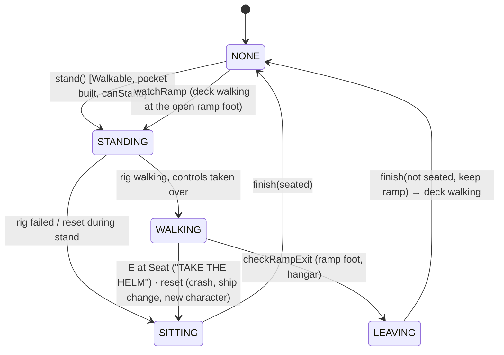

# 09 · Life on foot, NPC traffic, training and audio: port reference

Port spec for everything the player does **outside the pilot seat**, the **living world** around the ship, and the **sound**:

- walking aboard the own ship (walkable ships) and on the station decks: private hangar with lift, concourse, private quarters;
- the deck UI (fades, location banner, interaction cards, elevator, personal terminal), crowd NPCs, the quarters features (lights, radio, bed, hologram, trophy wall, window planet);
- NPC ship traffic (fly-bys, formation pairs, drop-ins from cruise with a flash, station departures and arrivals);
- other pilots (multiplayer: documented, **dropped** for the singleplayer port);
- the 17-step flight training;
- layered ship audio, music rotation, cues and loops, deck ambience;
- the voice: 92 announcement keys with a queue, four priority tiers, tones, cooldowns and expiry;
- the automatic callouts that watch the ship and feed the voice.

**Sources.** All Lua paths are relative to `roblox/lua/`. `path:line` points at the line where a function, table or constant starts. Deck templates, ship walk data and deck sounds were stream-parsed from `Assets.rbxmx` for this spec (scanner in the scratchpad, not committed). Nothing is estimated unless it says so. Where the export lacks data (two ScreenGuis, the voice text sheet, the audio files), the spec says so and proposes a phone-first rebuild.

**Units and frames.** 1 stud = 1 unit = 1 m (`ShipConfig.Scale.MetresPerStud = 1`). Roblox is right-handed, Y-up, and `LookVector` is **-Z**, like the Kotlin engine. **On foot the units are avatar units:** the Roblox R15 character is about 5 units tall, walks at 16 u/s and falls with the Roblox default gravity 196.2 u/s². The decks and the walkable interiors are built at that scale. Keep it (decision D1): nothing on foot shows metres, and every deck and interior dimension in this spec is in these units.

**Server → local.** The server modules of this area (`ShipServer/ShipDecks`, `ShipServer/ShipTraining`, `ShipServer/ShipPilots`) become local logic or are dropped (8.3). Teleports, reserved servers, friends and other players' ships do not exist in the port.

**Naming.** The player is **PILOT**. The Roblox terminal frame is called `Commander` and shows the Roblox display name; the port shows the pilot name (default "PILOT", Q7) and never "COMMANDER" or "CMDR".

**Missing from the export** (see 5.0 and section 10):
- `StarterGui.StationLife` (deck UI) and `StarterGui.Training` (training panel): layout, captions and their `Sounds` folders. Only the element contract that the scripts look up is known.
- The voice text sheet `VoiceLines\ShipVoice_Lines.md` and the 91 recordings `Voice_<Key>` (made by AFloidDEV with ElevenLabs, per `roblox/EXPORT_INSTRUCTIONS.md`). Only keys, asset ids, tiers and triggers are known. Spoken texts below are marked *src* (quoted in a Lua comment) or *prop.* (proposed for this spec).
- Every audio file. Roblox audio cannot be used in the app; Appendix A lists each sound and what file the port needs.

---

## 0. Key facts in one screen

- **Docking leads into a private hangar.** After the clamps close, the screen fades to black ("DOCKING COMPLETE" / station name). The ship then sits on a lift 72 u up in a shaft. The hatch opens in 2.2 s, the lift lowers the ship in 8 s (smoothstep) while the hangar lights come up, then the station services open seated in the cockpit. LAUNCH reverses it: hatch 2.2 s, lift up 5 s, fade "LAUNCH CLEARANCE", the docking computer flies out as before.
- **Three decks**, each a copy of an `Assets/Decks` template in its own scene: **HANGAR** (174 × 137 × 199 u), **CONCOURSE** (174 × 51 × 134 u; bar, 6 shops, notice board, 2 service kiosks, 4 elevators, 14 NPCs, a 140 u window onto the host planet), **QUARTERS** (62 × 19 × 48 u; terminal, light moods, radio, bed, ship hologram, trophy wall, window). An elevator panel moves between them with a 0.45 s fade each way.
- **Walking**: Roblox humanoid feel. WalkSpeed 16, JumpHeight 7.2, third-person orbit camera (zoom 0.5–16, first person at the minimum), interaction cards within 8 u (12 u for BOARD SHIP), 69 sittable seats.
- **Walkable ships** (MORVEN, KESSOCK, LOCHRAN): stand up from the helm in flight (below 30 m/s, or with autopilot or in a jump), landed, or in the hangar. You walk in a static copy of the interior (the "pocket"), drawn wherever the ship really is, so manoeuvres never throw you. Doors open as you approach. In the hangar the ramp opens and you can walk down onto the deck and back up without a fade.
- **NPC traffic**: at most **2** NPC ships at once, only near a station (within 8 km) or in a planet's or moon's approach zone, never in empty space. An encounter comes every 45–120 s (×0.45 near a station, ×1.25 outside Sol). Encounter types are FLYBY (weight 1, 25 % as a PAIR), DROPIN (0.8; arrives from cruise with a flash, leaves the same way) and STATION (1.4; flies out of or into the nearest station's mouth). NPCs pass within about 220–330 u and fade out at the edge of a ~400–480 u "sight bubble". They dodge, and jump away when the player rams them.
- **Training**: 17 lessons (WELCOME, LAUNCH, STEER, THROTTLE, YAW, THRUSTERS, BOOST, STOP, TARGET, SURVEY, AUTOPILOT, LAND, TAKEOFF, APPROACH, REQUEST, DOCK, SELL). Each has a goal checked every frame. On success a green tick shows and the next step follows 1.6 s later. Steps already done are skipped. New pilots cannot skip; others skip with a double tap. The finish card shows the credits earned.
- **Audio**: six layers loop permanently and only move in volume and pitch: Engine, Thrust, Decel, Rcs, Rumble, Cruise. On top come cues (boost, cruise in/out, FA click and chirp, clamps, touchdown, hull hits, warp), a warp loop, and music as a shuffled playlist with 30–90 s silence between tracks. On the decks the ship sounds are muted. Deck music (lounge, radio) hushes the flight music.
- **Voice**: one line at a time, 0.35 s gap. Tiers STATUS < ADVISORY < CAUTION < WARNING sort the queue. A WARNING cuts lower lines, and the jump countdown cuts STATUS and ADVISORY. WARNING lines get a 0.9 s alarm tone first. The same line repeats at most every 2.5 s, and queued lines expire after 6/5/3/1.5 s by tier. Lines starting with "Control" sound like radio, the rest like the ship computer.
- **Callouts**: altitude (500/100/50/30/20/10), terrain and sink-rate warnings with a 0.5–5 s look-ahead, gear, cruise, boost ready, heat, fuel, scooping, gravity well, G-load, speed limit, collision course, docking request, scan and deposit. They stay quiet for 6 s after start and 1.5 s after any pause (decks, walking aboard, jump tunnel, crash).
- **Kotlin today has none of this**: no audio, no voice, no walking, no interiors, no NPCs, no training (section 7).

---

## 1. Overview: what the player experiences

1. **Docking into the own hangar.** After the clamps close ("LANDING CLAMPS ENGAGED. WELCOME TO …"), the screen fades to black over 0.45 s with "DOCKING COMPLETE" over the station name. It fades back in to show the hangar from the cockpit. The ship stands on a lift platform high in the shaft, the hangar below is still dark, and the hatch below is closed. The two hatch halves slide apart (2.2 s, an air-release hiss) and the lift sinks 72 u over 8 s with a motor hum. The 28 accent-coloured pad lights on the platform blink (0.3 s on, 0.3 s off) and the hangar brightens as the ship comes down. The pad number ("04") is painted on the floor, the walls, the shaft sign and the lift. At the bottom the station services open, seated, and the hatch closes overhead. The ship's own sounds are silent from the first fade until launch. The flight music keeps playing.
2. **Getting out.** The services hub has **DISEMBARK** ("WALK THE STATION") and **QUARTERS** ("YOUR PRIVATE ROOM") tiles. DISEMBARK fades ("DISEMBARKING" / station) and puts the pilot on the hangar floor in front of the ship's nose, looking at it. QUARTERS goes straight to the private quarters. On foot the pilot walks with Roblox's humanoid feel: third-person camera, jump, and seats that you sit on by walking into them.
3. **Interaction cards.** Within 8 u of a point of interest a card floats 1.2 u above it with a key cap, an action ("CALL ELEVATOR") and an object ("ELEVATOR"). Pressing the key (on the phone: tapping the card or USE) triggers it. Only the nearest card shows.
   - **Hangar:** "STATION SERVICES" at the hangar console (services open on foot, with CLOSE instead of LAUNCH), "CALL ELEVATOR", and "BOARD SHIP" in front of the nose (12 u). Two traffic controllers work in the control booth.
   - **Concourse:** four elevators, two "STATION SERVICES" kiosks, "ORDER A DRINK" at THE LONG ORBIT bar, "BROWSE" at six shops, and "STATION NEWS" at the notice board. Fourteen people stand or sit around: a bartender, four patrons, two pairs chatting, three shopkeepers, an officer and a visitor. A centrepiece turns at 6°/s, the lounge plays music, and a 140 u window shows the host planet.
   - **Quarters:** "PERSONAL TERMINAL", "LIGHTS" (cycles WARM, COOL, NIGHT, NEON), "RADIO" ("MERIDIAN FM · ON AIR"), "REST" at the bed (sets the home station), and "LEAVE QUARTERS" at the door. A glowing blue hologram of the own ship turns over the table. The trophy wall lists up to 12 charted worlds. The window shows the host planet with its day side towards you.
4. **Elevator.** The panel lists PRIVATE HANGAR ("PAD 04 · VARROW"), CONCOURSE ("SHOPS · LOUNGE · KIOSKS") and PRIVATE QUARTERS ("CABIN 01 · PRIVATE"). The current deck is marked and cannot be picked. A pick fades to black with the deck title, the pilot arrives at that deck's elevator, and a location banner (station · deck · system and host) shows for 5 s.
5. **Terminal.** It shows the pilot's name and credits, the statistics (credits earned and spent, trades, worlds surveyed, jumps, dockings, ships lost, pilot since), the owned ships (ACTIVE/STORED), the charted worlds with their values, mood buttons and "SET AS HOME STATION".
6. **Back to the ship.** BOARD SHIP (fade "BOARDING" / ship name) seats the pilot, and the services reopen. On a walkable ship the pilot can instead open the ramp from inside and simply walk down onto the hangar floor, or walk up the open ramp back on board, without any fade.
7. **Launch.** LAUNCH in the seated services opens the hatch (2.2 s), lifts the ship up the shaft (5 s), fades ("LAUNCH CLEARANCE"), and hands over to the docking computer, which flies out as before. If the station refuses the launch, the pilot is back in the hangar with the lift already down.
8. **Walking aboard in flight.** On a walkable ship, LeaveSeat (key 1) stands the pilot up behind the seat. The ship has to be below 30 m/s, or on autopilot, or in a jump, or set down on the ground. Steering and flight displays rest, throttle goes to 0 and Flight Assist on, so the ship coasts to a stop. Autopilot and jumps fly on. Doors slide open when you come near. The hold shows as many cargo containers as the cargo fill needs. Status points answer with short reports: SHIP STATUS, REACTOR, CARGO MANIFEST, SURVEY SCANNER, MINING CONTROL, REFINERY. Flavour points give random lines: GALLEY, MED BAY, EVA LOCKERS, CREW QUARTERS. "TAKE THE HELM" sits back down.
9. **NPC traffic.** Near stations and planets, ships of five classes come by now and then:
   - VARROW couriers, patrols and scouts; BRANNOCK freighters and traders; MORVEN haulers, bulk carriers and transports; KESSOCK prospectors, ore haulers and miners; LOCHRAN surveyors and explorers.
   - Each has a call sign such as "FREIGHTER KTV-218".
   - They cross ahead of the nose in a gentle banked curve, sometimes in pairs. Some drop out of cruise with a blue-white flash and a streak, slow down, fly on, and jump away with another flash. Near a station they fly out of or into the mouth at docking-computer speeds.
   - Their engines glow with their throttle and their strobes blink.
   - They keep at least 120 u between hulls, dodge a player who heads at them, and jump away when rammed.
   - There is none while docked, landed, in an atmosphere, in a jump, during training or in empty space between zones.
10. **Training.** New pilots fly it first, whichever mode they chose in the menu (doc 07). A panel shows "STEP n / 17", a title, an explanation with the keys highlighted, key caps, a goal with a check box, and a live status line. The lessons are: leave the station, point the nose at the nearest moon, reach a speed, yaw both ways, fire all four thrusters, boost, full stop, lock the home planet, survey it, autopilot to the landing zone, land, climb back to space, return to the station, request docking, dock, sell the survey data. A finish card says "TRAINING COMPLETE" with "+ n CR EARNED" and a tip to explore other systems.
11. **Sound.** The engine hum rises with the throttle, before the ship even moves. Thrust roars and retro hisses follow the real acceleration. Thruster hiss follows turning, a rumble grows with speed, and a deep cruise hum grows logarithmically from top speed to 20 km/s. Boost, cruise engage and disengage, flight-assist chirps, docking clamps, release hiss, touchdown thumps scaled by sink rate, hull hits and warp sounds play as cues. Music is a shuffled rotation with fades, toggled with J.
12. **Voice.** A ship computer and station control speak:
    - "Ship computer online. All systems online." on start.
    - Altitude calls when sinking toward the ground, "Pull up", "Terrain ahead", "Sink rate".
    - "Gear down", cruise, boost ready, heat, fuel, gravity well, G warnings, overspeed, "Collision alert".
    - Docking chatter mapped from the comms text, the jump countdown "Five … One. Jump.", and the ship-loss sequence.
    - Lines never overlap. Warnings cut in front, and stale ones are dropped.

---
## 2. Modules

Module map of this area (client unless noted):

| Module | Lines | Role | Port |
|---|---|---|---|
| `ShipClient/ShipDecks.lua` | 2263 | Deck session: lift and hatch, scenes, interactions, quarters features, walking camera, flows | **port** |
| `ShipClient/ShipDeckUi.lua` | 552 | Fade, banner, elevator and terminal panels, interaction cards (`StarterGui.StationLife`) | **port** (UI rebuilt) |
| `ShipClient/ShipAboard.lua` | 1480 | Walking aboard the own ship: pocket, ramp, doors, cargo, interactions, camera | **port** |
| `ShipClient/ShipCrowd.lua` | 104 | Hides other players' characters unless on the same deck | drop (no other players) |
| `ShipClient/ShipTraffic.lua` | 1843 | NPC ship traffic | **port** |
| `ShipClient/ShipPilots.lua` | 697 | Other pilots: send and receive state, beacons, hulls, friends, joining | drop (multiplayer) |
| `ShipCore/ShipPilotCodec.lua` | 202 | Binary codec for pilot states | drop (keep notes for later) |
| `ShipClient/ShipTraining.lua` | 1698 | Flight training engine and steps, teleport covers | **port** (teleports dropped) |
| `ShipClient/ShipAudio.lua` | 848 | Layers, cues, loops, music rotation, flight sound events | **port** |
| `ShipClient/ShipVoice.lua` | 403 | Voice queue with tiers, tones, cooldowns, expiry | **port** |
| `ShipClient/ShipCallouts.lua` | 666 | Automatic voice callouts from the flight state | **port** |
| `ShipServer/ShipDecks.lua` | 168 | Deck slots, deck keys, home station | local (`DeckSession`) |
| `ShipServer/ShipPilots.lua` | 396 | Pilot roster, relay, join friend | drop |
| `ShipServer/ShipTraining.lua` | 223 | Training and SOLO servers, FinishTraining | local (`Training.finish`) |

Shared data used here: `ShipCore/ShipStationLore.lua` (DeckTitles `:61`, Moods `:68`, Bar `:78`, Shops `:93`, News `:104`; Accent per station `:19`), `ShipClient/ShipRig.lua` (character), `ShipClient/ShipHull.lua` (ship model visibility, collision, local frames), `ShipClient/ShipNotices.lua` (toasts, comms → voice).

### 2.1 ShipDecks: the deck session (`ShipClient/ShipDecks.lua`)

**Purpose.** Life on foot at a station. Each client builds its own copies of the three deck templates far above the flight world. In the port they live in their own scene (8.2). While a deck is active, ShipClient runs `deckFrame` instead of the flight loop (`ShipClient.lua:2327`).

**Context** (`ShipDecks.new(ctx)`, `:190`). The ctx provides `player, profile, rig, notices, deckUi, audio` and these callbacks:

| Callback | ShipClient (`:1749`) |
|---|---|
| `getHull()` | current `ShipHull` (changes with the ship) |
| `getProbe()` | `ShipStation.probeFor(model)` → `{ radius, points, ground }`; `ground = RootToGround − SeatOffset.Y` (Varrow 11 − 0.5 = 10.5) |
| `hideSpace()` / `showSpace()` | hide/restore the flight world, stations, traffic (`traffic:clear()`), markers, cursor, speed lines, dust, HUD and warning GUIs (`:1698`, `:1722`) |
| `openServices(onFoot)` | `stationUi:open(docking:getStation(), docking:getPad(), onFoot)` |
| `closeServices()` | `stationUi:close()` |
| `launchFlight()` | `docking:launch()` |
| `isDocked()` | `docking:isDocked()` |
| `isExternal()` | external camera view active (keeps the hull fully visible) |

**State** (`:200-220`):

| Field | Meaning |
|---|---|
| `active` | a deck session runs (from `arrive` until `exit`) |
| `mode` | `"NONE"`, `"SEATED"` (in the cockpit on the lift), `"WALKING"` |
| `deck` | `"HANGAR"`, `"CONCOURSE"`, `"QUARTERS"` or nil |
| `busy` | a flow (fade, elevator, lift) is running; blocks other flows and interactions |
| `overlay` | open window on foot: `"ELEVATOR"`, `"TERMINAL"`, `"SERVICES"`, `"REST"` or nil |
| `sequence` | lift/hatch sequence `{ down, stage = OPEN/MOVE/CLOSE, t, from, started, onDone }` or nil |
| `scenes[deck]` | built deck instances (2.1.3) |
| `entry`, `pad` | station entry (`entry.def`, `entry.host`, `entry.offset`, `entry.economyName`) and pad number |
| `slot`, `concourseSlot` | world slots from the server (port: always 1) |
| `moodIndex` | 1..4 into `ShipStationLore.Moods` (default 1 = WARM) |
| `radioOn` | quarters radio state (default false; survives deck changes within the session) |
| `clock` | seconds since the session started (blink timing) |
| `fillTimer` | countdown to the next clock/credits sign refresh (20 s) |
| `viewLight[deck]` | cached sun search per deck (2.1.2) |
| `savedLighting`, `savedCamera` | flight values restored on exit |

**Constants** (`:45-85`):

| Name | Value | Meaning |
|---|---|---|
| `TEMPLATES` | HANGAR→`Hangar`, CONCOURSE→`Concourse`, QUARTERS→`Quarters` | template names in `Assets/Decks` |
| `ORDER` | HANGAR, CONCOURSE, QUARTERS | elevator order |
| `PROMPT_LABELS` | Elevator "ELEVATOR", Services "STATION SERVICES", Terminal "PERSONAL TERMINAL", Lights "LIGHTS", Music "RADIO", Bed "REST", Bar "ORDER A DRINK", Shop "BROWSE", Notice "STATION NEWS", Board "BOARD SHIP" | action text when a marker has no `Label` |
| `LIGHTING_KEYS` | Ambient, OutdoorAmbient, Brightness, ClockTime, ExposureCompensation, FogColor, FogEnd, FogStart, EnvironmentDiffuseScale, EnvironmentSpecularScale, GeographicLatitude | lighting a deck may set through model attributes |
| `IDLE_ANIMATION` | `rbxassetid://507766666` | Roblox R15 default idle (NPCs) |
| `SIT_ANIMATION` | `rbxassetid://2506281703` | Roblox R15 default sit (NPCs with `Npc = "Sit"`) |
| `HOLO_COLOR` | (90, 200, 255) | ship hologram colour |
| `BLINK_OFF` | 0.85 | transparency of a blinking light in its off phase |
| `MAX_PLAQUES` | 12 | trophy wall capacity |
| `DESCENT_DARKNESS` | 1.5 | exposure stops the hangar is darker with the lift at the top |
| `HOLO_RATE` | 1/30 s | hologram update interval (30 Hz) |
| `PANE_GAP` | 0.6 | camera stays this far in front of a window pane |

#### 2.1.1 Queries and texts

| Function | Line | Result |
|---|---|---|
| `hasTemplate(deck)` | 247 | the template exists and is a Model |
| `isAvailable()` | 254 | `ShipConfig.Decks ~= nil` and a HANGAR template exists. Without it, docking opens the services seated as before. |
| `isActive()`, `isSeated()`, `isWalking()`, `getDeck()`, `isBusy()` | 258-276 | state reads; seated/walking require `active` |
| `canDisembark()` | 279 | `isSeated() and not busy and (sequence == nil or sequence.stage == "CLOSE")`: as soon as the lift is down (the hatch may still be closing) |
| `canQuarters()` | 284 | active, not busy, deck ≠ QUARTERS, QUARTERS template exists, and walking or `canDisembark()` |
| `stationTitle()` | 294 | `upper(def.Name)` or "STATION" |
| `stationDetail()` | 299 | `"%s  ·  %s ORBIT"` (system name, host), e.g. "SOL  ·  EARTH ORBIT" |
| `shipName()` | 307 | `upper(ShipEconomy.ShipById[activeShip].Name)` or `upper(ShipConfig.Hull.Model)` |
| `padText()` | 312 | `"%02d"` of the pad, e.g. "04" |
| `fillText(kind)` | 316 | texts for signs with attribute `Fill` (table below) |
| `applyFills(scene, only?)` | 340 | writes each `Fill` label (only that kind if given) when the text changed |

`Fill` kinds (`:316-337`) and where the templates use them (2.2):

| Kind | Text |
|---|---|
| `StationName` | station title, e.g. "MERIDIAN STATION" |
| `StationSubtitle` | `"%s  ·  %s ORBIT  ·  %s"` (system, host, economy), e.g. "SOL  ·  EARTH ORBIT  ·  HIGH TECH" |
| `PlayerName` | `upper(player.DisplayName)` (port: pilot name) |
| `ShipName` | `shipName()` |
| `PadNumber` | `padText()` |
| `Clock` | `os.date("!%H:%M")`, UTC "HH:MM" ("STATION CLOCKS RUN ON SOL STANDARD TIME") |
| `Credits` | `ShipEconomy.formatCredits(credits)`, e.g. "12,400 CR" |

Clock and Credits are refreshed every 20 s (`fillTimer`, `:2184`), all fills on `enterScene`, `ShipName` on a ship change.

#### 2.1.2 Lighting

- `saveLighting()` (`:355`) stores the flight values of all `LIGHTING_KEYS` and disables every `DepthOfFieldEffect` (flight blur smears interiors). `restoreLighting()` (`:373`) puts them back.
- `applyLighting(scene)` (`:391`) copies each `LIGHTING_KEYS` attribute of the deck model to Lighting. For decks with a window view it calls `aimViewLight`. Then `scene.exposure = Lighting.ExposureCompensation`. On QUARTERS it calls `applyMood`.
- **Window sun** (`aimViewLight`, `:432`). The light on the window planet must always come from the same side as seen from the window: `ShipConfig.Decks.ViewLight = (−0.5, 0.5, 0.7)` in the view marker's axes (X right, Y up, Z toward the viewer). The wanted sun direction is

  `want = normalize(view.Right·L.x + view.Up·L.y − view.Look·L.z)`.

  So the sun is up-left and behind the viewer: the day side faces the window and the terminator lies on the right. Roblox can only set the sun through `ClockTime` and `GeographicLatitude`, so the code searches once per deck. The coarse pass tries clock 0..23.5 in steps of 0.5 and latitude −88..88 in steps of 4. The fine pass tries ±0.5 h in steps of 0.05 and ±4° in steps of 0.4 (clamped to ±89). The pair with the largest `dot(sunDirection, want)` wins, about 2600 tries in total, and the result is cached in `viewLight[deck]`. Then the night-shade copy is turned to the light: `towardLight(centre, sun)` (local +X to the light) if `ShadeMode = "Ramp"`, else positioned at `centre − sun·ShadeOffset·factor`.
  **Port:** set the window planet's light direction to `want` directly. No search is needed.
- **Quarters mood** (`applyMood`, `:483`) for mood `m` (WARM/COOL/NIGHT/NEON, 3.10):
  - every `Mood` Light: `Color = m.Color`, `Brightness = base·m.Brightness`;
  - every `Mood` part (Neon is dimmed only through its colour): `Color = m.Color·clamp(0.25 + 0.75·m.Brightness, 0, 1)`;
  - while in the quarters: `Lighting.Ambient = m.Ambient`.

#### 2.1.3 Building a deck scene (`buildScene`, `:521`)

1. **Origin** (`originFor`, `:508`):
   - CONCOURSE: `ConcourseBase + ((concourseSlot−1)·SlotSpacing, 0, 0)`.
   - HANGAR: `PrivateBase + ((slot−1)·SlotSpacing, 0, 0)`.
   - QUARTERS: the hangar's origin + `QuartersOffset (0, 0, −1600)`.
   - All have no rotation, so front stays −Z.
   - These positions only keep Roblox decks away from the flight world and from other players. **Port:** each deck is its own scene with the origin at its `Root`.
2. **Clone** the template, delete scripts, and pivot so that `Root` (or `PrimaryPart`) sits exactly on the origin (`model:PivotTo(origin · root⁻¹ · pivot)`).
3. **Scan** the descendants:
   - `scene.markers[name] = {parts}` from the `Markers` folder.
   - BaseParts:
     - `Accent = true` → colour = station accent (`ShipStationLore.get(id).Accent`);
     - `Blink = period` (> 0) → blink list `{part, period, base transparency, on}`;
     - `Mood = true` → mood list;
     - `PadLight = true` → pad-light list `{part, base}`.
   - Lights: `Accent` on the light or its holder → accent colour; `Mood` on the light or its holder → mood list with base brightness.
   - TextLabels with a `Fill` attribute → fill list.
   - Models with `SpinDegreesPerSecond ≠ 0` → spin list `{model, speed, centre = PrimaryPart CFrame or pivot, pivot, angle = 0}`.
   - Sounds: the first of each name goes into `scene.sounds[name]`, stopped.
4. **Window panes** (`collectPanes`, `:115`): non-Neon, non-ForceField parts that are see-through (Glass, or 0.05 < Transparency < 0.95) and flat. With the sorted sizes `d1 ≤ d2 ≤ d3`, a pane needs `d1 ≤ 1` and `d2 ≥ 6`. They are used by the walk camera (2.1.9).
5. **NPCs** (`:618`): every Model with a Humanoid in `Npcs`.
6. HANGAR → `readLift`. QUARTERS and CONCOURSE → `buildView`. Then `createPrompts` and `applyFills`.

`destroyScene(deck)` (`:639`) hides its cards, stops its animation tracks and destroys the model.

#### 2.1.4 The window planet (`buildView`, `:712`)

- `view` = the `View` marker CFrame, else `origin · (0, 18, −70)`. `direction = (view · rotX(−12°)).LookVector`: tilted 12° down, so the planet's rim is in view. `centre = view.Position + direction · ViewDistance (1300)`.
- If the station's host part has a smooth sphere mesh with a `SphereRadius` attribute (`viewCopy`, `:660`): copy it without tags and attributes (gravity, markers and targeting never see it), anchored, no collision or shadow.
  - `factor = (ViewDiameter/2) / bodyRadius = 450 / bodyRadius`.
  - Orientation: `below = entry.offset.Unit` (host centre → station) or `−direction`. `rotation = turnOnto(below, −direction) · host.Rotation`, so the surface point under the station faces the window. `turnOnto(a, b)` (`:691`) is the shortest-arc rotation: axis `a×b`, angle `atan2(|a×b|, a·b)`, with a 180° fallback about any perpendicular axis.
  - The shells `CloudLayer`, `Atmosphere` and `AtmosphereHaze` of the host model get the same treatment: mesh scale `radius·factor / SphereMeshRadius`, rotation kept relative to the body. `NightShade` is copied too and aimed by `aimViewLight` (2.1.2).
- Fallback: a smooth ball of diameter `min(900, 2048)` in the host colour and material (SmoothPlastic if Neon, default colour (70,110,160)), plus a 1.06× atmosphere shell copying `Atmosphere` colour, material and transparency.
- **Apparent size:** radius 450 at 1300 → angular radius **20.25°**, centred 12° below the view axis (the disc spans −32.25° … +8.25° of elevation). This is fixed whatever the real host distance (Q16).

#### 2.1.5 Lift and hatch (HANGAR)

- `readLift(scene)` (`:809`): `scene.lift` = model `Lift`. `liftBottom` = marker `LiftBottom` (else the top of `Lift/Base`, else the origin). `travel = LiftTop.y − LiftBottom.y` (template: **72**; default 72). Hatch halves `Hatch/HatchLeft|HatchRight` with attribute `OpenOffset` (template: **(∓42, 0, 0)**): `{item, closed CFrame, offset in world}`.
- `setLift(h)` (`:847`): 0 = down in the hangar, 1 = up in the shaft. Pivot = `liftPivot + Y·(travel·h)`.
- `setHatch(o)` (`:855`): 0 = closed, 1 = open. Each half at `closed + offset·o`.
- `liftCFrame()` (`:868`) = `CFrame(liftBottom + Y·travel·height) · origin.Rotation`: the top centre of the platform, front −Z.
- `shipBounds()` (`:872`) = model attributes `BoundsSize`, `RootToBoundsCenter` (defaults (42,21,66) and (0,−0.5,22.6)).
- **Ship pose on the lift** (`getShipCFrame`, `:888`): `liftCFrame · (−centre.X, probe.ground, −centre.Z)`. The hull's bounds centre sits over the platform centre and the gear stands on it, as `padPose` does at a station pad.
- **Pad lights** (`blinkPadLights`, `:899`): `on = not moving or (clock mod 0.6) < 0.3`. Transparency = base if on, else 0.85. Written only on change.

**Sequence** (`updateSequence`, `:909`), driven every frame from `update`:

| Stage | Behaviour | Exit |
|---|---|---|
| `OPEN` | Once: `from = hatchOpen` and play `HatchOpen`. `setHatch(from + (1−from)·smooth(t/HatchSeconds))`. | t ≥ 2.2 s → `MOVE`, t = 0 |
| `MOVE` | Once: `LiftMotor` looped and playing. `k = smooth(t/seconds)`, seconds = 8 (down) or 5 (up). `setLift(down ? 1−k : k)`. Down: `Exposure = scene.exposure − 1.5·(1−k)`. Pad lights blink. | t ≥ seconds: stop the motor, steady pad lights. **Down** → `CLOSE` (from = hatchOpen) and run `onDone` (`landed`). **Up** → sequence nil, run `onDone` (`depart`). |
| `CLOSE` | `setHatch(from·(1 − smooth(t/2.2)))` | t ≥ 2.2 s → nil |

`smooth(t) = t²(3 − 2t)` with t clamped to 0..1 (`:91`).

#### 2.1.6 Interactions (`makePrompt`, `createPrompts`, `refreshPrompts`, `interact`)

- `makePrompt(scene, holder, kind, action, object?, range?)` (`:981`) creates a ProximityPrompt with:
  - key E, `HoldDuration` 0, no line of sight, `MaxActivationDistance = range or PromptRange (8)`;
  - `Exclusivity = OnePerButton` (Roblox shows only one card per key: the nearest);
  - `Style` from `deckUi:promptStyle()` (custom card), disabled at first;
  - attribute `Kind`;
  - Triggered → `interact(kind, holder)`; Shown/Hidden → `deckUi:showPrompt/hidePrompt`.
- `createPrompts(scene)` (`:1008`): for every marker with a non-empty `Interact` attribute. Action = `Label` attribute or `PROMPT_LABELS[kind]` or `upper(kind)`. Object = `Object` attribute (for `Shop`, the `Shop` attribute if no Object). Range = `Range` attribute.
- `placeBoardPoint()` (`:1030`): an invisible 1-unit part at `liftCFrame · (−4, 3, −size.Z/2 − 3)` (on the floor in front of the bow, a little to the left). It carries the prompt "BOARD SHIP" / ship name / **range 12**, built once per hangar and moved on a ship change. It sits by the floor rather than the cockpit because there the canopy covered the card.
- `refreshPrompts()` (`:1056`): prompts are enabled only when `active and mode == WALKING and not busy and overlay == nil`, and only on the current deck. Otherwise `deckUi:clearPrompts()`.
- `setOverlay(name)` (`:1078`): while walking, `rig:setControlsEnabled(name == nil)` stops walking while a window is open. Then `refreshPrompts()`. `deckUi.onClosed` clears the ELEVATOR and TERMINAL overlays (`:227`).

`interact(kind, holder)` (`:1100`) is ignored unless walking, not busy and with no overlay:

| Kind | Effect |
|---|---|
| `Elevator` | `openElevator()` |
| `Services` | overlay SERVICES; `openServices(true)` (CLOSE instead of LAUNCH; CLOSE → `onServicesClosed` clears the overlay) |
| `Terminal` | `openTerminal()` |
| `Lights` | `cycleMood()` |
| `Music` | `toggleRadio()` |
| `Bed` | `rest()` |
| `Board` | `board()` |
| `Bar` | sound Select; toast `Bar.Name` ("THE LONG ORBIT"), `Lines[random]:format(Drinks[random])`, 6 s |
| `Shop` | sound Select; brand = holder's `Shop` attribute. Known brand → toast(brand, `Shops[brand][1] .. " " .. Shops[brand][2]`, 6 s). Else toast(`upper(brand or "SHOP")`, "THE SHOP IS CLOSED RIGHT NOW.", 4 s) |
| `Notice` | sound Select; toast "STATION NEWS", random `News` line, 8 s |

#### 2.1.7 Elevator (`deckInfo`, `openElevator`)

- `deckInfo(deck)` (`:1144`):
  - HANGAR: `"PAD %s  ·  %s"` (pad, ship).
  - CONCOURSE: "SHOPS  ·  LOUNGE  ·  KIOSKS" when no other player is on this station's concourse, else `"%d PILOT%s ON DECK"`. The port always uses the first text.
  - QUARTERS: `"CABIN %02d  ·  PRIVATE"` (slot; port: "CABIN 01").
- `openElevator()` (`:1165`): the list `{id, name = DeckTitles[id], info, here = id == deck}` in ORDER, for existing templates. `deckUi:openElevator(stationTitle, list, travel)` → overlay ELEVATOR. Without the GUI it travels straight to the next existing deck in ORDER (cyclic).

#### 2.1.8 Quarters: trophies, hologram, mood, radio, rest, terminal

- **Trophies** (`getTrophies`, `:1199`):
  - For each `profile.charted` key `"<systemIndex>/<body>"`, the entry is `{body = upper(name), system = upper(systemName or "?"), class = upper(body.class or "WORLD"), value = formatCredits(surveyValue(body)), sort = value}`. Errors count as 0.
  - Sorted by value descending, then by name ascending.
  - `fillTrophies` (`:1231`) clones the `Plaque` template in `TrophyBoard/…/List` for the first 12, filling `Body`, `System` and `Class`. `Empty` is visible when the list is empty.
- **Hologram** (`buildHologram`, `:1274`). It is rebuilt only when the ship model changes:
  - Clone `Assets/Ships/<Hull.Model>` and remove `Cockpit` and every `GearClosed` part (the hologram shows the gear down).
  - Parts with Transparency ≥ 0.99 or named `Plume` become invisible. All others are Neon (90,200,255) at transparency 0.6 with textures removed, anchored, without collision or shadow.
  - Remove scripts, lights, sounds, decals, GUIs, particles, beams, trails, SurfaceAppearances and prompts.
  - Scale so that `max(size.X, size.Z) = HologramLength (7)`, using `BoundsSize`, else the bounding box.
  - Turn about the hull's bounding-box centre with the bow toward −Z. Place at the `Hologram` marker (quarters (−2, 5.89, −11)). It turns at `HologramSpin` 18°/s and is updated at 30 Hz.
- **Mood** (`setMood(id)`, `:1357`, from the terminal; `cycleMood`, `:1369`, from the switch): `moodIndex = moodIndex mod 4 + 1`, `applyMood`, sound Select, toast "LIGHTS", mood id ("COOL"), 2 s.
- **Radio** (`toggleRadio`, `:1380`):
  - Toggles `radioOn` and loops or stops the quarters `Radio` sound.
  - Sound Select; toast "RADIO", "MERIDIAN FM  ·  ON AIR" or "OFF" (2 s). The text says MERIDIAN FM at every station.
  - Then `updateMusicHush`.
- **Music hush** (`updateMusicHush`, `:1402`): `audio:setMusicHush(active and (deck == CONCOURSE or (deck == QUARTERS and radioOn)))`. Decks with their own music fade the flight music out so two tracks never play together. The hangar keeps the flight music.
- **Home station** (`callSetHome`, `:1410`): server `SetHome`. On ok: terminal button text "THIS IS YOUR HOME STATION", toast "HOME STATION SET", "<STATION> IS YOUR HOME PORT NOW." (4 s). Else a red toast "HOME STATION" with the reason or "TRY AGAIN IN A MOMENT.".
- **Rest** (`rest`, `:1423`): overlay REST. Fade out "RESTING" / station, wait 0.9 s, fade in, clear the overlay, `callSetHome`. Resting sets the home station.
- **Terminal** (`openTerminal`, `:1436`) builds:
  - `name = upper(DisplayName)`, `handle = "@" .. Name`, `credits`, `userId` (avatar), `mood` (current id).
  - `stats` rows: CREDITS EARNED, CREDITS SPENT (credits format), TRADES, WORLDS SURVEYED, JUMPS, DOCKINGS, SHIPS LOST (grouped digits), and PILOT SINCE `upper(os.date("!%d %b %Y", Created))` (e.g. "09 NOV 2026") if `Stats.Created` is set.
  - `ships`: `{name, status ACTIVE/STORED}` sorted by `Order`.
  - `trophies = getTrophies()`.
  - Handlers `onMood(id) → setMood(id)` and `onHome → callSetHome`.
  - If shown: home button text from `view.HomeStation == entry.def.Id`, overlay TERMINAL. Without the GUI: toast "PERSONAL TERMINAL", credits.

#### 2.1.9 Entering decks, NPCs, animation, arrival points, walking camera

- `enterScene(scene)` (`:1525`) leaves the previous deck (`leaveScene`: stop its sounds and tracks; models other than the hangar are unparented, the hangar stays because the ship parks there). Then it parents the new deck, sets `deck`, runs `updateMusicHush`, `applyLighting` and `applyFills`, and loops `Ambience` and `LoungeMusic`. In QUARTERS it resumes the radio if `radioOn`, fills the trophies and builds the hologram. It starts the NPC animations if none run, and sets `fillTimer = 20`.
- `playNpcs(scene)` (`:1501`): each NPC humanoid plays a looped idle (or sit if `Npc == "Sit"`) with fade 0.2 s, weight 1, and speed `0.85 + random·0.3`, so they are not all in step.
- `animateScene(scene, dt)` (`:1571`), every frame on the current deck:
  - blinkers: `on = (clock mod period) < period/2`, transparency base or 0.85, written on change;
  - spinners: `angle = (angle + rad(speed)·dt) mod 2π`, pivot = `centre · rotY(angle) · centre⁻¹ · pivot`;
  - hologram: accumulate `holoTimer`; at ≥ 1/30 s, `angle += rad(18)·holoTimer`, reset the timer and pivot to `base · rotY(angle) · offset`.
- **Arrival points** (`arrival(scene, from)`, `:1596`):
  - From `"SHIP"` in the hangar: `spot = liftCFrame · (−10, 3, −size.Z/2 − 7)`, looking at `nose = liftCFrame · (0, 3, −size.Z/2)` (level). This applies only if the spot lies inside the hangar (`origin`-local Z > −78). Otherwise the marker below.
  - From `"SPAWN"`: marker `Spawn`, else `ElevatorArrive`.
  - From `"ELEVATOR"`: marker `ElevatorArrive`, else `Spawn`.
  - Markers are flattened to yaw only. On the concourse a random lateral jitter of ±4 u is added so that players do not spawn inside each other.
  - Fallback `origin · (0, 3, 0)`. The root is 3 u above the floor.
- **Walking camera** (`useWalkCamera(at)`, `:1617`):
  - Classic camera, zoom 0.5..16 (`CameraMinZoom`, `CameraMaxZoom`), subject = humanoid. At arrival the camera is placed at `at · (0, 3, 12)` looking at `at + (0, 1.5, 0)`.
  - Roblox's own camera then applies: orbit with the right mouse button, wheel zoom, first person at the minimum zoom, occlusion against opaque colliding parts.
  - **Pane keep** (`keepCamera`, `:1665`, bound after Roblox's camera step):
    - Cast the segment focus → camera against every pane (`paneHit`, `:133`, a slab test in the pane's local box). The hit fraction must be in [0, 1], the box must not contain the focus, and the pane must not be behind the camera.
    - If hit, put the camera at `focus + dir·max(t·length − 0.6, 0.1)`, so it never slips through a window and shows the deck from outside.
    - Character fade `fadeFor(d)` (`:162`): `fade = d < 2 ? 1 − (d − 0.5)/1.5 : 0`; values under 0.5 become 0, the rest are rounded to 0.01. It is applied to the own character when it changes. This mirrors Roblox's transparency controller.
  - `restoreCamera()` (`:1651`) restores the player camera settings.
- `showBanner()` (`:1719`): `deckUi:banner(stationTitle, DeckTitles[deck], stationDetail)`.

#### 2.1.10 Flows (they yield, so they run in their own thread)

| Flow | Line | Steps |
|---|---|---|
| `arrive(entry, pad, instant?)` | 1732 | 1. Refuse if active, busy or unavailable. busy = true. 2. Server `EnterDeck("SHIP")`; abort (return false, so services open as before) if not ok or no longer docked. 3. Store entry, pad, slot; `Runtime.Deck = true`. 4. Fade out: instant → (station, "PRIVATE HANGAR"), else ("DOCKING COMPLETE", station). 5. `buildScene("HANGAR")`; on failure clean up, `Runtime.Deck = false`, fade in, return false. 6. active, mode SEATED, `saveLighting`, `hideSpace`, `enterScene`, `audio:setMuted(true)`, `deckUi:setShown(true, false)`, hull not solid, interior per `seatedView()` (inside unless the external view is on). 7a. Instant (game start docked): lift 0, hatch 0, fade in, `landed()`. 7b. Normal: lift 1, hatch 0, exposure −1.5, sequence `{down, OPEN, onDone = landed}`, fade in. Returns true. |
| `landed()` | 1803 | busy = false, `refreshPrompts`, `openServices(false)` (no banner: the services front page names station and pad) |
| `moveTo(deck, from)` | 1817 | Server `EnterDeck(deck)` (fail → false, upper reason). CONCOURSE: rebuild if the slot changed. Build or reuse the scene, `enterScene`. If not walking yet: WALKING, hull `setInterior(false)`, `setSolid(true)` (big hull parts collide). Overlay nil. HANGAR → `placeBoardPoint`. `rig:setWalking(true, arrival(scene, from))`, `useWalkCamera(at)`, `deckUi:setShown(true, true)`. |
| `disembark(target = HANGAR)` | 1860 | Needs `canDisembark()` and the template. busy; close services; fade out (HANGAR: "DISEMBARKING", else the deck title; sub = station); `moveTo(deck, HANGAR ? "SHIP" : "ELEVATOR")`. On failure: red toast "DISEMBARK", reason or "THE HATCH STAYS SHUT.", and reopen the services seated. Fade in, not busy, `refreshPrompts`, banner on success. |
| `goQuarters()` | 1885 | Walking: close services, clear the overlay, `travel("QUARTERS")`. Seated: `disembark("QUARTERS")`. |
| `travel(deck)` | 1895 | Needs walking, not busy, a different deck and an existing template. busy, close panels, `refreshPrompts`. Fade out (deck title / station), `moveTo(deck, "ELEVATOR")`. Failure: red toast "ELEVATOR", reason or "THE ELEVATOR IS NOT RESPONDING.". Fade in, not busy, `refreshPrompts`. On success: sound Elevator and the banner. |
| `seat()` | 1927 | mode SEATED, no overlay. Re-enter the hangar if elsewhere. `rig:setWalking(false, getShipCFrame())`, `restoreCamera`, hull not solid, interior per `seatedView()`, UI without walking hints, `refreshPrompts`. |
| `board()` | 1945 | Walking on the HANGAR only. busy, close panels, fade ("BOARDING", ship), server `EnterDeck("SHIP")`, `seat()`, `openServices(false)`, fade in, not busy. |
| `walkIn()` | 1969 | (ShipAboard, up the ramp) Walking in the hangar, not busy, no overlay → mode SEATED, close panels, `restoreCamera`, hull not solid, UI without hints, `refreshPrompts`. Does not yield. |
| `walkOut(view)` | 1991 | (ShipAboard, down the ramp) Seated in the hangar, not busy → close services, WALKING, no overlay, hull `setInterior(false)`/`setSolid(true)`, `placeBoardPoint`, `useWalkCamera(nil)`, camera = `view`, UI with hints, `refreshPrompts`, async `EnterDeck("HANGAR")`. |
| `rewalk(character)` | 2017 | After a respawn on foot: wait ≤ 10 s for the rig, then close panels and put the character at `arrival(scene, "SPAWN")`. (Port: no character deaths; keep as "reset position".) |
| `launch()` | 2038 | Seated, not busy → busy, `refreshPrompts`, close services. No hangar scene → `depart()`; else sequence `{up, OPEN, onDone = depart}`. |
| `depart()` | 2061 | Fade out ("LAUNCH CLEARANCE", station). Remember entry and pad, `exit()`, `launchFlight()`, wait ≤ 6 s while still docked. If still docked (launch refused): `arrive(entry, pad, true)`, or open the services seated if that fails. Fade in. |
| `exit()` | 2080 | Seat the rig at `getShipCFrame()` if walking, mode NONE, `restoreCamera`, sequence and overlay nil, close panels, clear cards, hide the UI, destroy all scenes, deck nil, `restoreLighting`, hull not solid with interior per `seatedView()`, `audio:setMuted(false)`, inactive, `updateMusicHush` (unhushes), not busy, `Runtime.Deck = false`, `showSpace`. |
| `onServicesClosed()` | 2111 | Clears the SERVICES overlay |
| `clearShipFootprint()` | 2124 | After a ship change while walking in the hangar: if the root lies inside the new hull box (local to `getShipCFrame()·centre`, half extents `size/2 + (2, 3, 2)`), zero its velocity and move it to the SPAWN arrival. Otherwise physics would push the character through the platform. |
| `onShipChanged()` | 2147 | Hull solid when walking, interior when seated, re-place the board point, `clearShipFootprint`, rebuild the hologram if in the quarters, refresh all `ShipName` fills |

#### 2.1.11 Per frame (`update(dt)`, `:2173`)

Runs only while active:

1. `clock += dt`, then `updateSequence(dt)` if a sequence runs.
2. On the current deck: `animateScene`, and every 20 s refresh the Clock and Credits fills.
3. **Fall guard:** walking, root not anchored, and `root.Y < origin.Y − FallLimit (4)` → zero velocity, pivot to the SPAWN arrival. The lift pit is 8 below the floor; a character at −5 used to stay in the dark for ever.
4. **Undocked from outside:** if not busy and no longer docked → busy, fade out (no text), `exit`, fade in.

`getStatus()` (`:2214`) reports everything for tests: available, active, mode, deck, busy, overlay, the sequence as "OPEN DOWN" etc., lift height, hatch fraction, slots, scene list, enabled prompts, walking, root position, deck attributes, station, mood, radio.

### 2.2 Deck templates in `Assets.rbxmx` (data assets of this area)

All three have `Root` (a 4 × 4 × 4 part) at the identity, so the template coordinates below are deck-local. Model attributes: `BuiltBy` ("DECK"/"DECK-B"), `DeckName`, `PartCount`, `BuildStamp`, plus the lighting values.

| | HANGAR | CONCOURSE | QUARTERS |
|---|---|---|---|
| Records / BaseParts (without NPCs) | 4887 / 809 | 5553 / 978 | 1131 / 404 |
| `PartCount` attribute | 844 | 1225 | 417 |
| Extents (x, y, z) | −87..87, −10..127, −89..110 | −87..87, −3..48, −67..67 | −31..31, −2..17, −24.5..24 |
| Collidable parts (walk collision) | 279 (273 blocks, 4 cylinders, 2 wedges) | 448 (328 blocks, 57 cylinders, 1 wedge, 62 seats) | 85 (66 blocks, 12 cylinders, 7 seats) |
| SurfaceGui frames / TextLabels | 3381 / 86 | 1054 / 139 | 582 / 35 |
| Top-level groups | Catwalks, Ceiling, Console, ControlBooth, ElevatorLobby, Floor, Hatch, Lift, Lights, Markers, Npcs, Props, Root, Shaft, WallBack, WallFront, WallL, WallR, `Ambience` | Centrepiece, Gallery, Hall, Lights, Lobby, Lounge, Markers, Npcs, Root, Shell, Shops, `Ambience`, `LoungeMusic` | CeilingLights, Door, Kitchen, Lights, Living, Markers, Root, Shell, Sleep, TrophyWall, Wardrobe, Window, Work, `Ambience`, `Radio` |
| Lighting attributes | Ambient (18,20,26), OutdoorAmbient (10,12,16), Brightness 0.5, ClockTime 0, ExposureCompensation 0.2, FogColor (10,12,16), FogEnd 100000 | Ambient (60,62,70), OutdoorAmbient (30,34,44), Brightness 1.5, ClockTime 14, Exposure 0, FogColor (12,14,20), FogEnd 100000 | Ambient (40,38,36) (overridden by the mood), OutdoorAmbient (20,22,28), Brightness 1.0, ClockTime 14, Exposure 0, FogColor (20,22,28), FogEnd 100000 |
| Tagged parts | Accent 64, Blink 15 (periods 0.9/1.0/1.2/1.4/1.6 s), PadLight 28, Fill 14 | Accent 104, Blink 4 (1.4/1.6/2.2/3.0 s), Glass 39, Fill 11, spin 1 (`Centrepiece` 6°/s) | Accent 3 parts + 1 PointLight, Mood 24 parts + 9 SurfaceLights, Glass 3, Fill 7 |
| Window panes (camera keep) | 1: `ControlBooth/BoothWindow` 27.6 × 11.2 | 7: `Shell/Window/Glass` 140 × 31, six `ShopWindow` 9.5 × 7 | 1: `Window/Window` 44 × 11 |
| MeshParts | 30 (2 NPC bodies) | 210 (14 NPC bodies) | 0 |

The 240 MeshParts are the R15 avatar bodies of the NPCs (with `HumanoidDescription`, `WrapTarget` and layered-clothing constraints). They are Roblox avatar assets and cannot be used in the port (Q6).

**Markers** (deck-local position, look direction, attributes):

| Deck | Marker | Position | Look | Interact / Label / Object / Range |
|---|---|---|---|---|
| HANGAR | LiftBottom | (0, 0, 0) | −Z | – |
| | LiftTop | (0, 72, 0) | −Z | – |
| | Elevator | (47.6, 3, 107.5) | −Z | Elevator / "CALL ELEVATOR" / "ELEVATOR" / 8 |
| | ElevatorArrive | (40, 3, 104) | −Z | – |
| | Services | (−54, 3, −22) | −X | Services / "STATION SERVICES" / "HANGAR CONSOLE" / 8 |
| | Spawn | (−47, 3, −40) | (0.97, 0, 0.25) | – |
| | *(BoardPoint, runtime)* | lift · (−4, 3, −len/2 − 3) | – | Board / "BOARD SHIP" / ship name / 12 |
| CONCOURSE | Elevator ×4 (Index 1..4) | (−16 / 0 / 16 / 32, 3, 63.2) | −Z | Elevator / "CALL ELEVATOR" / "ELEVATOR 1..4" / 7 |
| | ElevatorArrive, Spawn | (0, 3, 57) | −Z | – |
| | Notice | (−50, 3, 62.4) | −Z | Notice / "STATION NEWS" / "NOTICE BOARD" / 9 |
| | Shop 1..3 | (75.4, 3, −12 / 8 / 38) | −X | Shop / "BROWSE" / KESTREL OUTFITTERS, NOVA NOODLE, QUANTA PARTS & SUPPLY / 8 |
| | Shop 4..6 | (−75.4, 3, −12 / 8 / 38) | +X | Shop / "BROWSE" / HELIX CARTOGRAPHIC GUILD, BLUEPOINT CLINIC, STARFALL CURIOS / 8 |
| | Bar | (−73.2, 3, −48) | +X | Bar / "ORDER A DRINK" / "THE LONG ORBIT" / 9 |
| | Services ×2 | (∓26, 3, 14.8) | +Z | Services / "STATION SERVICES" / "SERVICES KIOSK" / 8 |
| | View | (0, 15, −66) | −Z | – |
| QUARTERS | View | (0, 8, −23.5) | −Z | – |
| | Lights | (11.4, 3, 22) | −Z | Lights / "LIGHTS" / "LIGHT SWITCH" / 8 |
| | Elevator | (18, 3, 21.8) | −Z | Elevator / "LEAVE QUARTERS" / "DOOR" / 8 |
| | ElevatorArrive, Spawn | (18, 3, 17) | −Z | – |
| | Bed | (−15.4, 3, −6) | +X | Bed / "REST" / "BED" / 8 |
| | Hologram | (−2, 5.89, −11) | −Z | – |
| | Terminal | (25.7, 3, −14.5) | −X | Terminal / "PERSONAL TERMINAL" / "TERMINAL" / 8 |
| | Music | (−3.5, 3, 19.6) | −Z | Music / "RADIO" / "RADIO" / 8 |

ORBITAL POST is in `ShipStationLore.Shops`, but no marker uses it.

**Lift and hatch.** `Lift/Base` is 74 × 2 × 116 with its top at y = 0 (centre (0, −1, 0)). There are 28 `PadLight` strips (accent, 0.9 × 0.16 × 2.6 along the long sides at x = ±36, z = −52..52 step 13, and 2.6 × 0.16 × 0.9 across the ends at z = ±57). There are also 2 girders, 3 cross girders, 4 guide shoes and 3 receptacles. `Hatch/HatchLeft` and `HatchRight` are models (x −41..41, y 57.1..59.8, z −60.9..60.9) opening by (∓42, 0, 0). The shaft runs y 60..127. `LiftTop` at y = 72 puts the ship in the shaft above the closed hatch.

**Sounds** (`Ambience`, `LoungeMusic` and `Radio` are children of the deck model, so they play non-positionally. The other two are parented to parts and are 3D with inverse roll-off):

| Deck | Sound | Asset | Volume | Loop | Roll-off |
|---|---|---|---|---|---|
| HANGAR | `Ambience` | 9112795463 | 0.35 | yes | – |
| | `Hatch/HatchSound/HatchOpen` | 9116496074 (same file as cue DockRelease) | 0.80 | no | 30..400 |
| | `Lift/Base/LiftMotor` | 9125970709 | 0.60 | yes | 40..500 |
| CONCOURSE | `Ambience` | 9112787259 | 0.30 | yes | – |
| | `LoungeMusic` | 109587767880146 | 0.25 | yes | – |
| QUARTERS | `Ambience` | 110069549367875 | 0.20 | yes | – |
| | `Radio` | 124606321940913 | 0.35 | yes | – |

**NPCs** (root position, facing yaw with 0 = −Z, pose):

| Deck | NPC | Position | Yaw | Pose |
|---|---|---|---|---|
| HANGAR | Npc_ControllerSeated | (−49.5, 26.9, 81.0) | 0° | Sit |
| | Npc_ControllerStanding | (−37.8, 26.3, 78.2) | −26.8° | Idle |
| CONCOURSE | Npc_Bartender | (−80.6, 3.3, −48.5) | −90° | Idle |
| | Npc_Patron1, 2 | (−72.3, 3.7, −54 / −50) | 90° | Sit |
| | Npc_Patron3, 4 | (−71.9, 3.7, −40.6), (−66.1, 3.7, −34.8) | 135° | Sit |
| | Npc_WindowPairA, B | (25.2, 2.2, −60.4), (28.8, 2.3, −59.6) | −106.7°, 78.7° | Idle |
| | Npc_HallPairA, B | (−35.0, 3.1, −2.0), (−31.6, 3.0, −3.6) | −64.8°, 115.2° | Idle |
| | Npc_ShopkeeperKESTREL, NOVA | (81.2, 3.2, −11.5), (81.2, 3.1, 8.5) | 90° | Idle |
| | Npc_ShopkeeperHELIX | (−81.2, 3.3, −11.5) | −90° | Idle |
| | Npc_Officer | (79.5, 3.2, 57.0) | 90° | Idle |
| | Npc_Visitor | (−8.6, 19.7, 37.5) | 0° | Sit |

The NPC humanoids have HipHeight 2.29 and no name tags (DisplayDistanceType None). They never move: only the idle/sit animations play.

**Signage fills** (all Roblox `TextSize` 8 with TextScaled boards):

- HANGAR:
  - `PadNumber` on the floor, the front wall stencil, the shaft sign, the lift markings ×2, the wall numbers ×2, the control-booth pad screen and the lift console. Font Michroma, colours (214,212,204), (240,168,18) amber or (110,196,255).
  - `StationName` on the front-wall sign (Michroma, (240,244,255)) and the console screen (Titillium 600, (150,200,255)).
  - `StationSubtitle` (Titillium 600, (150,200,255)); `PlayerName` on the owner sign in the elevator lobby (Michroma); `ShipName` on the ship status screen (Michroma, (150,200,255)).
- CONCOURSE:
  - `StationName` on the notice board, the banner, two kiosks and the wayfinding screen ×2. Michroma, (80,170,255), (236,242,255) or (150,164,184).
  - `StationSubtitle` on the banner (Gotham SSm 500, (150,164,184)); `Clock` on the kiosks ×2 and the info screen ×2 (Gotham SSm 700, (80,170,255)).
- QUARTERS:
  - `PlayerName` on the door plate and the terminal (Sarpanch 700, (214,212,204)); `Clock` on the bed clock (Michroma, (255,150,90)) and the terminal (Michroma, (110,200,255)).
  - `Credits` (Sarpanch 700, (255,196,90)), `ShipName` (Sarpanch 700, (214,212,204)), `StationName` (Sarpanch 700, (110,200,255)).

**Trophy board** (`TrophyWall/TrophyPanel/TrophyBoard`, SurfaceGui on the Front face, 50 px/stud, LightInfluence 0). All rects are UDim2 (scale, offset):

| Element | Position | Size | Look |
|---|---|---|---|
| Background | (0,0) | (1,1) | (12,17,25) + UIGradient |
| Header "CHARTED WORLDS" | (0.03, 0.04) | (0.5, 0.12) | Sarpanch 700, (232,238,246) |
| Guild "HELIX CARTOGRAPHIC GUILD · SURVEY RECORD" | (0.5, 0.075) | (0.47, 0.06) | Titillium 600, (140,170,200) |
| Rule | (0.03, 0.18) | (0.94, 0 + 2 px) | (110,200,255) at 35 % transparency |
| List (UIGridLayout cells 0.2425 × 0.31, padding 0.01 × 0.035) | (0.03, 0.23) | (0.94, 0.70) | transparent |
| Plaque (template, hidden) | – | (0.25, 0.30) | (22,30,40), UICorner, UIStroke |
| Plaque/Icon | (0.05, 0.5) | (0.5, 0.62) | (120,170,210), square aspect, corner, gradient |
| Plaque/Body "WORLD NAME" | (0.30, 0.10) | (0.66, 0.38) | Sarpanch 700, (240,244,250) |
| Plaque/System "SYSTEM" | (0.30, 0.50) | (0.66, 0.20) | Titillium 600, (150,180,210) |
| Plaque/Class "CLASS" | (0.30, 0.72) | (0.66, 0.18) | Titillium 600, (110,200,255) |
| Empty "NO WORLDS CHARTED YET" | (0.03, 0.46) | (0.94, 0.12) | Michroma, (130,150,172) |
| Empty/Slogan "EVERY WORLD HAS A STORY" | (0.20, 1.25) relative to Empty | (0.6, 0.55) | Titillium 600, (200,170,110) |

Text in the export carries the `·` mojibake for "·" (the `&#194;&#183;` trap from doc 08 §2.3); the converter must decode it as "·".

**Seats.** 69 `Seat` parts are enabled (`Disabled = false`, CanTouch): concourse lobby benches 6, shop stools 3, lounge stools and benches 18, hall planter benches 35; quarters couch 6 and desk chair 1. In Roblox a walking humanoid that touches an enabled seat **sits down automatically**, and jumping stands it up. This is engine behaviour, not Lua, but it is part of the deck feel (decision D6).

### 2.3 ShipDeckUi: the on-foot GUI (`ShipClient/ShipDeckUi.lua`)

**Purpose.** It fills, shows and wires `StarterGui.StationLife`. The look belongs to the GUI (not exported). Without the GUI, prompts fall back to Roblox's default look, fades are skipped, and the elevator and terminal return false so that ShipDecks picks for itself.

**Element contract** (`attach`, `:109`):

```
StationLife (ScreenGui) ─ Canvas (UIScale; design 1920 × 1080) ─┬─ Location: Station, Deck, Detail
                                                                ├─ Hints                     (key hints, visible only walking)
                                                                ├─ Elevator: Subtitle, CloseButton, List.Destination (template: Name, Info, Here, Hover)
                                                                ├─ Terminal: Commander{Avatar, Name, Handle, Credits}, Stats.Stat{Label, Value},
                                                                │            Ships.ShipRow{Name, Status}, Trophies.Trophy{Body, System, Class, Value},
                                                                │            Trophies.Empty, Moods{<mood buttons>{Focus}}, HomeButton{Label}, CloseButton
                                                                ├─ Fade: Caption, Sub        (full-screen black)
                                                                └─ PromptTemplate: Key.Text, Action, Object, Progress
StationLife.Sounds: Select, Hover, Open, Close, Prompt, Elevator   (ids unknown)
```

- **Scaling** (`:147`): `factor = max(min(vw/1920, vh/1080), 0.05)`, `UIScale = factor`, `canvas.Size = (1/factor, 1/factor)`.
- **Hidden at attach:** the templates, Location, Elevator and Terminal. `Fade` stays visible at BackgroundTransparency 1 with empty texts. `CloseButton.Modal = true` frees the mouse in first person.
- **`wire(button, onClick, store)`** (`:183`): Activated → if `button.Active`, sound Select and `onClick`. MouseEnter → Hover visible plus sound Hover. MouseLeave → Hover hidden.
- **`setShown(shown, walking)`** (`:226`): `gui.Enabled = shown or faded` (a running fade keeps the black up). Hints visible = shown and walking. Hiding closes the panels and the banner.
- **`banner(station, deck, detail)`** (`:244`): fill and show Location. It hides after `BannerSeconds` (5) unless a newer banner came (token).
- **Fades** (`:265-310`) are TweenService Sine InOut over `FadeTime` (0.45 s):
  - `fadeOut(caption, sub)`: `faded = true`, GUI on, texts set, background transparency → 0 and both labels' text transparency → 0, then wait 0.45 s.
  - `fadeIn()`: `faded = false`, background → 1 over 0.45 s, labels → 1 over 0.315 s (0.7×), wait 0.45 s. Afterwards the GUI is disabled if not shown.
- **`closePanels()`** (`:323`): drop the panel connections, hide Elevator and Terminal, sound Close, call `onClosed`.
- **`openElevator(subtitle, destinations, onPick)`** (`:348`): returns false without the GUI. It closes other panels, fills `Subtitle`, and clones `Destination` per entry (`Name`, `Info`, `Here` visible for the current deck, `Active = not here`, Hover hidden). A click closes the panels, then `onPick(id)`. Shows the panel, sound Open.
- **`openTerminal(data, handlers)`** (`:386`):
  - Commander: Avatar = Roblox headshot of `userId` (150 × 150), Name, Handle, Credits.
  - Lists: Stats (`Label`, `Value`), ShipRow (`Name`, `Status`), Trophy (`Body`, `System`, `Class`, `Value`). `Trophies.Empty` is visible when there are none.
  - Mood buttons: each child of `Moods` whose upper-cased name equals a mood id. `Focus` is visible on the current one. A click moves the focus and calls `onMood(name)`.
  - `HomeButton` → `onHome`. Shows the panel, sound Open.
- **`setHomeText(text)`** (`:465`): `HomeButton.Label`.
- **Interaction cards** (`showPrompt`, `:477`), for prompts with Style Custom whose parent is a part or attachment:
  - A BillboardGui `Prompt` with Adornee = parent, not always-on-top, LightInfluence 0, size `max(template.X, 200) × max(template.Y, 48)` px, `StudsOffsetWorldSpace = (0, 1.2, 0)`.
  - The card clone fills it, with `Key.Text` = key name ("E"), `Action` and `Object`; `Progress` is hidden. The billboard lives in its own PlayerGui folder `DeckPrompts`, not in the ScreenGui, so it survives `Enabled = false`. Sound Prompt.
  - `hidePrompt` destroys the card; `clearPrompts` destroys all of them.

### 2.4 ShipAboard: walking aboard the own ship (`ShipClient/ShipAboard.lua`)

**Problem and approach** (`:5-37`). A physics character on a moving floor gets thrown about when the ship accelerates, turns, jumps (up to 250 km/s) or when the floating origin shifts. So the walker stands in a **pocket**: a static, invisible copy of the ship's walk collision (group `Walk`, mover colliders and cargo slots), far above the flight world at `Aboard.PocketBase (0, 32000, 0) + ((slot−1)·SlotSpacing, 0, 0)`. Everything is drawn where the ship really is:

- `toWorld = eye · pocketCFrame⁻¹`, with `eye = shipCFrame · hull.seat` (SeatOffset (0, 0.5, 0)). The camera is computed in the pocket and placed at `toWorld · view`.
- Every character aboard has an anchored **proxy** copy in the ship whose parts follow the original each frame (`BulkMoveTo`).

**Port:** this is simply walking in the **ship's local frame** (eye space: the model `Root` = eye, front −Z). Simulate the walker against the ship's walk colliders in that frame and render with `shipPose · seat`. No pocket, no proxies.

**Context** (`ShipAboard.new(ctx)`, `:180`, ShipClient `:1974`):

| Callback | ShipClient |
|---|---|
| `getHull()`, `getSlot()` | current hull; DeckSlot (port: 1) |
| `canOpenRamp()` | `decks:isActive() and deck == HANGAR and not decks:isBusy()`, else `false, "THE RAMP ONLY OPENS IN A STATION HANGAR."` |
| `walkOut(at, view)` / `walkIn()` | `decks:walkOut(view)` / `decks:walkIn()` |
| `getStatus(kind)` | `aboardStatus` (`:1888`), texts in 2.4.6 |
| `getCargo()` | `profile:getCargoUsed()`, `Ships[model].CargoCapacity` |
| `onStand(fromDeck)` | `hideFlightUi` (maps and the station panel close; markers, cursor, speed lines, dust, cockpit, HUD and interior GUI hidden; Flight Assist remembered). Seated in the hangar: services close. The first 2 times (not from the deck): toast "ON FOOT", "WASD WALK  ·  SPACE JUMP  ·  R-MOUSE LOOK  ·  WHEEL ZOOM  ·  E AT THE HELM TO SIT DOWN", 7 s. |
| `onSit(seated)` | `showFlightUi` (restores the HUD unless on the decks, restores Flight Assist, centres the cursor). Seated in the hangar: reopen the services seated. |

**State machine** (`state`): `NONE` → `STANDING` (inside `stand`) → `WALKING` → `SITTING` (inside `sit`/`reset`) or `LEAVING` (down the ramp) → `NONE` (in `finish`). `Runtime.Aboard = true` from STANDING until `finish`. Flight keys are ignored while it is set (`ShipClient.lua:1164`).

**Constants** (`:55-93`):

| Name | Value | Meaning |
|---|---|---|
| `STAND_HEIGHT` | 3 | root above the floor |
| `HEAD_HEIGHT` | 1.5 | head above the root (camera focus) |
| `CAMERA_GAP` | 0.35 | camera distance kept in front of a wall |
| `CAMERA_PASS` | Cockpit, Chair, Seat, Console, Table, HoloTable, Galley, Bunk, MedBed, MedCabinet, Lockers, Locker, Container, Crate, Reactor, Rail, Stairs, StairSide, Desk, Bench, BunkEnd, Crates, Plant, Bin, Machinery, Suit, RampGuard | walk parts that do **not** block the camera (furniture) |
| `FURNITURE` | Chair, Console, Table, HoloTable, Galley, Bunk, BunkEnd, MedBed, MedCabinet, Locker, Lockers, Container, Crate, Crates, Desk, Bench, Bin, Machinery, Suit, Plant, Reactor | low furniture whose collider is grown to `FURNITURE_HEIGHT` 6 (otherwise you could jump on the chair and then the table) |
| `PITCH_LIMIT` | 78° | camera pitch clamp |
| `PROMPT_INTERVAL`, `CREW_INTERVAL`, `CARGO_INTERVAL` | 0.1 s, 0.5 s, 4 s | update rates |
| `RAMP_IN_FROM`, `RAMP_IN_SIDE` | −0.5, 9 | boarding zone at the ramp foot (along, across) |
| `RAMP_OUT_ALONG`, `RAMP_OUT_SIDE` | −1.5, 10.5 | leaving zone |
| `GROUND_SIDE`, `GROUND_FROM` | 24, −6 | pocket floor under the ramp foot |

#### 2.4.1 Input (`connectInput`, `:239`) and movement (`drive`, `:881`)

- **Mouse:** with the right button held (or in first person, zoom ≤ `FirstPerson` 0.9): `yaw −= dx·k`, `pitch = clamp(pitch − dy·k, ±78°)`, with `k = MouseSensitivity 0.0045 · setting MouseSensitivity`.
- **Wheel:** `zoom = clamp(zoom·(1 − 0.18·step) − 0.3·step, 0.5, 14)`.
- **Interact:** E or gamepad ButtonX (not while a text box has focus) → `interactCurrent()`.
- **Movement:**
  - Keys W/↑ forward, S/↓ back, D/→ right, A/← left; Space jumps.
  - Gamepad: Thumbstick1 (magnitude > 0.2) adds (x, y). Thumbstick2 (> 0.2): `yaw −= x·0.05`, `pitch += y·0.04` **per frame** (port: 3.0 rad/s and 2.4 rad/s at 60 fps). ButtonA jumps.
  - `move = rotY(yaw)·(right, 0, −forward)`, normalised if its length exceeds 1, passed to `humanoid:Move` (speed = WalkSpeed·|move|).
- First person (zoom ≤ 0.9): `AutoRotate` is off and the root faces the camera yaw. Otherwise Roblox turns the figure toward the movement direction.

#### 2.4.2 Ramp geometry (`getRamp`, `:321`), measured once per model with the ramp closed

1. The ramp mover is the child of `Movers` with `Trigger = "Ramp"` (`makeMover`, `:279`). Its parts split into `sources` (attribute `WalkCollider`: collision) and visible `parts`, each with its local CFrame in eye space.
2. `exit` = position of point `Points/Exit`. `open = moverMove(ramp, 1)`.
3. Surface = the sources named `Ramp` (else all sources). `middle` = average of their open positions. `dir = flat(middle − exit).Unit` (toward the ship), `side = dir × Y`.
4. For each corner of each open surface box: `lip = min((corner − exit)·dir)` (ramp edge nearest the foot) and `width = max |(corner − exit)·side|`.
5. `inSide = min(9, max(1, width))`, `outSide = min(10.5, width + 0.5)`, `groundSide = min(24, 2·(outSide + 1.5))`.

`rampCoords(p)` = `((p − exit)·dir, |(p − exit)·side|)` (along, across).

#### 2.4.3 Movers (`moverMove`, `:154`; `updateMovers`, `:951`)

- `moverMove(m, k)` with `k = smooth(k)`: Slide → `CFrame(offset·k)`. Hinge → `hinge · rotX(rad(angle·k)) · hinge⁻¹`, a rotation about the hinge's local X axis.
- Near doors (`Trigger = "Near"`, `Center` set): `target = 1` if any crew position (eye space) is within `Range` of `Center`, else 0.
- Every mover with `t ≠ target`: `t` moves toward the target by `dt / OpenSeconds` (clamped). Then `poseMover` writes the visible parts and the hull's own copies of the colliders through `hull:setLocalCFrame`, and the pocket colliders through `pocket · move · rel`.
- `settleRamp()` (`:438`): whenever nobody walks (state NONE: seated, in flight), the ramp snaps shut **instantly** (t = target = 0). It is called every seated frame (`ShipClient.lua:2219`, `:2896`).

#### 2.4.4 Pocket (`buildPocket`, `:496`; `addCollider`, `:595`; `addGround`, `:628`)

- A collider is added for every BasePart in `Walk`, every mover source (Slide/Hinge movers only), and every `WalkCollider` part of a cargo slot.
- Collider: an invisible anchored copy, collide and query on. If `FURNITURE[name]` and the part stands upright (`rel.UpVector.Y > 0.99`) and is lower than 6: `size.Y = 6` and `rel = rel · (0, grow/2, 0)`.
- Bounds for the fall guard:
  - `lowest = min(rel.Y − halfHeight)` with `halfHeight = ½(|R.Y|·sx + |U.Y|·sy + |L.Y|·sz)` (the real lower edge of the rotated box);
  - `reach = max(|rel.Position| + |size|/2)`.
- **Ground at the ramp foot** (only when `canOpenRamp()`, i.e. in the hangar): `length = lip + 1.5 − GROUND_FROM = lip + 7.5`, middle = `exit + dir·(GROUND_FROM + length/2) − (0, 0.5, 0)`, size `(groundSide, 1, length)`, facing `dir`. `lowest = min(lowest, exit.Y − 1)`.
- Cargo slots: models with attribute `CargoSlot = n`, sorted by n.
- Points: every BasePart in `Points` with `{name, rel, kind = Interact, label = Label, object = Object, range = Range or Decks.PromptRange}`. Points with a kind get an invisible card prompt on an attachment `PromptHeight` (2.4) above them (`makeCard`, `:1255`).
- `buildPocket` fails (`stand` → "THIS SHIP HAS NO ROOM TO WALK AROUND") if there are no colliders.
- `clearPocket(keepRamp)` (`:648`): close all movers (except the ramp if kept), show all cargo parts again, destroy the cards and the pocket.

#### 2.4.5 Standing up, sitting down, leaving

- **`stand(rel?, view?, velocity?)`** (`:700`):
  - Needs state NONE, a `Walkable` model (attribute) and a ready rig. `buildPocket`. From the deck (rel given): `ctx.walkIn()` must succeed.
  - State STANDING, `Runtime.Aboard = true`.
  - Spot:
    - from the deck: `pocket · rel`; yaw from the view look (`yawOf(v) = atan2(−v.x, −v.z)`), `pitch = clamp(asin(look.y), ±78°)`, `zoom = clamp(|view − head|, 0.5, 14)` (else 7);
    - from the seat: point `Stand` (else `Seat`) raised by 3, facing its look, pitch −14° (over the seat back), zoom 7.
  - `onStand(fromDeck)`, hull `setInterior(false)` (show the whole interior), `setClearGlass(true)` (tinted panes drop to transparency `GlassClear` 0.5 for oneself).
  - Already walking (deck): pivot the character there and keep its velocity. Else `rig:setWalking(true, spot)`; if that fails → SITTING → `finish(true)`.
  - Roblox's own controls are disabled because walking uses `drive`. State WALKING, timers reset, server `EnterShip`.
- **`sit()`** (`:778`, E at the `Seat` point "TAKE THE HELM"): SITTING, `rig:setWalking(false)`, `finish(true, false)`, server `LeaveShip`.
- **`reset()`** (`:792`): the same, forced (new character, ship change, crash, decks gone).
- **`finish(seated, keepRamp)`** (`:809`): clear glass off, mouse default, audio listener back to the camera, AutoRotate back on if still walking (deck), drop proxies, `clearPocket(keepRamp)`, state NONE, `Runtime.Aboard = false`, `onSit(seated)`.
- **`onShipChanged()`** (`:834`): `reset()` and forget the ramp.

**canStand** (ShipClient `:2032`) decides when LeaveSeat works:

| Condition | Result / toast "CAN'T STAND UP" (red, 4 s) |
|---|---|
| already aboard | no (silent) |
| model not `Walkable` | "THIS SHIP HAS NO ROOM TO WALK AROUND." |
| training active | "FINISH THE FLIGHT TRAINING FIRST." |
| crash or atmosphere entry/exit busy | no (silent) |
| on a deck | only on the HANGAR with `decks:canDisembark()` (silent otherwise) |
| docking busy (requesting … launching) | silent if docked, else "STAY AT THE HELM WHILE DOCKING." |
| surface scene or landed on the surface | yes if landed and speed < 2, else "SET THE SHIP DOWN FIRST." |
| atmosphere state not SPACE | no (silent) |
| in space | yes if warp travelling, autopilot engaged or speed < `Aboard.MaxStandSpeed` 30; else "SLOW DOWN OR ENGAGE THE AUTOPILOT FIRST." |

`standUp` (`:2066`) centres the cursor (so an old deflection is not read as a steering command later) and runs `aboard:stand()`. A reason it returns is shown as the same red toast. While aboard, ShipClient sets the throttle to 0 and Flight Assist on unless the autopilot flies (`:2427`), ignores the stick (`:2379`), and hides dust and speed lines (`:2971`).

#### 2.4.6 Per frame (`frame(dt, shipCFrame)`, `:847`), after `hull:update`, instead of the cockpit camera

1. `eye = shipCFrame · seat`, `toWorld = eye · pocket⁻¹`, camera Scriptable. Not WALKING → camera = eye (standing up and sitting down keep the cockpit view) and return. Walking without a root → `reset()`.
2. `drive(root)` (2.4.1).
3. **Fall guard** (`keepAboard`, `:936`): if the local `here.Y ≤ lowest − FallLimit (12)` or `|here| ≥ reach + 80` → zero velocity, put the character at `Stand` + 3.
4. `updateMovers(dt)` (2.4.3), with crew positions = proxy roots (or the own root).
5. **Camera** (`updateCamera`, `:1023`):
   - `head = root + (0, 1.5, 0)`, `turn = rotY(yaw)·rotX(pitch)`.
   - Third person (zoom > 0.9): `distance = cameraDistance(head, −turn.Look)`.
   - `view = CFrame(head) · turn · (0, 0, distance)`; `camera.CFrame = toWorld · view`, focus `toWorld · head`. The sound listener is at `view`: steps and voices play in the pocket.
   - `cameraDistance` (`:1002`): up to 6 raycasts from the head backwards, length `zoom + 0.35`. A hit that blocks the camera (`blocksCamera`, `:989`: not in `CAMERA_PASS` and largest dimension ≥ 3) gives `max(along − 0.35, 0.3)`. A non-blocking hit is skipped by restarting 0.05 past it. No hit → zoom.
   - Mouse lock: first person → LockCenter; rotating → LockCurrentPosition; else Default. The icon is hidden in first person.
   - **Self fade:** `selfFade = (first or distance < 0.9) ? 1 : clamp((2.6 − distance)/1.7, 0, 0.85)`.
6. Crew and proxies (`updateCrew` every 0.5 s, `updateProxies` every frame): same `DeckKey "S:<captain>"`, anchored copies, own proxy faded by `selfFade`. **Port: drop**; draw the own figure in the ship frame with the fade.
7. **Cards** (`updatePrompts`, `:1287`, every 0.1 s):
   - `feet = local(root) − (0, 3, 0)`. Best = the nearest point by horizontal distance with `|dy| < 3.5` and distance ≤ its range.
   - On a change, hide the old card and show the new one. `labelCard`: action = `Label` or `upper(kind)`; Ramp points say "CLOSE RAMP" if `ramp.target > 0`, else "OPEN RAMP"; object = `Object`.
8. **Cargo** (`updateCargo`, `:1368`, every 4 s): `shown = used > 0 ? clamp(ceil(used/capacity · n), 1, n) : 0` slots of n. Slots 1..shown are visible (colliders on), the rest hidden (`hull:setHidden`, colliders off).
9. **Ramp exit** (`checkRampExit`, `:1057`):
   - Requires ramp open (t ≥ 1), pocket ground, WALKING, and `feet.Y ≤ exit.Y + 1.2`.
   - Leaves when `along ≤ −1.5` or `across ≥ outSide`.
   - `at = toWorld · root`, view and velocity are carried over. `walkOut(at, view)` must succeed. State LEAVING, card cleared, character placed at `at` with its world velocity, `finish(false, true)`. Then Roblox controls on: the deck walking takes over.

**Boarding from the hangar** (`watchRamp(shipCFrame)`, `:460`, called every walking deck frame in the hangar, `ShipClient.lua:2123`):
- Requires state NONE, ramp open (t ≥ 1) on this model, and walking.
- `feet = eye⁻¹ · root − (0, 3, 0)`. Needs `|feet.Y − exit.Y| ≤ 1.5`, `−0.5 ≤ along ≤ lip − 0.2` and `across ≤ inSide`.
- Then `stand(eye⁻¹·root, eye⁻¹·camera, eye⁻¹·velocity)` in its own thread.

**Interactions** (`interactCurrent`, `:1320`; sound Select first):

| Kind | Effect |
|---|---|
| `Seat` | `sit()` |
| `Ramp` | `toggleRamp()` (`:1342`): opening needs `canOpenRamp()`, else red toast "RAMP LOCKED", the reason or "THE RAMP ONLY OPENS IN A STATION HANGAR.", 4 s. Toggles `target`; the card is relabelled. |
| `Galley`, `Medbay`, `Locker`, `Bunk` | toast `TITLES[kind]`, random line from `LINES[kind]`, 5 s |
| `Status`, `Reactor`, `Manifest`, `Survey`, `Mining`, `Refinery` | toast `TITLES[kind]`, `getStatus(kind)` or "ALL SYSTEMS NOMINAL.", 6 s |

`TITLES` (`:96`): Status "SHIP STATUS", Reactor "REACTOR", Manifest "CARGO MANIFEST", Galley "GALLEY", Medbay "MED BAY", Locker "EVA LOCKERS", Bunk "CREW QUARTERS", Survey "SURVEY SCANNER", Mining "MINING CONTROL", Refinery "ORE REFINERY".

`LINES` (`:108`):
- Galley: "FRESH COFFEE. THE MACHINE RATTLES LIKE A LOOSE THRUSTER." / "HOT TEA AND A RATION BAR. CLASSIC LONG-HAUL DINNER." / "A NOTE ON THE FRIDGE SAYS: BUY MORE SUGAR."
- Medbay: "HEALTH SCAN COMPLETE. ALL VITALS NORMAL." / "SCAN COMPLETE. HEART RATE A LITTLE HIGH - TOO MUCH COFFEE?"
- Locker: "EVA SUITS CHARGED AND STOWED." / "TWO SUITS, FOUR OXYGEN PACKS AND ONE SPARE BOOT."
- Bunk: "YOU REST FOR A MOMENT. READY FOR THE NEXT RUN." / "A SHORT NAP. THE ENGINES HUM YOU TO SLEEP."

**Status texts** (`aboardStatus`, ShipClient `:1888`; heat = round(heat·100)):
- Status: `"%s  ·  FUEL %d %%  ·  HEAT %d %%"`. The state is the first that applies: "IN HYPERSPACE" (warp travelling), "AUTOPILOT ENGAGED", "DOCKED", "LANDED ON <BODY>", "COMING TO A STOP" (speed > 1), else "HOLDING POSITION".
- Reactor: `"%s  ·  CORE HEAT %d %%"`, with "COOLANT LOOPS RUNNING HOT" if heat ≥ `Warnings.Overheat.Phase1Heat` 0.8, else "OUTPUT STABLE".
- Manifest: "HOLD EMPTY  ·  %d T FREE", or `"CARGO %d / %d T"` followed by up to 3 `"%d T <COMMODITY>"` (largest first), joined by "  ·  ".
- Survey: `"%s  ·  NO DATA ON BOARD"` or `"%s  ·  %d SURVEY(S) ON BOARD  ·  <CR>"`. The prefix is "LONG-RANGE ARRAY  ·  +%d %% RANGE" if the ship perk `ScanRange` > 1, else "SCANNER READY".
- Mining: `"%s  ·  LAND AND HOLD %s  ·  CARGO %d / %d T"`. The prefix is "TWIN LASERS  ·  %g× SPEED" if the perk `MineSpeed` > 1, else "LASERS CHARGED"; `%s` = the mine key name (H).
- Refinery: "CRUSHERS IDLE  ·  NO ORE IN THE HOLD", or "CRUSHERS RUNNING  ·  " followed by up to 3 `"%d T <RESOURCE>"`.

Other toasts of this flow: on a ship switch to a walkable model, "WALKABLE INTERIOR", "PRESS 1 TO LEAVE THE SEAT AND WALK AROUND ON BOARD." (6 s, `ShipClient.lua:1147`).

### 2.5 Ship walk data in `Assets.rbxmx`

Walkable models carry `Walkable = true`: **MORVEN, KESSOCK, LOCHRAN**. CALDER, TORRIN and DORNOCH have `Walkable = false`; VARROW and BRANNOCK have no attribute. **The glTF export (`Ships.gltf`) has no `Walk`, `Points` or `CargoSlot` data.** It has `Movers` and `Interior` nodes but not the attributes, so the walk data must come from `Assets.rbxmx` (9.2).

| Ship | Walk colliders | `WalkCollider` parts | Points (Interact / Label / Object / Range) | Movers | Cargo slots |
|---|---|---|---|---|---|
| MORVEN (`BoundsSize` 61.5 × 40.3 × 107.0, `RootToGround` 26) | 76: Wall 26, Ceiling 6, Floor 5, Console 5, GearLeg 5, Prow 3, Chair 2, BridgeSide 2, CornerGlass 2, Bunk 2, HullSide 2, Rear 2, Nacelle 2, Cockpit, HoloTable, Galley, Table, MedBed, MedCabinet, Rail, Reactor, Lockers, Stairs, StairSide, Belly | `Movers/Ramp` 1, `Interior/Container` 12 | Seat / TAKE THE HELM / HELM / 6; Stand; RampBridge, RampHold / RAMP / RAMP CONTROL / 6; Status / SHIP STATUS / NAVIGATION / 6; Bunk / REST / BUNK / 6; Galley / BREW COFFEE / GALLEY / 6; Medbay / RUN HEALTH SCAN / MED BAY / 6; Reactor / CHECK REACTOR / REACTOR / 7; Locker / OPEN LOCKER / EVA LOCKERS / 6; Manifest / CARGO MANIFEST / LOADMASTER / 6; Exit | BridgeDoorL/R and EngineDoorL/R: Slide, Near, offset ∓1.65 X, 0.5 s, range 7.5, centres (0, −1.05, 11.4) and (0, −1.05, 39.4). Ramp: Hinge at (0, −18.6, 86) (identity), 123°, 3.4 s, Trigger Ramp | 12 (with colliders) |
| KESSOCK (32.6 × 27.0 × 92.4, 11.8) | 77: Wall 22, Bin 6, Console 5, GearLeg 4, HullSide 4, Ceiling 3, Floor 2, Chair 2, BridgeSide 2, CornerGlass 2, Cab 2, Tank 2, Rear 2, Laser 2, Prow 2, and others | `Movers/Ramp` 1, `Movers/RampGuard` 2 | Seat; Stand; Status / SHIP STATUS / PROSPECTOR / 5; Mining / MINING REPORT / MINING CONTROL / 5; RampBridge, RampHold / RAMP / RAMP CONTROL / 3.5; Bunk / REST / BUNK / 5; Galley / BREW COFFEE / GALLEY / 5; Locker / CHECK SUITS / EVA LOCKERS / 4.5; Reactor / CHECK REACTOR / REACTOR / 4.5; Refinery / REFINERY / REFINERY / 4.5; Manifest / ORE MANIFEST / LOADMASTER / 5; Exit | Bridge, Engine and Hold doors L/R: Slide, Near, ∓1.65, 0.5 s, 7.5, centres z = 9.4, 26.4, 37.4. Ramp: Hinge at (0, −3.55, 55) (identity), 71°, 3.0 s | 6 (no colliders) |
| LOCHRAN (40.5 × 17.5 × 52.8, 8.4) | 33: Wall 5, GearLeg 3, Bench 3, CanopySide 2, BunkEnd 2, Nacelle 2, Scoop 2, Cockpit, Floor, Ceiling, Desk, Chair, Galley, Bunk, Table, Plant, Crates, Locker, Belly, Nose, Stern | `Movers/Ramp` 1, `Movers/RampGuard` 2 | Seat; Stand; Bunk / REST / BUNK / 5; Survey / SURVEY SCANNER / SURVEY / 4.5; Galley / BREW COFFEE / GALLEY / 4.5; RampCabin / AIRSTAIR / AIRSTAIR / 3.5; Status / SHIP STATUS / NAVIGATION / 4.5; Reactor / CHECK REACTOR / REACTOR / 4; Locker / CHECK SUITS / EVA LOCKER / 4; Exit | Ramp (side airstair): Hinge at (−6.7744, −3.55, 5.1), rotation id 0x0E (yaw −90°: hinge X axis = ship +Z), 155.7°, 2.4 s | 0 |

All positions are in eye space (Root = eye). Ramp points always read "OPEN RAMP"/"CLOSE RAMP", so the Lochran label "AIRSTAIR" only remains as the object.

### 2.6 ShipCrowd (`ShipClient/ShipCrowd.lua`): dropped

Every 0.3 s on Heartbeat, other players' characters are shown only if their `DeckKey` attribute equals the own, non-empty one. Hidden means LocalTransparencyModifier 1 and no name tag. A change in a character's descendant count triggers a re-apply (`:63`). This also hides the anchored characters of other pilots in flight that would otherwise stand beside the own ship. **Port:** no other players, so nothing to do. The concourse "crowd" is the 14 template NPCs.

### 2.7 ShipServer/ShipDecks (`ShipServer/ShipDecks.lua`) → local `DeckSession`

| Remote | Server rule | Port |
|---|---|---|
| `EnterDeck(deck ∈ SHIP, HANGAR, CONCOURSE, QUARTERS)` (`:115`) | Not docked → `{ok=false, reason="NOT DOCKED"}`. CONCOURSE: key `"C:<stationId>"`, slot = per-station counter assigned on first visit. Else key `"P:<UserId>"`, slot = the player's private slot (smallest free number on join). Sets the attributes `Deck`, `DeckKey`, `DeckStation`. Rate limit 0.4 s, burst 4. | always `{ok, slot = 1}` while docked; store deck name only for status |
| `LeaveDeck()` | `Deck = "FLIGHT"`, `DeckKey = ""` | no-op |
| `EnterShip()` (`:139`) | key `"S:<UserId>"`, `Deck = "ABOARD"` | no-op |
| `LeaveShip()` (`:147`) | docked → `Deck = "SHIP"`, key `"P:<UserId>"`; else FLIGHT | no-op |
| `SetHome()` (`:156`) | Not docked → "NOT DOCKED". Else `profile.HomeStation = stationId`, urgent save, `{ok, station}`. Rate limit 2 s, burst 2. | `profile.homeStation = docked station id`; urgent save (doc 08 SaveManager) |
| `onUndock` | `reset` to FLIGHT | – |

### 2.8 ShipTraffic: NPC ships (`ShipClient/ShipTraffic.lua`)

**Purpose.** Scenery ships that come by now and then. Purely local: no server, no remotes, every player has their own traffic. NPCs are not shown on markers or radar: `getContacts()` exists but nothing reads it. They have no collision (CanCollide, CanQuery and CanTouch are all off).

**Sight bubble** (header `:8-17`). Roblox draws parts only up to the graphics level's draw distance. `ShipImpostors` measures it (`ctx.sight`; level 6 ≈ 550 u; default `Impostors.DefaultSight` 500 until measured). An NPC must pass inside that bubble to be seen: it fades in near the edge, comes to a few hundred units, and fades out at the edge.

- `bubble(r) = clamp(sight·0.93 − r, 240, 1000)` (`:619`).
- In the direction of a celestial body the NPC also stays in front of its impostor (impostors start at 0.8 L = 0.72·sight).
- **Port:** the Kotlin renderer has true depth and no draw-distance cut. Keep `sight` as a constant (D3, Q9) so that the encounter geometry stays 1:1. Drop `hidden`/`pathVisible` or keep them returning false (D4).

**Hull templates** (`buildTemplate`, `:321`), built once per class, one class per frame at start (`prepare`, `:552`):

1. Clone `Assets/Ships/<class>`. Delete the groups `Cockpit`, `Interior`, `Bridge`, `Walk`, `Points` and `Gear`, and every mover except `Ramp` (closed, part of the outer skin).
2. Delete parts marked `Interior` or `HideSeated`, and clutter: GUIs, lights, particles, beams, trails, fire, smoke, sparkles, sounds, scripts, prompts, click detectors, joints, constraints, highlights, selection boxes, humanoids.
3. Remove invisible parts (Transparency ≥ 0.98, unless `EngineGlow`), re-parenting their children. **Keep** `EngineGlow`, Neon and everything under `Engines`. From the rest keep the largest by `area = xy + yz + zx` until `PartBudget` 400 parts in total.
4. Strip tags and attributes (except `EngineGlow`), so nothing takes the NPC for a player ship, body or target. Glass panes (Material Glass or attribute `Glass`, transparency < 0.9) become opaque: there is no interior to see.
5. Result `{ship, model, size = BoundsSize, radius = |size|/2, centre = root·RootToBoundsCenter, rootToCentre, parts, source}`. All parts anchored, no collision, query, touch or shadow.

Export part counts after step 1 (before the budget): VARROW ≈ 150, BRANNOCK ≈ 406, MORVEN ≈ 650, KESSOCK ≈ 700, LOCHRAN ≈ 550. Each class has 2 strobe parts (name contains "Strobe") and 3–4 `EngineGlow` discs.

**Hull instances** (`takeHull`, `:745`):
- A pool holds 1 per class (`PoolPerClass`).
- Each part stores `offset = centre⁻¹ · part.CFrame`. Each `EngineGlow` disc gets a plume part plus a `ShipExhaust` (half particle rate, no veil). Each strobe gets a random phase.
- Drawn with one `BulkMoveTo` per ship: `cframe_i = npc.cf · offset_i`.
- `setGlow` (`:445`, written only when it moved ≥ 0.03): `glow = clamp(throttle)`, disc transparency `0.5·(1 − glow)`, `exhaust:set(glow)`.
- `blink` (`:458`): strobe on while `((clock + phase) mod 1.4) < 0.1` (transparency 0 on, 1 off).
- `showHull(fade)` (`:809`): `step = round(clamp(fade)·12)`. Only a new step writes `LocalTransparencyModifier = 1 − step/12`. Step 0 unparents the model.
- In landing mode `ShipFarSquash.fitHull` squashes a hull behind the far-field seam. That is irrelevant in space, where traffic runs (port: ignore).

**Classes** (`Tuning.Classes`, `:167`):

| Class | Weight | Roles | Radius (½·‖BoundsSize‖) |
|---|---|---|---|
| Varrow | 3 | COURIER, PATROL, SCOUT | 40.4 |
| Brannock | 3 | FREIGHTER, TRADER | 57.4 |
| Morven | 1.5 | HAULER, BULK CARRIER, TRANSPORT | 64.9 |
| Kessock | 1.5 | PROSPECTOR, ORE HAULER, MINER | 50.8 |
| Lochran | 2 | SURVEYOR, EXPLORER | 34.4 |

`classOrder()` (`:724`) draws the classes that have templates **without replacement**, weighted, so a planner can try the first 3 (FLYBY, DROPIN) or 4 (STATION) classes in that order.

**Call signs** (`callLetters`, `:261`):
- Three letters from "BCDFGHJKLMNPRSTVWXZ" (no vowels, so no words form).
- Rejected: KKK, FCK, FKN, FKK, NGR, NGG, FGT, CNT, DCK, SHT, WTF, PRN, SXX, NZS, and anything containing "SS" or "HH".
- Number 100..998. Name = `"%s %s-%03d"` (role, letters, number), e.g. "FREIGHTER KTV-218". A wingman gets the leader's letters and number + 1.

#### 2.8.1 Zones and scheduling (`update`, `:1335`; `schedule`, `:1260`)

`update(dt, ctx)` runs every flight frame after the floating-origin shift and after `stations:place`. The ctx has `active, shipCFrame, velocity, sight, stations, systemIndex`. ShipClient sets `active` (`:2752`):

`active = not travelling and not controlled and not onFoot and not warp:isActive() and docking FREE and not surface and atmosphere SPACE and not training.active and not crashing`.

`shipRadius` is not passed, so `Tuning.PlayerRadius` 60 applies.

1. `clock += dt`. A new `systemIndex` → `clear()` (the origin jumps without `onShift`). A positive `ctx.sight` updates `sight`.
2. `active` changes:
   - becoming active after more than 3 s inactive → `timer = max(timer, rand(20, 45))` (FirstDelay);
   - becoming inactive → dismiss all NPCs with `FadeOut` 1.1 s.
3. `stepShips(dt, ctx)`: move first, then plan, so a new ship is placed relative to where the player is this frame.
4. Active: every `BodyScan` 0.5 s run `scanBodies(position)`, then `schedule(dt, ctx)`. Inactive: `inactiveFor += dt`.
5. `stepFlashes(dt)`.

`scanBodies` (`:639`): for each part tagged `CelestialBody`:
- `radius = CollisionRadius or SurfaceRadius or Size.X/2`.
- Disc half-angle `disc = asin(1.15·r/d)` (or π/2 inside).
- Zone body: not a star, with `depth = (d − r)/zoneHeight(r) < 1`, where `zoneHeight = max(MassShadowRadius or r·MassShadowFactor(5)) · BodyZoneFactor 1.5, BodyZoneMin 2500)`. The smallest depth wins.

`schedule` (`:1260`):
- `station, stationDistance = stations:nearest(position)`; `nearStation = distance < StationRange 8000`.
- `zone = "station"` if near a station, else the zone body's name, else nil (deep space).
  - Entering a zone from deep space → `timer = max(timer, rand(8, 18))` (ZoneDelay).
  - No zone (and not forced) → the clock stands still.
- `factor = nearStation ? 0.45 : 1`, and ×1.25 outside Sol (`systemIndex ≠ 1`). `timer −= dt/factor`. Not due yet → return.
- Refusal reasons:
  - "no models" (no templates yet);
  - "full" (`#npcs ≥ MaxShips` 2; a wingman counts);
  - "too fast" (player speed > 3000).
- Otherwise `info = {station, stationDistance, nearStation, massLock = distance < Stations.DockingRange 6000}`.
- `kind = forced or pickKind(info)`, then `plan(kind)`. If that fails, the kind is not forced and not FLYBY/PAIR → try FLYBY. Success → `timer = rand(45, 120)`; failure → `stats.skipped++` and `timer = rand(3, 6)` (RetryDelay).

`pickKind` (`:1231`):
- Options: FLYBY (weight 1); DROPIN (0.8) if not mass-locked; STATION (1.4) if a station is within `StationReach` 3400.
- Weighted pick. A FLYBY becomes a PAIR with probability 0.25.
- `plan`: DROPIN needs `forced or not massLock`.

#### 2.8.2 Planners

Common helpers:
- `minGap(r) = MinGap 120 + r + PlayerRadius 60` (`:613`).
- `coneDirection(ship, yaw, pitch) = (ship.Rotation · rotY(u₁·yaw) · rotX(u₂·pitch)).LookVector` with u uniform in [−1, 1].
- `crossing(sight, up)`: the horizontal perpendicular `perpendicular(sight, up)` rotated about `sight` by `u·CrossTilt` (35°), sign random.
- `perpendicular(a, up) = normalize(a × up)`, falling back to `a × X`, then `a × Z`.
- `orient(p, fwd, up)`: `lookAt(p, p + fwd)` with the up vector made perpendicular. If they are nearly parallel (< 0.05), `perpendicular(fwd, X) × fwd` is used.
- `segmentDistance(a, b, p)`: distance from point to segment.

**pathClear** (`:674`): the segment must keep `≥ (station radius or 700) + r + 60` from every station root and build site, and `≥ body radius + r + 60` from every body centre. **pathVisible** (`:714`) samples 11 points (i = 0..10) through `hidden` (`:694`): beyond `0.7·sight` a point is hidden when its angle to a body's direction is less than `disc + asin(min(1, r/d)) + 2°`.

**FLYBY / PAIR** (`planFlyby`, `:975`). A pair falls back to single when `#npcs + 2 > MaxShips`. For the first 3 classes:
- `spacing = pair ? 2r + WingGap 30 : 0`, `bubble' = bubble(r) − 0.75·spacing`.
- `low = minGap + 30`, `high = min(PassMax 450, 0.7·bubble')`. Skip the class if `high ≤ low`.
- Up to 6 tries:
  - `pass = low + (high − low)·u^1.3` (biased toward low).
  - `sight = coneDirection(ship, 70°, 22°)`, `closest = pos + sight·pass`, `heading = crossing(sight, up)`. Near a station: `stationHeading(heading, sight, closest, station, 0.5)` (below).
  - `half = sqrt(bubble'² − pass²)`, `start = closest − heading·half`, `finish = closest + heading·half`.
  - Accept if `half ≥ MinChord 140`, pathClear and pathVisible for radius `r + spacing`.
- NPC values:
  - `speed = clamp(2·half / rand(9, 14), 40, 320)`, `cruise = speed`, `throttle = rand(0.4, 0.7)`;
  - `base = player velocity` (an NPC shares the player's base motion, so an encounter works at any player speed);
  - `forward = normalize(base + heading·speed)`;
  - `side = +1` if `(pos − closest)·(heading × up) > 0` else −1;
  - `turn = side·2°/s·rand(0.3, 1)` (a curve away from the player); `cruiseBank = turn/2° · 16°`;
  - `maxAge = 2·half/speed + 10`.
- Pair: `addWing` (`:1040`):
  - `lateral` = the part of `sight` perpendicular to `forward` (if its length > 0.3, else `perpendicular(forward, up)`);
  - `along = forward` if `sight·forward > 0` else `−forward`;
  - `world = lateral·spacing + along·0.6·(r_leader + r_wing)`;
  - `offset = leader.cf⁻¹(world) + (0, rand(−8, 8), 0)`;
  - the wingman fades in and jumps `WingDelay` 0.35 s after the leader.

**stationHeading** (`:955`): `flat` = the part of `toStation = root − from` perpendicular to `sight`. If `|flat| < 0.35·|toStation|` → keep the heading. With probability `awayChance` → `−flat.Unit` (away), else `flat.Unit` (toward, "inbound").

**DROPIN** (`planDropIn`, `:1072`). For the first 3 classes:
- `low = minGap + 40`, `high = min(450, 0.62·bubble)`.
- 6 tries:
  - `pass` uniform in [low, high]; `sight = coneDirection(56°, 22°)`; `heading = crossing`; near a station `stationHeading(…, 0)` (always toward, inbound = true).
  - `cruise = rand(50, 95)`, `half = sqrt(bubble² − pass²)`, `entry = sqrt((0.9·bubble)² − pass²)`.
  - `back = (DropSpeed 650 − cruise)·DropBleed 0.4`, `settled = −entry + back + cruise·0.4·4`.
  - `stay = min(rand(3, 8), (half − settled − cruise·1.3·1.5)/cruise − 0.3)`.
  - Accept if `entry ≥ 70`, (inbound or `stay ≥ 0.8`), pathClear and pathVisible from `arrival = closest − heading·entry` to `closest + heading·half`.
- NPC values:
  - `speed0 = cruise + back/bleed = 650`; phase ARRIVE; `throttle 0.15`; fade starts at 1 (no fade-in: it appears with the flash);
  - `stay = max(stay, 0.8)`; `jumpOut = not inbound`;
  - `turn = side·2°·rand(0.2, 0.6)`;
  - `maxAge = 1.6 + stay + 1.3 + (inbound ? 2·half/cruise : 0) + 10`.
- Flash at `arrival` (inward).

**STATION** (`planStation`, `:1143`). Needs a visible station with an approach and `stationDistance ≤ 3400`.
- `reach = |Outer − Mouth|` (900 with the standard Mouth (0, 0, −370) and Outer (0, 0, −1270)), `axis = (Outer − Mouth)/reach`, `right = perpendicular(axis, Y)`, `upLocal = right × axis`.
- The player's root-local position relative to the mouth gives `along` and `lateral`. Refused if the player is in the hangar, or `−depth − 60 < along < 60` with `lateral < max(mouth.X, mouth.Y)/2 + 60` (in front of or inside the mouth). `depth` = hangar Z (700 default); MouthSize attribute or (260, 120).
- For the first 4 classes:
  - The class must fit: `size.X < mouth.X − 40` and `size.Y < mouth.Y − 24`.
  - `lane = right·u₁·(mouth.X/2 − size.X/2 − 20)·0.6 + upLocal·u₂·(mouth.Y/2 − size.Y/2 − 12)·0.5`.
  - `inside = −(size.Z/2 + 40)`, `far = reach + StationRun 800`.
  - Sample `s = inside..far` in steps of 25. Visible where `distance < 0.92·bubble` and not hidden. `first` and `last` are the visible extremes, `nearest` the closest distance.
  - Accept if `last − first ≥ 150` and `nearest > minGap + 40`.
- NPC values: `direction = ±1` (50 %: outbound); `s = outbound ? max(inside, first − 100) : last`; `fadeTarget = 0` (stepStation fades it by visibility); `maxAge 150`.

`stationSpeed(s, reach)` (`:487`):

`s < 0: lerp(30, 70, clamp((s+120)/120))`; `s ≥ 0: lerp(70, 160, clamp(s/(0.7·reach)))` (hangar 30, mouth 70, cruise 160 m/s).

#### 2.8.3 Stepping (`stepShips`, `:1383`)

In list order (leader before wingman), for each NPC that is not done:
1. `age += dt`, then the kind's step (below).
2. Fade: after `fadeDelay`, `fade` moves toward `fadeTarget` at `fadeRate·dt`.
3. Leaving with `fade ≤ 0` → done.
4. Otherwise `draw`.

Done NPCs are recycled.

**Free flight** (`stepFree`, `:1428`, FLYBY and DROPIN):

| Phase | Speed and throttle | Exit |
|---|---|---|
| `ARRIVE` | `speed = cruise + (speed0 − cruise)·e^(−t/0.4)`, throttle 0.15 | t > 1.6 s → CRUISE, throttle 0.45 |
| `CRUISE` | `speed = cruise`; heading turns about `up` by `turn·dt` | `jumpOut and t > stay` → `spool(1.3 s)` |
| `SPOOL` | `k = min(t/spool, 1)`; `speed = cruise·(1 + 1.5k²)`; `throttle = lerp(spoolThrottle, 1, min(1, 2k))` | k ≥ 1 → `jump` |

Then:
- `bankTarget = CRUISE ? cruiseBank : 0`;
- `drift *= e^(−dt/6)`;
- `velocity = base + heading·speed + drift`, `position += velocity·dt`;
- `keepClear` (below);
- `forward = lerp(forward, vel.Unit, 1 − e^(−dt/0.45))`, `bank += (bankTarget − bank)(1 − e^(−dt/1.6))`;
- `cf = orient(pos, forward, up) · rotZ(bank + sin(0.8·age + seed)·1.2°)`.

**keepClear** (`:1483`). `rel = npc − player`, `away = rel/|rel|`, `edge = minGap + 90`:
- `d < edge`: `drift += away·80·min(1, (edge − d)/90)·dt` (dodge).
- `d < minGap`: clamp the position to `player + away·minGap`; with `closing = (vNPC − vPlayer)·away < 0`, remove the closing part from drift and velocity.
- Record `distance` and `closest` (when visible).
- Not in SPOOL or ARRIVE and `onCollision` → `stats.evades++`, `spool(0.5 s)` (jump away).
- Not leaving → `checkExit`.

**onCollision** (`:1471`): `rv = vNPC − vPlayer`. With `|rv|² ≥ 1`: `t = −rel·rv/|rv|²`; true when `0 < t < 2 s` and `|rel + rv·t| < minGap`.

**checkExit** (`:1525`):
- Distance > `1.3·bubble + 50`, or hidden now, or hidden 0.5 s ahead → dismiss with `FadeQuick` 0.5 s.
- Otherwise (`age > 1.5` and `exiting`) or `age > maxAge` → dismiss with `FadeOut` 1.1 s. `exiting`: radial speed `rel·rv/d > 0` and `d + radial·1.1 > bubble + 20`.

**Wingman** (`stepWing`, `:1539`):
- While the leader lives:
  - `cf = leader.cf · (offset + bob) · rotZ(sin(0.7·age + seed)·1°)`, with `bob = (0, 1.5·sin(0.9·age + seed), 2·sin(0.6·age + seed))`;
  - copies the leader's velocity, forward, up, base and throttle;
  - dismissed with the leader's fade time when the leader leaves.
- Leader gone:
  - the leader jumped → `jumpIn = 0.35` s, throttle 1, then `jump`;
  - otherwise it drifts on and is dismissed (1.1 s).
- Also: kept ≥ minGap; if the wingman goes hidden or exits first, the **leader** is dismissed (the whole formation leaves); if the wingman gets within `minGap + 10` or on a collision course, the leader spools 0.5 s.

**Station traffic** (`placeStation`, `:1603`; `stepStation`, `:1620`):
- Done if the station disappears.
- `s += direction·stationSpeed(s)·dt`; `here = mouth + axis·s + lane`; `cf = root · lookAt(here, here + axis·direction, upLocal) · rotZ(sin(0.5·age + seed)·1.5°)`.
- Velocity in world; `throttle = outbound ? lerp(0.35, 0.8, clamp(s/reach)) : 0.2`.
- The player within `minGap + 20` or on a collision course → dismiss quick.
- End of the path (inbound `s < −size.Z/2`, outbound `s > far`, or `age > maxAge`) → dismiss 1.1 s.
- Else `inside` = within `bubble + 20` (including the radial 1.1 s look-ahead) and not hidden now or 1.1 s ahead. Then `fadeTarget = inside ? 1 : 0` and `fadeRate = 1/(inside ? 1.6 : 1.1)`.
- `outside` accumulates while not inside; more than 3 s once seen, or 12 s never seen → dismiss.

`spool(npc, s)` (`:1663`): phase SPOOL, `spool = s`, `cruise = max(speed, 20)`, `spoolThrottle = throttle`. `jump(npc)` (`:1672`): jumped, done, `stats.jumps++`, and a flash (outward) if visible (fade > 0.05). `dismiss(npc, s)` (`:1681`): leaving, `fadeTarget 0`, `fadeRate = 1/max(s, 0.05)`.

`onShift(shift)` (`:598`): every non-STATION NPC and every flash moves by `−shift` (floating origin).

#### 2.8.4 Jump flash (`flash`, `:1692`; `stepFlashes`, `:1721`)

- Two Neon spheres (a ball and a streak) in (205, 230, 255) plus a PointLight (range 60, brightness 6, no shadows).
- The flash drifts with the base velocity (not in its first frame). `size = radius·1.8`. Duration 0.6 s; `t = age/0.6`.
- `rise = min(t/0.15, 1)`, `decay = max(t − 0.15, 0)/0.85`.
- Ball: diameter `size·(0.3 + 0.7·rise)·(1 − 0.35·decay)`, transparency `decay^0.6`; light brightness `6·(1 − t)`.
- Streak: length `320·(1 − 0.5t)`, width `size·0.14·(1 − 0.6t)`, centred `±length/2` along the direction (ahead when jumping out, behind when arriving), transparency `min(1, 0.1 + 1.5t)`.

`clear()` (`:1807`) recycles everything and sets `timer = max(timer, rand(20, 45))`. It is called on system build, surface entry, decks (`hideSpace`), crash and respawn. `spawnNow(kind)` (`:1802`) forces a plan in the next active frame (debug). `getStatus()` (`:1785`) gives a one-line report.

### 2.9 Other pilots: ShipPilots (client and server) and ShipPilotCodec (dropped)

Multiplayer only. Not ported. Summarised so that a later multiplayer port has the rules.

- **Modes** (`setMode`, `:263`): MENU, SOLO, OPEN, TRAINING. Only OPEN sends and shows. ShipClient sets it from the launch mode (`:477`).
- **Info** (`sendInfo`, `:342`): `PilotInfo(mode, ship, system)` on a change or every 15 s. The server roster (`ReplicatedStorage.ShipCore.Pilots/<UserId>`) has the attributes UserId, DisplayName, Mode, Ship, System.
- **State send** (`sendState`, `:431`): FLYING every `SendInterval` 0.1 s; DOCKED and SURFACE every `IdleInterval` 1 s; nothing while JUMPING or DOWN. Reference (`locate`, `:357`):
  - docked → `"S:<stationId>"` at 0;
  - surface → `"B:<body path>"` from the real pose;
  - in a station frame → `"S:<id>"`/`"C:<siteId>"` in root space;
  - near a planet or moon (within `BodyReach` 8 radii; the current one sticks to 9.6) → `"B:Earth/Luna"`;
  - else `"U"` universe coordinates.
  The velocity is the finite difference to the last sent state with the same reference (span 0.02..1 s).
- **Codec** (`ShipPilotCodec.lua`): `f64 time, u8 status (0 FLYING, 1 DOCKED, 2 SURFACE), u8 flags (1 boost, 2 gear, 4 cruise), u8 throttle·255, u8 refLen + ref (≤ 48 chars, kinds U/B/S/C), f64×3 position, f32×3 velocity, i16×4 quaternion·32767`. That is 56 bytes + ref. Decoding validates sizes, control characters, the kind, status, finiteness (|time| < 1e11, |pos| < 1e12, |vel| < 1e8). Batches are `u8 count + {f64 userId, u8 len, state}`, packed below 900 bytes.
- **Server relay** (`ShipServer/ShipPilots.lua`, `:165`): every `RelayInterval` 0.1 s, fresh states of OPEN pilots go to every other OPEN pilot in the same system. States more than 30 s from server time are rejected.
- **Receive and draw** (`receive`, `:281`; `place`, `:472`; `draw`, `:507`):
  - Out-of-order states are dropped.
  - Position = `state + v·clamp(now − t, 0, MaxExtrapolate 1)` plus a correction offset that decays by `e^(−Smoothing 12·dt)` (offsets above `SnapDistance` 3000 snap). The rotation slerps by `1 − decay`.
  - A pilot is hidden after `Timeout` 4 s and removed after 16 s.
- **Beacons** (`showBeacon`, `:552`): invisible parts tagged `ShipPilot`.
  - Label `"<NAME>  ·  DOCKED"`/`"ON THE SURFACE"`; BodyClass `"FRIEND|PILOT  ·  <SHIP>"`.
  - Colour: friends (90,230,120), others (205,215,225).
  - Priority: friends 1e12, within `NameRange` 50 km 1e9, else 1.
  - A one-time toast per friend and system: "FRIEND NEARBY", "<NAME> IS FLYING IN THIS SYSTEM." (6 s).
- **Hulls** (`updateHull`, `:620`): a flying pilot closer than `HullRange` 2500 borrows a stripped hull from ShipTraffic (`borrowHull`, `:848`; `fromShip = SeatOffset · rootToCentre`) and fades it over `HullFade` 0.6 s.
- **Join a friend** (`ShipPilots.join` / server `join`, `:220`): checks friendship, finds the friend's server and teleports with TeleportData `{Mode = "OPEN", Follow}`, behind the training cover. Arrival toasts "FRIEND NOT HERE" and "JOINED YOUR FRIEND" (`ShipClient.lua:3229-3245`).
- **Studio test pilot**: debug only.

### 2.10 ShipTraining: flight training (`ShipClient/ShipTraining.lua`)

**Purpose.** Lessons for new pilots, each with a goal checked every frame. The look belongs to `StarterGui.Training` (not exported). Without the GUI the training stays silent.

**Before the world is built** (all multiplayer and teleport plumbing, dropped):
- `arrivalMode()` (`:687`) returns TRAINING (training server), SOLO (own private server), GALAXY (back from training) or OPEN (joined a friend), from TeleportData or the workspace attributes `TrainingServer`/`SoloServer`. `arrivalFollow()` and `arrivalNext()` read TeleportData.
- `required(player, wait)` (`:719`): false if `Training.Required == false`. Otherwise wait up to `wait` s for the `TrainingDone` attribute; required if it is false. Offline saves (SaveStatus OFFLINE) count only with the workspace attribute `ForceTraining`.
- `transfer`, `transferSolo`, `teleportWithCover` and `arrivalCover` (`:771-996`) show the **transfer cover**: frame `Transfer` with `Box.Caption`, `Title`, `Body` and a wandering bar `Box.Bar.Fill.Position = ((clock·0.55) mod 1.3 − 0.3, 0)`, DisplayOrder 1100. It shows for at least 1.2 s and waits up to 30 s for a teleport. Captions: TRAINING "FLIGHT TRAINING", SOLO "SOLO", GALAXY and OPEN "OPEN PLAY". Its texts (titles "PREPARING YOUR TRAINING FLIGHT", "ENTERING SOLO PLAY", "JOINING THE GALAXY", "JOINING YOUR FRIEND", "FLIGHT TRAINING FIRST" and their bodies) are teleport-only. Arrival covers reveal over 0.8 s (Sine Out), at the latest after 25 s.
- **Port:** the menu (doc 07) chooses SOLO or TRAINING. A required training simply starts in-process (Q11).

**Construction** (`new(ctx)`, `:1002`): the ctx carries player, playerGui, profile, trainingServer, markers, docking, atmosphere, surface, survey, thrust, input, autopilot, stations, stationUi, warp, starMap, systemMap, decks, `getSystem()` and `getShipCFrame()` (ShipClient `:1787`). The training exists only in launch mode TRAINING (`:1815`).

**GUI contract** (`attach`, `:1031`):
- `Canvas` attributes: AccentColor, InkColor, BodyColor, MutedColor, GoodColor. Defaults Accent (255,122,0), Ink (242,238,232), Body (196,170,146), Muted (150,120,92), Good (120,220,150).
- `Panel`: `Header.Step`, `Progress.Fill`, `Title`, `Body` (RichText), `Keys` with `KeyTemplate.Key`, `Objective.Check` (UIStroke) with `Fill`, `Objective.Lines.Goal`, `Objective.Lines.Status`, `Buttons.Continue`, `Buttons.Skip`, `Hint`.
- `Finish`: `Title`, `Body`, `Earned`, `Next`, `Buttons.Primary`, `Buttons.Secondary`, `Note`. Also `Dim` and `Transfer`, and `Sounds` with `Step` and `Done` (ids unknown).
- Scaling as ShipDeckUi (1920 × 1080). DisplayOrder 72, above the station services (70).
- `Hint` = "<ReleaseMouse key> FREES THE MOUSE TO CLICK" (visible while the mouse is captured).
- Enter (not while the star map is open) = CONTINUE, or the primary button on the finish card.

**Start** (`start`, `:1134`, from `afterReveal`): wait `START_DELAY` 1.5 s. Then `startCredits = credits`, resolve `home()`, `required = required(player, 5)`, Skip visible only if not required, panel visible, `go(1)`, and `update` every Heartbeat.

**World helpers** (`:1166-1288`):

| Helper | Definition |
|---|---|
| `isFlying()` | docking FREE and not `Runtime.Deck` |
| `speed()` | `thrust.velocity.Magnitude` |
| `home()` | station `homeId` (fixed at the first call: the station docked at start, else the nearest) |
| `homeName()` | upper station name or "THE STATION" |
| `planet()` | the home station's host body (if parented) |
| `planetName()` | `displayName`: attribute `DisplayName` or the model name, upper |
| `charted()` | `profile:isCharted(system, planet model name)` |
| `surveyData()` | unsold survey entries: count and Σ Value |
| `steerTarget()` | the nearest `CelestialBody` that is not the planet and not an impostor copy (from Earth: Luna) |
| `angleTo(part)` | `deg(acos(look · dir))` |
| `aimTolerance(part, min)` | `max(min, deg(asin(clamp(R/max(d,1)))))` with `R = SurfaceRadius` or Size.X/2 |
| `landingDistance()` | `max(0, ‖planet − ship‖ − barrier − R·Atmosphere.HoverEntryAltitude 0.35)`, barrier = CollisionRadius or R |
| `k(action)` | key cap as RichText `<font color="#ff7a00">KEY</font>` (accent) |
| `term(text)` | button or tab name in ink colour |
| `held(actions, s)` | all actions held for ≥ s (accumulated while held this step); status `"KEYS   "` + caps in Good (done) or Muted |

**Steps** (`STEPS`, `:197`; 17 in total; "STEP n / 17" counts skipped ones too). `{k:X}` is the key name of action X in accent, `{t:X}` a term in ink:

| # | id (line) | Title | Gate | Skip when | Goal | Done when | Status lines |
|---|---|---|---|---|---|---|---|
| 1 | WELCOME (`:199`) | WELCOME, PILOT | – | – | PRESS CONTINUE (OR ENTER) | CONTINUE (manual) | – |
| 2 | LAUNCH (`:210`) | LAUNCH | – (needs home) | already flying | LEAVE THE STATION | `isFlying()` | "LEAVING THE HANGAR ..." (LAUNCHING), "BOARD YOUR SHIP FIRST" (walking on a deck), "LIFT MOVING ..." (deck busy), "PRESS LAUNCH IN STATION SERVICES" |
| 3 | STEER (`:244`) | STEERING | space | no steer target | POINT YOUR NOSE AT `<TARGET>` | angle ≤ `aimTolerance(target, 6°)` held ≥ 1 s (enter: lock the target) | `"%d° OFF TARGET"` |
| 4 | THROTTLE (`:287`) | THROTTLE | space | – | `REACH %d M/S` | `speed ≥ goal`, `goal = max(20, min(100, floor(speedLimit·0.08)·10))` | `"<speed>  /  %d M/S"` |
| 5 | YAW (`:312`) | YAW (ROLL with MOUSE X AXIS: YAW) | space | – | YAW BOTH WAYS (ROLL BOTH WAYS) | `held({YawLeft, YawRight}, 0.5)` | KEYS line |
| 6 | THRUSTERS (`:335`) | THRUSTERS | space | – | FIRE ALL FOUR THRUSTERS | `held({StrafeUp, StrafeDown, StrafeLeft, StrafeRight}, 0.4)` | KEYS line |
| 7 | BOOST (`:354`) | BOOST | space | – | FIRE THE BOOST | `thrust.boosting` | `"PRESS B"` |
| 8 | STOP (`:372`) | FULL STOP | space | – | `HOLD X UNTIL YOU STAND STILL` | FullStop held > 0.2 s and speed < 3 m/s | `<speed>` |
| 9 | TARGET (`:392`) | TARGETS | space | no planet | `LOCK <PLANET>` | locked == planet (enter: clear a lock that is not the planet) | `"LOCKED: <NAME>"` / "NOTHING LOCKED" |
| 10 | SURVEY (`:420`) | SURVEY | space | charted / no planet | `SURVEY <PLANET>` | charted | `"LOCK <PLANET> FIRST (T)"` / `"HOLD G WHILE POINTING AT IT"` |
| 11 | AUTOPILOT (`:446`) | AUTOPILOT | space | `canLandNow()` / no planet | REACH THE LANDING ZONE | `canLandNow()` | `"AUTOPILOT <STATUS>  ·  LANDING ZONE IN <d>"`, `"LOCK <PLANET> FIRST"`, `"LANDING ZONE IN <d>"` |
| 12 | LAND (`:480`) | LANDING | flight | no planet | `LAND ON <PLANET>` | atmosphere SURFACE | "ENTERING THE ATMOSPHERE ...", `"PRESS L NOW"`, `"DESCEND: LANDING ZONE IN <d>"` |
| 13 | TAKEOFF (`:508`) | TAKE OFF | flight | no planet | CLIMB BACK INTO SPACE | atmosphere SPACE | "LEAVING THE ATMOSPHERE ...", `"ALTITUDE <a>  /  <exit altitude>"` |
| 14 | APPROACH (`:536`) | BACK TO THE STATION | space | docking ≠ FREE or a dock candidate in range / no home | `GET WITHIN 6.00 km OF <HOME>` | same as skip | `"DISTANCE <d>"` |
| 15 | REQUEST (`:567`) | DOCKING REQUEST | – | no home | GET DOCKING CLEARANCE | state GRANTED, AUTO, CLAMPING or DOCKED | "CONTACTING TRAFFIC CONTROL ...", "FLY CLOSER TO THE STATION", `"PRESS K"` |
| 16 | DOCK (`:594`) | DOCKING | – | no home | `DOCK AT <HOME>` | DOCKED or `Runtime.Deck` | "DOCKING COMPUTER FLYING ...", "CLAMPS ENGAGING ...", "CONTACTING TRAFFIC CONTROL ...", `"PRESS P  ·  PAD %02d"`, `"CLEARANCE LOST: REQUEST AGAIN WITH K"` |
| 17 | SELL (`:625`) | SELL YOUR DATA | – | no unsold data | SELL YOUR SURVEY DATA | count == 0 | `"ON BOARD: %d DATA SET(S)  ·  <CR>"` |

The GET WITHIN distance is `upperDistance(DockingRange)`, i.e. `ShipUnits.distance(6000)` upper-cased: "6.00 KM". `<d>`, `<a>` and `<speed>` use `ShipUnits` upper-cased ("4.48 KM", "260 M/S").

**Body texts** (exact; `{k:…}` resolved by `ShipKeys.label`, mouse placeholders from `ShipMenuData.KeyNames`):

- WELCOME: "THIS FLIGHT TEACHES YOU THE BASICS: FLYING, SURVEYING A PLANET, LANDING, DOCKING AND SELLING YOUR DATA. THE CREDITS YOU EARN ARE YOURS TO KEEP."
- LAUNCH: "YOUR SHIP IS PARKED IN THE HANGAR OF <HOME>. PRESS {t:LAUNCH} IN STATION SERVICES: THE LIFT TAKES YOU UP AND THE STATION FLIES YOU OUT."
- STEER (mouse rolls, default): "MOUSE: PITCH AND ROLL. THE FURTHER THE ARROW LEANS OUT, THE FASTER YOU TURN. {k:CenterCursor} CENTRES IT. ROLL THE TARGET ABOVE YOU, PULL UP, AND YAW THE LAST DEGREES WITH {k:YawLeft} / {k:YawRight}." (With `Cursor.DecayTime > 0`, "STOP AND IT GLIDES BACK." replaces the centring sentence. With MOUSE X AXIS: YAW: "MOUSE: PITCH AND YAW. … ROLL WITH {k:YawLeft} / {k:YawRight}.")
- THROTTLE: "HOLD {k:ThrottleUp} TO OPEN THE THROTTLE AND {k:ThrottleDown} TO CLOSE IT. IT STAYS WHERE YOU LEAVE IT, AND THE SHIP PICKS UP SPEED GRADUALLY: MASS TAKES TIME TO PUSH."
- YAW (default): "{k:YawLeft} AND {k:YawRight} YAW THE NOSE LEFT AND RIGHT. YAW IS SLOW BUT PRECISE: USE IT TO LINE UP A TARGET. FOR BIG TURNS, ROLL WITH THE MOUSE AND PULL UP." (MOUSE X AXIS: YAW: "… ROLL THE SHIP AROUND ITS NOSE. A GOOD HABIT: ROLL YOUR TARGET ABOVE YOU, THEN PULL UP. THE SHIP PITCHES FASTER THAN IT TURNS SIDEWAYS.")
- THRUSTERS: "THRUSTERS MOVE THE SHIP WITHOUT TURNING IT. {k:StrafeUp} AND {k:StrafeDown} TAKE YOU STRAIGHT UP AND DOWN, {k:StrafeLeft} AND {k:StrafeRight} SLIDE YOU SIDEWAYS. SPACE AND L-CTRL WORK FOR UP AND DOWN TOO."
- BOOST: "{k:Boost} FIRES THE BOOST: A SHORT BURST OF EXTRA THRUST PAST TOP SPEED. IT HEATS THE SHIP AND NEEDS A MOMENT TO RECHARGE."
- STOP: "HOLD {k:FullStop} FOR A FULL STOP: THE THROTTLE DROPS TO ZERO AND THE RETRO THRUSTERS BRAKE YOU TO A HALT. FLIGHT ASSIST ({k:ToggleFlightAssist}) KEEPS THE SHIP STEADY, SO LEAVE IT ON FOR NOW."
- TARGET: "{k:CycleTarget} LOCKS THE NEAREST TARGET, EVERY FURTHER PRESS THE NEXT ONE OUT. OR OPEN THE SYSTEM MAP WITH {k:SystemMap} AND CLICK A BODY. {k:ClearTarget} CLEARS THE LOCK."
- SURVEY: "SURVEY DATA EARNS NEW PILOTS THEIR FIRST CREDITS. KEEP <PLANET> LOCKED, POINT YOUR NOSE AT IT AND HOLD {k:Survey} UNTIL THE BAR UNDER THE CROSSHAIR IS FULL."
- AUTOPILOT: "THE AUTOPILOT FLIES YOU TO THE LOCKED TARGET. WITH <PLANET> LOCKED, PRESS {k:Autopilot}: IT TURNS, CRUISES AND STOPS JUST ABOVE THE ATMOSPHERE. STEERING HARD OR PRESSING {k:Autopilot} AGAIN GIVES YOU BACK CONTROL."
- LAND: "PRESS {k:Land} TO LAND. THE SHIP DIVES THROUGH THE ATMOSPHERE ON ITS OWN AND LEVELS OUT ABOVE THE GROUND. NEAR A STATION, {k:Land} STILL LANDS: DOCKING HAS ITS OWN KEY, {k:Dock}."
- TAKEOFF: "YOU ARE DOWN ON <PLANET>. FLY LOW OVER THE GROUND IF YOU LIKE. TO LEAVE, PULL THE NOSE UP AND CLIMB: HIGH ENOUGH, THE SHIP LEAVES THE ATMOSPHERE BY ITSELF."
- APPROACH: "HEAD BACK TO <HOME>. LOCK IT WITH {k:CycleTarget} OR ON THE SYSTEM MAP, THEN LET THE AUTOPILOT ({k:Autopilot}) TAKE YOU THERE, OR FLY YOURSELF."
- REQUEST: "STATIONS WANT TO KNOW WHO IS COMING. PRESS {k:Dock} TO REQUEST DOCKING: TRAFFIC CONTROL ASSIGNS YOU A PAD AND MARKS IT FOR YOU."
- DOCK: "PRESS {k:Autopilot} AND THE DOCKING COMPUTER FLIES YOU THROUGH THE MOUTH AND ONTO YOUR PAD. OR FLY IN YOURSELF: SLOWLY THROUGH THE MOUTH, THEN SET DOWN ON THE MARKED PAD."
- SELL: "WELCOME BACK. IN STATION SERVICES, OPEN {t:CARTOGRAPHY} AND PRESS {t:SELL ALL DATA}. ANY STATION BUYS SURVEY DATA."

Key caps per step (`keys`): STEER MOUSE, CenterCursor, YawLeft, YawRight · THROTTLE ThrottleUp, ThrottleDown · YAW YawLeft, YawRight · THRUSTERS StrafeUp, StrafeDown, StrafeLeft, StrafeRight · BOOST Boost · STOP FullStop · TARGET CycleTarget, SystemMap, ClearTarget · SURVEY Survey · AUTOPILOT Autopilot · LAND Land · TAKEOFF ThrottleUp, StrafeUp · APPROACH CycleTarget, Autopilot · REQUEST Dock · DOCK Autopilot.

**Engine** (`:1362-1507`):

- **Gate** (`gate(need)`, `:1362`), for steps with `need`:
  - on a deck or docked → "LAUNCH FIRST: PRESS LAUNCH IN STATION SERVICES";
  - docking computer controlling → "WAIT UNTIL YOU ARE CLEAR OF THE STATION";
  - warp active → "WAIT UNTIL THE JUMP IS OVER";
  - need = space and the atmosphere not SPACE → "CLIMB BACK INTO SPACE FIRST".
  A gated status shows in Muted and nothing is checked.
- **Skip** (`skips`, `:1393`): planet steps without a planet, station steps without a home, or `skip()` returning true.
- **`go(i)`** (`:1407`):
  - Advance past skipped steps; past the end → `showFinish`.
  - Reset `doneAt`, `stepTime`, `holds` and `flags`, then run `enter`. Errors are only warnings, so a broken step never halts the lesson.
  - Set "STEP i / 17", progress fill `(i−1)/17`, title (string or function), body, goal, key caps, check box unticked, empty status, CONTINUE visible only for manual steps. Sound Step.
- **`update(dt)`** (`:1462`): Hint visible while the mouse is captured.
  - Done and waiting → when `os.clock() ≥ doneAt`, `go(i+1)`.
  - Manual → nothing.
  - Gated → muted status.
  - Else accumulate `holds[name] += dt` for each step key held (not while typing), then `pcall(check)`: done → `complete`; not done → status text (accent).
- **`complete()`** (`:1445`): `doneAt = now + (manual ? 0.15 : 1.6)`, check box ticked (UIStroke Good, Fill visible, goal Good), status "DONE" in Good, CONTINUE hidden, progress `i/17`, sound Done (not for manual steps).
- **`continue()`** (`:1510`, button or Enter): during the done pause, skip the wait; on a manual step, complete it.
- **`skipPressed()`** (`:1522`), not when required:
  - first press → "CLICK AGAIN TO SKIP" in Accent, armed 3 s (then back to "SKIP TRAINING" in Muted);
  - second press within 3 s → `leave(false, true)`.
- **`showFinish()`** (`:1546`): inactive, panel hidden.
  - Title "TRAINING COMPLETE".
  - Body "YOU FLEW, SURVEYED, LANDED AND DOCKED. FROM HERE THE GALAXY IS YOURS: SURVEY WORLDS, TRADE BETWEEN STATIONS AND SAVE UP FOR A BETTER SHIP."
  - Earned "+ <CR> EARNED", visible if `credits − startCredits > 0`.
  - Next "TIP: SOL IS LONG CHARTED. OTHER SYSTEMS PAY FAR MORE FOR SURVEY DATA. OPEN THE STAR MAP WITH {StarMap key} TO PLOT A JUMP."
  - Primary "FLY ON" (training server: "FLY SOLO" or "JOIN THE GALAXY"). Secondary and Note only on a training server (Note for SOLO: "FLY SOLO TAKES YOU TO YOUR OWN PRIVATE SESSION. YOUR SHIP AND CREDITS COME WITH YOU.").
  - Dim and Finish visible, sound Done. `wantsCursor()` is true while shown.
- **`leave(completed, toGalaxy)`** (`:1602`): finished, everything hidden and disconnected, `FinishTraining(completed, leaveServer)` asynchronously. The training-server teleport parts are dropped in the port.

### 2.11 ShipServer/ShipTraining → local

- `FinishTraining(completed, leave)` (`:191`): `profile.Training.Done = true`, plus `Completed = true` or `Skipped = true`, urgent save. **Port:** the same on the local profile; ignore `leave`.
- `StartTraining`, `StartSolo`, reserved servers, `TrainingTeleportFailed`, `afterTraining` and `learnKind`: dropped.
- `required(player)` (`:86`) is the server copy of the client rule (profile `Training.Done == false` and `Training.Required`).

### 2.12 ShipAudio: layered ship sound and music (`ShipClient/ShipAudio.lua`)

**Principle** (`:1-33`): several loops run all the time and only their volume (and pitch) moves. Nothing starts or stops while flying, because that clicks and causes load pauses. Every volume is smoothed, because a 0→1 jump within one frame is audible as a click.

**Groups** (`new`, `:55`):

| Group | Gain | Contents |
|---|---|---|
| `ShipAudio` | `Audio.MasterVolume (1) · setting EffectsVolume`; 0 while muted (decks, crash cinematic) | flight layers, cues, loops |
| `ShipMusic` | setting MusicVolume | playlist tracks |

Settings changes apply live (`ShipSettings.Changed`, `:89`). The music runs on its own Heartbeat (`:104`), because `update()` rests on the decks.

**Smoothing** (`ShipMath.smooth`, `ShipCore/ShipMath.lua`): `x += (target − x)·(1 − e^(−dt/τ))`. With τ = 0 it jumps to the target. After τ, 63 % of the gap is closed; after 3τ, 95 %.

#### 2.12.1 Layers (`applyLayer`, `:538`; `update`, `:576`)

For layer L with `amount a ∈ [0, 1]`:
- `targetVolume = a·L.Volume`, `targetPitch = L.PitchMin + (L.PitchMax − L.PitchMin)·a`;
- `volume = smooth(volume, targetVolume, L.FadeTime)`, `pitch = smooth(pitch, targetPitch, L.PitchTime)`;
- written to the looped sound (Volume, PlaybackSpeed). A layer with an empty SoundId is skipped.

`update(dt, state)`, called once per flight frame (`ShipClient.lua:2911`). The state has throttle (−0.25..1), speed, maxSpeed (`Thrust.MaxSpeed` 1000), forwardAccel (u/s², + = speeding up), rotationAmount and rollAmount (0..1 after the dead zone), topSpeed (handling), velocity, boosting, cruising, flightAssist, dockState, landed, warp (in the tunnel) and crashing.

| Layer | Amount |
|---|---|
| Engine | `Idle 0.55 + 0.45·abs(throttle)`: follows the **lever**, not the speed, so you hear the engine spool before the ship moves |
| Thrust | `max(forwardAccel / AccelReference 25, 0)` |
| Decel | `max(−forwardAccel / 25, 0)` (mutually exclusive with Thrust) |
| Rcs | `max(rotationAmount, rollAmount·RollWeight 0.8)` |
| Rumble | `Idle 0.30 + 0.70·speedFraction^1.3`, `speedFraction = clamp(speed/maxSpeed)` |
| Cruise | 0 unless `cruising and not warp`. Then `top = max(topSpeed or 0.25·Thrust.MaxSpeed, 1)`, `span = ln(max(FullSpeed 20000/top, 1.01))`, `share = clamp(ln(max(speed, top)/top)/span)`, `amount = Idle 0.35 + 0.65·share`: quiet at top speed, louder with every tenfold speed, full at 20 km/s |

Order inside `update`: Engine, Thrust, Decel, Rcs, `updateLoops`, `updateCueFades`, Rumble, Cruise, `updateEvents`.

#### 2.12.2 Cues, loops and hits

- **`playCue(name, volumeScale = 1)`** (`:627`): cancel a running fade-out of that cue. `Volume = cue.Volume·scale`, `PlaybackSpeed = cue.Pitch or 1`, `TimePosition = cue.StartTime or 0`, play. With `MaxTime`, schedule a stop at `now + MaxTime`.
- **`stopCue(name, fade = 0.12)`** (`:650`): if playing and not already fading, fade linearly from the current volume to 0 over `fade`, then stop and restore the configured volume (`updateCueFades`, `:659`). Scheduled `MaxTime` stops use the cue's `FadeOut`.
- **`startLoop(name)`** / **`stopLoop(name, instant)`** (`:467`, `:481`): target volume 1 or 0, smoothed with the loop's `FadeTime`, stopped below 0.01. `instant` cuts at once (the warp exit sound takes over exactly then). `updateLoops` (`:522`).
- **`playHit(strength = 1, minGap = HitCooldown 0.14)`** (`:501`): refuse if less than `minGap` since the last hit. Pick `MetalHit1..3` at random, `Volume = 2.4·clamp(strength, 0.15, 1.6)`, `PlaybackSpeed = 0.9 + random·0.25`. Callers:
  - atmosphere entry debris (`ShipClient.lua:494`, strength from ShipAtmosphere);
  - station hull scrape above 4 u/s (`:2738`, `clamp(speed/CrashSpeed 45, 0.15, 1)`, gap 0.3);
  - ring debris (`:3069`, `0.3 + clamp(speed/400, 0, 1.1)`, gap `Rings.HitCooldownSeconds`).

#### 2.12.3 Flight sound events (`updateEvents`, `:702`), once per `update`

- `resync` = no `update` for more than `ResyncGap` 0.5 s (decks, crash, a load pause). It only adopts states and plays nothing, except the docking transitions, because the launch from the hangar falls exactly into such a pause.
- Warp or crashing → `quietUntil = now + QuietTime 1.5`. `quiet = resync or now < quietUntil`.

| Event | Rule | Cue |
|---|---|---|
| Boost | rising edge of `boosting`, not quiet | `Boost` |
| Flight Assist | any change (not on resync) | `FlightAssist` (switch click) + `FlightAssistOn`/`Off` (chirp). The voice line comes from ShipClient. |
| Cruise on | `rawCruise = cruising and not warp and not crashing`. `cruiseOff` counts seconds without rawCruise. `cruising = rawCruise or (wasCruising and cruiseOff < CruiseOffDelay 0.2)`. On → if not quiet and `now − engagedAt ≥ CruiseCooldown 4` | `CruiseEngage`; set `cruiseSince` |
| Cruise off | off edge, not quiet, after `≥ CruiseMinTime 2 s` of cruise | `stopCue(CruiseEngage)` + `CruiseDisengage` |
| Touchdown on terrain | `landed` rising edge, not quiet, after `airTime ≥ TouchdownAirTime 1 s` | `playTouchdown(sink)`, sink = `max(−vel.Y, 0)` from the previous frame |
| Pad touchdown | dockState changes to CLAMPING (with a known previous state) | `playTouchdown(previous speed)` |
| Clamps closed | CLAMPING → DOCKED | `DockClamp` |
| Clamps open | any change to LAUNCHING | `DockRelease` (MaxTime 1.8, FadeOut 0.6) |

A start that is already docked jumps straight to DOCKED and stays silent. `airTime` resets on resync.

**`playTouchdown(sink)`** (`:795`): at most every `TouchdownCooldown` 2 s (pad and terrain both report). `scale = clamp(MinScale 0.4 + sink/Surface.SafeLandingSpeed (38), 0.4, MaxScale 1.2)` → `playCue("Touchdown", scale)`.

#### 2.12.4 Music rotation (`buildMusic`, `:214`; `updateMusic`, `:350`)

- **Tracks** = playlist entries with a SoundId. Today: Deep Space (gain 1.00), Long Haul (0.93), Meridian Lights (0.73); "Sol Standard I" (0.88) and "II" (0.85) are not uploaded. Without any track the single `Music.SoundId` loops (the menu music; looped, never ends).
- **Shuffle bag** (`queueNextTrack`, `:266`): drop failed tracks. An empty bag is refilled with all good tracks, Fisher–Yates shuffled (`Random.new()`). If the last element (played next) equals the last played track, swap it with a random other one. Pop from the end; preload the next track.
- **States:**
  - **GAP**: `timer −= dt`. When ≤ 0 and a next track exists:
    - failed → queue another;
    - not loaded → wait, and after `LoadTimeout` 20 s queue another (it stays in the next shuffle);
    - loaded and audible → `startTrack` (volume 0, from 0, PLAYING).
    - The first gap is `FirstGap` 3 s.
  - **PLAYING**:
    - Ended (or not playing for more than 0.5 s without a pause) → `finishTrack`: stop, GAP with `rand(GapMin 30, GapMax 90)` s, queue the next.
    - `ending = skip or (not looped and TimePosition ≥ TimeLength − FadeTime 3)`.
    - `target = audible and not ending ? 1 : 0`, `level = smooth(level, target, FadeTime/3 = 1 s)`, so 95 % after 3 s.
    - Target 1 while paused → resume.
    - Target 0 and level < 0.005 → finish if ending, else **pause** (resumes at the same point).
    - `Volume = level · Music.Volume (0.10) · gain`.
- `audible = musicEnabled and not musicHushed`. `setMusicEnabled` (key J `Keys.ToggleMusic`, cockpit button "Music") and `setMusicHush` (decks with their own music, the crash cinematic) only fade and pause, they never stop.
- `skipMusic()` (debug): in a gap start now; while playing, fade out and finish.

`setMuted(m)` (`:815`): effects group volume 0, or `MasterVolume · EffectsVolume`. `setMasterVolume`, `setMusicVolume` (writes `Music.Volume`).

### 2.13 ShipVoice: the announcer queue (`ShipClient/ShipVoice.lua`)

**Why** (`:5-27`): the autopilot key can be hit any number of times, and about 90 lines can become due at the same time. Without management they talk over each other.

**Setup** (`new`, `:100`):
- Group `ShipVoice` with gain `Voice.Volume (1.6) · EffectsVolume`. It is read once at creation; unlike ShipAudio, a later EFFECTS change does not reach the voice in Roblox. Port: apply it live.
- Two sub-groups with their own effect chains (`Voice.Effects`, `buildEffects`, `:78`; earlier entries get higher priority = earlier in the chain): **Computer** (volume 1; Equalizer Low −3, Mid 0, High +2 dB; Flange Depth 0.35, Mix 0.18, Rate 0.35) and **Control** (volume 1.3; Equalizer Low −24, Mid +3, High −16 dB; Distortion Level 0.2).
- Keys starting with `"Control"` play through Control (radio), all others through Computer.
- One Sound per line with an id. One tone per tier with a `Tone` id, at `ToneVolume` 0.5, through the main group (dry).
- Everything is preloaded, because a warning that still has to load comes too late.

**Ranks:** `rankOf(key)` = 3.5 for timed keys (`Voice.Timed`: Count5..Count1, Jump), else the tier's `Rank` (STATUS 1, ADVISORY 2, CAUTION 3, WARNING 4). The tier comes from `Voice.Tier[key]` (default STATUS).

**`say(key)`** (`:221`). Returns false (dropped) when:
- the key has no sound;
- it played less than `RepeatCooldown` 2.5 s ago;
- it is playing now (including its tone);
- it is already queued.

Otherwise `entry = {key, rank, timed, queuedAt = now}`:
1. Full queue (`#queue ≥ QueueLimit 4`): if the tail's rank ≥ the new rank → drop the new entry; else drop the tail.
2. Insert before the first entry with a lower rank (stable within a rank).
3. **Cut-in:** if a line is playing and `cuts(current, entry)` → stop it, `busyUntil = 0`. `cuts` is true when the new tier has `Interrupts` (WARNING) and `current.rank < entry.rank`, or the new entry is timed and the current is not and `current.rank ≤ 2`.

`sayAll(keys)` says a string or a list in order. `interrupt()` (`:280`) stops the current line and clears the queue (crash).

**`update()`** (`:299`), every frame (flight, decks and destruction call it):
1. **Current line:**
   - `loadedAt` = first frame where it is loaded and has a length.
   - `deadline = loadedAt + TimeLength/max(PlaybackSpeed, 0.01) + END_SLACK 0.15`. Not loaded: `since + 8 s` for a line, `1.2 s` for a tone (safety for a recording that never loads).
   - Still playing before the deadline → return. Playing past it → stop (stuck).
   - Clear `current`. If it was a tone: re-insert the line after it (`queuedAt = now`, `toned = true`), `busyUntil = now + ToneGap 0.08`. Else `busyUntil = now + (timed ? TimedGap 0.08 : Gap 0.35)`.
2. `now < busyUntil` or the queue is empty → return.
3. **Expiry:** drop entries waiting longer than `maxWait`: timed 0.5 s, else the tier's `MaxWait` (STATUS 6, ADVISORY 5, CAUTION 3, WARNING 1.5) or `Voice.MaxWait` 6.
4. Pop the head. If its tier has a tone, it was not toned yet, it is not timed and not in `NoTone` → play the tone first (`current.after = entry`). Else `lastPlayed[key] = now` and play the line.

`isSpeaking()`; `getStatus()` gives playing ("TONE>Key"), the queue, and the line count.

**Tones** today: WARNING = `rbxassetid://110361439788976` (the 0.9 s ImpactClosingAlarm, also `Warnings.Sounds.Phase1`). CAUTION has an empty id ("Tone_Caution.mp3" not uploaded), so CAUTION lines play without a tone. `NoTone`: OverheatStage1, OverheatCritical, HullImpact, HullFailure, ImpactImminent (they have their own alarm, or a tone would come too late).

### 2.14 ShipCallouts: automatic announcements (`ShipClient/ShipCallouts.lua`)

**Principles** (`:14-24`):
- **Edges:** speak on a change, not while a state lasts. Warnings repeat at their cooldown while the danger lasts.
- **Hysteresis:** a threshold re-arms only after the value has clearly gone back.
- **Debounce** (`steady`, `:135`): a new boolean counts only after it has held for `hold` s. The first call adopts the value silently.
- **Quiet:** crash, walking aboard, the jump tunnel and the decks are silent. After a pause (and at start) the state is first read silently.

**`say(key)`** (`:112`): silent before `graceUntil` (start: now + `StartGrace` 6). Per-key cooldown from `Callouts.Cooldown` (default 0). Then `voice:say`; `last[key] = now` only if the voice accepted it.

**`update(dt, f)`** (`:159`). The frame `f` has shipCFrame, velocity, speed, topSpeed, gravityState, shipLanded, clearance (gear height), onFoot, crashing, controlled (docking computer, clamps or landing guidance flying), stationLock and probeRadius. ShipClient fills it at `:2941-2958`.
1. More than `FRAME_GAP` 0.5 s since the last call → `resume(now)`: reset all trackers, `graceUntil = max(graceUntil, now + QuietGrace 1.5)`.
2. Crashing → quiet, remember the warp state, return.
3. `updateJump()` (also during the tunnel):
   - IDLE→ALIGN: "JumpCharging";
   - ALIGN or COUNTDOWN → IDLE: "JumpCancelled";
   - ARRIVE or TUNNEL → IDLE: "JumpArrival".
4. On foot or warp travelling → quiet, return. Leaving quiet → `resume(now)`.
5. `updateAtmosphere`, `updateSurface`, `updateFlight`, `updateSystems`, `updateSpeed`, `updateCollision`, `updateDocking`, `updateWork`.

Trackers that survive pauses: `fuelLowSaid`, `fuelCriticalSaid`, `heatWarned`, `heatRisingSaid`, `gSaid`, `approachArmed`, `flareArmed`, `tooFastArmed`. Otherwise "Fuel low" would come again after every jump.

**Atmosphere** (`:221`), phases HEAT → DESCENT → LEVEL (down), CLIMB → EMERGE (up). On a phase change (with a known previous state):

| Change | Line |
|---|---|
| → HEAT | "EntryStarted" (resets the entry flags) |
| → CLIMB | "AscentStarted" |
| → EMERGE | "LeavingAtmosphere" |
| LEVEL → none, state SURFACE | "LevelOff" ("Entry complete. You have control.") |
| EMERGE → none, state SPACE | "OrbitReached" |

- During HEAT or DESCENT, once per entry: "EntryHeat" when `atmosphere:getHeat() ≥ EntryHeatStart 0.25`.
- In DESCENT with `turbulence > 0`: the first time "CloudDeck"; at least `TurbulenceDelay` 3 s later and with `turbulence ≥ TurbulenceMin 0.3`, once "Turbulence".

**Surface** (`:307`), only in the landing scene, not while guided or controlled. `height = altitude − clearance`, `sink = −vel.Y`, `horizontal = |vel.XZ|`, `safe = Surface.SafeLandingSpeed 38`.
- **Landed** edge: after `airTime ≥ TouchdownAirTime 2 s`: "HullImpact" if `prevSink > 0.6·safe` (22.8), else "Touchdown". The sink rate comes from the previous frame, because the ground check has already zeroed it in the contact frame. Then `airTime = 0`, return.
- **Impact prediction** every `TerrainInterval` 0.1 s (`predictImpact`, `:282`):
  - for `t` in `Lookahead {0.5, 1, 1.5, 2, 3, 4, 5}`: `h = altitude(pos + vel·t) − clearance`.
  - At the first `h ≤ 0`: interpolate `hitT` linearly between the samples. Take the slope at the hit point from the 4 neighbours ±2 u: `normal = normalize(−dx, 4, −dz)`. `impact = max(−vel.Y, −vel·normal·0.5)`, the same rule the crash check uses.
- **Warnings**, first match wins:

| Line | Condition |
|---|---|
| "ImpactImminent" | `hitT ≤ 1.2` and impact > `0.75·safe` (28.5) |
| "PullUp" | `hitT ≤ 3.5`, sink > 3, impact > 28.5 |
| "TerrainAhead" | `hitT ≤ 5`, sink ≤ 3, impact > 28.5 |
| "SinkRate" | `sink > 0.9·safe` (34.2) and `height/sink < 8` |
| "Terrain" | `height < 10`, horizontal > 90, sink < 4, `airTime ≥ 4` |

  A warning sets `lastWarningAt`. Calm = no alarm and more than 1.5 s since the last one.
- **Approach:** above `ApproachRearmHeight` 90, arm `flare` and `tooFast`. When calm and sink > 2:
  - "TooFastToLand" if armed, height < 45 and horizontal > `1.5·safe` (57);
  - else "Flare" if armed, height < 15 and sink > 8.
  Each disarms once spoken.
- **Altitude calls:** for `{500, 100, 50, 30, 20, 10}`, re-arm when `height > step·1.4 + 5`. Every armed step the ship has dropped below is disarmed. Only the lowest of those is spoken, if sink > 1.5 and calm: "AltFiveHundred", "AltOneHundred", "AltFifty", "AltThirty", "AltTwenty", "AltTen".

**Flight** (`:412`):
- Gear: `steady(gearDown, hold GearHold 1)` → "GearDown"/"GearUp".
- Cruise: the off edge of `thrust.cruising` sets `cruiseForced = flightAssist and not boosting and throttle > 0.3 and speedLimit ≤ topSpeed·1.2` (a body or station limit choked it). `steady(cruise, 0.5)` → "CruiseOn", else "CruiseDropped" if forced, else "CruiseOff".
- Boost: `boostCooldown` going from > 0 to ≤ 0 → "BoostReady".

**Systems** (`:453`):
- **Heat:** the warning phase rising (from ShipWarnings: phase 1 at heat ≥ 0.8, phase 2 at ≥ 1.0, hysteresis ×0.88) → "OverheatStage1" (phase 1) or "OverheatCritical" (phase 2).
  - Phase > 0 → `heatWarned`.
  - Heat ≥ `HeatRising` 0.65 and rising and not said → "HeatRising" (sets heatWarned).
  - Heat < `HeatNormal` 0.5 → re-arm, and if warned → "HeatNormal".
- **Fuel:** ≤ `FuelCritical` 0.08 → "FuelCritical" once (also sets the low flag); ≤ `FuelLow` 0.2 → "FuelLow" once. Each re-arms above its threshold + `FuelRearm` 0.05.
- **Scoop:** `steady(scooping, 0.5)` rising → "ScoopStarted". Scooping stops with fuel ≥ 0.999 → "TankFull".
- **Gravity:** `steady(inInfluence, 1)` changed, not in the surface scene, atmosphere SPACE → "GravityEntered"/"GravityLeft".
- **G-load:** `strain ≥ 0.9·BlackoutStartG 6.5` (5.85 g) and not said → "Redout" if `redout ≥ RedoutPush 0.55`, else "HighG". Re-arm below `0.6·6.5` (3.9 g).

**Speed** (`:538`):
- Without a finite `thrust.rawSpeedLimit`, or when controlled or warp active → reset the steady overspeed.
- `over = speed > 1.2·limit and speed − limit > 15`. `steady(over, SpeedHold 0.6)` true → "ControlReduceSpeed" if `stationLock`, else "Overspeed", repeating at their cooldowns (10 s and 6 s).
- Re-arm when `speed < 0.75·limit`. When armed, not over, not cruising, `limit < topSpeed` and `speed > 0.93·limit` → "ApproachingSpeedLimit" once.

**Collision** (`:569`), every `CollisionInterval` 0.15 s, not controlled, not in the surface scene, speed ≥ `CollisionSpeed` 30:
- `stations:timeToContact(pos, vel, probeRadius, CollisionTime 2.5)`. If nothing: a Spherecast against the traffic folder, reach `min(speed·2.5, 1000)`.
- If `t ≤ 2.5` and `−vel·normal ≥ 30` → "CollisionAlert".
- **Note:** the NPC hulls have `CanQuery = false`, so the Spherecast never hits them. In practice the alert only covers stations (Q13).

**Docking** (`:609`): entering REQUESTING → "DockingRequestSent", start the stand-by timer. Still REQUESTING after `StandByAfter` 2 s → "ControlRequestReceived" once. With the 1.6 s request delay this never happens (doc 08).

**Work** (`:630`):
- `steady(survey.scanning, 0.2)` rising with progress < 0.15 → "ScanStarted".
- `steady(mining.depositInRange, 0.5)` rising → "DepositDetected".

### 2.15 Voice and sound triggers outside these modules

| Source | Trigger | Lines / sounds |
|---|---|---|
| `ShipNotices:toast` (`ShipNotices.lua:206`) → `speakNotice(title)` | toast title in `Voice.NoticeLines` | "JUMP BLOCKED" → JumpBlocked; "MINIMUM ALTITUDE" → MinimumAltitude; "SURVEY COMPLETE" → ScanComplete, DataStored; "FIRST DISCOVERY" → ScanComplete, NewDiscovery, DataStored; "ALREADY CHARTED" → ScanComplete; "CARGO HOLD FULL" → CargoFull; "LAUNCH DENIED" → ControlHoldPosition. Plus the GUI sound "Toast". |
| `ShipNotices:comms` (`:190`) → `speakComms(body)` | the body starts with a `Voice.CommsLines` prefix (first match) | "DOCKING REQUEST GRANTED" → ControlDockingGranted; "DOCKING REQUEST DENIED" / "DOCKING DENIED" → ControlDockingDenied; "DOCKING COMPUTER ENGAGED" → DockingComputerEngaged; "LANDING CLAMPS ENGAGED" → Docked; "LAUNCH CLEARED" → ControlClearedToLaunch, LaunchInitiated; "YOU ARE CLEAR OF THE STATION" → DepartureClear. Plus the GUI sound "Comms". |
| ShipWarp countdown (`ShipWarp.lua:385`) | each new integer second of the countdown | Count5 … Count1, then Jump (timed) |
| ShipWarp sound events (`ShipClient.lua:918`) | EnterWarp / StartTravel / StopTravel / ExitWarp / AbortWarp | cue WarpEnter / loop WarpTravel / hard stop / cue WarpExit / `stopCue(WarpEnter)` |
| ShipClient `toggleAutopilot` (`:964`) | key or button | AutopilotOff / AutopilotOn / AutopilotNoTarget (no id: silent) |
| ShipClient flight loop (`:2389-2415`) | autopilot leaves on atmosphere, arrives, is overridden | AutopilotAtmosphere; AutopilotTargetReached or AutopilotOff; AutopilotManualOverride |
| ShipClient (`:2930`) | Flight Assist changed | FlightAssistOn / FlightAssistOff |
| ShipClient `watchLanding` (`:1012`) | L pressed but no landing within `RequestWindow` + 0.1 s | LandingBlocked |
| ShipClient station scrape (`:2736`) | hull slide | `playHit` above 4 u/s; HullImpact above `HullImpactSpeed` 12 |
| ShipClient `tryAttach` (`:1216`) | first character attach, + `WelcomeDelay` 5 s | Welcome, SystemsOnline |
| ShipClient `startCrash` (`:1490`) | crash starts | `interrupt()`, HullFailure; at the cinematic's title cue (`Destruction.Gui.TitleIn` 0.6 s after it starts): ShipDestroyed, then the losses: ReplacementFee (fee > 0), CargoLost, SurveyDataLost; at the recovery cue (`RecoveryIn` 1.6 s): ReplacementReady. Audio muted and music hushed during the cinematic. |
| ShipClient `respawnAfterCrash` (`:1419`) | in the black hold | Rebooting; after the black hold + fade-in: SystemsOnline |
| `mining.onTon` (`:717`) | a ton mined | GUI sound "Comms", ExtractionComplete |
| ShipWarnings | impact and overheat warnings | Phase1 tone (2 plays, 2.5 s apart), Phase2 loop, overheat loop (other area, Appendix A) |
| ShipMarkers | target lock | `LockSound` 10128760939 at 0.45 |
| ShipDestruction | crash cinematic | explosion boom, deep and pops, rumble loop. **Bug:** the debris hits read `ShipConfig.Audio["MetalHit"..i]`, which is nil because the hits live in `Audio.Cues`, so debris impacts are silent (other area, Q14). |
| ShipEntryFx | entry heat | Wind (`rbxasset://sounds/action_falling.ogg`) and Rumble loops by heat (other area) |

### 2.16 ShipClient integration: where this area is called (`ShipClient.lua`)

| Lines | What |
|---|---|
| 44-56, 61-137 | Training arrival mode, arrival cover, training-required redirect, `transfer`/`transferSolo` (port: menu decides) |
| 145, 158-159, 180-184, 190 | requires: ShipAudio, ShipVoice, ShipCallouts, ShipDeckUi, ShipDecks, ShipCrowd, ShipAboard, ShipTraffic |
| 270, 301 | `audio = ShipAudio.new()`, `voice = ShipVoice.new()` |
| 352-358 | `notices:setVoice(voice)`; `traffic = ShipTraffic.new()`, `trafficContext` |
| 374-420 | station services callbacks into the decks: `onLaunch` → `decks:launch()` when active; `onClose`, `onDisembark`, `onQuarters`, `canDisembark`, `canQuarters`, `getDeck`, `hasDeck` |
| 423-424 | `deckUi`, `crowd` |
| 429-446 | `docking.onDocked`: `thrust:reset()`, autopilot off, then `decks:arrive(entry, pad)` in a thread, or services seated |
| 471-477 | `pilots` (multiplayer) |
| 494-503 | atmosphere hit → `audio:playHit`; DOWN → `traffic:clear()` |
| 561-567 | `buildSystem` → `traffic:clear()` |
| 716-737 | mining voice; `callouts = ShipCallouts.new(voice, {atmosphere, warp, thrust, systems, warnings, hull, docking, surface, stations, traffic, survey, mining})` |
| 891-933 | warp callbacks: `voice:say(line)`, audio cues and loops |
| 962-1020 | autopilot and landing voice lines; the dock key launches the decks lift |
| 1099-1100 | cockpit "Music" button → `setMusicEnabled` |
| 1108-1150 | `switchShip`: `aboard:onShipChanged()`, `decks:onShipChanged()`, WALKABLE INTERIOR toast |
| 1152-1166 | LeaveSeat → `standUp`; `Runtime.Deck`/`Aboard` block the flight keys |
| 1196-1227 | new character → `aboard:reset()`; Welcome + SystemsOnline |
| 1419-1666 | crash and respawn: audio mute/hush, traffic clear, voice sequence, `aboard:reset()` |
| 1691-1783 | `hideSpace`/`showSpace`; `decks = ShipDecks.new(ctx)` |
| 1785-1815 | `newTraining()`; `training` exists only in mode TRAINING |
| 1825-2083 | aboard: hide/show flight UI, `aboardStatus`, `aboard = ShipAboard.new(ctx)`, `canStand`, `standUp` |
| 2085-2239 | **`deckFrame(dt)`**: `decks:update`, then walking → `hull:update` on a ship change and `aboard:watchRamp`; seated → input, rig anchor, parked interior state, `hull:update(shipCFrame, 0)`, `aboard:frame` (on foot aboard) or the cockpit camera + `aboard:settleRamp()`; then notices, station UI, construction, **`voice:update`** |
| 2249-2281 | destruction frame: traffic inactive, `voice:update` |
| 2288-2315 | `updatePilots` |
| 2321-2334 | render step: decks active → `impostors:hide()`, `deckFrame`, pilots DOCKED/hidden, return |
| 2346-2430 | onFoot (aboard): no flight input, no boost, autopilot voice, throttle 0 + Flight Assist on |
| 2728-2745 | station collision: hit sound, HullImpact |
| 2750-2768 | **traffic context and `traffic:update`**; pilots status |
| 2770-2787, 2889-2897, 2901, 2971-2976 | aboard: rig not anchored, `aboard:frame` or `settleRamp`, no entry glow, no dust |
| 2908-2935 | **`audio:update(dt, state)`**; Flight Assist voice |
| 2940-2958 | **callout frame and `callouts:update`** |
| 2989-2999 | mouse released for the training finish card |
| 3061 | **`voice:update(dt)`** |
| 3065-3070 | ring debris → `playHit` |
| 3208-3226 | `afterReveal`: docked start → `decks:arrive(entry, pad, true)` or services; `training:start()` |
| 3466-3488, 3581-3588, 3826-3945 | debug commands: `training`, `trainingStart`, `trainingNext`, `trainingGo`, `musicNext`, `traffic(kind)`, `pilots`, `aboard(...)`, `decks`, `arrive`, `disembark`, `travel`, `board`, `interact(kind)`, `deckGo(x, y, z, yaw)`, `deckCamera(...)` |

---
## 3. Tunables

### 3.1 `ShipConfig.Decks` (`ShipConfig.lua:2983`)

| Key | Value | Meaning |
|---|---|---|
| `PrivateBase` | (0, 20000, 0) | Roblox world position of the own hangar (port: own scene, unused) |
| `QuartersOffset` | (0, 0, −1600) | quarters relative to the hangar; its window looks to −Z where only the planet is (port: unused) |
| `ConcourseBase` | (0, 26000, 0) | shared concourse base (port: unused) |
| `SlotSpacing` | 3000 | X spacing of slots, also used for the aboard pocket (port: unused) |
| `WalkSpeed` | 16 | u/s on foot (`ShipRig.setWalking`) |
| `JumpHeight` | 7.2 | jump apex in u (with gravity 196.2 → take-off speed √(2·196.2·7.2) = 53.2 u/s, 0.54 s in the air) |
| `CameraMaxZoom` / `CameraMinZoom` | 16 / 0.5 | deck camera zoom range; minimum = first person |
| `FallLimit` | 4 | below `origin.Y − 4`: back to the arrival point (the lift pit is 8 deep) |
| `FadeTime` | 0.45 s | every deck fade, each way |
| `LiftDownSeconds` | 8 | lift down after docking |
| `LiftUpSeconds` | 5 | lift up for launch |
| `HatchSeconds` | 2.2 | hatch open or close |
| `BannerSeconds` | 5 | location banner |
| `PromptRange` | 8 | default interaction range (decks and aboard points) |
| `HologramLength` | 7 | longest horizontal size of the ship hologram |
| `HologramSpin` | 18 °/s | hologram turn rate |
| `ViewDistance` | 1300 | window planet distance (Roblox drops whole parts from ~2000) |
| `ViewDiameter` | 900 | window planet diameter (→ 20.25° angular radius) |
| `ViewLight` | (−0.5, 0.5, 0.7) | light direction on the window planet in view axes (X right, Y up, Z toward the viewer) |

### 3.2 `ShipConfig.Aboard` (`:3033`), `Runtime` (`:3069`), `Training` (`:3058`)

| Key | Value | Meaning |
|---|---|---|
| `Aboard.PocketBase` | (0, 32000, 0) | pocket position (port: ship frame instead) |
| `Aboard.MaxStandSpeed` | 30 | standing up in space only below this speed (unless autopilot or jump) |
| `Aboard.CameraMinZoom` / `CameraMaxZoom` / `CameraStartZoom` | 0.5 / 14 / 7 | aboard camera distance |
| `Aboard.FirstPerson` | 0.9 | zoom ≤ this = first person |
| `Aboard.MouseSensitivity` | 0.0045 rad/px | × the MouseSensitivity setting (0.25..2) |
| `Aboard.FallLimit` | 12 | below the lowest floor's lower edge − 12: back to the helm |
| `Aboard.PromptHeight` | 2.4 | card height above an aboard point (plus the card's own 1.2 offset) |
| `Aboard.GlassClear` | 0.5 | tinted panes' LocalTransparencyModifier while walking aboard (for oneself) |
| `Runtime.Deck` | false | true while a deck session runs: no flight keys |
| `Runtime.Aboard` | false | true while walking aboard: no flight keys, the ship holds its course |
| `Training.Required` | true | new pilots fly the training first, whichever card they picked; false switches it off |

### 3.3 Constants in the modules

Deck and aboard constants are in 2.1 and 2.4. Training (`ShipTraining.lua:69-93`):

| Name | Value | Meaning |
|---|---|---|
| `ORDER_PANEL` / `ORDER_COVER` | 72 / 1100 | display order (above services 70 / above the menu curtain 1000) |
| `TRANSFER_TIMEOUT` / `TRANSFER_MIN` | 30 s / 1.2 s | teleport wait / minimum cover time (dropped) |
| `ARRIVAL_TIMEOUT` / `REVEAL_TIME` | 25 s / 0.8 s | arrival cover (dropped) |
| `START_DELAY` | 1.5 s | after the reveal until lesson 1 |
| `DONE_PAUSE` | 1.6 s | green tick → next step (0.15 s for manual steps) |
| `SKIP_CONFIRM` | 3 s | second tap on SKIP must come within this |
| `DEFAULTS` | Accent (255,122,0), Ink (242,238,232), Body (196,170,146), Muted (150,120,92), Good (120,220,150) | panel colours unless the canvas overrides them |

Voice (`ShipVoice.lua:46-52`): `MAX_UNKNOWN_LINE` 8 s, `MAX_UNKNOWN_TONE` 1.2 s, `END_SLACK` 0.15 s, `TIMED_RANK` 3.5.
Callouts (`ShipCallouts.lua:39-41`): `FRAME_GAP` 0.5 s, `MAX_CAST` 1000.
Audio (`ShipAudio.lua:53`): `CUE_FADE_TIME` 0.12 s.
Pilots (client `:53-59`): `INFO_REFRESH` 15 s, `FRIEND_PRIORITY` 1e12, `NEAR_PRIORITY` 1e9. Server: `MAX_PACKET` 900, `MAX_TIME_SKEW` 30 s.

### 3.4 `ShipTraffic.Tuning` (`ShipTraffic.lua:80`)

| Key | Value | Meaning |
|---|---|---|
| `MaxShips` | 2 | NPCs at once (a wingman counts) |
| `IntervalMin` / `IntervalMax` | 45 / 120 s | time between encounters |
| `FirstDelay` | 20–45 s | after start, after a pause > 3 s, after `clear()` |
| `RetryDelay` | 3–6 s | after a failed plan |
| `StationRange` | 8000 | "near a station" (from its centre) |
| `StationFactor` | 0.45 | interval factor near a station |
| `OtherSystemFactor` | 1.25 | interval factor outside Sol |
| `MaxPlayerSpeed` | 3000 | faster (cruise) → no new encounter |
| `BodyZoneFactor` | 1.5 | planet or moon zone height = mass shadow × this |
| `BodyZoneMin` | 2500 | minimum zone height above the surface |
| `ZoneDelay` | 8–18 s | quiet time after entering a zone |
| `Weights` | FLYBY 1, DROPIN 0.8, STATION 1.4 | encounter mix |
| `PairChance` | 0.25 | a FLYBY becomes a PAIR |
| `StationReach` | 3400 | station traffic only this close to the station centre |
| `MinGap` | 120 | closest approach between hulls |
| `PlayerRadius` | 60 | player hull radius (ctx.shipRadius is not passed) |
| `PassMax` | 450 | maximum closest approach of a pass |
| `MinChord` | 140 | half-chord inside the bubble at least |
| `AvoidBuffer` | 90 | dodge starts at minGap + 90 |
| `AvoidAccel` | 80 u/s² | dodge acceleration |
| `DriftDecay` | 6 s | dodge drift time constant |
| `EvadeHorizon` | 2 s | collision look-ahead |
| `EvadeSpool` | 0.5 s | spool time of an evasive jump |
| `SightUse` | 0.93 | bubble edge = sight × this − radius |
| `SafeSightUse` | 0.7 | beyond this share of the sight, impostor occlusion is checked |
| `DiscMargin` | 2° | margin around a body disc |
| `BigDisc` | 4° | status only: a "big body" |
| `BubbleMin` / `BubbleMax` | 240 / 1000 | bubble clamp |
| `BodyScan` | 0.5 s | body scan interval |
| `FlybyTime` | 9–14 s | time across the bubble |
| `FlybySpeed` | 40–320 u/s | own speed clamp |
| `ConeYaw` / `ConePitch` | 70° / 22° | closest point within this cone around the nose (DROPIN: 56° / 22°) |
| `CrossTilt` | 35° | course tilt against the horizontal |
| `TurnRate` | 2 °/s | maximum curve rate |
| `BankMax` | 16° | bank at full curve |
| `WingGap` | 30 | gap between hulls in a pair |
| `WingDelay` | 0.35 s | wingman fade-in and jump delay |
| `DropSpeed` | 650 u/s | speed on arrival from cruise |
| `DropBleed` | 0.4 s | deceleration time constant |
| `DropCruise` | 50–95 u/s | speed after the bleed |
| `DropStay` | 3–8 s | time flying on before jumping away |
| `JumpSpool` | 1.3 s | spool before jumping away |
| `StationSpeeds` | Hangar 30, Mouth 70, Cruise 160 | station lane speeds (as the docking computer) |
| `StationRun` | 800 | path end beyond the outer approach point |
| `FadeIn` / `FadeOut` / `FadeQuick` | 1.6 / 1.1 / 0.5 s | fades |
| `FadeSteps` | 12 | transparency steps (written only on change) |
| `FlashTime` / `FlashSize` | 0.6 s / 1.8 radii | jump flash |
| `FlashColor` | (205, 230, 255) | flash colour |
| `FlashLight` | 6 | flash light brightness |
| `StreakLength` | 320 | flash streak length |
| `StrobePeriod` / `StrobeOn` | 1.4 s / 0.1 s | strobe lights |
| `PartBudget` | 400 | parts per NPC hull |
| `PoolPerClass` | 1 | pooled hulls per class |
| `Strip` | Cockpit, Interior, Bridge, Walk, Points, Gear | removed groups |
| `KeepMovers` | Ramp | movers kept (closed) |
| `Classes` | 2.8 | five classes with weights and roles |

### 3.5 `ShipConfig.Pilots` (`:1580`), multiplayer, dropped

`Tag` "ShipPilot", `SendInterval` 0.1 s, `IdleInterval` 1 s, `RelayInterval` 0.1 s, `Timeout` 4 s, `MaxExtrapolate` 1 s, `Smoothing` 12 /s, `SnapDistance` 3000, `BodyReach` 8 radii, `FriendColor` (90,230,120), `PilotColor` (205,215,225), `NameRange` 50000, `HullRange` 2500, `HullFade` 0.6 s, `FriendNotice` true.

### 3.6 `ShipConfig.Audio` (`:1748`)

| Key | Value | Meaning |
|---|---|---|
| `MasterVolume` | 1.0 | × EffectsVolume = effects group gain |
| `AccelReference` | 25 u/s² | acceleration at which Thrust/Decel are full |
| `HitCooldown` | 0.14 s | minimum gap between hull hits |

**Layers** (all looped, created at start and playing for ever):

| Layer | SoundId | Volume | PitchMin–Max | FadeTime | PitchTime | Extra |
|---|---|---|---|---|---|---|
| Engine | 96025018085726 | 0.75 | 0.80–1.15 | 0.6 | 0.9 | `Idle` 0.55 |
| Thrust | 9119414091 | 0.22 | 0.90–1.20 | 0.35 | 0.5 | |
| Decel | 9119414082 | 0.18 | 0.80–0.95 | 0.35 | 0.5 | |
| Rcs | 9125353894 | 1.2 | 0.95–1.25 | 0.12 | 0.2 | `RollWeight` 0.8 |
| Rumble | 105319176350102 | 0.60 | 0.90–1.10 | 0.8 | 1.0 | `SpeedCurve` 1.3, `Idle` 0.30 |
| Cruise | 9114031425 | 0.80 | 0.92–1.10 | 0.8 | 1.5 | `Idle` 0.35, `FullSpeed` 20000 |

**Music** (`Audio.Music`): `SoundId` 96582856040286 (menu music, and the flight fallback without a playlist), `Volume` 0.10, `Enabled` true, `GapMin`/`GapMax` 30/90 s, `FirstGap` 3 s, `FadeTime` 3 s, `LoadTimeout` 20 s. Playlist (gain matches loudness to the quietest, Deep Space at −17.2 LUFS; final volume = Volume × Gain): Sol Standard I (—, 0.88), Sol Standard II (—, 0.85), Deep Space (134396819929443, 1.00), Long Haul (120398099187284, 0.93), Meridian Lights (86545000988437, 0.73).

**Cues:**

| Cue | SoundId | Volume | Pitch | StartTime | MaxTime / FadeOut | Use |
|---|---|---|---|---|---|---|
| FlightAssist | 9120103801 | 0.18 | 1 | – | – | FA toggle click |
| FlightAssistOn | 9113462527 | 0.65 | 1 | – | – | rising chirp |
| FlightAssistOff | 9113461918 | 0.42 | 1 | – | – | falling chirp |
| MetalHit1/2/3 | 75476866312400 / 124242779805268 / 72658745512033 | 2.4 | 0.9–1.15 random | – | – | hull hits |
| WarpEnter | 134109310387207 | 2.6 | 1 | – | – | 2 s before the jump (its hit is 2 s in) |
| WarpExit | 128075296791691 | 2.6 | 1 | – | – | tunnel end |
| Boost | 9120009360 | 0.8 | 1 | 0.12 | – | boost |
| CruiseEngage | 9118752044 | 0.7 | 1 | 0.3 | – | cruise on |
| CruiseDisengage | 9125484367 | 1.1 | 1 | – | – | cruise off |
| DockClamp | 9125681878 | 0.8 | 0.8 | – | – | clamps closed |
| DockRelease | 9116496074 | 0.75 | 1 | – | 1.8 / 0.6 | clamps open |
| Touchdown | 9114787862 | 0.47 × scale | 1 | 0.28 | – | touchdown |

**Loops:** WarpTravel 94469489903395, Volume 2.2, FadeTime 0.25.

**Events** (`Audio.Events`): `CruiseOffDelay` 0.2, `CruiseMinTime` 2.0, `CruiseCooldown` 4.0, `TouchdownAirTime` 1.0, `TouchdownCooldown` 2.0, `TouchdownMinScale` 0.4, `TouchdownMaxScale` 1.2, `QuietTime` 1.5, `ResyncGap` 0.5 (all in seconds except the scales).

### 3.7 `ShipConfig.Voice` (`:2063`)

| Key | Value | Meaning |
|---|---|---|
| `Volume` | 1.6 | × EffectsVolume = voice group gain |
| `Gap` | 0.35 s | pause between two lines |
| `QueueLimit` | 4 | queued lines |
| `RepeatCooldown` | 2.5 s | the same line not more often |
| `MaxWait` | 6 s | default expiry |
| `WelcomeDelay` | 5 s | after the first character attach |
| `ToneVolume` | 0.5 | pre-tone volume |
| `ToneGap` | 0.08 s | tone → line gap |
| `TimedMaxWait` / `TimedGap` | 0.5 s / 0.08 s | countdown expiry and gap |

**Tiers** (`:2077`):

| Tier | Rank | MaxWait | Tone | Interrupts |
|---|---|---|---|---|
| STATUS | 1 | 6 s | – | – |
| ADVISORY | 2 | 5 s | – | – |
| CAUTION | 3 | 3 s | "" (Tone_Caution.mp3 not uploaded) | – |
| WARNING | 4 | 1.5 s | 110361439788976 (0.9 s alarm) | yes |
| *(timed)* | 3.5 | 0.5 s | never | cuts STATUS/ADVISORY |

**Tier per line** (`:2088`; all others STATUS):
- WARNING: PullUp, TerrainAhead, Terrain, SinkRate, ImpactImminent, Overspeed, HighG, Redout, OverheatCritical, FuelCritical, CollisionAlert, HullImpact, HullFailure.
- CAUTION: TooLowGear, TooFastToLand, Flare, LandingBlocked, MinimumAltitude, ApproachingSpeedLimit, FlightAssistOff, OverheatStage1, FuelLow, CargoFull, ControlDockingDenied, ControlHoldPosition, ControlReduceSpeed, AutopilotAtmosphere, CruiseDropped, JumpCancelled, JumpBlocked.
- ADVISORY: AltFiveHundred, AltOneHundred, AltFifty, AltThirty, AltTwenty, AltTen, EntryHeat, Turbulence, CloudDeck, LeavingAtmosphere, HeatRising, GravityEntered, NewDiscovery, DepositDetected, ControlRequestReceived, ControlDockingGranted, ControlClearedToLaunch, AutopilotNoTarget, AutopilotManualOverride.

**NoTone:** OverheatStage1, OverheatCritical, HullImpact, HullFailure, ImpactImminent. **Timed:** Count5, Count4, Count3, Count2, Count1, Jump.

**Effects:** Computer `{Volume 1, Equalizer {LowGain −3, MidGain 0, HighGain 2}, Flange {Depth 0.35, Mix 0.18, Rate 0.35}}`; Control `{Volume 1.3, Equalizer {LowGain −24, MidGain 3, HighGain −16}, Distortion {Level 0.2}}`. Roblox bands: low < 400 Hz, mid 400 Hz–4 kHz, high > 4 kHz; gains in dB; Flange Rate in Hz.

**NoticeLines and CommsLines:** 2.15. **Lines** (92 keys, 91 ids): Appendix A.5.

### 3.8 `ShipConfig.Voice.Callouts` (`:2164`)

| Key | Value | Meaning |
|---|---|---|
| `StartGrace` / `QuietGrace` | 6 / 1.5 s | silent read-in after start / after a pause |
| `Altitudes` | 500 AltFiveHundred, 100 AltOneHundred, 50 AltFifty, 30 AltThirty, 20 AltTwenty, 10 AltTen | heights above the touchdown point (u) |
| `AltitudeRearm` | 1.4 | re-arm above `step·1.4 + 5` |
| `AltitudeMinSink` | 1.5 u/s | altitude calls only while sinking faster |
| `Lookahead` | 0.5, 1, 1.5, 2, 3, 4, 5 s | impact prediction samples |
| `TerrainInterval` | 0.1 s | prediction rate |
| `DangerShare` | 0.75 | warn only if impact > 0.75 × SafeLandingSpeed (28.5) |
| `ImpactTime` / `PullUpTime` / `TerrainAheadTime` | 1.2 / 3.5 / 5 s | warning horizons |
| `SinkRateTime` / `SinkRateShare` | 8 s / 0.9 | sink-rate rule |
| `CloseHeight` / `CloseSpeed` / `CloseAirTime` | 10 / 90 / 4 s | "Terrain" rule |
| `FlareHeight` / `FlareSink` | 15 / 8 | "Flare" |
| `TooFastHeight` / `TooFastShare` | 45 / 1.5 | "TooFastToLand" |
| `ApproachRearmHeight` | 90 | re-arms flare and too-fast |
| `TouchdownAirTime` | 2 s | touchdown call only after this long airborne |
| `HardLandingShare` | 0.6 | "HullImpact" instead of "Touchdown" above 0.6 × 38 = 22.8 |
| `GearHold` | 1 s | gear change must hold |
| `HeatRising` / `HeatNormal` | 0.65 / 0.5 | heat calls (overheat phase 1 at 0.8) |
| `FuelLow` / `FuelCritical` / `FuelRearm` | 0.2 / 0.08 / 0.05 | fuel calls |
| `HighGShare` / `GRearmShare` / `RedoutPush` | 0.9 / 0.6 / 0.55 | G calls (× BlackoutStartG 6.5) |
| `OverspeedShare` / `OverspeedMargin` | 1.2 / 15 | overspeed rule |
| `ApproachShare` / `ApproachRearmShare` | 0.93 / 0.75 | approaching the speed limit |
| `SpeedHold` | 0.6 s | overspeed must hold |
| `CollisionTime` / `CollisionSpeed` / `CollisionInterval` | 2.5 s / 30 / 0.15 s | collision alert |
| `HullImpactSpeed` | 12 | station hull scrape → "HullImpact" (ShipClient) |
| `StandByAfter` | 2 s | "Request received. Stand by." |
| `EntryHeatStart` | 0.25 | "EntryHeat" |
| `TurbulenceDelay` / `TurbulenceMin` | 3 s / 0.3 | "Turbulence" |

**Cooldowns** (`Cooldown`, `:2249`; seconds; missing = 0):

| Lines | Cooldown |
|---|---|
| ImpactImminent | 3 |
| PullUp, TerrainAhead, SinkRate | 3.5 |
| HullImpact | 2 |
| DockingRequestSent | 3 |
| CollisionAlert | 4 |
| Touchdown | 5 |
| CruiseOn, CruiseOff, Overspeed | 6 |
| GearDown, GearUp, BoostReady, Flare, CruiseDropped, HighG, Redout, ScanStarted | 8 |
| Terrain, TooFastToLand, ControlReduceSpeed | 10 |
| GravityEntered, GravityLeft | 15 |
| HeatRising, HeatNormal, Turbulence | 20 |
| ScoopStarted, TankFull, EntryHeat, CloudDeck | 30 |
| ApproachingSpeedLimit | 45 |
| DepositDetected | 60 |

The voice's own `RepeatCooldown` 2.5 s applies on top.

### 3.9 `ShipStationLore` deck data (`ShipCore/ShipStationLore.lua`)

| Data | Values |
|---|---|
| `DeckTitles` (`:61`) | HANGAR "PRIVATE HANGAR", CONCOURSE "CONCOURSE", QUARTERS "PRIVATE QUARTERS" |
| `Moods` (`:68`) | WARM (255,196,140) × 1.1, ambient (46,40,34) · COOL (170,210,255) × 1.2, ambient (34,40,50) · NIGHT (90,110,200) × 0.35, ambient (14,16,26) · NEON (255,80,200) × 1.0, ambient (36,20,40) |
| `Bar` (`:78`) | Name "THE LONG ORBIT". Drinks: "NEBULA FIZZ. IT GLOWS FAINTLY BLUE AND TASTES OF CITRUS." / "COLD FUSION TEA. STRONG ENOUGH TO RESTART A REACTOR." / "PERIHELION SOUR. SWEET FIRST, THEN A BURN AT THE CLOSEST APPROACH." / "DARK MATTER STOUT. NOBODY HAS EVER SEEN THE BOTTOM OF THE GLASS." Lines: "THE BARTENDER SLIDES OVER A %s" / "\"ON THE HOUSE FOR NEW PILOTS.\" A %s" / "\"YOU LOOK LIKE YOU NEED ONE.\" A %s" |
| `Shops` (`:93`) | KESTREL OUTFITTERS "DRESS FOR THE VOID." + "NEW FLIGHT SUITS ARRIVE NEXT CYCLE. CHECK BACK SOON." · NOVA NOODLE "HOT, FAST, ZERO-G SAFE." + "THE COOK WAVES A LADLE. THE KITCHEN OPENS SOON." · HELIX CARTOGRAPHIC GUILD "EVERY WORLD HAS A STORY." + "THE GUILD BUYS SURVEY DATA AT EVERY STATION CARTOGRAPHY DESK." · QUANTA PARTS & SUPPLY "PARTS FOR EVERY HULL." + "MODULE FITTING IS COMING. FOR NOW THE SHELVES ARE FOR SHOW." · BLUEPOINT CLINIC "WE PATCH PILOTS." + "A MEDIC NODS AT YOU. NO INJURIES TODAY." · STARFALL CURIOS "SOUVENIRS FROM ACROSS THE STARS." + "SNOW GLOBES WITH TINY STATIONS INSIDE. ADORABLE." · ORBITAL POST "PARCELS BETWEEN STARS." + "NO MAIL FOR YOU TODAY, PILOT." (no marker) |
| `News` (`:104`) | the 7 lines shared with the services ticker (doc 08 §2.2): "SOL TRANSIT AUTHORITY REMINDS PILOTS: SLOW DOWN INSIDE THE DOCKING ZONE." · "HELIX CARTOGRAPHIC GUILD: UNCHARTED SYSTEMS PAY UP TO THREE TIMES MORE THAN SOL." · "THE LONG ORBIT HOSTS OPEN MIC NIGHT EVERY TENTH CYCLE." · "OKORO-BRANDT HEAVY INDUSTRIES ANNOUNCES LONGER WARRANTIES ON THE BRANNOCK FREIGHTER." · "HALDEN DRIVE WORKS: THE VARROW REMAINS THE MOST FLOWN STARTER SHIP IN SOL." · "PILOTS ARE ASKED TO KEEP HANGAR LIFTS CLEAR DURING DESCENT." · "STATION CLOCKS RUN ON SOL STANDARD TIME." |
| `Stations[id].Accent` (`:19`) | MERIDIAN (80,170,255), TRANQUILITY (255,170,70), ARES (255,96,70), GALILEAN (250,210,90), TITAN (110,230,140), HELIOS (255,130,40); generated stations by hash (doc 08) |

### 3.10 Values from other areas that this area reads

| Value | Where | Used by |
|---|---|---|
| `Camera.SeatOffset` (0, 0.5, 0) | `:2655` | eye frame (aboard, lift pose, borrowed hulls) |
| Ship model attributes `BoundsSize`, `RootToBoundsCenter`, `RootToGround`, `Walkable` | Assets | lift pose, board point, traffic radius, aboard |
| `Stations.DockingRange` 6000 | `:2925` | traffic mass lock; training APPROACH goal |
| `Stations.CrashSpeed` 45 | `:2941` | hit volume |
| `Surface.SafeLandingSpeed` 38 | `:760` | touchdown scale, surface callouts |
| `Physics.BlackoutStartG` 6.5 | `:2440` | G callouts |
| `Warnings.Overheat.Phase1Heat` 0.8, `Phase2Heat` 1.0, hysteresis 0.88 | `:571` | heat phases for the callouts, reactor text |
| `Gravity.Tag` "CelestialBody", `MassShadowFactor` 5 | `:449`, `:462` | traffic zones, training targets |
| `Atmosphere.HoverEntryAltitude` 0.35, `RequestWindow` 3.0 s | `:957`, `:958` | training landing distance; LandingBlocked after 3.1 s |
| `Thrust.MaxSpeed` 1000 | `:31` | rumble speed fraction |
| `Impostors.DefaultSight` 500 | `:2531` | traffic bubble before measurement |
| `Keys.*` | `:2763` | training texts, aboard hints (8.1) |
| Settings MouseSensitivity, MouseYaw, MusicVolume, EffectsVolume | `ShipSettings.lua` | aboard camera, training texts, audio |

---
## 4. State machines, timings, thresholds and edge cases

### 4.1 Deck session



Overlays while walking (no walking, no cards): ELEVATOR, TERMINAL, SERVICES, REST. Each closes back to walking. `busy` covers every fade and the lift.

### 4.2 Lift timelines

**Arrival** (t = 0 at the clamps closing; `onDocked`):

| t (s) | Event |
|---|---|
| 0 | `EnterDeck`; fade to black starts ("DOCKING COMPLETE" / station) |
| 0.45 | black: hangar built, lift at the top (72), hatch closed, exposure −1.3 (hangar 0.2 − 1.5); ship audio muted; fade in starts; sequence OPEN starts (HatchOpen sound) |
| 0.45 → 2.65 | hatch opens (smoothstep): 50 % at 1.55 s |
| 2.65 | MOVE down: lift motor loop, pad lights blink 0.3/0.3 s |
| 6.65 | lift at 36 (half), exposure −0.55 |
| 10.65 | lift down, exposure 0.2, motor stops, pad lights steady; `landed()` → services open; CLOSE starts |
| 12.85 | hatch closed |

**Launch** (t = 0 at LAUNCH): OPEN 0 → 2.2; MOVE up 2.2 → 7.2 (pad lights blink); 7.2 fade out 0.45 → 7.65 exit and `docking:launch()` (DockRelease cue on the next flight frame) → wait for the undock (≤ 6 s) → fade in 0.45. There is no darkening on the way up.

**Deck change** (elevator): 0.45 fade out → `EnterDeck` → build or reuse → walking placed → 0.45 fade in → "Elevator" sound, banner (5 s).

### 4.3 Aboard



**Ramp handover zones** (ramp coordinates: `along` from the Exit point toward the ship, `across` = |lateral|):

```
  hangar ←── along < 0 ──  Exit point (along = 0)  ── along > 0 ──→ ramp lip → ship
  across ≤ inSide   [ −0.5 … lip − 0.2 ]  → deck → aboard (stand)     |feet.y − exit.y| ≤ 1.5
  aboard → deck     along ≤ −1.5  or  across ≥ outSide                feet.y ≤ exit.y + 1.2, ramp open, ground
  pocket ground     from along −6 to lip + 1.5, width groundSide (≤ 24)
```

The zones do not overlap (in from −0.5, out at −1.5), so there is no flip-flop at the border.

### 4.4 NPC lifecycle

`planned → (fade in 1.6 s, or appears with a flash) → flying (FLYBY: CRUISE · DROPIN: ARRIVE 1.6 s → CRUISE stay → SPOOL 1.3 s → jump flash · STATION: along the lane) → leaving (fade 1.1 s, or 0.5 s quick) → done (recycled)`.

Dismiss triggers: out of the bubble or behind a body (quick); exiting the bubble outward after 1.5 s of age, or `age > maxAge` (1.1 s); player too close or on a collision course (spool 0.5 s and jump; STATION: quick fade); traffic inactive (1.1 s); `clear()` (instant).

**Invariants:**
- Distance to the player ≥ `minGap` (220–245 u by class) after `keepClear`.
- At most 2 NPCs.
- No new encounter while the player is faster than 3000 u/s or outside every zone.

### 4.5 Training step engine

`go(i)` → [gated? muted status] → check each frame → done → tick and "DONE" → wait 1.6 s (manual: 0.15 s; CONTINUE skips the wait) → `go(i+1)` (skipping done or impossible steps) → after 17 → finish card → FLY ON → `FinishTraining(completed = true)`. Skip (double tap within 3 s, only if not required) → `FinishTraining(false)`.

### 4.6 Music

`GAP (first 3 s, then 30–90 s) → [next loaded and audible] PLAYING (fade in to 1 over ~3 s) → [ending: 3 s before the end, or skip] fade out → GAP`. Muted (J) or hushed (deck music, crash cinematic): fade to 0, pause, resume at the same position later.

### 4.7 Voice queue: worked cases

1. **Spam the autopilot key** 5× in 1 s: "AutopilotOn" queued; "AutopilotOff" queued (a different key); the next "AutopilotOn" is dropped while it plays or is queued, or within 2.5 s of playing. The result never overlaps.
2. **Altitude call playing, PullUp due:** PullUp is WARNING (Interrupts) with rank 4 > 2. It cuts the altitude call, plays the 0.9 s tone, then "Pull up" 0.08 s later. It expires if it waited more than 1.5 s.
3. **Countdown during a long STATUS line:** Count5 (timed, rank 3.5) cuts STATUS or ADVISORY (rank ≤ 2), but not CAUTION or WARNING. It waits at most 0.5 s and has a 0.08 s gap after it.
4. **Queue full (4):** a new STATUS line is dropped if the tail is STATUS or higher. A new WARNING evicts a STATUS tail.
5. **Same key at the same tier:** it stays queued (a duplicate is rejected). The order within a tier is first come, first served.

### 4.8 Callout gating

| Situation | Callouts |
|---|---|
| first 6 s after start | silent (read-in) |
| crash (warnings busy) | silent; warp state tracked |
| walking aboard, jump tunnel | silent (jump callouts still run before this check) |
| deck session (no `update` calls) | silent; resume with 1.5 s grace |
| surface scene | surface block active; collision off; gravity calls off |
| controlled (docking computer, clamps, landing guidance) | surface block off; overspeed reset; collision off |
| warp active | overspeed reset |

### 4.9 Timing summary

| Value | Source |
|---|---|
| Deck fade 0.45 s each way, text fade-in 0.315 s | Decks.FadeTime |
| Hatch 2.2 s, lift down 8 s / up 5 s, pad blink 0.3/0.3 s | Decks |
| Rest: fade + 0.9 s hold + fade | `rest` |
| Banner 5 s | Decks.BannerSeconds |
| Sign refresh (clock, credits) 20 s | `fillTimer` |
| Hologram 30 Hz, 18 °/s; centrepiece 6 °/s | constants and template |
| Aboard: cards 0.1 s, crew 0.5 s, cargo 4 s; Near doors 0.5 s; ramps 3.4 s (MORVEN), 3.0 s (KESSOCK), 2.4 s (LOCHRAN) | ShipAboard, models |
| Traffic: first 20–45 s, interval 45–120 s (×0.45 near a station, ×1.25 outside Sol), retry 3–6 s, zone delay 8–18 s | Tuning |
| NPC fades 1.6/1.1/0.5 s; flash 0.6 s; strobe 0.1 s per 1.4 s; drop bleed τ 0.4 s (1.6 s); spool 1.3 s (evade 0.5 s) | Tuning |
| Training: start +1.5 s after reveal, done pause 1.6 s, skip arming 3 s | ShipTraining |
| Music gaps 30–90 s (first 3 s), fades 3 s (τ 1 s), load timeout 20 s | Audio.Music |
| Layer smoothing τ: Engine 0.6/0.9, Thrust and Decel 0.35/0.5, Rcs 0.12/0.2, Rumble 0.8/1.0, Cruise 0.8/1.5 s | Audio |
| Voice gap 0.35 s, tone gap 0.08, timed gap 0.08, repeat 2.5 s, expiry 6/5/3/1.5/0.5 s | Voice |
| Callout grace 6 s / 1.5 s; terrain look-ahead every 0.1 s; collision every 0.15 s | Callouts |
| Welcome +5 s after the character attaches | Voice.WelcomeDelay |

### 4.10 Edge cases (from the Lua)

- **No HANGAR template** (or `Decks` nil): docking opens the services seated, with no lift (`isAvailable`).
- **`EnterDeck` refused or the dock lost during the arrival fade:** clean up and services seated (`arrive` returns false).
- **Launch refused** (`LAUNCH DENIED`, red toast and ControlHoldPosition voice): after ≤ 6 s still docked → instant re-arrival in the hangar with the lift down.
- **Disembark during the hatch close:** allowed (`canDisembark` accepts stage CLOSE).
- **Interactions while busy or with an overlay:** ignored. Cards are hidden while seated, busy or in a window.
- **Falling through a gap on a deck** (below origin − 4): back to the Spawn arrival (`update`). Aboard: below the lowest floor − 12 or farther than reach + 80 → back to Stand (`keepAboard`).
- **Ship change while walking in the hangar:** if the new hull covers the character, it is moved to Spawn (`clearShipFootprint`). The board point and hologram follow. Aboard resets to the seat (the pocket belongs to the old hull).
- **External camera view** when seated on the lift: the whole hull stays visible (`seatedView`), otherwise ~1500 Calder parts would be missing until V is pressed twice.
- **Concourse slot changed** (multiplayer) → rebuild. Port: never.
- **Radio state** survives deck changes within a session; quarters re-entry resumes it.
- **Music hush** only on CONCOURSE and on QUARTERS with the radio on; leaving the decks always unhushes (`exit` → `updateMusicHush` with `active = false`).
- **Ship audio** is muted for the whole deck session, including the seated lift ride. The lift and hatch are heard through the deck's own sounds.
- **ShipAudio resync:** the first flight frame after the decks plays only the docking transition (DockRelease), nothing else.
- **Ramp** snaps shut instantly whenever nobody walks aboard (`settleRamp`, every seated frame). Opening it outside a station hangar is refused ("RAMP LOCKED").
- **Standing up on the decks:** only on the HANGAR, seated with the lift down. On a walkable ship this is the alternative to DISEMBARK.
- **Training active:** no NPC traffic and no standing up. Its gates read `Runtime.Deck` and docking states.
- **Traffic during a system change:** cleared, because the origin jumps without `onShift`. Station traffic follows its station in root space; a vanished station ends it.
- **Voice lines without an id** (AutopilotNoTarget) are silently rejected by `say`. A CAUTION tone without an id means no tone.
- **A voice recording that never loads** blocks at most 8 s (tone 1.2 s).
- **CollisionAlert** never fires for NPCs (CanQuery off); see Q13.
- **ShipDestruction** debris hits are silent (wrong config path); see Q14.

---

## 5. On screen

### 5.0 What the export contains

`StarterGui.StationLife` and `StarterGui.Training` are built by Studio-side installers that are not in `scripts.rar`. Their UDim2 rects, static captions (the panel titles, CONTINUE, SKIP TRAINING, the finish Secondary button, CLOSE), the `Hints` contents, and the `Sounds` asset ids are unknown (Q5).

Known exactly:
- the element contracts (2.3, 2.10);
- every dynamic text, colour default and state rule;
- the in-world SurfaceGuis inside the deck templates (trophy board, signage fills) and the BillboardGui card sizing.

The layouts below are a **phone-first rebuild** for the reference screen of doc 08 §5.0: 20:9 landscape, Xiaomi 15, 929 × 417 dp, with layout unit `u` = 1 dp, inside the safe insets. Minimum type 9 u, body 10–12 u, touch targets ≥ 44 × 44 u. The Roblox 1920 × 1080 canvas maps at 0.386 u per design px.

### 5.1 Shared look

- **Fonts** (engine atlas faces): `UI` = Titillium Web SemiBold (body), `TITLE` = Sarpanch Bold (titles, buttons, labels), `MONO` = Roboto Mono Medium (numbers). The deck signage uses Michroma and Gotham SSm in Roblox. Bake static signage like the stations (doc 08 §9.2). Draw dynamic fills (station name, pad number, pilot name, clock, credits, ship name) with a 3D text pass: map Michroma → `TITLE` and Gotham SSm → `UI` (or add Michroma as a 4th atlas face; Q5).
- **Deck UI palette:** the services palette, Accent (255,170,60), Ink (230,236,240), Muted (140,150,160), Good (120,220,150), Bad (255,90,80), Panel (14,18,24) at 92 %. The deck title in the banner uses the **station accent** (`ShipStationLore` Accent), as the deck's own lights do.
- **Training palette:** Accent (255,122,0), Ink (242,238,232), Body (196,170,146), Muted (150,120,92), Good (120,220,150), Panel (8,5,3) at 90 %, matching the construction panel and the menu.
- **Panels** open with `ShipUi.animateOpen` (0.22 s Quint Out rise from +5.4 u, veil (6,10,16) from 65 % to 0). They close at once with the Close sound. Buttons: pressed state Accent at 20 %; disabled at 45 % opacity.

### 5.2 Deck HUD (walking and seated)

| Element | Rect (u) | Content and style |
|---|---|---|
| Fade | full screen | black (0,0,0), alpha 0→1 over 0.45 s Sine InOut. Caption TITLE 26 u Ink, tracking 0.15, centred at H/2 − 10. Sub UI 12 u Muted at H/2 + 18. On the fade in, the texts go first (0.315 s). |
| Location banner | top centre, y = st + 20, width ≤ 520 | Station TITLE 22 u Ink tracking 0.12; deck title TITLE 11 u in the station accent, tracking 0.35; detail UI 10 u Muted ("SOL  ·  EARTH ORBIT"). No panel, 0.7 text shadow. Visible 5 s; a new banner restarts the timer. |
| Pause button | sl+14, st+12, 46 × 38 | as in flight: opens pause |
| Walk stick | left 42 % of the width, floating | appears under the thumb: ring radius 52 u, knob 22 u, Ink 35 %. Deflection → move direction relative to the camera yaw, magnitude → speed (dead zone 0.12). |
| Look zone | right 58 %, behind the buttons | drag: yaw −= dx·k, pitch −= dy·k with k = 0.0045·(px→design)·sensitivity (8.1). Two fingers pinch → zoom. |
| JUMP | W−sr−30−62, H·0.62, Ø 62 | circle, Ink stroke 1.5 u, label TITLE 11 "JUMP" |
| USE | above-left of JUMP, Ø 54 | shown only with an active card. Label = the card action, 2 lines max, TITLE 9.5. Tap = interact (same as tapping the card). |
| Interaction card (world) | anchored 1.2 u above the marker (aboard: 2.4 + 1.2), screen size 170 × 44 at any distance (clamped) | panel (6,10,16) at 80 %, 1 u stroke Ink 35 %, radius 6. Left cap 32 × 32: a hand/tap glyph (touch) or the gamepad button "X". Action TITLE 12 Ink, object UI 9.5 Muted. The whole card is a tap target. Sound "Prompt" when it appears. |
| Hints (coachmark) | bottom centre, H−sb−56, ≤ 520 × 40 | the first 2 times on foot only: "LEFT THUMB WALK  ·  DRAG TO LOOK  ·  PINCH TO ZOOM  ·  JUMP  ·  USE AT A MARKER" (UI 10 Ink on a Panel plate). Replaces the Roblox `Hints` frame. |

When seated on the lift, only the fade, the services and the toasts show.

### 5.3 Elevator panel

Centred modal, width 420 u, height `64 + 64·n + 56` u (n = destinations, 3), Panel colour, radius 12, stroke Accent 45 %:
- Header TITLE 16 "ELEVATOR" (Q5: the GUI's own title is unknown) and Subtitle UI 10 Muted = station title.
- One row per destination, 56 u high: name TITLE 14 Ink ("PRIVATE HANGAR"), info UI 10 Muted ("PAD 04  ·  VARROW"). The current row shows a tag "YOU ARE HERE" (TITLE 9 Good, right) and is not tappable (45 %).
- CLOSE button 120 × 44 at the bottom right.
- Gamepad: D-pad focus, A pick, B close.
- Sounds: Open, Hover (focus move with a pad), Select, Close.

### 5.4 Personal terminal

Modal 760 × 360 u (centred; on 16:9 it shrinks to the safe width), three columns:

| Column (u) | Content |
|---|---|
| Left 220: PILOT | emblem (the menu's pilot emblem instead of a Roblox headshot, 72 u), name TITLE 18 Ink (pilot name), credits MONO 14 Accent ("12,400 CR"). The Roblox `@handle` is dropped. Below: mood buttons WARM, COOL, NIGHT, NEON (2 × 2 grid of 96 × 40, Focus = Accent stroke and fill 20 %); `HomeButton` 200 × 44 "SET AS HOME STATION" / "THIS IS YOUR HOME STATION" (the latter Good and inactive). |
| Middle 250: RECORD | 8 stat rows, 28 u each: label UI 10 Muted left, value MONO 11 Ink right. CREDITS EARNED, CREDITS SPENT, TRADES, WORLDS SURVEYED, JUMPS, DOCKINGS, SHIPS LOST, PILOT SINCE ("09 NOV 2026"). |
| Right 250: FLEET and CHARTED WORLDS | ships: name TITLE 11, status TITLE 9 (ACTIVE in Good, STORED in Muted). Trophies: body TITLE 11 Ink, system and class UI 9 Muted, value MONO 10 Accent, scrollable. Empty text "NO WORLDS CHARTED YET" (from the trophy board). |

A CLOSE button sits top right. Sounds: Open, Select, Close.

### 5.5 Training panel and finish card

| Element | Rect (u) | Content |
|---|---|---|
| Panel | top centre: x = W/2 − 200, y = st + 8, 400 × auto (max 170) | Panel (8,5,3) at 90 %, radius 10, 1 u Accent stroke at 35 % |
| Header | top row | "STEP 4 / 17" MONO 9 Muted, left; a collapse chevron at the right (phone addition: collapsed shows title + goal + status only, 64 u) |
| Progress | under the header, full width, 2 u | track Ink 12 %, fill Accent; width `(i−1)/17`, `i/17` once done |
| Title | | TITLE 16 Ink ("THROTTLE") |
| Body | | UI 10.5 Body colour, up to 4 lines; key spans in Accent, terms in Ink (coloured runs, doc 08 §5.1 `RichSpans`) |
| Keys | row of caps | each cap 22 u high, padding 8, TITLE 9 Ink on Ink 10 %, stroke Ink 35 %; hidden if none |
| Objective | bottom row | check box 14 u (stroke Accent, Good when done; inner Fill Good). Goal TITLE 11 Ink → Good. Status UI 9.5: Accent (live), Muted (gated), Good ("DONE"). |
| CONTINUE | bottom right, 120 × 40 | Accent fill, Ink text; manual steps only |
| SKIP TRAINING | bottom left, text button 44 high | Muted; after the first tap "TAP AGAIN TO SKIP" in Accent for 3 s; hidden when required |
| Dim | full screen | black 50 % behind the finish card |
| Finish card | centred 460 × 250 | "TRAINING COMPLETE" TITLE 22 Accent; body UI 11 Ink (3 lines); "+ 1,250 CR EARNED" MONO 14 Good (only if > 0); tip UI 10 Muted; primary "FLY ON" 180 × 46 Accent |

The panel must not cover the throttle lever (left) or the stick (right). Top centre fits between them on 20:9. On 16:9 and 4:3, collapse it by default while a flight control is held (phone adaptation). Sounds: Step (each new step), Done (non-manual completion and finish).

### 5.6 Toasts and messages of this area

All go through FlightNotices (doc 08 §5.4: title TITLE 13, Accent or Bad; body UI 10.5 Ink).

| Title | Body | Bad | Seconds |
|---|---|---|---|
| THE LONG ORBIT | bar line with a drink | | 6 |
| <SHOP> | shop slogan + line / "THE SHOP IS CLOSED RIGHT NOW." | | 6 / 4 |
| STATION NEWS | random news line | | 8 |
| LIGHTS | WARM, COOL, NIGHT or NEON | | 2 |
| RADIO | "MERIDIAN FM  ·  ON AIR" / "OFF" | | 2 |
| HOME STATION SET | "<STATION> IS YOUR HOME PORT NOW." | | 4 |
| HOME STATION | reason / "TRY AGAIN IN A MOMENT." | yes | 4 |
| PERSONAL TERMINAL | credits (only without a terminal UI) | | 4 |
| DISEMBARK | reason / "THE HATCH STAYS SHUT." | yes | 4 |
| ELEVATOR | reason / "THE ELEVATOR IS NOT RESPONDING." | yes | 4 |
| ON FOOT | "WASD WALK  ·  SPACE JUMP  ·  R-MOUSE LOOK  ·  WHEEL ZOOM  ·  E AT THE HELM TO SIT DOWN" (port: touch text, 8.5) | | 7 |
| CAN'T STAND UP | the canStand reasons (2.4.5) | yes | 4 |
| WALKABLE INTERIOR | "PRESS 1 TO LEAVE THE SEAT AND WALK AROUND ON BOARD." (port: "TAP WALK TO LEAVE THE SEAT …") | | 6 |
| RAMP LOCKED | "THE RAMP ONLY OPENS IN A STATION HANGAR." | yes | 4 |
| SHIP STATUS, REACTOR, CARGO MANIFEST, SURVEY SCANNER, MINING CONTROL, ORE REFINERY | status texts (2.4.6) | | 6 |
| GALLEY, MED BAY, EVA LOCKERS, CREW QUARTERS | random lines | | 5 |
| FRIEND NEARBY, FRIEND NOT HERE, JOINED YOUR FRIEND | – | | dropped |

### 5.7 In-world elements

- **Pad numbers, station names, pilot name, clock, credits, ship name** on the deck signs (2.2 fills), refreshed as in 2.1.1.
- **Trophy board** (quarters): the SurfaceGui layout in 2.2, at 50 px/stud. Plaques are a 4 × 3 grid. Body, System and Class come from `getTrophies`; the value is not on the plaque.
- **Ship hologram:** emissive (90,200,255) at 40 % opacity (transparency 0.6), additive look, 7 u long, turning 18 °/s, at (−2, 5.89, −11) in the quarters.
- **Pad lights:** 28 accent strips on the lift; blink 0.3/0.3 s while it moves, off = 15 % opacity (transparency 0.85).
- **Blinkers:** 15 hangar and 4 concourse parts, half-period on/off, off = transparency 0.85.
- **Window planet:** the host body rendered at 20.25° angular radius, 12° below the window axis, day side toward the viewer (light from up-left behind).
- **NPC ships:** stripped hull, engine discs glowing with the throttle (disc opacity 0.5 + 0.5·throttle), exhaust plumes at half rate, strobes white for 0.1 s every 1.4 s.
- **Jump flash:** additive sphere in (205,230,255) growing to 1.8 hull radii in 0.09 s then shrinking 35 % while fading (`decay^0.6`), plus a streak (length 320 → 160, width 0.25 → 0.1 radii) ahead (leaving) or behind (arriving), and a point light 6 → 0 over 0.6 s.
- **Aboard cards:** as deck cards, anchored 2.4 u above the point.

---
## 6. Dependencies on other modules and areas

| This area needs | From | Area / doc |
|---|---|---|
| Docking states (FREE … LAUNCHING), `onDocked(entry, pad)`, `launch()`, `isDocked`, `isControlling`, `getStation`, `getPad`, `getCandidate`; comms texts; `startDocked` | ShipDocking | 08 |
| Station services: `open(entry, pad, onFoot)`, `close`, the DISEMBARK and QUARTERS tiles with their sub-texts (`ShipStationUi.lua:554-566`), CLOSE instead of LAUNCH, `isShown` | ShipStationUi | 08 |
| Station entries: `def` (Id, Name, Host, SystemName), `host`, `offset`, `economyName`, `rootCF`, `approach.Mouth/Outer`, `hangarSize`, `model` (MouthSize), `visible`; `nearest`, `findById`, `findSite`, `getEntries`, `getSites`, `isInHangar`, `getLimit`, `timeToContact`, `getFrame` | ShipStation | 08 |
| Accent colours, News | ShipStationLore | 08 (shared file) |
| Profile: credits, charted set, Stats, Ships, HomeStation, Training, Survey, cargo; `SetHome`, `FinishTraining` | ShipProfile / ShipData | 08 (`save/Profile.kt`) |
| Survey values and body classes for trophies | ShipEconomy, ShipStations.getBodies | 08 |
| `formatCredits`, `groupDigits`, ship catalogue (Name, Order) | ShipEconomy | 08 |
| Toasts, comms, notices → voice | ShipNotices / FlightNotices | 08 §2.6 |
| Ship models: hull pieces, `seat`, `setInterior`, `setSolid`, `setClearGlass`, `setHidden`, local CFrames, `BoundsSize`, `RootToBoundsCenter`, `RootToGround`, `Walkable`; Walk, Points, Movers, CargoSlot; exhaust | ShipHull, ship import | task #7, cockpit/HUD doc |
| Character rig: walk/anchor, controls on/off | ShipRig | this area (new in Kotlin) |
| Flight state: thrust (velocity, throttle, boosting, cruising, flightAssist, boostCooldown, speedLimit, rawSpeedLimit), handling.topSpeed, rotation input amounts, forward acceleration, systems (heat, fuel, strain G, redout, scooping), warnings (heatPhase, isBusy), gravity state (inInfluence) | ShipThrust, ShipHandling, ShipRotation, ShipSystems, ShipWarnings, ShipGravity | flight model doc |
| Atmosphere (state, phase, heat, turbulence, canLandNow, isGuiding, isBusy), surface (isActive, getAltitude, getExitAltitude, body), clearance | ShipAtmosphere, ShipSurface | planet entry doc |
| Warp (getState, isActive, isTravelling; voice and sound callbacks) | ShipWarp | 07 |
| Markers (setLocked, getLocked), autopilot (isEngaged, getStatus) | ShipMarkers, ShipAutopilot | HUD / flight docs |
| Celestial bodies with SurfaceRadius, CollisionRadius, MassShadow*, IsStar, DisplayName; floating origin `onShift` | world | 03 |
| Body rendering for the window planet (host body with clouds, atmosphere, night side) | BodyRenderer | 03 |
| Settings: MouseSensitivity, MouseYaw, MusicVolume, EffectsVolume; main menu SOLO/TRAINING, training required | Settings, MainMenu | 07 |
| Crash cinematic cues (Title, Recovery) | ShipDestruction | destruction doc |
| Survey (`scanning`, `progress`), mining (`depositInRange`, `onTon`) | ShipSurvey, ShipMining | 08 |

Provided to others: the audio engine and `ShipAudio` (cue API for warp, warnings, destruction, menu, UI clicks), the voice queue (`say`, `sayAll`, `interrupt`), traffic hulls (`borrowHull`, multiplayer only), the deck session (services tiles, launch path, `Runtime.Deck`), `Runtime.Aboard` (no flight keys), and the training gates on traffic and standing up.

---

## 7. Gap analysis against the current Kotlin code

| Area | Kotlin today | Needed |
|---|---|---|
| Audio engine | **None.** No sound API in `Platform`, no assets, no mixer. Haptics exist (`Haptics` TAP/TICK/BUMP/HEAVY via `Platform.haptic`). | `AudioOut` platform interface, an Android mixer (AudioTrack) and music player, a desktop recorder, sound bank, buses, settings volumes (8.4) |
| Ship audio | none | `ShipAudio` port: 6 layers, cues, loop, events, music rotation, mute/hush |
| Voice | none | `Voice` queue, tiers, tones, 91 baked lines, notice and comms mapping |
| Callouts | none | `Callouts` with the frame inputs; needs atmosphere, surface, warp, systems ports first (stubs return "no change") |
| Settings | quality, fps, stick, sensitivity, left-handed, haptics, fps meter, livery (`Settings.kt`) | `musicVolume`, `effectsVolume` (+ "mus", "fx" keys), `musicOn` (J), `mouseYaw` equivalent (`stickXRoll` exists) |
| Docking UI | `DockedScreen` placeholder ("DOCKED", LAUNCH; "SHIPYARD, MARKET AND REPAIRS ARRIVE WITH THE ECONOMY PORT.") | services from doc 08 + DISEMBARK and QUARTERS tiles + CLOSE on foot |
| Interiors | none. `SceneRenderer` draws space (bodies, stations from `StationMesh`, ship, dust, asteroid field) | interior scene renderer for the 3 decks (baked mesh, lamp slots, mood, accent, fills, panes, dynamic lift/hatch/spin/hologram), indoor lighting, window planet pass |
| Walking | none | character controller (capsule vs boxes, cylinders, wedges; step, jump, gravity 196.2, seats), walk camera (orbit, zoom, first person, occlusion, pane keep, self fade), figure renderer (pilot and NPCs, idle/sit/walk/jump animation) |
| Aboard | none (the ship is a procedural `KiteShip` mesh; the glTF import is task #7 in progress) | walk data per walkable ship (Walk colliders, Points, Movers, CargoSlots) from `Assets.rbxmx`; interior visibility (HideInside, HideSeated, clear glass); ramp and door animation |
| Touch input | `TouchFlightControls` (throttle lever, stick, BOOST, FA, CAM, pause, LOCK, MAP, action button, up/down) | `TouchWalkControls` (stick, look drag, pinch, JUMP, USE, pause); WALK button on the flight HUD for walkable ships; card tapping |
| Gamepad | `GamepadState` A, B, X, Y, LB, RB, START, SELECT, D-pad, sticks, triggers | walk mapping (8.1); panel focus navigation |
| NPC traffic | none. Asteroid field only. | `Traffic` port, NPC hull LODs per class (from the ship import), exhaust reuse, strobes, jump flash renderer |
| Training | none | `Training` engine + 17 steps + panel + finish card + touch texts; needs the flight, survey, atmosphere, autopilot and docking ports (steps whose systems are missing are skipped with `skips`) |
| Station lore | doc 08 plans `station/StationLore.kt` (accents, operators, news) | add DeckTitles, Moods, Bar, Shops |
| Save | doc 08 plans `save/Profile.kt` / `SaveManager` | `homeStation`, `training {done, completed, skipped}`, `pilotName` |
| Messages | `Game.showMessage` single line (3 s) | FlightNotices (doc 08) toasts with titles, voice hook |
| Harness | scenarios with screenshots, haptic counters, debug commands | audio event log, voice queue log, deck and traffic scenarios, allocation checks (9.6) |
| Units on foot | – | keep avatar units (D1) |

---

## 8. Phone adaptation

### 8.1 Input mapping

**Walking on the decks** (Roblox default character controls and camera):

| Roblox input | Touch | Gamepad |
|---|---|---|
| W/A/S/D, arrows: walk relative to the camera | floating stick, left 42 % of the screen; analog speed | left stick (dead zone 0.2 radial) |
| Space: jump | JUMP button | A |
| Right mouse drag: orbit the camera | drag in the right zone | right stick: yaw 3.0 rad/s, pitch 2.4 rad/s at full deflection (the aboard rates) |
| Wheel: zoom 0.5–16 (first person at 0.5) | pinch; pinching in past 0.5 = first person | LB/RB step zoom (×0.82 / ×1.22 per press); R3 toggles first person |
| E: interact (nearest card) | tap the card or USE | X |
| Click in panels (elevator, terminal, services on foot) | tap; panels are modal and walking stops | D-pad focus, A select, B close |
| Esc / menu | pause button, Android back (back closes a panel first) | START (pause), B (close a panel) |
| Walk into a seat to sit; Space to stand | the same; while seated JUMP reads "STAND" | A |

**Walking aboard** (ShipAboard's own controls):

| Roblox input | Touch | Gamepad |
|---|---|---|
| LeaveSeat "1" (stand up from the helm) | **WALK** button on the flight HUD, shown when the ship is walkable and `canStand` holds (else the reason as a toast on tap). In the hangar also the DISEMBARK tile. | Y held 0.5 s (Y alone already switches the camera in flight) |
| W/A/S/D, arrows, Thumbstick1 | stick (as decks) | left stick |
| Space, ButtonA | JUMP | A |
| RMB drag, or always in first person: yaw/pitch 0.0045 rad/px × sensitivity | drag in the look zone: same constant per design pixel (1 design px = 0.386 u → 0.0117 rad per u at sensitivity 1) | right stick 3.0 / 2.4 rad/s |
| Wheel: zoom 0.5–14 (first person ≤ 0.9) | pinch | LB/RB |
| E / ButtonX: interact; E at the Seat point sits down | tap the card or USE ("TAKE THE HELM") | X |

**Training:**
- Enter / CONTINUE → the CONTINUE button (gamepad A).
- SKIP needs a second tap within 3 s.
- The finish card's FLY ON → tap or A.
- The `ReleaseMouse` hint is not shown on touch.

**Audio:**
- J (toggle music) → a MUSIC ON/OFF row in the pause menu, and the cockpit "Music" button where the cockpit port has it.
- MUSIC and EFFECTS sliders in Settings → AUDIO (doc 07).

### 8.2 Performance (60 fps on Xiaomi 15, playable mid-range; zero allocation per frame)

- **Decks:**
  - Bake each deck into a few static sections (opaque, emissive, glass, decals from SurfaceGuis), like the stations (doc 08 §8.2), plus dynamic sub-meshes: lift, hatch L and R, centrepiece, hologram.
  - Lamp slots (blink, pad light, mood, accent) are per-vertex slot ids driven by a uniform array: animation costs one uniform upload, not geometry writes.
  - Hangar frames: 3381 SurfaceGui frames, baked into decal geometry once.
  - Budget: ≤ 25 draw calls per deck plus figures, plus the ship (hangar), plus the window planet (BodyRenderer, one draw).
  - Load the hangar during the arrival fade and the 8 s descent; load the concourse and quarters on a worker thread at the first dock and keep them resident while docked (≈ 1–3 MB of GPU data each). If a deck is not ready at the elevator fade, hold the black until it is.
- **Indoor light:** bake the PointLights, SpotLights and SurfaceLights into vertex colours. Keep at most 2 dynamic lights: the hangar's lift spot, and the quarters mood as an ambient term. `ClockTime`, the sky and fog do not matter indoors except through the window: fog off.
- **Figures:** 2 + 14 NPCs plus the pilot. Low-poly (≤ 1500 triangles each), GPU skinning with ≤ 16 bones or rigid parts (R15-like segments). Procedural idle and sit, so no animation data streams.
- **Walking physics:**
  - Static colliders in a uniform grid (8 u cells): hangar 279 boxes, concourse 448, quarters 85.
  - The capsule sweeps against OBBs, cylinders and wedges with preallocated contact arrays, in 1–2 substeps at 60 Hz.
  - Aboard: ≤ 80 walk colliders + movers + cargo, all in ship space; nothing changes with flight speed.
- **Traffic:**
  - Fixed NPC slots (2) and flash slots (4), preallocated.
  - One mesh per class (≤ 400 parts → LOD mesh ≤ 8k triangles), plus engine discs and plumes through the existing exhaust renderer at half particle rate.
  - Fade with dithered alpha (screen-door) to avoid sorting.
  - Body scan every 0.5 s and the scheduling code run on existing arrays: no allocation.
- **Audio thread:** see 8.4. The game thread only writes target parameters into preallocated slots (volatile floats or a lock-free command ring of primitives).
- **Voice queue and callouts:** fixed arrays (queue ≤ 4 + current + tone). `steady` flags are fields. `predictImpact` makes ≤ 7 + 4 altitude queries every 0.1 s.
- **Strings:** cards, status lines, banner and terminal values are formatted into `TextBuf` and rewritten only on change. Toasts may allocate on the event (as today).

### 8.3 Singleplayer replacements for server logic and data stores

| Roblox | Port |
|---|---|
| `EnterDeck`, `LeaveDeck`, `EnterShip`, `LeaveShip`, slots, DeckKey attributes | local `DeckSession`: always ok while docked, slot 1; deck name kept for status and tests |
| `SetHome` | `profile.homeStation = dockedStationId`, urgent save |
| `FinishTraining(completed, leave)` | `profile.training.done = true; completed or skipped = true`; urgent save |
| `StartTraining`, `StartSolo`, teleports, arrival covers, TeleportData | none: the menu starts TRAINING or SOLO in-process |
| Training `required` from player attributes | `settings`/`profile.training.done == false && TrainingConfig.required` |
| ShipPilots (client, server), PilotCodec, ShipCrowd, friends, JoinPilot | dropped |
| `player.DisplayName` / `Name` / headshot | `profile.pilotName` (default "PILOT"; Q7); emblem instead of an avatar |
| `os.date("!%H:%M")`, `os.date("!%d %b %Y")` | UTC from `System.currentTimeMillis()`, formatted into `TextBuf` (month names "JAN" … "DEC") |
| ProximityPrompt, ProximityPromptService | `Prompts`: nearest enabled marker within its range from the character root, horizontal distance aboard with abs(dy) < 3.5 |
| Humanoid, PlayerModule, Roblox camera, Poppercam | `Walker`, `WalkCamera` (2.1.9, 2.4.6) |
| `ContentProvider:PreloadAsync`, Sound.IsLoaded, TimeLength | asset load at start (sfx, voice) / on demand (music, deck music); lengths from the decoder |
| SoundGroups and SoundEffects | mixer buses; voice effects baked offline (8.4) |
| `workspace:BulkMoveTo`, LocalTransparencyModifier | model matrices and per-draw alpha |

### 8.4 Audio engine (Android and desktop)

- **Interface** (`core`): the platform provides `AudioOut` (9.1). The game thread calls only non-allocating setters and triggers on fixed **voice slots** (e.g. 40):
  - 6 flight layers;
  - 1 warp loop;
  - 14 cues (12 cue names + 2 headroom for hit overlap);
  - 2 voice (line + tone);
  - 6 deck (2 ambience, lounge, radio, hatch, motor);
  - 6 UI;
  - 2 music;
  - 3 warnings and destruction.
- **Buses:** SFX (`MasterVolume × effects`; muted on decks), VOICE (`1.6 × effects`), MUSIC (`musicVolume`), DECK (ambience, hatch and lift through effects; lounge music and radio through music, D5), UI (effects).
  - Master limiter: Roblox gains go up to 2.6 (cues) and 1.6 × 1.3 (Control voice). Keep the relative gains and scale the master by a fixed headroom (start at 0.4) with a soft-knee limiter.
- **Android:**
  - One `AudioTrack` (float, 48 kHz stereo, `PERFORMANCE_MODE_LOW_LATENCY`, `USAGE_GAME`) fed by a mixer thread at 256–512 frames per burst.
  - All SFX, layer loops and voice lines are decoded once at load (MediaExtractor + MediaCodec from OGG Vorbis) into `ShortArray`s; ≈ 25 MB with mono 32 kHz loops.
  - Per voice slot: position (double), rate (pitch = playback speed, linear interpolation), smoothed gain, loop, start offset.
  - Music and the deck music stream through `MediaPlayer` (pause and resume at the same position; volume via `setVolume`).
  - `onPause`: pause the track and players; `onResume`: resume. Audio focus: duck the music on transient loss.
- **Desktop harness:**
  - `RecordingAudioOut` logs `(frame, slot, sound, gain, rate, event)` for assertions.
  - It can also mix to a WAV for listening tests.
  - `NullAudioOut` for performance runs.
- **Voice effects:** bake offline (`tools/audio/bake_voice.py`, ffmpeg or sox):
  - Computer lines: 3-band EQ −3 dB < 400 Hz, +2 dB > 4 kHz; flanger depth 0.35, mix 0.18, rate 0.35 Hz.
  - Control lines (keys starting with "Control"): EQ −24 dB < 400 Hz, +3 dB 400 Hz–4 kHz, −16 dB > 4 kHz; distortion 0.2; gain ×1.3.
  - Then loudness-normalise all lines to the same LUFS. The dry originals stay in the source folder.
- **Pitch range:** the layers need 0.80–1.25 playback rate (linear interpolation is fine at these ratios).

### 8.5 Texts for touch

`ShipKeys.label(action)` must become an input-method label provider:
- touch: the control's on-screen name in a key-cap style;
- gamepad: the button glyph;
- keyboard (desktop harness): the Roblox key.

The labels come from the flight and HUD port. Proposed touch names:

| Action | Touch label | Gamepad |
|---|---|---|
| MOUSE (steering) | STICK | L STICK |
| CenterCursor | – (the touch stick recentres itself); drop the sentence | – |
| YawLeft / YawRight | RUDDER ◀ / ▶ (sideways on the throttle lever) | RIGHT STICK ◀ / ▶ |
| ThrottleUp / ThrottleDown | THROTTLE ▲ / ▼ (slide the lever) | RT / LT |
| StrafeUp / StrafeDown | ▲ / ▼ thruster buttons | R STICK ▲▼ |
| StrafeLeft / StrafeRight | (needs a touch control; flight doc) | LB / RB |
| Boost | BOOST | A |
| FullStop | double-tap the lever (TouchFlightControls "all stop") | (flight doc) |
| ToggleFlightAssist | FA | X |
| CycleTarget / ClearTarget | LOCK / long-press LOCK | D-PAD ▲ / ▼ |
| SystemMap / StarMap | MAP | SELECT |
| Survey | SCAN (hold) | (flight doc) |
| Autopilot | AUTO | (flight doc) |
| Land / Dock | ACTION (shows LAND / DOCK) | D-PAD ▼ |
| LeaveSeat | WALK | Y (hold) |
| ToggleMusic | pause menu "MUSIC" | – |

Body texts change where they describe the mouse or keyboard. Proposed touch versions (same style, upper case; `{X}` = touch label):

- STEER: "THE RIGHT STICK PITCHES AND ROLLS. THE FURTHER YOU PUSH, THE FASTER YOU TURN. ROLL THE TARGET ABOVE YOU, PULL UP, AND USE THE {RUDDER} FOR THE LAST DEGREES."
- THROTTLE: "SLIDE THE {THROTTLE} UP TO OPEN IT AND DOWN TO CLOSE IT. IT STAYS WHERE YOU LEAVE IT, AND THE SHIP PICKS UP SPEED GRADUALLY: MASS TAKES TIME TO PUSH."
- YAW: "SLIDE SIDEWAYS ON THE THROTTLE FOR THE {RUDDER}: IT YAWS THE NOSE LEFT AND RIGHT. YAW IS SLOW BUT PRECISE: USE IT TO LINE UP A TARGET. FOR BIG TURNS, ROLL WITH THE STICK AND PULL UP."
- THRUSTERS: "THRUSTERS MOVE THE SHIP WITHOUT TURNING IT. {▲} AND {▼} TAKE YOU STRAIGHT UP AND DOWN, {◀} AND {▶} SLIDE YOU SIDEWAYS."
- STOP: "DOUBLE-TAP THE THROTTLE FOR A FULL STOP: …" (rest unchanged; FA → {FA}).
- TARGET: "{LOCK} LOCKS THE TARGET NEAREST YOUR NOSE, EVERY FURTHER TAP THE NEXT ONE OUT. OR OPEN THE {MAP} AND TAP A BODY. HOLD {LOCK} TO CLEAR THE LOCK."
- SURVEY, AUTOPILOT, LAND, APPROACH, REQUEST, DOCK: replace the key by its touch label ("HOLD {SCAN}", "TAP {AUTO}", "TAP {ACTION} WHEN IT SAYS LAND/DOCK").
- Finish tip: "… OPEN THE {MAP} AND SWITCH TO THE GALAXY TO PLOT A JUMP."
- ON FOOT toast: "LEFT THUMB WALK  ·  DRAG TO LOOK  ·  PINCH TO ZOOM  ·  USE AT THE HELM TO SIT DOWN".
- WALKABLE INTERIOR toast: "TAP WALK TO LEAVE THE SEAT AND WALK AROUND ON BOARD."

The check rules stay the same. `held()` needs "is the control for action X held" from touch and gamepad: rudder deflection beyond 0.5 counts as YawLeft or YawRight, the vertical buttons as StrafeUp or StrafeDown, the FullStop gesture counts as held while active.

---
## 9. Kotlin port plan

### 9.1 Classes and files (`:core`, package `com.starwake.core`)

| File | Port of | Contents |
|---|---|---|
| `audio/AudioOut.kt` | SoundService | `interface AudioOut { fun load(sound: Int, path: String, stream: Boolean); fun isLoaded(sound: Int): Boolean; fun length(sound: Int): Float; fun play(slot: Int, sound: Int, gain: Float, rate: Float, loop: Boolean, startAt: Float, bus: Int); fun set(slot: Int, gain: Float, rate: Float); fun stop(slot: Int); fun pause(slot: Int); fun resume(slot: Int); fun isPlaying(slot: Int): Boolean; fun position(slot: Int): Float; fun setBusGain(bus: Int, gain: Float) }` + `NullAudioOut`. `Platform.audio: AudioOut` |
| `audio/SoundBank.kt` | asset ids | `const val` sound ids, asset paths, base volumes, pitch, start time, MaxTime/FadeOut (Appendix A); slot allocation constants |
| `audio/AudioConfig.kt` | `ShipConfig.Audio` | layers, music, cues, loop, events (3.6) |
| `audio/ShipAudio.kt` | ShipAudio | `update(dt, AudioState)` (a reused state object), `playCue`, `stopCue`, `startLoop`, `stopLoop`, `playHit`, `playTouchdown`, `setMuted`, `setMusicEnabled`, `setMusicHush`, `updateMusic(dt)` (always called, also on decks), events. RNG = the engine `Rng` (seedable for tests). |
| `audio/VoiceConfig.kt` | `ShipConfig.Voice` | keys (enum `VoiceLine` with tier, timed, noTone, voice Computer/Control), tiers, gaps, notice and comms maps |
| `audio/Voice.kt` | ShipVoice | queue (fixed array of 4), current, tone, `say`, `sayAll`, `interrupt`, `update`, `isSpeaking`, `status(TextBuf)` |
| `audio/Callouts.kt` | ShipCallouts | `CalloutFrame` (reused), `CalloutSources` interface (atmosphere, warp, thrust, systems, warnings, hull, docking, surface, stations, survey, mining), `steady` tracker fields, `predictImpact`, all blocks of 2.14 |
| `life/DeckConfig.kt` | `Decks`, `Aboard` | 3.1, 3.2 |
| `life/DeckModel.kt` | templates | loads `assets/decks/<Deck>.dkm` + meta (markers, panes, colliders, seats, lamp slots, fills, dynamic groups, NPC placements, sounds, lighting, trophy board, view marker) |
| `life/DeckScene.kt` | `buildScene` scene table | per-deck runtime: lift height, hatch open, blink states, spin angle, hologram, fills text cache, mood, accent, prompts |
| `life/DeckSession.kt` | ShipDecks + ShipServer/ShipDecks | state machine of 4.1, flows of 2.1.10 as **coroutine-free step machines** (each flow = a small state enum advanced in `update`; fades are timers), `update(dt)`, `canDisembark`, `canQuarters`, `interact`, elevator data, terminal data, trophies, mood, radio, music hush, home |
| `life/Walker.kt` | Humanoid + ShipRig walking | capsule (radius 1.0, height 5.0, root 3 above the floor), walk 16, jump 7.2 at gravity 196.2, step-up 2.0 (Q8), slope limit 89°, seats (sit on contact if enabled and free; JUMP stands up), fall guard hooks; frame-agnostic (works in deck space or ship space) |
| `life/WalkCamera.kt` | Roblox camera + `keepCamera` + ShipAboard camera | yaw, pitch (±78°), zoom (deck 0.5–16, aboard 0.5–14 start 7), first person thresholds, occlusion ray against opaque colliders (aboard: `CAMERA_PASS`, small parts pass), pane keep (0.6), self fade (`fadeFor` / `selfFade`) |
| `life/Aboard.kt` | ShipAboard | ship-frame walking, movers, ramp geometry and handover, cargo slots, points, interactions, status texts (from a `StatusSource`) |
| `life/ShipWalkData.kt` | `Walk`, `Points`, `Movers`, `CargoSlot` | per walkable ship: collider list (eye space), points, movers (kind, trigger, offset, hinge, angle, seconds, centre, range, part ranges in the ship mesh), cargo slot part ranges |
| `life/Prompts.kt` | ProximityPrompt + DeckUi cards | marker list → nearest within range; card layout and drawing; tap hit test |
| `life/Figures.kt` + `gfx/FigureRenderer.kt` | NPC humanoids, own character | 16 NPC placements, pilot figure, procedural idle (breathing, weight shift, head turn; speed 0.85–1.15), sit pose, walk cycle by speed, jump pose |
| `gfx/InteriorRenderer.kt` | deck rendering | deck sections, lamp slot uniforms, accent and mood colours, glass, decals, 3D text for fills, window planet via `BodyRenderer`, the ship in the hangar via the ship renderer |
| `ui/DeckUi.kt` | ShipDeckUi | fade, banner, hints coachmark, elevator panel, terminal panel, card drawing, sounds |
| `input/TouchWalkControls.kt` | – | 5.2 layout, outputs `moveX`, `moveZ`, `lookDx`, `lookDy`, `pinch`, `jumpEdge`, `useEdge`, `pauseEdge` |
| `game/Training.kt` | ShipTraining | steps (data classes with lambdas allocated once at init), engine, gates, `held` input queries, `TrainingSources` |
| `ui/TrainingPanel.kt` | Training GUI | 5.5 |
| `traffic/Traffic.kt` | ShipTraffic | fixed NPC slots, flash slots, planners, steppers, zone logic, `onShift(dx, dy, dz)`, `clear`, `spawnNow`, status |
| `traffic/NpcHulls.kt` + `gfx/NpcShipRenderer.kt` | `buildTemplate`, `takeHull` | per class: LOD mesh, radius, size, centre, engine disc and strobe ranges; draw with model matrix, glow, strobe and dithered fade |
| `gfx/JumpFlashRenderer.kt` | `flash`/`stepFlashes` | additive sphere + streak billboards + light term |
| `station/StationLore.kt` (shared with doc 08) | ShipStationLore | + DeckTitles, Moods, Bar, Shops |
| `save/Profile.kt` (doc 08) | ShipData | + `homeStation`, `training.done/completed/skipped`, `pilotName` |
| `Settings.kt` | ShipSettings | + `musicVolume`, `effectsVolume`, `musicOn` |
| `app/…/AndroidAudio.kt` | – | `AudioOut` with AudioTrack mixer thread + MediaPlayer music, audio focus, lifecycle |
| `desktop/…/RecordingAudioOut.kt` | – | event log + optional WAV mix |

### 9.2 Converters and asset tools (`tools/`)

1. **`tools/roblox/convert_decks.py`.** It reuses the station converter (doc 08 §9.2: stream parsing, attribute decoding, mojibake fix, tessellation, material classes, SurfaceGui baking, lights into vertex colours). Inputs: `Assets/Decks/{Hangar,Concourse,Quarters}`. Outputs `app/src/main/assets/decks/<Deck>.dkm` + `<Deck>.json`:
   - **sections:** static opaque, emissive, glass, decals; dynamic groups `Lift` (moves in Y), `Hatch/HatchLeft`, `Hatch/HatchRight`, `Centrepiece` (spin 6°/s about its PrimaryPart);
   - **lamp slots:** each `Blink` part (period), `PadLight`, `Mood`, `Accent` → slot ids;
   - **fills:** TextLabels with `Fill`: kind, rect in part space, face, colour, font (mapped), alignment;
   - **markers:** name, CFrame, Interact, Label, Object, Range, Shop, Index;
   - **panes** (the `collectPanes` rule);
   - **colliders:** `CanCollide` parts as OBB, cylinder (X axis) or wedge; seats with their CFrame and size;
   - **NPCs:** name, root CFrame, pose (`Npc`), HipHeight; the bodies are dropped;
   - **sounds:** name, asset id, volume, loop, roll-off, parent kind (global or positional);
   - **lighting attributes;** the trophy board layout; the View marker;
   - a validation report: counts equal 2.2.
2. **`tools/roblox/convert_walk.py`.** For MORVEN, KESSOCK and LOCHRAN, output `assets/ships/<Ship>.walk.json`:
   - the `Walk` colliders in eye space (root-relative), with names for `FURNITURE` and `CAMERA_PASS`;
   - `Points` (name, rel, Interact, Label, Object, Range);
   - `Movers` (Kind, Trigger, OpenOffset, Hinge CFrame decoded including the rotation id, OpenAngle, OpenSeconds, Center, Range, the names of their visible parts and `WalkCollider` sources);
   - `CargoSlot` numbers with their part names and colliders;
   - the `HideInside`, `HideSeated`, `CockpitOnly`, `GearClosed` and `Glass` flags if the ship import lacks them.
   The mesh import (task #7) must keep each mover's and cargo slot's parts as separately transformable sub-meshes.
3. **NPC hull LODs.** In the ship import: apply `buildTemplate`'s strip and budget rules (2.8). Glass becomes opaque. Keep the engine discs and strobes as tagged sub-meshes. Output `assets/ships/<Ship>.npc.mesh` for VARROW, BRANNOCK, MORVEN, KESSOCK and LOCHRAN.
4. **`tools/audio/`.**
   - `check_audio.py` verifies that every Appendix A file exists, its length and loudness, and that loops are seamless.
   - `bake_voice.py` applies the Computer and Control effect chains to the dry voice files (8.4) and normalises them.
   - `encode.py` → OGG Vorbis: sfx and voice mono 32 kHz q5; layers 32 kHz mono; music 44.1 kHz stereo q5.

### 9.3 Hooks into `Game.kt` (frame order mirrors ShipClient)

- **Ownership.** `Game` creates `audio` (`ShipAudio` over `platform.audio`), `voice`, `callouts`, `traffic`, `deckSession`, `aboard`, `training` (only in TRAINING mode), `deckUi` and `trainingPanel`. The `FlightNotices` of doc 08 gets `voice` (`setVoice`) so that its toasts and comms speak.
- **`drawFrame` → `update(dt)`:**
  - `deckSession.isActive()` → `updateDeck(dt)` (below) instead of `updateFlight`, and render the interior scene instead of space (the space HUD hidden: `hideSpace`).
  - Otherwise `updateFlight(dt)` with these insertions (ShipClient order):
    1. Input: if `aboard.isActive()`, feed `TouchWalkControls`/gamepad to `aboard` and skip the flight input. Flight keys and buttons are ignored while `Runtime.Deck or Runtime.Aboard`.
    2. Autopilot voice (engage, disengage, override, atmosphere, arrival). On foot without autopilot: throttle 0, Flight Assist on.
    3. After stations, docking and collision: `traffic.update(dt, ctx)` with `active` as in 2.8.1. Hull scrape → `audio.playHit`, `voice.say(HullImpact)`.
    4. Camera: on foot → `aboard.frame(dt, shipPose)`; else the chase or cockpit camera and `aboard.settleRamp()`.
    5. `audio.update(dt, state)`; Flight Assist change → `voice.say(FlightAssistOn/Off)`.
    6. `callouts.update(dt, frame)`.
    7. `voice.update(dt)`, every frame, including the decks and the crash.
  - **Always:** `audio.updateMusic(dt)`, also in the menu (the menu music is doc 07's) and on the decks.
- **`updateDeck(dt)`** (port of `deckFrame`, `ShipClient.lua:2090`):
  - `deckSession.update(dt)`.
  - Walking: `walker` input → `walker.step`; `aboard.watchRamp(shipPose)` in the hangar.
  - Seated: cockpit camera on the parked ship pose; the interior shows the parked state; `aboard.settleRamp()`.
  - Then FlightNotices, the services screen and `voice.update`.
- **Docking hooks** (doc 08's `Docking`):
  - `onDocked(entry, pad)` → `deckSession.arrive(entry, pad, instant = false)` (returns false → services seated).
  - Start docked → `arrive(instant = true)` after the start fade.
  - The services LAUNCH, and the ACTION button while docked → `deckSession.launch()` when active, else `docking.launch()`.
  - The services' DISEMBARK, QUARTERS and CLOSE → the session.
- **Overlay routing:** walking panels (elevator, terminal) take pointer input before `TouchWalkControls`. Back closes a panel, else opens pause. While on foot, pause → resume returns to walking.
- **Crash:** `aboard.reset()`, `voice.interrupt()`, `voice.say(HullFailure)`, the cinematic cue lines, `audio.setMuted(true)` / `setMusicHush(true)` during the cinematic; respawn → `traffic.clear()`, Rebooting, SystemsOnline after the black hold.
- **System build or warp arrival:** `traffic.clear()` (the system index changes).
- **First flight frame after start:** schedule Welcome + SystemsOnline at +5 s (`Voice.WelcomeDelay`).
- **`activePlay`:** walking counts as active play (keep the screen on).
- **Debug commands** (harness), mirroring ShipClient: `deck-arrive [instant]`, `deck-disembark [deck]`, `deck-travel <deck>`, `deck-board`, `deck-interact <kind>`, `deck-go x y z yaw`, `deck-camera ax ay az bx by bz`, `aboard stand|sit|goto <point>|view yaw pitch zoom|interact|ramp|foot <d>`, `traffic [FLYBY|PAIR|DROPIN|STATION]`, `training`, `training-go <id>`, `training-next`, `music-next`, `voice <key>`, `audio-log on|off`.

### 9.4 Implementation order

| # | Milestone | Done when |
|---|---|---|
| 1 | `AudioOut` (Android mixer, desktop recorder), `SoundBank`, settings volumes, `ShipAudio` layers, cues, loop, events, music rotation; placeholder files until Q1–Q4 are answered | flight scenario audio log matches the expected cue order; no allocation; 60 fps |
| 2 | `Voice` + `VoiceConfig` + notice/comms mapping + the ShipClient voice hooks (autopilot, FA, welcome, crash, warp countdown) | unit tests of 4.7 pass; spam test no overlap |
| 3 | `Callouts` with the sources available (flight, docking, warp, systems); surface and atmosphere blocks once those ports land | unit tests with scripted frames |
| 4 | Traffic: NPC LOD meshes (needs task #7), `Traffic`, renderer, flash | traffic scenario: all four kinds seen, ≥ minGap kept, screenshots |
| 5 | Training engine + panel + touch texts; steps unlock as their systems exist (missing → skipped) | training scenario walks all available steps with debug commands; finish card |
| 6 | Decks seated: converter, `InteriorRenderer`, `DeckSession` arrival and launch with lift and hatch, services integration | deck-arrive and deck-launch scenarios: screenshots at 0, 4, 8, 11 s; no hitch > 33 ms |
| 7 | Decks on foot: `Walker`, `WalkCamera`, `TouchWalkControls`, prompts, elevator, quarters features, terminal, figures, window planet, deck sounds | deck-walk and quarters scenarios; 60 fps on device |
| 8 | Aboard: walk data converter, `Aboard`, movers, ramp handover, cargo, WALK button | aboard scenario in flight and in the hangar (ramp out and in without a fade) |

### 9.5 Tests (unit, `core/src/test/…`)

| Test | Checks |
|---|---|
| `VoiceQueueTest` | tier ordering and stability; WARNING cuts; timed cuts rank ≤ 2 only; queue full eviction; RepeatCooldown; duplicate rejection; expiry per tier; tone first then line after 0.08 s; NoTone; deadline for an unloaded line 8 s; gap 0.35 / 0.08 |
| `CalloutsTest` | `steady` debounce; altitude re-arm (`step·1.4 + 5`) and lowest-only; fuel thresholds and re-arm; heat sequence; gear hold 1 s; cruise forced vs normal off; grace 6 s and resume 1.5 s; impact prediction against a synthetic height field (vectors in Appendix B) |
| `ShipAudioTest` | layer amounts (Appendix B); smoothing; cruise log formula; touchdown scale; cue MaxTime fade; events: boost edge, cruise delay and cooldown, resync silence except docking; music bag never repeats the last track, gap range, pause/resume on hush |
| `TrafficTest` (seeded RNG) | bubble and minGap per class (Appendix B); flyby pass in [low, high] and half-chord ≥ 140; drop-in speed curve; station speed table; keepClear never below minGap; fade steps of 1/12; schedule factors and zone delay; a pair counts 2 |
| `DeckSessionTest` | arrive → landed after 10.65 s (non-instant); `canDisembark` during CLOSE; disembark, travel and board flows; launch refused → re-arrive; overlay blocks interactions; mood cycle; radio hush; home set; trophies sort; fills texts; fall guard |
| `AboardTest` | ramp geometry from a fixture (lip, width, zones); handover in and out does not oscillate; movers posing (slide and hinge); furniture growth; cargo slot count formula; canStand table |
| `TrainingTest` | skip rules, gates, the done pause, CONTINUE shortcut, double-tap skip, the THROTTLE goal formula, aim tolerance, finish card values |
| `WalkerTest` | jump apex 7.2 ± 0.05, walk speed 16, step-up, seat capture, no tunnelling at 60 Hz |
| Allocation guards | each `update` path runs 600 frames under an allocation counter (as the existing no-allocation tests do) |

### 9.6 Harness scenarios (`desktop`)

| Scenario | Script | Output |
|---|---|---|
| `audio-flight` | launch, throttle up, boost, cruise on and off, FA toggle, dock | audio event log (cue order and gains), music state; assert no overlap of voice slots |
| `voice-stress` | `voice` commands: AutopilotOn ×10, PullUp during AltOneHundred, Count5..1 during a STATUS line | queue log; screenshots not needed |
| `traffic` | spawn each kind near HOME STATION and near a planet; 30 s each | screenshots at the closest approach; log distances, minGap held, fades |
| `deck-arrive` | dock (instant off) | screenshots at 0.5, 2.6, 6.6, 10.7 s; lift height and exposure log |
| `deck-walk` | disembark, walk to the elevator, concourse, bar, shop, notice, kiosk | screenshots of each card and toast; banner |
| `deck-quarters` | travel to the quarters; terminal; moods ×4; radio; rest | screenshots incl. the window planet and the hologram |
| `aboard` | switch to MORVEN, fly at 20 m/s, stand, walk to the galley, sit; dock, open the ramp, walk out and back | screenshots, mode log, no fade on the ramp handover |
| `training` | TRAINING mode: `training-go` each step and `training-next` | panel screenshots at 20:9, 16:9 and 4:3; finish card |
| `deck-perf` | 60 s walking in the concourse | frame time, draw calls, 0 B/frame |

---
## 10. Open questions (for the user) and risks

### 10.1 Decisions taken in this spec (change them by answering the matching question)

- **D1 · Avatar units on foot.** Decks and walkable interiors keep Roblox units: the figure is 5 units tall, walks at 16 u/s and jumps 7.2 u under 196.2 u/s² gravity. The flight side keeps 1 unit = 1 m. Nothing on foot displays metres. (Q8)
- **D2 · Decks are separate scenes.** No world slots (`PrivateBase`, `ConcourseBase`, `SlotSpacing`, `PocketBase` are unused). The flight world is not drawn while on a deck. Walking aboard is simulated in the ship's frame.
- **D3 · Traffic sight is a constant** 550 (≈ Roblox graphics level 6). It keeps the encounter geometry 1:1. With 500, DROPIN is impossible for BRANNOCK, MORVEN and KESSOCK, and only LOCHRAN can fly as a pair (Appendix B.2). (Q9)
- **D4 · No impostor occlusion in traffic** (`hidden` = false): the Kotlin renderer has true depth.
- **D5 · Buses:** deck ambience, hatch and lift go through EFFECTS; lounge music and radio go through MUSIC (in Roblox they ignore both sliders). (Q10)
- **D6 · Seats sit you down** on contact, as the Roblox engine did (69 seats). (Q15)
- **D7 · Voice effects are baked offline** from the dry recordings with the configured chains.

### 10.2 Questions

1. **Q1 · Voice.** Please export the 91 recordings `Voice_<Key>` (dry originals) and the text sheet `VoiceLines\ShipVoice_Lines.md`. The texts in Appendix A.5 marked *prop.* are guesses. `AutopilotNoTarget` was never uploaded: record it, or keep the line silent?
2. **Q2 · Music.** Please send the files of the menu music (96582856040286), Deep Space, Long Haul and Meridian Lights, and Sol Standard I and II if they exist. May they ship inside the Android app (licence of the generator used)?
3. **Q3 · Own sound effects.** Which of these are your own uploads, and can you send the originals?
   - Engine 96025018085726; Rumble 105319176350102 ("Machine Rumble");
   - MetalHit1–3 75476866312400 / 124242779805268 / 72658745512033;
   - WarpEnter 134109310387207, WarpExit 128075296791691, WarpTravel 94469489903395;
   - Warnings Phase1 110361439788976 (also the WARNING voice tone), Phase2 117348053215881, Overheat loop 90441956558948;
   - Quarters Ambience 110069549367875, LoungeMusic 109587767880146, Radio 124606321940913.
4. **Q4 · Library sounds.** Thrust, Decel, Rcs, Cruise, the FA click and chirps, Boost, CruiseEngage and Disengage, DockClamp, DockRelease, HatchOpen, Touchdown, LiftMotor, the hangar and concourse ambience, and the menu UI sounds are Roblox Creator Store or Roblox-library recordings (ProSoundEffects, "RBLX UI"). They cannot ship outside Roblox. May the port use licensed or CC0 stand-ins of the same character (descriptions in A.1–A.4), or synthesise them?
5. **Q5 · Deck and training GUIs.** `StarterGui.StationLife` and `StarterGui.Training` are not in the export: their layout, the static captions (e.g. the finish card's Secondary button) and their `Sounds` (Select, Hover, Open, Close, Prompt, Elevator; Step, Done). Can they be exported (or screenshotted), or is the phone rebuild of 5.2–5.5 fine? Should the deck signage keep Michroma (a new atlas face) or use Sarpanch?
6. **Q6 · Figures.** The NPCs and the walking pilot are Roblox R15 avatars (meshes, clothes and animations are Roblox assets). Is an original low-poly crew figure with procedural idle, sit, walk and jump acceptable? How should the pilot look (flight suit, helmet)?
7. **Q7 · Pilot name.** Signs, the door plate and the terminal show the Roblox display name. Ask for a call sign at the first start, or always show "PILOT"?
8. **Q8 · Walking feel.** Keep the Roblox humanoid numbers (D1), including the auto step-up of about 2 u and the snappy 0.54 s jump?
9. **Q9 · Traffic sight.** Which graphics level did you usually play at? (It sets how close NPCs come and whether big ships can drop in; D3.)
10. **Q10 · Deck music.** Should the lounge music and the radio follow the MUSIC slider (D5)?
11. **Q11 · Training and modes.** In singleplayer the menu offers SOLO and TRAINING only (OPEN PLAY and friends are dropped). Keep "new pilots must fly the training, no skip" (`Training.Required = true`)?
12. **Q12 · Multiplayer.** Confirm that other pilots, the crowd visibility, friends, joining and the pilot codec are dropped for now.
13. **Q13 · NPC collision alert.** In Roblox the "Collision alert" never fires for NPC ships (their parts are not queryable), only for stations. Keep that, or add the intended NPC check?
14. **Q14 · Crash debris sounds.** The crash cinematic's debris impacts are silent in Roblox (they read a config path that does not exist). Fix in the port?
15. **Q15 · Seats.** Keep sitting by walking into benches and stools (D6), or sit only with USE?
16. **Q16 · Window planet.** It is always drawn at 20.25° angular radius, whatever the real host distance. Keep, or use the true size from the station (9.8°–28° at 2.1–5.9 host radii)?

### 10.3 Risks

| # | Risk | Mitigation |
|---|---|---|
| R1 | No usable audio files: the game ships silent, or with stand-ins that change the feel | ask Q1–Q4 early; build the engine with placeholder tones; `check_audio.py` reports what is missing |
| R2 | Interior rendering cost: 3381 baked GUI frames in the hangar, three decks, fills, the window planet, figures | bake once; lamp slots as uniforms; LODs; measure with `deck-perf` on a mid-range phone; drop the window clouds on low quality |
| R3 | The walking feel differs from Roblox (stepping, sliding on edges, jump arc) | `WalkerTest` vectors; side-by-side clips from Roblox; tune only `Walker` constants |
| R4 | Art gap: figures and animations do not exist | procedural rigid-segment figures first (blocky, like R15), proper art later (Q6) |
| R5 | Aboard depends on the ship import keeping movers and cargo slots as separate parts, plus walk data from `Assets.rbxmx` | define the mesh contract with task #7 now (9.2) |
| R6 | Callouts and training read many systems that are not ported yet; partial inputs could speak wrong lines | gate each callout block and training step on the availability of its source (absent → silent or skipped) |
| R7 | Training texts reference controls that have no touch equivalent yet (strafe left/right, full stop, survey hold) | provide the label provider (8.5) together with the flight controls port; skip steps whose control is missing |
| R8 | The audio thread glitches under GC or CPU load | no allocation on the audio thread; 2–3 bursts of buffer; the mixer at elevated priority; measure underruns |
| R9 | Licensing of music and voice generated with third-party AI tools | user decision (Q1, Q2) |
| R10 | Roblox quirks ported literally (e.g. `settleRamp` snapping shut, `ControlRequestReceived` never reachable) | kept 1:1 and documented; change only with the user |

---

## Appendix A: complete sound and voice inventory

**Origin key:**
- **own** = uploaded by AFloidDEV (stated in the Lua);
- **own?** = a long id, probably own (Q3);
- **PSE** = ProSoundEffects recordings from the Roblox Creator Store (named in `ShipConfig.Audio` comments);
- **lib?** = a 9.1e9-range id like the PSE uploads, probably library;
- **Roblox** = Roblox built-in or "RBLX UI" assets.

Only own files can be exported; the rest need replacements (Q4).

**Port files:** `app/src/main/assets/audio/<group>/<name>.ogg` (9.2 step 4).

### A.1 Flight layers (looped for ever, SFX bus, muted on decks)

| Name → file | Id | Origin | Description (from the config) | Volume | Pitch range |
|---|---|---|---|---|---|
| Engine → `sfx/engine.ogg` | 96025018085726 | own? | engine base hum | 0.75 | 0.80–1.15 |
| Thrust → `sfx/thrust.ogg` | 9119414091 | PSE "Spaceship Interior Rocket Engine Constant 1", 36 s loop | muffled engine roar, 0.5–1 kHz | 0.22 | 0.90–1.20 |
| Decel → `sfx/decel.ogg` | 9119414082 | PSE "… Constant 2", 37.6 s | the same family, lower: retro thrusters | 0.18 | 0.80–0.95 |
| Rcs → `sfx/rcs.ogg` | 9125353894 | PSE "Air Release From Balloon Slow Dull Hiss Subtle 2", 21.3 s | dull gas hiss, the first 1.5 s stronger | 1.2 | 0.95–1.25 |
| Rumble → `sfx/rumble.ogg` | 105319176350102 | own ("Machine Rumble") | hull rumble with speed; also the crash rumble and the entry rumble | 0.60 | 0.90–1.10 |
| Cruise → `sfx/cruise.ogg` | 9114031425 | PSE "Death Rumble Constant Deep Quivering Hum 1", 36 s | deep trembling hum 60–120 Hz | 0.80 | 0.92–1.10 |

### A.2 Cues and loops (SFX bus)

| Name → file | Id | Origin | Description | Volume (pitch, start) | Trigger |
|---|---|---|---|---|---|
| FlightAssist → `sfx/fa_switch.ogg` | 9120103801 | PSE "Toggle Switch Metal Industrial Equipment 32", 0.7 s | switch click | 0.18 | FA change |
| FlightAssistOn → `sfx/fa_on.ogg` | 9113462527 | PSE "Blitz Riffs Electronic Computer Tones 24", 0.46 s | chirp rising 1.6 → 3.5 kHz | 0.65 | FA on |
| FlightAssistOff → `sfx/fa_off.ogg` | 9113461918 | PSE "… Tones 18", 0.39 s | chirp falling 2.2 → 1.2 kHz | 0.42 | FA off |
| MetalHit1–3 → `sfx/hit1..3.ogg` | 75476866312400, 124242779805268, 72658745512033 | own? | metal impacts | 2.4 × strength (0.9–1.15) | entry debris, station scrape, ring debris |
| WarpEnter → `sfx/warp_enter.ogg` | 134109310387207 | own? | jump entry; its hit is 2 s into the file | 2.6 | 2 s before the jump |
| WarpExit → `sfx/warp_exit.ogg` | 128075296791691 | own? | jump exit | 2.6 | tunnel end |
| WarpTravel → `sfx/warp_travel.ogg` (loop) | 94469489903395 | own? | tunnel loop | 2.2, fade 0.25 | tunnel |
| Boost → `sfx/boost.ogg` | 9120009360 | PSE "Thruster Blast 8", 2.3 s | fire burst, pressure wave, hissing tail | 0.8 (start 0.12) | boost rising edge |
| CruiseEngage → `sfx/cruise_on.ogg` | 9118752044 | PSE "Rumbly Blast Short Buildup Whooshy Burst 3", 3.9 s | swelling rumble with an air burst | 0.7 (start 0.3) | cruise on |
| CruiseDisengage → `sfx/cruise_off.ogg` | 9125484367 | PSE "Deep Hits Big Reverberant Booms Rumbling Tail 2", 4.4 s | deep boom with a rumbling tail | 1.1 | cruise off |
| DockClamp → `sfx/clamp.ogg` | 9125681878 | PSE "Metal Pole Grabs Big Single Smacking Thunks 24", 1.6 s | heavy metal clamp | 0.8 (pitch 0.8) | CLAMPING → DOCKED |
| DockRelease → `sfx/release.ogg` | 9116496074 | PSE "Medium Pressure Air Release 6", 5 s | air release, faded after 1.8 s over 0.6 s | 0.75 | → LAUNCHING |
| Touchdown → `sfx/touchdown.ogg` | 9114787862 | PSE "Head Bumps Impacts On B-17 Bulkhead Wall 8", 1.9 s | deep dull thump with a rattle | 0.47 × 0.4–1.2 (start 0.28) | touchdown |

### A.3 Music (MUSIC bus, streamed)

| Track → file | Id | Origin | Gain |
|---|---|---|---|
| Menu / fallback → `music/menu.ogg` | 96582856040286 | own? | menu 0.3 × setting (doc 07); flight fallback 0.10 |
| Sol Standard I → `music/sol_standard_1.ogg` | — (not uploaded) | own? | 0.88 |
| Sol Standard II → `music/sol_standard_2.ogg` | — (not uploaded) | own? | 0.85 |
| Deep Space → `music/deep_space.ogg` | 134396819929443 | own? | 1.00 (−17.2 LUFS reference) |
| Long Haul → `music/long_haul.ogg` | 120398099187284 | own? | 0.93 |
| Meridian Lights → `music/meridian_lights.ogg` | 86545000988437 | own? | 0.73 |

### A.4 Deck sounds and deck UI

| Name → file | Id | Origin | Volume | Use |
|---|---|---|---|---|
| Hangar Ambience → `deck/hangar_ambience.ogg` (loop) | 9112795463 | lib? | 0.35 | hangar, global |
| HatchOpen → `deck/hatch.ogg` | 9116496074 | PSE (same as DockRelease) | 0.80 | hatch opening, positional 30–400 |
| LiftMotor → `deck/lift_motor.ogg` (loop) | 9125970709 | lib? | 0.60 | lift moving, positional 40–500 |
| Concourse Ambience → `deck/concourse_ambience.ogg` (loop) | 9112787259 | lib? | 0.30 | concourse, global |
| LoungeMusic → `deck/lounge.ogg` (loop) | 109587767880146 | own? | 0.25 | concourse, global; hushes the flight music |
| Quarters Ambience → `deck/quarters_ambience.ogg` (loop) | 110069549367875 | own? | 0.20 | quarters, global |
| Radio → `deck/radio.ogg` (loop) | 124606321940913 | own? | 0.35 | quarters with the radio on; hushes the flight music |
| StationLife Select, Hover, Open, Close, Prompt, Elevator → `ui/deck_*.ogg` | unknown (GUI not exported) | ? | ? | buttons, panels, card shown, elevator arrival |
| Training Step, Done → `ui/training_step.ogg`, `ui/training_done.ogg` | unknown | ? | ? | new step, step done and finish |
| NPC idle / sit animations | 507766666 / 2506281703 | Roblox | – | not sound: replaced by procedural animation |

### A.4b Other areas (listed so the sound bank is complete)

| Name | Id | Origin | Use |
|---|---|---|---|
| Warnings Phase1 (also the voice WARNING tone) | 110361439788976 | own? | impact pre-warning (2 plays, 2.5 s apart, volume 0.7) and overheat stage 1; 0.9 s |
| Warnings Phase2 (loop) | 117348053215881 | own? | impact acute, volume 0.9, fade 0.35 |
| Overheat Phase2Sound (loop) | 90441956558948 | own? | overheat critical, 0.9 |
| Destruction Explosion | `rbxasset://sounds/impact_explosion_03.mp3` | Roblox | boom 2.2 (pitch 0.9–1.0), deep 1.6 (0.55), pops 1.2 (1.15–1.4) |
| Destruction Rumble (loop) | 105319176350102 | own | 1.1, pitch 0.62 |
| Entry Wind (loop) | `rbxasset://sounds/action_falling.ogg` | Roblox | 0.85, pitch 0.72–1.12 by heat |
| Entry Rumble (loop) | 105319176350102 | own | 0.75, pitch 0.8–1.05 |
| Target lock | 10128760939 | Roblox (RBLX UI Select 01) | 0.45 |
| Menu Hover / Select / Back / Launch | 10066931761 / 10128760939 / 10066914500 / 10066968815 | Roblox (RBLX UI) | 0.25 / 0.5 / 0.45 / 0.6 (doc 07) |
| FlightNotices Comms, Toast | unknown | ? | comms message, toast |
| StationServices Select, Hover, Open, Close, Buy, Sell, Error; Construction Click, Confirm | unknown | ? | doc 08 |
| Cockpit Press, Hover; maps Select, Hover, Open, Close, Lock, Jump | unknown | ? | cockpit, doc 07 |

### A.5 Voice lines (VOICE bus; file `voice/<Key>.ogg`, effects baked)

Columns: tier (`W` WARNING, `C` CAUTION, `A` ADVISORY, `S` STATUS, `T` timed), voice (`PC` ship computer, `RC` radio control), `tone` = the 0.9 s alarm first. Text: *src* = quoted in the Lua, otherwise *prop.* Cooldown = the callout cooldown in s (the voice adds 2.5 s repeat protection).

| Key | Id | Tier | Voice | Text | Trigger (cooldown) |
|---|---|---|---|---|---|
| PullUp | 95162579374960 | W tone | PC | "Pull up." *prop.* | landing scene: impact in ≤ 3.5 s, sink > 3, impact > 28.5 (3.5) |
| TerrainAhead | 70539191578196 | W tone | PC | "Terrain ahead." *prop.* | impact in ≤ 5 s, sink ≤ 3 (3.5) |
| Terrain | 105597277103643 | W tone | PC | "Terrain." *src* (config) | < 10 u over ground, > 90 u/s horizontal, sink < 4, airborne ≥ 4 s (10) |
| SinkRate | 83187888883537 | W tone | PC | "Sink rate." *prop.* | sink > 34.2 and ground in < 8 s (3.5) |
| ImpactImminent | 83271971668833 | W | PC | "Impact imminent." *prop.* | impact in ≤ 1.2 s (3) |
| TooLowGear | 76351905344263 | C | PC | "Too low. Gear." *prop.* | never (the gear is automatic) |
| TooFastToLand | 94942600153170 | C | PC | "Too fast to land." *prop.* | < 45 u, horizontal > 57, sinking, armed (10) |
| AltFiveHundred | 117408907788017 | A | PC | "Five hundred." *prop.* | below 500 u, sinking > 1.5 |
| AltOneHundred | 120056823470914 | A | PC | "One hundred." *prop.* | below 100 |
| AltFifty | 71660230908522 | A | PC | "Fifty." *prop.* | below 50 |
| AltThirty | 104686786552234 | A | PC | "Thirty." *prop.* | below 30 |
| AltTwenty | 100708527837366 | A | PC | "Twenty." *prop.* | below 20 |
| AltTen | 108274336968374 | A | PC | "Ten." *prop.* | below 10 |
| Flare | 100645688153380 | C | PC | "Flare." *prop.* | < 15 u with sink > 8, armed (8) |
| GearDown | 88649804008181 | S | PC | "Gear down." *prop.* | gear down, held 1 s (8) |
| GearUp | 120751046236611 | S | PC | "Gear up." *prop.* | gear up, held 1 s (8) |
| Touchdown | 123080285146061 | S | PC | "Touchdown." *prop.* | landed after ≥ 2 s airborne, sink ≤ 22.8 (5) |
| LandingBlocked | 139921077522762 | C | PC | "Landing blocked." *src* | L pressed, no landing within 3.1 s |
| MinimumAltitude | 122410710331848 | C | PC | "Minimum altitude." *prop.* | toast MINIMUM ALTITUDE (barrier hold) |
| EntryStarted | 125138166204565 | S | PC | "Atmospheric entry." *prop.* | entry phase HEAT |
| EntryHeat | 134237317400576 | A | PC | "Entry heat building." *prop.* | entry heat ≥ 0.25 (30) |
| Turbulence | 71426386831954 | A | PC | "Turbulence." *prop.* | ≥ 3 s after the cloud deck, ≥ 0.3 (20) |
| CloudDeck | 84963073029513 | A | PC | "Entering cloud deck." *prop.* | first turbulence in DESCENT (30) |
| LevelOff | 114784810677176 | S | PC | "Entry complete. You have control." *src* | guidance hands over on the surface |
| AscentStarted | 107048925941317 | S | PC | "Climbing out." *prop.* | phase CLIMB |
| LeavingAtmosphere | 82878121208204 | A | PC | "Leaving atmosphere." *prop.* | phase EMERGE |
| OrbitReached | 74860550163058 | S | PC | "Orbit reached." *prop.* | back in SPACE |
| Overspeed | 91618056542696 | W tone | PC | "Overspeed." *prop.* | > 1.2 × limit and > limit + 15 for 0.6 s (6) |
| ApproachingSpeedLimit | 99468675208387 | C | PC | "Approaching speed limit." *prop.* | > 0.93 × limit, armed (45) |
| HighG | 76250835477604 | W tone | PC | "High G." *prop.* | strain ≥ 5.85 g (8) |
| Redout | 99618262761067 | W tone | PC | "Redout." *src* (config) | the same, mostly from pushing (8) |
| FlightAssistOff | 73769555861315 | C | PC | "Flight assist off." *src* | FA off |
| FlightAssistOn | 126232969943524 | S | PC | "Flight assist on." *src* | FA on |
| BoostReady | 93396924497113 | S | PC | "Boost ready." *prop.* | boost recharged (8) |
| HeatRising | 121064178707200 | A | PC | "Heat rising." *prop.* | heat ≥ 0.65 rising (20) |
| OverheatStage1 | 98371997450082 | C | PC | "Overheating." *prop.* | overheat phase 1 |
| OverheatCritical | 87051670317634 | W | PC | "Heat critical." *prop.* | overheat phase 2 |
| HeatNormal | 136372430266005 | S | PC | "Heat normal." *prop.* | heat < 0.5 after a warning (20) |
| GravityEntered | 85437951448437 | A | PC | "Entering gravity well." *prop.* | influence on, 1 s, in space (15) |
| GravityLeft | 102885106692177 | S | PC | "Leaving gravity well." *prop.* | influence off, 1 s (15) |
| FuelLow | 76727330199383 | C | PC | "Fuel low." *prop.* | fuel ≤ 20 % (once until > 25 %) |
| FuelCritical | 96925878764267 | W tone | PC | "Fuel critical." *prop.* | fuel ≤ 8 % (once until > 13 %) |
| ScoopStarted | 133349446633280 | S | PC | "Fuel scooping." *prop.* | scooping 0.5 s (30) |
| TankFull | 107525102089251 | S | PC | "Fuel tank full." *prop.* | scooping ends full (30) |
| CollisionAlert | 101754614549316 | W tone | PC | "Collision alert." *prop.* | station hull in ≤ 2.5 s, closing ≥ 30 (4) |
| HullImpact | 103860502263909 | W | PC | "Impact." *src* (config) | hard touchdown (> 22.8) or station scrape > 12 (2) |
| CargoFull | 114086144656057 | C | PC | "Cargo hold full." *prop.* | toast CARGO HOLD FULL |
| ScanStarted | 139674458436056 | S | PC | "Scan started." *prop.* | survey scanning 0.2 s at < 15 % (8) |
| ScanComplete | 105795513274847 | S | PC | "Scan complete." *prop.* | toasts SURVEY COMPLETE, FIRST DISCOVERY, ALREADY CHARTED |
| NewDiscovery | 100652643516489 | A | PC | "New discovery." *prop.* | toast FIRST DISCOVERY |
| DataStored | 75732063441343 | S | PC | "Data stored." *prop.* | toasts SURVEY COMPLETE, FIRST DISCOVERY |
| DepositDetected | 71970785120078 | A | PC | "Deposit detected." *prop.* | deposit in range 0.5 s (60) |
| ExtractionComplete | 131851945823952 | S | PC | "Extraction complete." *prop.* | a ton mined |
| HullFailure | 79657228439318 | W | PC | "Hull failure." *prop.* | crash starts (after the queue is cleared) |
| ShipDestroyed | 112431245722536 | S | PC | "Ship destroyed." *prop.* | cinematic title (0.6 s) |
| ReplacementFee | 85128970874235 | S | PC | "Replacement fee deducted." *prop.* | after the title, fee > 0 |
| CargoLost | 85310022077177 | S | PC | "Cargo lost." *prop.* | cargo lost |
| SurveyDataLost | 121065223579243 | S | PC | "Survey data lost." *prop.* | survey data lost |
| ReplacementReady | 87977532354842 | S | PC | "Replacement ship ready." *prop.* | cinematic recovery (1.6 s) |
| Rebooting | 102661636965490 | S | PC | "Rebooting." *prop.* | respawn (black hold) |
| Welcome | 93669552602296 | S | PC | "Ship computer online." *src* | first character attach + 5 s |
| SystemsOnline | 106978685304509 | S | PC | "All systems online." *src* | after Welcome; after a respawn |
| DockingRequestSent | 99391939160608 | S | PC | "Docking request sent." *prop.* | docking → REQUESTING (3) |
| DockingComputerEngaged | 109744887551719 | S | PC | "Docking computer engaged." *prop.* | comms "DOCKING COMPUTER ENGAGED." |
| Docked | 93574537741055 | S | PC | "Docked." *prop.* | comms "LANDING CLAMPS ENGAGED. …" |
| LaunchInitiated | 90244334945416 | S | PC | "Launch initiated." *prop.* | comms "LAUNCH CLEARED. …" (second line) |
| DepartureClear | 80842748776996 | S | PC | "Departure clear." *prop.* | comms "YOU ARE CLEAR OF THE STATION. …" |
| ControlRequestReceived | 126263941316475 | A | RC | "Request received. Stand by." *src* | REQUESTING ≥ 2 s (unreachable with the 1.6 s delay) |
| ControlDockingGranted | 86909964660841 | A | RC | "Docking request granted." *prop.* | comms "DOCKING REQUEST GRANTED. …" |
| ControlDockingDenied | 83957617458230 | C | RC | "Docking request denied." *prop.* | comms "DOCKING REQUEST DENIED" / "DOCKING DENIED" |
| ControlHoldPosition | 108539685868273 | C | RC | "Hold position." *prop.* | toast LAUNCH DENIED |
| ControlClearedToLaunch | 95853597155909 | A | RC | "Cleared to launch." *prop.* | comms "LAUNCH CLEARED. …" (first line) |
| ControlReduceSpeed | 103950351223674 | C | RC | "Reduce speed." *prop.* | overspeed inside a station lock (10) |
| AutopilotOn | 104040692765823 | S | PC | "Autopilot engaged." *prop.* | autopilot on |
| AutopilotOff | 93354127189254 | S | PC | "Autopilot disengaged." *prop.* | autopilot off, target lost |
| AutopilotNoTarget | — | A | PC | "No target selected." *src* | autopilot without a lock (silent: no id) |
| AutopilotTargetReached | 138947945088296 | S | PC | "Target reached." *prop.* | autopilot ARRIVED |
| AutopilotManualOverride | 82787742269452 | A | PC | "Manual override." *prop.* | stick, keys or FA off while engaged |
| AutopilotAtmosphere | 95847416120195 | C | PC | "Autopilot off. Atmosphere." *prop.* | atmosphere or surface while engaged |
| CruiseOn | 127880407481585 | S | PC | "Cruise engaged." *prop.* | cruise 0.5 s (6) |
| CruiseOff | 83727877547023 | S | PC | "Cruise disengaged." *prop.* | cruise off 0.5 s (6) |
| CruiseDropped | 121770535580459 | C | PC | "Cruise dropped." *prop.* | cruise ended by a speed limit (8) |
| JumpCharging | 78299050897608 | S | PC | "Jump drive charging." *prop.* | warp IDLE → ALIGN |
| Count5 … Count1 | 135798578445320, 127358753206411, 100459937119997, 114752407588141, 85238887683280 | T | PC | "Five." … "One." *prop.* | countdown seconds 5 … 1 |
| Jump | 139574443825644 | T | PC | "Jump." *prop.* | countdown 0 |
| JumpCancelled | 135815258945376 | C | PC | "Jump cancelled." *prop.* | ALIGN or COUNTDOWN → IDLE |
| JumpBlocked | 118277207854018 | C | PC | "Jump blocked." *prop.* | toast JUMP BLOCKED |
| JumpArrival | 131472855092307 | S | PC | "Jump complete." *prop.* | TUNNEL or ARRIVE → IDLE |
| *(tone)* WARNING | 110361439788976 | – | dry | 0.9 s alarm | before W lines not in NoTone |
| *(tone)* CAUTION | — ("Tone_Caution.mp3" not uploaded) | – | dry | – | would precede C lines |

That is 92 keys and 91 recordings, plus 1–2 tones.

### A.6 Files the port needs (summary)

- **voice/** 91 files (+ AutopilotNoTarget if recorded), baked, mono 32 kHz OGG, normalised.
- **sfx/** 18 files: 6 layers, 12 cues; plus warp travel.
- **music/** 4–6 files.
- **deck/** 7 files.
- **ui/** about 12 small clicks: deck Select, Hover, Open, Close, Prompt, Elevator; training Step, Done; notices Comms, Toast; plus the services, construction and map sounds from docs 07 and 08.
- **Other areas:** warnings 3, destruction explosion, entry wind, lock click.

---

## Appendix B: test vectors (computed with a Python transcription of the Lua)

### B.1 Deck timings

- Lift down (8 s, travel 72, exposure base 0.2): t = 0 → height 72, exposure −1.3; t = 2 → 60.8, −1.066; t = 4 → 36.0, −0.55; t = 6 → 11.2, −0.034; t = 8 → 0, 0.2.
- Hatch open fraction (2.2 s): t = 0.55 → 0.156; 1.1 → 0.5; 1.65 → 0.844; 2.2 → 1.
- Jump take-off speed √(2·196.2·7.2) = 53.15 u/s, 0.542 s airborne.
- Window planet angular radius asin(450/1300) = 20.25°.

### B.2 Traffic geometry (PlayerRadius 60)

| Class | r | sight 500: bubble / minGap / flyby [low, high] / drop-in [low, high] | sight 550: bubble / flyby high / drop-in high |
|---|---|---|---|
| Varrow | 40.4 | 424.6 / 220.4 / [250.4, 297.2] / [260.4, 263.2] | 471.1 / 329.7 / 292.1 |
| Brannock | 57.4 | 407.6 / 237.4 / [267.4, 285.3] / [277.4, 252.7] **(no drop-in)** | 454.1 / 317.9 / 281.5 |
| Morven | 64.9 | 400.1 / 244.9 / [274.9, 280.0] / [284.9, 248.0] **(no drop-in)** | 446.6 / 312.6 / 276.9 **(no drop-in)** |
| Kessock | 50.8 | 414.2 / 230.8 / [260.8, 289.9] / [270.8, 256.8] **(no drop-in)** | 460.7 / 322.5 / 285.6 |
| Lochran | 34.4 | 430.6 / 214.4 / [244.4, 301.4] / [254.4, 267.0] | 477.1 / 334.0 / 295.8 |

- Pair spacing `2r + 30` and the reduced bubble (sight 500): Varrow 110.9 / 341.4, Brannock 144.8 / 299.0, Morven 159.9 / 280.1, Kessock 131.6 / 315.5, Lochran 98.8 / 356.5.
  - For a pair, `high = min(450, 0.7·bubble')` drops below `low` for every class except Lochran (249.6 > 244.4). At sight 500 only LOCHRAN pairs are possible; at sight 550, LOCHRAN and VARROW.
  - A failed PAIR plan does **not** fall back to FLYBY (`schedule` only falls back for DROPIN and STATION). It counts as skipped and retries in 3–6 s.
  - This is the Roblox behaviour to reproduce 1:1 (D3).
- Station lane (MouthSize default 260 × 120): every class fits. Lane half-widths x/y: Varrow 89.1/37.5, Brannock 81.9/34.1, Morven 79.2/27.8, Kessock 93.7/34.5, Lochran 89.8/39.2. Start `inside`: −73.0, −88.1, −93.5, −86.2, −66.4.
- Station speed (reach 900): s = −200 → 30; −60 → 50; 0 → 70; 100 → 84.3; 315 → 115; ≥ 630 → 160.
- Drop-in speed (cruise 50): t = 0 → 650; 0.2 → 413.9; 0.4 → 270.7; 0.8 → 131.2; 1.2 → 79.9; 1.6 → 61.0. Distance in ARRIVE ≈ 315.6 (cruise 95: 369.9).
- Spool speed factor `1 + 1.5k²`: k = 0.25 → 1.094; 0.5 → 1.375; 0.75 → 1.844; 1 → 2.5.
- Flash (t = age/0.6): t = 0 → size 0.30; 0.15 → 1.00; 0.3 → 0.938 (ball transparency 0.353); 0.6 → 0.815 (0.683); 0.9 → 0.691 (0.928). Streak length 320 → 176 at t = 0.9; streak transparency 0.1 → 1 by t = 0.6.

### B.3 Audio

- Engine amount and pitch target: throttle 0 → 0.55 / 0.993; 0.5 → 0.775 / 1.071; 1 → 1.0 / 1.15.
- Rumble amount: speed fraction 0 → 0.30; 0.25 → 0.415; 0.5 → 0.584; 1 → 1.0.
- Cruise amount (top 250): speed 250 → 0.35; 1000 → 0.556; 3000 → 0.719; ≥ 20000 → 1.0. (Top 400: 1000 → 0.502; 3000 → 0.685.)
- Touchdown scale: sink 0 → 0.4; 5 → 0.532; 10 → 0.663; 20 → 0.926; ≥ 30.4 → 1.2.
- Smoothing alpha per 60 fps frame: τ 0.12 → 0.1297; 0.35 → 0.0465; 0.6 → 0.0274; 0.8 → 0.0206; 1.0 → 0.0165.

### B.4 Training

- THROTTLE goal for `speedLimit` (m/s): 1000 → 100; 260 → 100; 140 → 100; 100 → 80; 60 → 40; 30 → 20.
- Aim tolerance for Luna (radius R, distance d): `max(6°, asin(R/d))`.
- Landing distance = `max(0, d − barrier − 0.35·R)`.
